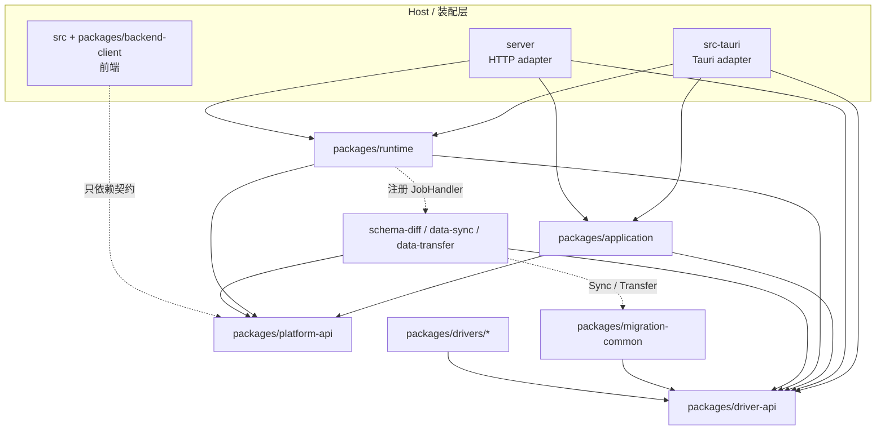
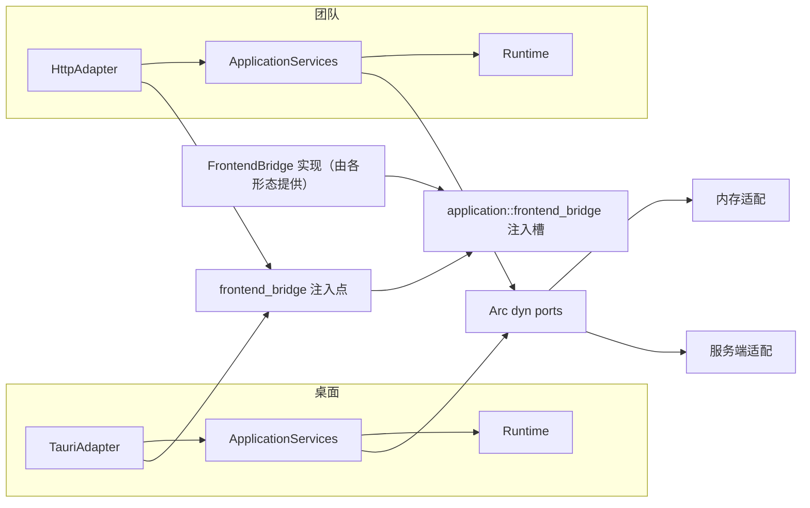
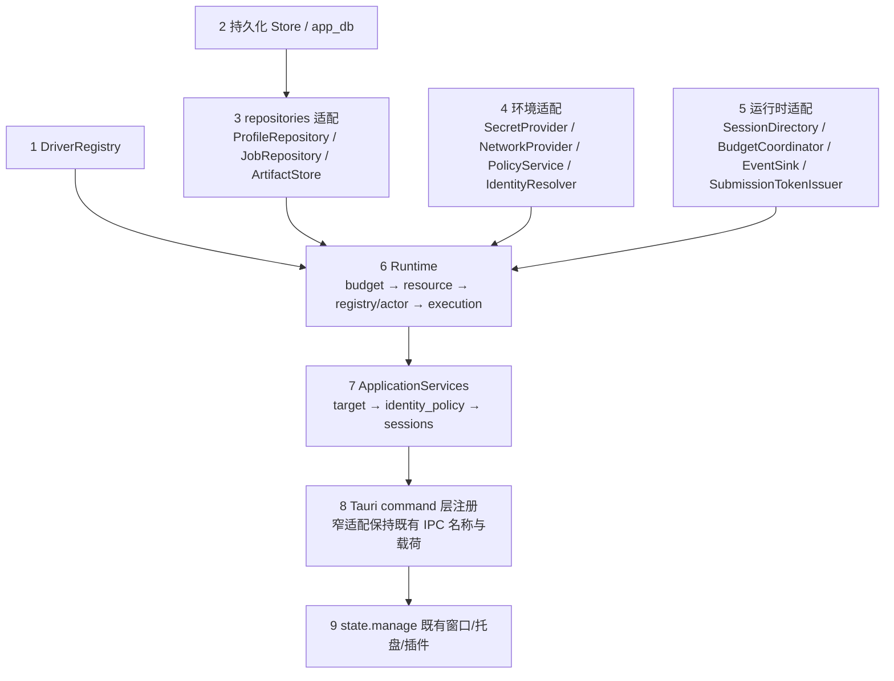
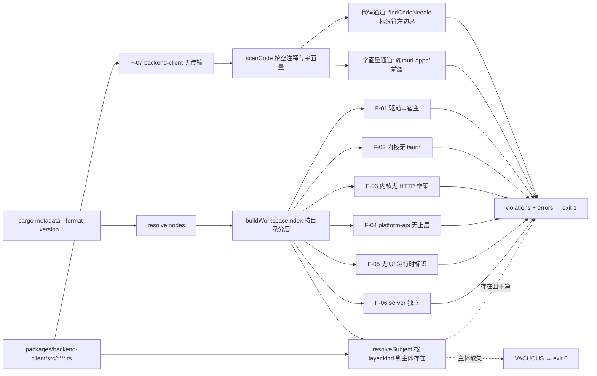

# DataZen 共享应用边界与端口详细设计

> 状态：平台 DTO / ports / facade 已实现；P5 已把 `JobHost` 与 AppDb SQLite v2 接入 AppState，并接通 Schema Diff、Data Sync、Data Transfer 三件套的桌面 Job 生命周期。团队 server 与完整 Profile/ConnectionUseCases 仍未全部接线，不能把本机 Job adapter 当成团队服务仓储。
>
> **尚未完整接线的准确含义**：运行期 `JobHost` 已承载三件套的桌面 Job；Profile/ConnectionUseCases 仍不能从真实连接配置完整构造所需的 revision/credential 字段。`src-tauri/src/platform/adapter.rs` 的连接用例不能为缺失字段伪造值。
>
> 仍待实现：团队 `server` crate、完整 Profile/ConnectionUseCases adapter，以及各节明确标为目标设计的 HTTP/多 worker 行为。P5 桌面迁移三件套独立测试与冒烟测试已通过；本机 Job host 不提供服务端或多 worker 语义。
> 读者：本文只定义包边界、端口签名、组装方式和护栏；DTO 语义、会话状态机、资源预算算法以既有文档为权威，本文不重复定义。标为「目标设计」的段落仍是契约，未随 P1 实现。
> 配套：[系统概要](system-overview.md)、[连接管理详细设计](connection-management.md)、[分阶段开发计划](../../development/platform-development-plan.md)。

## 1. 本文定位与配套契约

| 本文负责 | 权威文档（不重复定义） |
| --- | --- |
| 新增包的职责、依赖方向、模块树 | [概要 §4 模块职责与边界](system-overview.md#4-模块职责与边界)、[§4.1 目标代码组织](system-overview.md#41-目标代码组织) |
| `RequestContext` 的字段来源与构造位置 | [概要 §6.1 应用上下文](system-overview.md#61-应用上下文)、[连接 §3 INV-01](connection-management.md#3-不可破坏的不变量) |
| 所有连接 DTO / 回执 / 事件形状 | [连接 §4 DTO 与字段定义](connection-management.md#4-dto-与字段定义)、[§4.1 服务接口与补充响应](connection-management.md#41-服务接口与补充响应)、[§4.2 内部记录](connection-management.md#42-内部记录) |
| 端口 trait 的 Rust 签名、错误与装配差异 | 本文 §4 |
| 会话/资源/预算的行为契约 | [连接 §6 状态机与并发](connection-management.md#6-状态机与并发)、[§9 连接池、预算与清理](connection-management.md#9-连接池预算与清理) |
| 错误码取值 | [连接 §13 错误、重试和事件](connection-management.md#13-错误重试和事件) |
| 阶段顺序与交付门槛 | [开发计划 §5 P1](../../development/platform-development-plan.md#5-p1抽取共享应用边界和前端传输契约)、[§17 补充契约的阶段归属](../../development/platform-development-plan.md#17-补充契约的阶段归属) |

本文涉及的 crate 路径落地情况（按 `feat/platform-p1-core` 复核）：

| 路径 | 状态 |
| --- | --- |
| `packages/platform-api` | **已实现**，`datazen-platform-api`，Cargo 成员 |
| `packages/application` | **已实现**，`datazen-application`，Cargo 成员 |
| `packages/backend-client` | **已实现**，TS 包，**不是** Cargo 成员，接线三处已补齐（§2.5） |
| `packages/runtime` | 已存在于基线，但**其 ID / DTO 类型尚未迁移**到 `platform-api`（见 §2.6「待办：runtime 去重」） |
| `server/` | **不存在**，目标设计 |

`datazen-application` 的 normal + build 依赖闭包为 32 个 crate，`datazen-platform-api` 为 31 个；两者都不含 `tauri*`、不含宿主 crate `datazen`、不含 `axum`/`actix-web`/`warp`/`tonic`（`cargo metadata --format-version 1` 解析 `resolve.nodes` 闭包，见 F-02 / F-03 / F-04）。

## 2. 包边界与依赖矩阵

### 2.1 四个新包的职责

| 包 | 一句话职责 | 拥有的概念 | 明确不拥有 |
| --- | --- | --- | --- |
| `packages/platform-api` | 无平台依赖的最底层契约：ID newtype、`RequestContext`、全部 port trait、port 错误 | ID 类型、身份上下文、端口签名 | 任何用例逻辑、任何 I/O；实现只允许**形态中立、无副作用、无传输的进程内原语**（现状两处：`ports/clock.rs` 的 `SystemClock` / `FixedClock`、`ports/budget/pool_ledger.rs` 的进程内参考账本，见 §4.9） |
| `packages/application` | 用例编排：目标解析、授权顺序、DTO 校验、错误归一、前端桥注入端口 | 请求/响应 DTO 的应用侧视图、`ApiError`、用例服务、前端桥窄端口（`FrontendBridge`）与注入缝隙 | 会话状态、物理资源、驱动类型分支、任何具体传输实现 |
| `packages/runtime` | 连接运行时：session actor、资源与 lease、预算记账、execution 登记、事件 | `DbSession`、`ResourceLease`、`Execution`、Job 阶段 runtime 状态 | 权限判定来源、持久化介质、网络出口 |
| `packages/backend-client` | TypeScript 侧传输无关契约：DTO 镜像、client 接口、transport 接口 | `Id`/`Counter`/`Timestamp` 镜像、`BackendClient` 接口、`PlatformServices` 接口 | Tauri/HTTP/fetch 任何具体实现 |

### 2.2 模块树

```text
packages/platform-api/src/
├── id.rs                     # ID newtype（含宏）、Counter、Timestamp
├── context.rs                # RequestContext、OwnerRef、DelegationRef
├── error.rs                  # PortError
├── target.rs                 # NamespaceTarget/ObjectTarget/CanonicalTarget、namespaceShape 与 targetRequirements
├── ports/
│   ├── profile.rs            # ProfileRepository
│   ├── policy.rs             # PolicyService
│   ├── secret.rs             # SecretProvider
│   ├── job.rs                # JobRepository
│   ├── session_directory.rs  # SessionDirectory
│   ├── token.rs              # SubmissionTokenIssuer
│   ├── artifact.rs           # ArtifactStore
│   ├── event.rs              # EventSink
│   ├── network.rs            # NetworkProvider
│   ├── identity.rs           # IdentityResolver
│   ├── mod.rs                # 子树汇总与 pub use（端口 trait 的 re-export）
│   ├── clock.rs              # Clock + SystemClock / FixedClock（形态中立的进程内原语，见 §4.9）
│   └── budget/               # 四个预算端口 + 进程内参考账本
│       ├── mod.rs            # 子树汇总与 pub use
│       ├── coordinator.rs    # BudgetCoordinator（逻辑许可）
│       ├── pool.rs           # DriverPoolBudgetPort（物理连接）
│       ├── control.rs        # ControlResourcePort（控制连接）
│       ├── node.rs           # ClusterNodeBudgetPort（集群槽位）
│       ├── dimension.rs      # 维度 / 额度 / 队列取值
│       └── pool_ledger.rs    # InMemoryDriverPoolBudget（进程内参考账本，见 §4.9 的豁免）
├── dto/                      # 连接 §4 的契约词表：session / execution / job / artifact / profile / event / idempotency
└── lib.rs

packages/application/src/
├── dto/
│   ├── mod.rs                # re-export platform-api 的契约 DTO（不新增字段语义）
│   ├── requests.rs           # 用例入参与纯校验函数
│   ├── execution.rs          # DurableExecutionRecord（不可表示运行时绑定）
│   └── accept.rs             # IdempotencyAcceptRecord、AcceptedSubject、接受记录保留期
├── error.rs                  # ApiError + ApiErrorCode(31) + RetryDisposition
├── target.rs                 # CanonicalTarget 计算与 targetRequirements 校验（§4.3 六步纯函数）
├── identity_policy.rs        # INV-01..INV-03 的判定顺序编排
├── sessions.rs               # ConnectionUseCases：连接 §4.1 的 13 个方法签名
├── frontend_bridge.rs        # FrontendBridge 窄端口 + BridgeInjection 注入缝隙（失败关闭，§7.4）
└── lib.rs                    # ApplicationServices（§6.2 装配顺序第 7 步）

packages/runtime/src/
├── connection/               # 见 §3（尚未迁移到 platform-api 类型，见 §2.6）
├── budget.rs                 # 本机多维许可（port 之后的本地实现）
├── execution.rs
├── events.rs
├── job.rs
└── lib.rs

packages/backend-client/src/
├── types/                    # ids、target、context、session、execution、job、profile、artifact、event、idempotency、requests
├── client.ts                 # BackendClient 接口（21 个方法）+ backendId 注入登记
├── transport.ts              # BackendTransport 绑定接口、PlatformServices 接口（§7.1）、MethodMap
├── streams.ts                # AsyncIterable 事件流抽象
├── errors.ts                 # ApiError 反序列化
├── __tests__/                # 契约自检、门面载荷、流与错误
└── index.ts
```

### 2.3 依赖方向



`packages/schema-diff` 的生产路径通过 `datazen-driver-api::create_driver` 查询 inventory registry，再调用驱动提供的 `migration_renderer()`、`migration_capabilities()` 与 `type_normalizer()`；这些契约已覆盖 MySQL、PostgreSQL 和 SQLite 的结构迁移能力，无需在领域包绑定具体驱动。领域包的普通依赖与测试依赖均不包含具体 driver crate。方言 SQL 与真实 normalizer 的集成测试分别位于 `packages/drivers/{mysql,postgres,sqlite}/tests/schema_diff_*.rs`，由各驱动的 dev-dependency 引用领域包并链接自身注册；领域包保留纯逻辑测试与假 renderer 测试。

### 2.4 禁止的反向依赖（可被门禁直接检查的断言）

| 编号 | 断言 | 违背后果 |
| --- | --- | --- |
| F-01 | `packages/drivers/*` 的 crate 依赖闭包不含 `datazen`、`datazen-runtime`、`datazen-application`、`datazen-platform-api`、`datazen-ai-api`，且不含任何 `tauri*` crate | 驱动反向引用宿主或宿主框架，Web 端与宿主无关的构建被拖垮 |
| F-02 | `packages/application`、`packages/runtime`、`packages/platform-api` 的 normal + build 依赖闭包不含任何 `tauri*` crate，且不含 `datazen` 宿主 crate | 内核无法在没有 Tauri 的进程（测试、server worker）中编译 |
| F-03 | `packages/application`、`packages/runtime` 不含 `axum`、`actix-web`、`warp`、`tonic` 等 HTTP/传输框架 | 传输策略渗入业务内核 |
| F-04 | `packages/platform-api` 不依赖 `application` / `runtime` / 领域包 / `src-tauri` | ports 与用例循环依赖 |
| F-05 | `packages/application`、`packages/runtime`、`packages/platform-api` 不出现 `react`、`@tauri-apps/api` 等前端标识（Rust 侧通过 crate 名与 `build.rs` 依赖检查，前端侧由 §7 的字符串扫描补齐） | UI 运行时进入后端依赖图 |
| F-06 | `server` 的 normal + build 依赖闭包不含 `tauri*` 与 `datazen` 宿主 crate | server 无法独立构建 |
| F-07 | `packages/backend-client` 不含 `@tauri-apps/` 前缀、`fetch(`、`XMLHttpRequest` 字面量 | 传输无关契约被具体传输污染 |
| F-08 | `packages/migration-common` 的 normal + build 工作区依赖只允许自身与 driver-api；不含 `tauri`、`axum`、`actix-web`、`warp`、`tonic`、`react` | 公共算法反向依赖领域引擎、runtime 或平台传输，重新形成耦合 |
| F-09 | `packages/ai-providers` 的 normal + build 依赖闭包不含任何 `tauri*` crate，且不含 `datazen` 宿主 crate | 与 F-02 同因：这个包要同时被桌面端与服务端复用，一旦拖进 Tauri 就只能编进桌面进程 |
| F-11 | `packages/platform-infra` 的 normal + build 工作区依赖只允许自身；不含 `tauri`、`axum`、`actix-web`、`warp`、`tonic`、`react` | 公共基础设施一旦依赖任一上层 crate 或平台传输，就从「垫底」退化成所有形态被迫共同链接的耦合中枢 |
| F-12 | `packages/feature-core` 的 normal + build 依赖闭包不含 `tauri`、`axum`、`actix-web`、`warp`、`tonic`、`react`，不依赖桌面宿主层；仅依赖共享 runtime/application/领域包与契约 | Workflow、AI、Monitor、导出与 Workspace App 内核逻辑重新绑定桌面或服务端传输 |
| F-13 | `packages/tunnel` 的 normal + build 依赖闭包不含任何 `tauri*` crate，且不含 `datazen` 宿主 crate | 隧道机制（HTTP `CONNECT` 代理 / WebSocket 中继 / SSH 转发）是形态中立件：一旦拖进 Tauri 或宿主 crate，桌面端与将来的 Web 端就无法共用同一份实现 |
**F-01 的作用域同时覆盖两侧：manifest 声明边与解析闭包。** 上面"crate 依赖闭包"若按字面只理解为 `cargo metadata` 的 `resolve` 图，是**不够的**：那个图是 **feature-resolved 的**，只含当前 feature 解析下真正被链接的边。无人启用的 feature 背后的 optional 依赖根本不在 `resolve.nodes[].deps[]` 里，任何闭包遍历都看不见它。因此 F-01 也约束 `Cargo.toml` 的**声明边**——声明了、但当前 feature 解析不链接的边，同样算违反。两侧任一出现即违规。

这条不是修辞上的严谨，是实测出来的盲点：`packages/drivers/redis/Cargo.toml:27` 的 `tauri = { version = "2", optional = true }` 与 `src-tauri/Cargo.toml:58` 的 `tauri-plugin-webdriver = { version = "0.2", optional = true }` 都不在解析图里，只读闭包的守卫对它们完全失明。判定方式与告警含义见 §8.2 注 3。

**F-09 的两条实现路径，缺一不可。** 一条是依赖闭包：`forbiddenLayers: ['host']` 与
`forbiddenCrates`（F-09 写死 `['tauri']`），按 `cargo metadata` 的解析图闭包遍历。另一条是
**规范一致性**：`specTokens`（F-09 为 `tauri`）校验的是「§2.4 对应行是否仍然点名这个 token」，
守卫与规范一旦漂移即报错；它扫的是本文档，不是 crate 源码。由此得到两条实操约束：§2.4 表格里的
`tauri` 字面量**必须原样保留**（改写成「桌面壳」之类的同义词会让守卫误判为漂移）；而 crate 源码里的
边界靠依赖闭包保证，注释中出现框架名本身不违反本守卫。

**「禁服务端框架进入内核」由 F-12 承接。** 原 F-10 单独立行约束 `packages/workspace-apps`
不含 `axum`、`actix-web`、`warp`、`tonic`。该内核已并入 `packages/feature-core`，成为
`feature_core::workspace_apps` 模块；F-12 以反向 allow-list 钉死 feature-core 只依赖共享层，
其 `specCrates` 同样点名 `axum`、`actix-web`、`warp`、`tonic`，覆盖范围比原 F-10 更宽
（连带 `tauri`、`react` 与桌面宿主层）。因此 F-10 整条删除，其断言不被削弱。

### 2.5 workspace 成员与前端接线（已实现）

根 `Cargo.toml` 的 `members` 实际新增 `packages/platform-api` 与 `packages/application` 两条，`[workspace.dependencies]` 同风格追加两条 path 依赖：

```toml
[workspace]
members = [
    "src-tauri",
    "packages/driver-api",
    "packages/ai-api",
    "packages/platform-api",
    "packages/application",
    "packages/runtime",
    "packages/drivers/*",
]
# exclude 与 [workspace.dependencies] 中的 datazen-driver-api 写法保持原样

[workspace.dependencies]
datazen-platform-api = { path = "packages/platform-api" }
datazen-application = { path = "packages/application" }
```

与本文早期草案的差异：`server` **没有**加进 `members`——`server/` 在仓库中不存在，该 crate 属更晚阶段；`packages/runtime` 本就已在基线的 `members` 中，本次未改动这一行，只补 `platform-api` 与 `application` 两条。`packages/backend-client` 是 TypeScript 包，**不得**加入 Cargo `members`（`scripts/__tests__/check-platform-crate-boundaries.test.ts` 的 fixture 断言 `backend-client` 不在 cargo members 中）。`packages/drivers/*` 的通配与两个 `exclude`（kiwi / superset）保持原样，驱动注入仍由 `scripts/resolve-drivers.mjs` 写入占位段。

Wave-2 在此基础上又新增 `packages/ai-providers` 成员（AI provider 协议适配实现），其边界由
F-09 断言。`packages/ai-providers` **不在**「禁服务端框架进入内核」的作用域内：它按定义就是一个
HTTP *客户端*适配层（依赖 `reqwest` 访问各 provider 的端点），那条约束禁的是服务端框架进入内核，
不是禁内核发请求。**接入方式是消费方写显式 `path`**：`src-tauri/Cargo.toml` 顶部以
`datazen-ai-providers = { path = "../packages/ai-providers" }` 引入（与 Wave-1 各平台 crate 同风格，
不是 `{ workspace = true }`，因为根 `[workspace.dependencies]` 里没有这一条）。

Wave-2 原本还新增了 `packages/workspace-apps` 成员（Workspace App 形态中立内核）。**该成员已撤销**：
Workspace App 本身是一个通用 feature，其内核（manifest 规则、包安装、按 wapp 隔离的键值存储、
已安装包注册表、URI 语法与路由判定）不再自成一个包，而是并入 `packages/feature-core`，
成为 `feature_core::workspace_apps` 模块——与其它共享 feature（ai / workflow / dashboard /
export / backup）并列。根 `Cargo.toml` 的 `members` 相应移除 `packages/workspace-apps`，
`src-tauri/Cargo.toml` 移除 `datazen-workspace-apps = { path = "../packages/workspace-apps" }`，
改由既有的 `datazen-feature-core` 依赖承接。其边界由 F-12 断言（见 §2.4）。

#### 2.5.1 公共基础设施层 `packages/platform-infra`（已实现）

根 `Cargo.toml` 的 `members` 新增 `packages/platform-infra`，同样**不**进 `[workspace.dependencies]`
（它没有任何 `datazen-*` 依赖，加进去只会诱发 `src-tauri` 侧改用 `{ workspace = true }`，
而新 crate 的依赖必须写在 `# <<driver-dependencies>>` 占位段之外）。

这一层装的是**跨形态、跨领域、与业务无关**的机制原语。当前已落地两项：

**脱敏**（`redaction`）：三个入口 —— `redact_secrets_for_log` 清洗任意文本、
`redact_url_for_log` 只清洗 URL、`sql_preview_for_log` 截断 SQL 预览；覆盖面是凭据 userinfo、
整段查询串、`Bearer`、`password` 字段。本层是唯一实现，实测全仓 19 处调用点都经过它：
宿主 18 处直接引 `datazen_platform_infra::redaction::*`（原 `src-tauri/src/log_redact.rs` 薄壳已删除），
`packages/ai-providers/src/custom.rs:20` 同样直接引本层。
此前只有宿主那一份；Wave-2 抽取 `ai-providers` 时因跨 crate 不可见，它在 `protocol/mod.rs` 里
手写了第二份更弱的实现（只处理 userinfo 与整段 query，漏掉 `Bearer`、`?token=`、`"password":`）。
该重复已删除。
已知限制：`url_credentials_re` 用 `[^/@\s]+` 匹配 userinfo，密码含 `/` 时整条匹配失败、
凭据原样进日志。这是从宿主原实现逐字继承的，尚未修复。

**路径安全**（`path_safety`）：zip 条目名的 zip-slip 守卫与压缩比上限。此前同样是两份逐字节
相同的实现（`src-tauri/src/app_data_archive.rs` 与 `packages/platform-infra/src/path_safety.rs`），
各自被自己的测试钉住，单边改动会让安全检查在另一侧继续按旧规则放行。现已收敛为本层唯一实现：
`feature_core::workspace_apps` 的 `install` / `manifest` 与宿主 app-data 备份/恢复都调用它，
宿主 `src-tauri/src/app_data_archive.rs` 退化为同名 `pub use` 薄壳，调用点零改动。
守卫是纯 `std`（无 IO、无传输、无形态相关状态），且**比两份原件覆盖面更全**：
错误分支是两份原件的忠实并集 —— 原件只有 2 条错误串，本层 4 条
（`invalid zip entry name`、`symlink entry name not allowed` 是原实现就没有的分支）。
`MAX_COMPRESSION_RATIO = 100` 同居本层，因为压缩炸弹阈值是压缩包自身的属性，不是打开者的属性。

**为什么不能靠「当前共享层消费者为 0」来否决一个基础设施 crate。**
共享层存在的理由就是服务**尚未建出的第二种形态**：本仓库的 `platform-api` / `application` / `runtime`
同样是在消费者出现之前就落地的。web 版不会去读宿主的脱敏实现，
它只会照着 host 的样子再写一份——而且必然更弱，因为没人看得见 host 那份。
「现在没人调用」是滞后指标，不能用来否定设计意图。

**为什么它仍然不能叫 `common`。** 本仓库已有一个叫 `migration-common` 的 crate，
它之所以健康，正因为名字里写着领域、依赖面极窄（504 行，只依赖 `datazen-driver-api`，两个消费者）。
`platform-infra` 同理：名字点明「平台基础设施」，F-11 用反向 allow-list 钉死
「它不得依赖任何其它层」——这一条一旦破掉，它就退化成耦合中枢，而这正是要避免的 `common`。
新加入 `LAYERS` 的层会自动进入 F-11 的禁止集，不需要改规则文件。
前端侧接线的不是 pnpm workspace：`pnpm-workspace.yaml` 只有 `allowBuilds:`、**没有 `packages:` 通配**，`pnpm-lock.yaml` 也只有根一个 importer，因此 `packages/*` 下的前端包并不通过 pnpm 链接进 `node_modules`。既有 `packages/driver-sdk`、`packages/ui`、`packages/wapp-sdk`、`packages/extension-points` 靠三处显式配置生效，`packages/backend-client` 已同样补齐三处：

1. `tsconfig.json` 的 `compilerOptions.paths` 增加 `@datazen/backend-client` → `./packages/backend-client/src/index.ts`；
2. 同一文件的 `include` 数组加入 `packages/backend-client`（该数组逐个列出包目录，新增包不会自动纳入 `pnpm typecheck`）；
3. `vite.config.ts` 的 `resolve.alias` 增加同一条别名（应用运行期解析与 `typecheck` 解析分开，只配 paths 会在 Vite 构建时解析不到）。

这三处由 `contracts.test.ts` 的「TS 别名恰好接在三处」用例守住。

> **尚未实现**：仓库 `vitest.config.ts` 的 `include` 通配与 `resolve.alias` 未覆盖 `packages/backend-client`（两者都在 CI 轨道的改动范围）。P1 的 40 条前端单测用临时 vitest 配置在本地跑通，合并后需把该包的测试纳入默认 `npx vitest run`。

#### 2.5.2 形态中立隧道层 `packages/tunnel`（已实现）

根 `Cargo.toml` 的 `members` 新增 `packages/tunnel`，crate 名 `datazen-tunnel`。这一层装的是**隧道机制本身**：
HTTP `CONNECT` 代理隧道、WebSocket 中继隧道、SSH 转发隧道，以及它们依赖的 SSH known-hosts 存储与进程级
rustls provider 选择。

它**不装**装配：隧道从哪来配置、在哪个会话里存活、存到哪里，由宿主侧决定——`src-tauri/src/tunnel/mod.rs`
仍然留在宿主（它含 `resolve_tunnel_kind` / `start_for_connection` / `test_tunnel` 与形态相关的接线），
`network_provider.rs` 里的 `DesktopTunnelHost` 仍是桌面形态专属。

边界由 F-13 断言：normal + build 依赖闭包不含 `tauri*`、不含宿主 crate `datazen`。依赖方向是
host → tunnel，与 F-13 禁止的 tunnel → host 相反；该层的单元测试由 `run-platform-crate-tests.mjs` 的
`TESTED_LAYERS` 纳入 CI。

> **两处宿主符号随之改属**：① 进程级 rustls provider 的选择函数 `install_default_crypto_provider`
> 原本住在 `src-tauri/src/tls.rs`，其**实现体**下移到 `packages/tunnel/src/crypto.rs`——因为 `https://`
> 代理腿与 `wss://` 中继腿都要建**自动探测**的 `ClientConfig`，这个决策不能留在宿主边界之后。宿主侧
> `src-tauri/src/tls.rs` 保留模块文档、宿主接线守卫（`main()` 必须在解析 argv 前安装）与全部测试，并以
> `pub use` 原样再导出该函数，因此 `datazen::install_default_crypto_provider()` 这条对外路径、调用时机与
> 行为均未变，全仓仍然只有**一个**安装器。宿主 `tls.rs` 本身不能整体搬走：它用
> `include_str!("main.rs")` / `include_str!("lib.rs")` 做宿主接线守卫，跨 crate 内嵌会破 `cargo package`。
> ② SSH known-hosts 存储全仓只被 SSH 隧道使用（无第二消费者），随 `ssh.rs` 一并迁入本层（S4 会把它的
> 文件 I/O 变成端口）。

### 2.6 待办：runtime 去重（超出 P1 交付范围）

`packages/runtime` 在基线上已自带 `connection/types.rs` 的 ID newtype、`ExecutionTarget`、`ApiError` / `ApiErrorCode`、`CapabilitySnapshot`，与 `platform-api` 的同名类型**是两份互不相同的类型**。F-04 要求 `platform-api` 不反向依赖 runtime，因此去重方向只能是 runtime 改为 `pub use datazen_platform_api::{…}`——这需要改动 `packages/runtime/**`，不在 P1 写范围内。相关形状差异已在本文各节按「以 platform-api 为准」记录（runtime 的 `NamespaceTarget` 四个非 `Option` 字段、`path: String`、`ConfigRevision(pub u64)` 等在迁移时必须丢弃）。

### 2.7 形态中立：共享包里的名字不得绑死形态（已实现）

F-01…F-13 拦的是**依赖**。还有一类耦合不产生依赖边：**名字**。共享包里一个带形态名的
类型 / 常量 / 字面量，会把「只有桌面才成立」的假设焊进代码——桌面形态在场时看不出问题，
换成 web 形态才发现那一半用不了。

内核（`packages/runtime`）曾有三处这样的焊点，全部是桌面形态独占的名字：

| 位置 | 原名 | 现名 | 依据 |
| --- | --- | --- | --- |
| `tunnel/route.rs` 的稳定字面码 | `desktopRouteUnknown` 等四个 | `routeUnknown` / `tunnel*` | 与同模块既有的 `tunnelNotShareable` / `tunnelAlreadyHeld` / `tunnelRevisionUnavailable` 同族 |
| `tunnel/route.rs` 的租约前缀 | `desktop-tunnel/` | `tunnel/` | 同上；租约文本会进错误消息与 trace |
| `platform-api` 端口的导出目标 | `ExportSink::DesktopDialogHandle` | `ExportSink::HostHandle` | 端口只说「宿主持有句柄」，不规定宿主怎么渲染 |
| `runtime` 的额度档位 | `DESKTOP_*` / `desktop_default()` | `LOCAL_*` / `local_default()` | 两档按**内核跑在哪**区分：共享部署（`TEAM_*`）与本地客户端（`LOCAL_*`） |
| `runtime` 的连接夹具字段 | `desktop_total_target_connections` | `local_total_target_connections` | 同上 |

**判据是分词后逐词比，不是子串比**：`webhook` / `webdriver` 这类协议复合词不算形态名
（它们切出来是整词），否则误伤会逼人把合法写法藏起来。

**闸门**：`packages/runtime/src/tunnel/form_neutrality.rs`（随 `--lib` 跑，因而进 CI）。
它扫内核 crate 的 `src/`，两层都查——**字面量**（对外产出的稳定码、租约前缀、错误码）
与**标识符**（类型 / 常量 / 字段名）。三条配套事实：

- **闸门自证**：断言扫描器真的把已知的稳定码读了出来，否则「没发现违规」只意味着它
  什么也没看见；并断言被扫文件数达到下界，防止递归枚举少扫一片。
- **闸门有 kill test**：把带形态名的字面量与标识符当字符串喂给同一套判据，断言转红。
  闸门自己**不写**完整的形态名字面量（拆开拼），否则它会被自己的规则点红。
- **闸门有边界**（不留模糊措辞）：只认拉丁字母的形态名（中文散文不算契约）；只扫 `src/`
  ——`tests/` 里对**宿主 crate** 的合法引用（如按路径读 `src-tauri/…/identity.rs`
  验证宿主接线）里的形态名是真实存在的目录名，不是内核的形态假设；它查的是**名字**，
  管不了运行时行为，也挡不住蓄意对抗（`concat!` 拆分、`#[cfg]` 藏匿）。

其余共享包（`feature-core` / `platform-api` / `ai-providers` 等）里的形态名**未纳入**这道
闸门，原因是它们确有**领域含义**而非形态耦合：`AlertChannel::Desktop` 指「桌面通知」
这一投递渠道，`ExportSink` 的另一支 `ServerAuthorizedPath` 指「服务端授权的存储路径」。
`ai-providers` 的 `HttpClient::desktop()` 是一份**出网策略预设**（允许内网地址 + 走环境代理），
端口 `EgressPolicy` 本身形态中立，web 形态可以自带策略。把这三处一并禁掉是误伤，
不是治理。

## 3. runtime 包内部模块（目标设计，未随 P1 实现）

### 3.1 目录约定

拟新增模块全部落在 `packages/runtime/src/connection/`，与[连接管理 §14](connection-management.md#14-开发步骤与文件职责)的模块划分一一对应；runtime 的非连接职责（job 阶段调度、事件分发）留在 `packages/runtime/src/` 顶层，不进入 `connection/`。

```text
packages/runtime/src/connection/
├── mod.rs
├── types.rs          # 1 types/error
├── error.rs          # 1 types/error
├── testing.rs        # 2 testing/fake_resource
├── fake_resource.rs  # 2 testing/fake_resource
├── budget.rs         # 3 budget
├── resource.rs       # 4 resource
├── registry.rs       # 5 registry/actor
├── session_actor.rs  # 5 registry/actor
├── execution.rs      # 6 execution
├── adapters.rs       # 7 adapters
├── consumers.rs      # 8 consumers
└── routing.rs        # 9 routing
```

### 3.2 九个模块

| # | 模块 | 职责 | 公开类型（`pub`） | 内部状态（不 `pub`） | 明确不导出 |
| --- | --- | --- | --- | --- | --- |
| 1 | `types` / `error` | newtype、DTO 镜像、枚举、schema 校验 | `DbSessionId`、`SessionHandle`、`CanonicalTarget`、`ResourceLease`、`ExecutionErrorCode`、`RuntimeError` | `NAMESPACE_FIELDS` 校验表 | 不导出任何驱动专属类型；不导出序列化格式决策（属 adapters） |
| 2 | `testing` / `fake_resource` | 假资源、状态、屏障、故障注入；可返回事务/游标句柄的假命令 | `FakeResource`、`FakeClock`、`FailureInjector`、`FakeResourceJournal` | journal 计数、屏障等待队列 | 仅在 `#[cfg(any(test, feature = "test-harness"))]` 下编译；不导出 `FakeResource` 的内部句柄结构 |
| 3 | `budget` | 本机多维许可、可取消等待、幂等核销 | `BudgetRequest`、`BudgetPermit`、`BudgetSnapshot` | 分类队列与保留额、permit 账本 | 不导出全局连接额度常量（由 `BudgetCoordinator` 提供者决定） |
| 4 | `resource` | acquire / cleanup / quarantine、隧道引用、归池前宿主检查 | `ResourceManager`、`LeaseRequest`、`CleanupReport` | 物理连接表、poolKey 索引 | 不导出驱动 `Clean` 判定；不导出物理连接句柄 |
| 5 | `registry` / `actor` | session 生命周期、串行队列、`RuntimeEpoch`、会话级句柄登记 | `SessionRegistry`、`SessionActorHandle`、`SessionView` | actor 邮箱、句柄登记表 | 不导出 `dbSessionId` 生成器（由 `SessionDirectory` 决定） |
| 6 | `execution` | 幂等、授权重校验、来源、事件发布、取消 | `ExecutionGateway`、`ExecutionReceipt`、`CancelReceipt`、`ResultProvenance` | 幂等键账本、取消句柄表 | 不导出 `policyIsolationKey` 计算（属 `PolicyService`） |
| 7 | `adapters` | IPC / BackendClient 窄适配、旧接口过渡 | `ConnectionServiceImpl`（实现[连接 §4.1](connection-management.md#41-服务接口与补充响应)的服务接口） | 旧 manager 的句柄映射表 | 不导出第二套执行逻辑；同一请求不同时经过新旧管理器 |
| 8 | `consumers` | Query / Table / metadata、三件套、Workflow 的资源消费策略 | `ResourceConsumerProfile`、各 consumer 的声明式策略 | consumer → 资源类别映射 | 不持有 UI 生命周期；不把 tab 关闭当会话关闭 |
| 9 | `routing` | worker 目录入口、全局预算入口、drain | `RuntimeRouter`、`DrainPlan` | 节点心跳、drain 中的 worker 集合 | 不把旧 session 绑定到替代 worker；不做 sticky 路由决策以外的持久化 |

### 3.3 文件规模与拆分规则

- 单文件推荐不超过 800 行（[AGENTS.md](../../../AGENTS.md) 约定）。`session_actor.rs`、`resource.rs`、`execution.rs` 是最可能触顶的三个文件。
- 拆分单位是职责而非行数：状态机与它的转移表同文件，序列化与协议映射进 `adapters.rs`，两者不得互相内联。
- 生产路径禁止裸 `unwrap()` / `expect()`；错误一律 `thiserror` + `tracing`，对外统一 `CommandError` 映射（`CommandError` 定义在 `src-tauri/src/commands/error.rs`，Tauri adapter 侧职责见 [概要 §4](system-overview.md#4-模块职责与边界)）。

## 4. 端口 trait（已实现于 `packages/platform-api`）

> 落地形态：端口 trait 全部按 §4.1 约定建在 `packages/platform-api/src/ports/`（**确切条数以该模块头 `ports/mod.rs` 的计数为准**，它随实现同步维护，本文不复述数字），`#[async_trait]` + `Send + Sync + 'static` + `Arc<dyn X>` 注入，`PortError` 七个变体只派生 `Debug` 与 `thiserror::Error`（刻意不实现 `Serialize`，用例测试 `the_port_error_has_no_wire_shape_of_its_own` 守住）。`application` 与 `runtime` 通过 `pub use datazen_platform_api::…` 再导出，不重复定义。**端口 trait 本身只定义签名，不含任何实现**——**带副作用或带传输**的实现由端口的提供方 crate 各自承担，不得回填进 `platform-api`（否则契约与实现耦合，`platform-api` 的平台中立性即被破坏），也不得让两个提供方为同一端口各写一份。**例外说明**：只有形态中立、无副作用、无传输的进程内原语实现可以随端口一起提供，因为它没有第二份实现可写（先例 `ports::budget::pool_ledger`，见 §4.9 的 `Clock`）；其余实现一律不得回填。

- 所有 ID 参数使用 `platform-api` 的 newtype（`OrganizationId`、`PrincipalId`、`ConnectionId`、`DbSessionId`、`JobId`、`ExecutionId`、`ArtifactId`、`StreamId`、`RuntimeEpoch`…），**不使用裸 `String` 标识语义**。`connectionId` = 持久化配置 ID，`dbSessionId` = 运行时会话 ID，两者永不混用（[ID 术语规范](../../../AGENTS.md#id-术语规范)）。
- **`RequestContext` 与全部 ID newtype 定义在 `platform-api`**，无行为、无平台依赖；`application` 与 `runtime` 用 `pub use` 再导出。这样端口签名（`platform-api`）与用例签名（`application`）共用同一份类型定义而不产生依赖倒置（否则 `platform-api` 必须反向依赖 `application`，与 F-04 冲突）。
- 端口 trait 一律 `#[async_trait] pub trait X: Send + Sync + 'static`，对象安全，通过 `Arc<dyn X>` 注入。
- 端口错误统一 `PortError`；**业务拒绝不在端口层抛出**，由用例层转 `ApiError`（码表见[连接 §13](connection-management.md#13-错误重试和事件)）；执行终态错误走 `ExecutionErrorCode`，与 `ApiError.code` 是两个独立命名空间。
- **能力事实用「值」表达，不塞进 `PortError`**：例如「这个驱动 / 这个命令 / 这个目标不被支持」是**能力事实**（不是基础设施故障），端口用**返回值形状**承载它——见 §4.10 的 `TargetResolution::Unsupported { reason_code }`，由用例层翻译成 `ApiErrorCode::TargetUnsupported`。`PortError` 的变体集合已被 `packages/platform-api/src/error.rs` 的用例测试 `variant_set_includes_the_p5_job_contract` 钉死、**不可扩展**，所以新增一类「不被支持」只能靠返回值形状承载，**不得**为它新增 `PortError` 变体。
- 端口不做重试、不做权限判定、不做缓存。缓存与版本计算由 port 的提供方负责（例如 `SecretProvider` 负责 `credentialRevision`）。

**类型名的来源声明（本文集中说明一次）**：§4.3–§4.6 签名里出现的类型分两类，不得混为一谈。

- **复用既有文档的既有类型，形状不在本文重定义**：`RequestContext`（[概要 §6.1](system-overview.md#61-应用上下文)）、`OwnerRef`、`ExecutionTarget`、`SessionHandle`、`ConnectionEvent`、`IdempotentOperation`、`SubmissionToken`、`EventEnvelope`、`ExecutionErrorCode`（[连接 §4](connection-management.md#4-dto-与字段定义) 与 [§4.1](connection-management.md#41-服务接口与补充响应)）、`ProfileDraft`、`ProfilePatch`、`JobState`、`ArtifactChunk`（[概要 §6.2 BackendClient 与领域客户端](system-overview.md#62-backendclient-与领域客户端)）、`ApiError`（[概要 §6.3 首版 HTTP 映射](system-overview.md#63-首版-http-映射)、[连接 §13](connection-management.md#13-错误重试和事件)）。其中 `SubmissionToken.idempotencyKey` 的标量类型在本文记作 `IdempotencyKey`，指的就是该字段本身，不是新概念。
  - **已知偏差（实测，Wave-4 复核）**：上面这份清单里，`OwnerRef` 是**当前唯一**在代码中存在两种不同形状的名字。
    契约是 `packages/platform-api/src/context.rs` 的 `OwnerRef`，与本表所指的[连接 §4](connection-management.md#4-dto-与字段定义) **逐字段一致**；
    `packages/runtime/src/connection/types.rs` 另有一份**内核** `OwnerRef`，变体名相同、4 个变体里 3 个字段集不同，
    serde 属性也不同（契约用 `rename_all_fields`，内核只用 `rename_all`）。
    内核那份多带的 `organization_id` / `principal_id` / `connection_id` 是**承重**的：
    `packages/runtime/src/gateway/owner_binding.rs` 的归属闸门靠它做 CM-06 的跨租户 / 跨主体拒绝，
    `OwnerRef::hash()` 靠它生成 `runtimeEpoch` 指纹。
    该债已在三处代码注释中登记（`runtime/src/connection/types.rs`、`runtime/src/gateway/owner_binding.rs`、`application/src/identity_policy.rs`），
    并明确「刻意不去重：合并会改动序列化后的线上字面量」；`packages/runtime/tests/owner_binding.rs` 另有守卫测试钉住内核 `OwnerRef::Job` 的字段表。
    **按本表，平台文档认的目标形态是契约那一份**，内核那份是偏离目标的内核形态。
    统一两者属于契约 + CM-06 安全语义变更，需设计裁定，不在共享层迁移范围内。
- **本文新定义的类型**（这些名字在既有文档中或只被引用而无形体定义（如 `AuthorizationDecision`、`PortError`），或只以字段名/裸 `Counter` 出现（`delegationId`、`afterSequence`、`secretRef`、`credentialRevision`、`policyIsolationKey`、`executionIdentityKey`、`networkRouteRef`）；类型定义随 P1 一起在本包建立，语义仍以既有文档为权威）：§4.1 的 `PortError`；§4.3 的 `ProfileScope`/`ProfileRecord`/`ConfigRevision`/`JobDefinition`/`JobRecord`/`StageRecord`/`JobStateVersion`/`JobFilter`/`RecoveryFilter`/`Checkpoint`（形状即[连接 §4.2](connection-management.md#42-内部记录) 的 `JobCheckpoint`，端口层另起本名）/`CommitBoundary`/`JobClaim`/`WorkerId`/`AuthorizationSubject`/`AuthorizationAction`/`AuthorizationDecision`/`DelegationRef`/`DelegationGrant`/`PolicyIsolationKey`/`PolicyChangeStream`/`ExecutionIdentity`；§4.4 的 `SecretRef`/`SecretPurpose`/`ResolvedCredential`/`CredentialRevision`/`NetworkRouteRef`/`NetworkRouteRevision`/`RoutePlan`/`TunnelSpec`/`TunnelBinding`；§4.5 的 `SessionOwner`/`ReplacementCommit`/`ReplacementOutcome`/`InvalidationReason`/`CloseDisposition`/`BudgetRequest`/`BudgetPermit`/`BudgetPermitSet`/`NodeLease`/`DrainScope`/`DrainStatus`/`ReleaseOutcome`/`BudgetSnapshot`/`SubmissionPresentation`/`VerifiedSubmission`/`KeyVersion`；§4.6 的 `ArtifactSpec`/`ArtifactWriter`/`ChunkPayload`/`ChunkIndex`/`ByteRange`/`ExportSink`/`ExportReceipt`/`RevokeReason`/`EventSubscription`/`EventSequence`。它们是端口契约的私有词汇表，落盘与序列化规则各自写在其方法注释里。

```rust
// packages/platform-api/src/error.rs（已实现）
#[derive(Debug, thiserror::Error)]
pub enum PortError {
    #[error("backend unavailable: {0}")]           BackendUnavailable(String),
    #[error("compare-and-set conflict on {entity} {id}")]
    CasConflict { entity: &'static str, id: String },
    #[error("not found: {0}")]                     NotFound(String),
    #[error("token verification failed")]          TokenInvalid,
    #[error("provider timeout: {0}")]               ProviderTimeout(String),
    #[error("artifact expired")]                    ArtifactExpired,
    #[error("quota exceeded: {0}")]                QuotaExceeded(String),
}
```

### 4.2 端口方法语义的对齐来源

[概要 §6.4 repositories 与环境 ports](system-overview.md#64-repositories-与环境-ports) 已给出 10 个端口的**方法语义**（谁提供什么、什么不得序列化、什么禁止落盘）。本节的 Rust 签名是那张表的类型化结果：§6.4 的 10 行 + 本文新增的 `IdentityResolver`（§4.3 末）+ P2 新增的三个物理预算端口（§4.6）——**确切条数以 `ports/mod.rs` 模块头的计数为准**，因为本节的代码块并不逐条列出全部端口：§6.4 只有 10 行、最后一行是 `BudgetCoordinator`，`IdentityResolver` 不在其中（名字已见于[连接 §9.6](connection-management.md#96-poolkey版本与缓存的生产者) 的 PoolKey 维度表中 `executionIdentityKey` 一行，但 §6.4 的端口表没有它）；它与 §6.4 的 `SecretProvider` 行还有一处职责再划分，见下方第三条。

- 签名**不得收窄** [§6.4](system-overview.md#64-repositories-与环境-ports) 列出的语义；该表没写的方法名以本文为准。
- 端口之间允许协作（如 `ProfileRepository::disable` 后由 `PolicyService` 感知），但**不合并 trait**，以免实现方被迫实现不相关方法。
- 执行身份解析的归属已**收口**：§6.4 曾把「resolve execution identity」写在 `SecretProvider` 行，本文改判给 `IdentityResolver`（§4.3 末），`SecretProvider` 只提供版本化材料读取与轮换。现行[概要 §6.4](system-overview.md#64-repositories-与环境-ports) 的 `SecretProvider` 行与[概要 §4](system-overview.md#4-模块职责与边界) 的 `SecretProvider` 行均已移除「执行身份解析」，并在该表后新增一行说明「本表 10 行不含 `IdentityResolver`：执行身份解析由 `IdentityResolver` 承担」；**§6.4 仍是 10 行**，没有把 `IdentityResolver` 补成第 11 行——它由本文 §4.3 末新增，与 §4.2「§6.4 的 10 行 + 本文新增的 `IdentityResolver`」的口径一致。本文的判读与[连接 §9.6](connection-management.md#96-poolkey版本与缓存的生产者)（`executionIdentityKey` → `IdentityResolver`）和 [persistence-model §4.3](persistence-model.md#43-只存在于服务端的字段) 的生产者表三方同口径。

### 4.3 持久化与授权端口

```rust
#[async_trait]
pub trait ProfileRepository: Send + Sync + 'static {
    /// 以组织限定查询；越组织访问返回 NotFound 而不是 Empty（CM-05）。
    async fn list(&self, ctx: &RequestContext, scope: ProfileScope)
        -> Result<Vec<ProfileRecord>, PortError>;
    async fn get(&self, ctx: &RequestContext, connection_id: ConnectionId)
        -> Result<Option<ProfileRecord>, PortError>;
    async fn create(&self, ctx: &RequestContext, draft: ProfileDraft, idem: &IdempotencyKey)
        -> Result<ProfileRecord, PortError>;
    /// 按 expectedRevision 保存：版本不匹配返回 CasConflict，端口只承诺这一取值；它落到哪个 ApiError.code 由 server host 决定：[连接 §13](connection-management.md#13-错误重试和事件) code 表里的 TargetConflict 指命名空间**目标**冲突，与 CAS 失败无关；configRevision CAS 失败由 server host（[团队服务 §9.2](team-server-and-auth.md#92-apierror--http-映射表)）映射 409 ConfigRevisionMismatch，该 code 已由 §13 正式登记（触发列即本方法的 expectedRevision CAS 失败）。
    async fn compare_and_set(&self, ctx: &RequestContext, connection_id: ConnectionId,
        expected: ConfigRevision, patch: ProfilePatch) -> Result<ProfileRecord, PortError>;
    /// 禁用后不再出现在默认列表；物理会话按[连接 §7.5](connection-management.md#75-closesession)关闭，不由本端口触发。
    async fn disable(&self, ctx: &RequestContext, connection_id: ConnectionId)
        -> Result<ProfileRecord, PortError>;
    async fn advance_credential_revision(&self, ctx: &RequestContext, connection_id: ConnectionId)
        -> Result<CredentialRevision, PortError>;
}

#[async_trait]
pub trait JobRepository: Send + Sync + 'static {
    /// 先持久化后取资源（[连接 §10.1](connection-management.md#101-公共处理)）。成功返回即代表 Job 已受理。
    async fn accept(&self, ctx: &RequestContext, definition: JobDefinition, idem: &IdempotencyKey)
        -> Result<JobRecord, PortError>;
    async fn get(&self, ctx: &RequestContext, job_id: JobId) -> Result<JobRecord, PortError>;
    async fn list(&self, ctx: &RequestContext, filter: JobFilter)
        -> Result<Vec<JobRecord>, PortError>;
    async fn record_stage(&self, ctx: &RequestContext, claim: &JobClaim, stage: StageRecord)
        -> Result<(), PortError>;
    async fn record_commit_boundary(&self, ctx: &RequestContext, claim: &JobClaim, boundary: CommitBoundary)
        -> Result<(), PortError>;
    /// 状态 CAS；并发推进同一 Job 时由版本不匹配拒绝，不做覆盖写。
    async fn compare_and_set_state(&self, ctx: &RequestContext, claim: &JobClaim,
        expected: JobStateVersion, next: JobState) -> Result<JobRecord, PortError>;
    /// claim/renew：多 worker 抢占与续约；续约失败即视为失联（Job 停止新增资源）。
    async fn claim(&self, ctx: &RequestContext, job_id: JobId, worker: WorkerId)
        -> Result<JobClaim, PortError>;
    async fn renew(&self, claim: &JobClaim) -> Result<JobClaim, PortError>;
    /// 检查点写入与恢复候选查询：只返回需要人工/计划核验的待办，不自动重放副作用阶段。
    async fn save_checkpoint(&self, ctx: &RequestContext, claim: &JobClaim, cp: Checkpoint)
        -> Result<(), PortError>;
    async fn list_recoverable(&self, ctx: &RequestContext, filter: RecoveryFilter)
        -> Result<Vec<JobRecord>, PortError>;
}

```

P5 落地：上述 worker 写入端口携带 `JobClaim`；claim 含 jobId、stageId、workerId、claimGeneration 与期限。`InMemoryJobRepository` 以锁原子校验，桌面 `SqliteJobRepository` 以 SQLite 事务校验 claim generation、worker、期限及状态版本。`JobHost` 和 `JobRuntimeRepository` 还提供 cancel polling、未启动失败、pending verification、progress、artifact refs、bounded domain results 与 async recovery receipt 写入。AppDb v2 是当前桌面 adapter，已供迁移三件套共用；P9 才增加跨 worker 协调。

**Job 的组织维度（已实现）**：`JobDefinition` 与 `JobFilter` 都带**必填**的 `organizationId`（落库词汇的归属维度，与 `owner` 这个归属意图正交：`owner` 说「归谁」，`organizationId` 说「归哪个组织」）。因此：

- `accept` 把 `ctx` 的组织**盖章**到 `JobDefinition`；调用方在定义里自报的组织值不作数（INV-01），落库行因此永远属于受理它的那个组织。
- `list` 按 `filter.organizationId` **且** `ctx` 的组织过滤；两者不一致（例如拿别组织的过滤器来列举）时结果是**空**，不是错误。
- `get` / `list_recoverable` 按 `ctx` 的组织过滤。
- 跨组织访问按**读路径 / 写路径**分别处理，两个实现（内存 / SQLite）形状一致：
  - **读路径**（`get` / `list` / `list_recoverable`）按「**不存在**」处理（`NotFound` / 空列表），不返回「无权限」之类的错误，也不泄漏「存在但无权」（CM-05，与 `ProfileRepository` 的 `ProfileScope` 同口径）。
  - **写路径有三种形态**，越组织的拒绝形状**不同**，不可混为一谈：
    - **claim 作用域**（`record_stage` / `record_commit_boundary` / `compare_and_set_state` / `save_checkpoint` / `record_progress` / `record_artifacts` / `record_domain_result` / `finish`）由 **claim fencing** 兜底：claim 只在「按 `ctx` 组织核对过的行」上铸出，因此越组织的写入按 `StaleClaim` 拒绝（**不是** `NotFound`）。
    - **ctx 作用域**（取消 / 确认未开始 / 标记失败 / 待核验 / 恢复结论 / 认领 / 外部产物 / 恢复结果持久化）没有 claim 可比，用**显式组织谓词**过滤，越组织时受影响行数为 0，按 `NotFound` 处理。
    - **受理**没有 claim 可比，按 `ctx` **盖章**组织（INV-01）—— 调用方在定义里自报的组织值不作数。
  - `renew` 自身不属于上面任何一种：它只凭 claim 判定，**不做组织比对**（`JobClaim` 不携带组织维度，因此「跨组织续约」在本路径上不可表达）。
- 幂等回执按 `(organizationId, principalId, idempotencyKey)` 作用域：同一个键在另一个组织不是重放。

桌面是单租户：所有请求上下文都来自同一个本地组织，因此这些约束不改变任何桌面行为；它们是为 web 形态（多组织）准备的隔离边界。

```rust
#[async_trait]
pub trait PolicyService: Send + Sync + 'static {
    async fn authorize(&self, ctx: &RequestContext, subject: AuthorizationSubject,
        action: AuthorizationAction) -> Result<AuthorizationDecision, PortError>;
    /// 委托校验：被委托主体、作用域与有效期三者均需匹配，失败不得降级为调用者权限（CM-06）。
    async fn verify_delegation(&self, ctx: &RequestContext, delegation: DelegationRef)
        -> Result<DelegationGrant, PortError>;
    /// 参与 PoolKey 的策略隔离键；权限撤销必须使键立即变化。
    fn isolation_key(&self, ctx: &RequestContext) -> Result<PolicyIsolationKey, PortError>;
    /// 权限版本变更通知：订阅者据此淘汰缓存键，不得轮询。
    fn subscribe_version_changes(&self) -> PolicyChangeStream;
}

#[async_trait]
pub trait IdentityResolver: Send + Sync + 'static {
    /// 产出不可伪造的 executionIdentityKey；PoolKey 只用该键，不用客户端传入用户名。
    async fn resolve(&self, ctx: &RequestContext, target: &ExecutionTarget)
        -> Result<ExecutionIdentity, PortError>;
    async fn resolve_delegation(&self, ctx: &RequestContext, delegation: DelegationRef)
        -> Result<ExecutionIdentity, PortError>;
}
```

**`IdentityResolver` 的桌面实现（已落地）**：桌面形态的实现是 `src-tauri/src/platform/execution_identity.rs` 的 `DesktopIdentityResolver`（全仓唯一的 `impl IdentityResolver`），装配在 `PlatformAdapter::inject`（§6.2 第 4 步「环境适配」）。它的语义是：

- **派生输入只有三项**：`(organization_id, connection_id, policy_isolation_key)`，加一把**服务端持有的固定盐**。客户端传入的用户名、角色、`principal`、密码、token 一律不进入派生（CM §4.1）。策略隔离键按用户分桶是[连接 §9.6](connection-management.md#96-poolkey版本与缓存的生产者) 的要求，但它是 `PolicyService` 的服务端产物，客户端无法指定。
- **服务端固定盐**取宿主主密钥（`{appData}/.key` 或系统钥匙串），再用 HMAC-SHA256 做域分离派生（HKDF-Extract 形态）得到只用于身份派生的子钥。主密钥与子钥**都不进入**身份键——身份键是子钥对输入字段的 HMAC 摘要。主密钥取不到时**失败关闭**，不退回任何可预测的常量盐。
- **主密钥轮换 ⇒ 全部身份键变化**：身份键由主密钥派生的子钥决定，主密钥一换，所有 `(organization, connection, isolation)` 的身份键全部变，连接池与缓存整体失效（等价于「全部资源换身份」）。**当前仓库没有主密钥轮换路径**（`src-tauri/src/store/key_store.rs` 只有 load-or-create，跨后端迁移也保留原密钥字节），因此暂无实际风险；将来若引入轮换，必须同时给身份派生一把按 `keyVersion` 轮换的独立密钥，否则一次轮换就会把全部连接池打空。
- **消息编码与域标签（改动时最易改坏的两处）**：身份键的 HMAC 消息 = **域标签 + 每个字段的 `u32` 长度前缀 + 字段内容**。长度前缀是**承重**的：没有它，`("ab","c")` 与 `("a","bc")` 会拼成同一条消息，于是两个不同的身份输入派生出**同一个**身份键。两条域标签的用途是：本人路径用 `datazen.execution-identity.key.v1`，委托路径用 `datazen.execution-identity.delegation-key.v1`——刻意不同，因此即便两条路径的字段值完全一致，摘要也必然不同（委托身份**不可能**等于本人身份）。⚠️ **域标签与长度前缀都进 HMAC 输入**：改其中任何一个 ⇒ 每个正常路径调用的身份键**值**都变 ⇒ 等价于一次**全量身份键轮换**（连接池与缓存整体失效）；而正常路径用例断言的**关系**不变、照绿——所以改这两处必须连带跑变异（见本节末尾的引用块）。
- **确定性**：派生不含随机数、时间戳或进程内计数器，因此同一 `(organization, connection, isolation)` 跨进程重启返回同一身份键（INV-02 的会话连续性与池复用依赖这一点）。
- **凭据轮换只推进 `credential_revision`**：凭据版本取自 `SecretProvider::revision(secretRef)`（无凭据配置的连接退回配置记录上的版本），身份键的输入里没有凭据版本，因此轮换不动身份键。
- **两条独立路径**：`resolve` 与 `resolve_delegation` 的域标签与输入集都不同（委托路径额外绑定委托 id 与授权作用域），委托身份因此**不可能**等于本人身份；`resolve_delegation` 先经 `PolicyService::verify_delegation` 校验，校验不过失败关闭、**不降级**为调用者本人的权限（CM-06）；`resolve` 在委托上下文上一律拒绝。
- **委托的目标来自宿主协作者**：端口的 `resolve_delegation` 不接收 `ExecutionTarget`，而 `ExecutionIdentity` 必须带 `connectionId`，因此桌面侧由 `DelegationScopeBinding` 给出授权单登记的目标；授权单覆盖多个连接时失败关闭，不取第一个了事。

> **改这块之前先看变异**：上面这些性质里，**长度前缀、域分离、跨组织委托的显式检查、多连接失败关闭**这几条，用例若只写「正常路径的行为」，是**钉不住的**。但它们被破坏时的后果**分两类**，不能笼统说「输出不变」：
>
> - **进 HMAC 输入的那些**（域标签、长度前缀、子钥域分离、派生盐的来源）：改它们 ⇒ **每个正常路径调用的身份键值都变** ⇒ 等价于一次**全量身份键轮换**（连接池与缓存整体失效）。正常路径用例断言的**关系**（同输入同键、跨组织不同键、委托身份 ≠ 本人身份）**不变**，所以它们照绿。
> - **不在派生路径上的那些**（跨组织委托的显式检查、多连接失败关闭）：改它们 ⇒ 正常路径的输出**完全不变**，正常路径用例照绿。
>
> 两种情况下「用例全绿」都**不是**「没被破坏」的证据——前者把键的**值**换掉了，后者把失败关闭放开了。首版 16 条用例就漏了这些性质，是靠变异（去输入 / 去长度前缀 / 去域分离 / 放宽失败关闭）才暴露出来的；随后两轮共补 13 条针对性用例（长度前缀防撞车与反事实撞车、消息编码字节布局、域标签字面值、黄金值独立复算、身份键不含主密钥与派生盐、主密钥一换全部键都变、委托消息不可能等于本人、委托键绑定委托 id 与授权 scope、跨组织委托即便策略放行也被拒、委托路径不转调本人路径、授权单覆盖多连接失败关闭）。**改派生编码、域标签或失败关闭分支时，请连带跑变异，而不是只看用例是否全绿。**

**端口命名来源（已统一）**：全仓统一用 `PolicyService`（[概要 §4](system-overview.md#4-模块职责与边界)、[概要 §6.4](system-overview.md#64-repositories-与环境-ports)）。此前只有[连接 §9.6](connection-management.md#96-poolkey版本与缓存的生产者) 把 `policyIsolationKey` 的生产者写作 `AuthorizationService`，与本节 `PolicyService::isolation_key` 是**同一职责的两种叫法**（组织/用户/策略版本与只读限制），不是两个服务——`authorize`/`verify_delegation` 也落在本节同一 trait。该处**已改写为 `PolicyService`**，`AuthorizationService` 在文档与代码中归零，也没有拆分出新服务；[persistence-model §4.3](persistence-model.md#43-只存在于服务端的字段) 的生产者表本就记在 `PolicyService` 名下，三方现为同一名字。

`JobRepository` 的落库白名单必须排除 `dbSessionId`、SessionHandle、lease/cursor、取消句柄与 attachment token（[连接 §4.4](connection-management.md#44-可落盘来源与运行时绑定)）；`ExecutionView` 的持久化投影按[连接 §4](connection-management.md#4-dto-与字段定义)的两层来源规则拆分，实时 `runtimeBinding` 只留在 runtime 内存。

P5 本机 Core 的 `CommitBoundary` 已包含 stageId、operationId/batchId、stable target fingerprint、payload digest、evidence 与 verifiedAt，并与 checkpoint 写入 SQLite；accept 同事务写 Job、幂等 receipt、consumed plan ID 和初始详情。`JobDetails` 额外读取 progress、recovery verdict、bounded domain results、artifact IDs 与安全 recovery target projection。领域 verifier 仍负责外部事实核验，不允许只凭目标指纹宣称某批写入已生效。团队服务仓储仍是目标设计。详见[迁移任务设计](data-migration-jobs.md)。

**本节的三个窄端口**（签名见 §4.10）：`ProfileReader`（`ProfileRepository` 的**只读投影**：写路径只留在 `ProfileRepository`，桌面 `DesktopProfiles` 同时实现两个 trait、事实只有一份）、`MigrationProfileReader`（`MigrationHost` 三个读方法的**读侧拆分**：迁移的写与执行仍属 `MigrationHost` / `MigrationRunner`）、`ExecutionTargetResolver`（目标规范化的**环境部分**：与 §4.3 末的 `IdentityResolver` 分工不同——一个解析执行身份、一个解析执行目标；它存在的首要理由是**打破引用环**，`Application` 绝不能持 `Arc<PlatformAdapter>`）。

### 4.4 秘密、网络与执行材料端口

```rust
#[async_trait]
pub trait SecretProvider: Send + Sync + 'static {
    /// 只供建连/轮换等执行路径；ResolvedCredential 不得进入任何普通查询响应，也不入日志。
    async fn resolve(&self, ctx: &RequestContext, secret_ref: SecretRef, purpose: SecretPurpose)
        -> Result<ResolvedCredential, PortError>;
    /// 读取指定版本的历史材料（回滚用），不改变当前版本。
    async fn read_versioned(&self, ctx: &RequestContext, secret_ref: SecretRef,
        revision: CredentialRevision) -> Result<ResolvedCredential, PortError>;
    async fn rotate(&self, ctx: &RequestContext, secret_ref: SecretRef,
        expected: CredentialRevision) -> Result<CredentialRevision, PortError>;
    /// 不透明版本号；禁止用密码散列充当 PoolKey 组件。
    fn revision(&self, secret_ref: SecretRef) -> Result<CredentialRevision, PortError>;
}

#[async_trait]
pub trait NetworkProvider: Send + Sync + 'static {
    /// 目标服务端端点校验：出站策略检查含 DNS 解析后地址、重定向与隧道目标（[概要 §10](system-overview.md#10-安全和环境差异)）。
    async fn resolve_route(&self, ctx: &RequestContext, route_ref: NetworkRouteRef)
        -> Result<RoutePlan, PortError>;
    fn revision(&self, route_ref: NetworkRouteRef) -> Result<NetworkRouteRevision, PortError>;
    /// 共享引用：同一路由/隧道被多处使用时返回同一 binding 的引用计数句柄。
    async fn ensure_tunnel(&self, ctx: &RequestContext, spec: TunnelSpec)
        -> Result<TunnelBinding, PortError>;
    async fn release_tunnel(&self, binding: &TunnelBinding) -> Result<(), PortError>;
}
```

当前 `NetworkProvider` 实现数据库路由/隧道，尚无 HTTP 发送端口。AI HTTP 使用
`datazen_ai_providers::http::HttpClient` 和可注入 `EgressPolicy`，详见 [AI HTTP 出站边界](../backend/ai.md#ai-http-出站边界)。
默认仅允许公网，桌面宿主显式选择支持私网与环境代理的策略；服务端适配尚未落地。

`SecretProvider` 只认 `SecretRef`，不认 `connectionId`；`connectionId` → `SecretRef` 的映射由 `ProfileRecord` 持有（[连接 §4.1](connection-management.md#41-服务接口与补充响应) 的内部 `ConnectionProfile` 同列 `connectionId` 与 `secretRef`）。因此[团队服务 §10.2 `SecretProvider`](team-server-and-auth.md#102-secretprovider) 的「按 `connectionId` + `credentialRevision` 解析执行身份」在端口层拆成三步：`ProfileRepository::get` 由 `connectionId` 取 `secretRef` 与 `configRevision`，`SecretProvider::resolve(ctx, secret_ref, purpose)` 配 `revision(secret_ref)` 取材料与 `CredentialRevision`，执行身份本身由 `IdentityResolver::resolve` 产出（§4.3）。

**本节的两个窄端口**（签名见 §4.10）：`MasterKeyProvider`（**主密钥保管**——主密钥是密钥保管职责而非数据存储职责，因此**不属** `Store`；端口只暴露「取主密钥 / 派生子密钥」，材料不可序列化）与 `ExecutionSettingsReader`（**执行期设置项的只读投影**——只给 `safe_mode` 与结果集上限两项，不给 MCP / AI / 驱动私有设置与用户偏好）。后者与 `SettingsRepository`、以及 feature-core 层的 `DatabaseToolHost::execution_settings()` 是**同一份事实的三种取用宽度**，不是三份重复实现；收敛方向是让后两者改为经本端口取。

### 4.5 会话目录、预算与令牌端口

```rust
#[async_trait]
pub trait SessionDirectory: Send + Sync + 'static {
    /// dbSessionId 为随机 128 位以上；登记 owner/epoch 原子完成，碰撞重生成。
    async fn register(&self, owner: SessionOwner) -> Result<SessionHandle, PortError>;
    async fn lookup(&self, db_session_id: DbSessionId)
        -> Result<Option<SessionOwner>, PortError>;
    /// 只更新业务活动时间，且只在已接受的实际业务操作开始与终结时更新；登录心跳、读取状态、订阅与 attach 均不得刷新（[连接 §6.4](connection-management.md#64-attachment-与超期处理)、[§9.2](connection-management.md#92-可调初始值)）。
    async fn touch(&self, handle: &SessionHandle, business_activity: Timestamp)
        -> Result<(), PortError>;
    /// old/new/operation 状态必须原子提交：prepared 候选不可路由，committed 后旧条目改关闭路由。
    async fn commit_replacement(&self, commit: ReplacementCommit)
        -> Result<ReplacementOutcome, PortError>;
    /// worker 失联/资源丢失时作废条目；调用方必须让后续请求得到 SessionLost，不得透明重建。
    async fn invalidate(&self, db_session_id: DbSessionId, reason: InvalidationReason)
        -> Result<(), PortError>;
    async fn release(&self, handle: &SessionHandle, disposition: CloseDisposition)
        -> Result<(), PortError>;
    async fn sweep_expired(&self, now: Timestamp) -> Result<Vec<SessionOwner>, PortError>;
}

#[async_trait]
pub trait BudgetCoordinator: Send + Sync + 'static {
    /// 可取消等待，acquire timeout 默认 10 秒（取值来源：[连接 §9.2 可调初始值](connection-management.md#92-可调初始值)，首版配置起点而非硬编码），超时由用例转 ApiError ResourceBusy。
    async fn acquire(&self, request: BudgetRequest) -> Result<BudgetPermit, PortError>;
    async fn try_acquire(&self, request: BudgetRequest)
        -> Result<Option<BudgetPermit>, PortError>;
    /// Job 多端申请：一次预留全部许可或整体失败释放，不持有半边无限等待。
    async fn reserve_many(&self, requests: &[BudgetRequest])
        -> Result<BudgetPermitSet, PortError>;
    /// 节点额度续期；续约失败即视为失联，停止发放新资源，已有 permit 走各自正常归还。
    async fn renew_node_lease(&self, lease: &NodeLease) -> Result<NodeLease, PortError>;
    /// drain：进入排空后不再发放新 permit，等待已有 permit 归还。
    async fn drain(&self, scope: DrainScope) -> Result<DrainStatus, PortError>;
    /// 幂等核销：同一 permit 重复归还不重复释放额度（[连接 §9.3](connection-management.md#93-预算会计) / INV-10）。
    async fn release(&self, permit: &BudgetPermit, outcome: ReleaseOutcome)
        -> Result<(), PortError>;
    async fn snapshot(&self) -> Result<BudgetSnapshot, PortError>;
}

#[async_trait]
pub trait SubmissionTokenIssuer: Send + Sync + 'static {
    /// createProfile 不绑定会话；其余运行时会话操作绑定 owner runtimeEpoch。
    async fn issue(&self, ctx: &RequestContext, operation: IdempotentOperation,
        handle: Option<&SessionHandle>) -> Result<SubmissionToken, PortError>;
    async fn verify(&self, presented: &SubmissionPresentation)
        -> Result<VerifiedSubmission, PortError>;
    fn key_version(&self) -> Result<KeyVersion, PortError>;
}
```

`SessionDirectory` **禁止**磁盘持久化、快照与 append-only 日志；丢失目录必须使相关会话明确失效，不得据此恢复物理会话（[连接 §12](connection-management.md#12-web多实例权限与结果)）。`SubmissionTokenIssuer` 的签名载荷按[连接 §4.1](connection-management.md#41-服务接口与补充响应)的 `IdempotentOperation` 覆盖，默认有效期 24 小时，过期语义见[连接 §13.1](connection-management.md#131-幂等键期限与响应分类)。

P9 adapter 的目录 CAS、路由信封、预算 generation 与 expiredHeld 核销按 [多 worker 协议](multi-worker-coordination.md) 实现。现有 port 是 P1 基础签名；跨节点 operationId/查询与 fencing 字段在 P9 以版本化 DTO 补齐，并同步 fake，不能将当前签名标成完整集群协议。节点分配账允许持久化，物理 ResourceLease 和目录仍只在内存。

**本节的一个窄端口**（签名见 §4.10）：`MonitorGrantReader`（**监控授权单的只读窄端口**——`authorized_target` 与宿主侧的 `DelegationScopeBinding` **同形**，集成时应收敛为一条，否则全仓会留下两个同义形状）。

### 4.6 结果与事件端口

```rust
#[async_trait]
pub trait ArtifactStore: Send + Sync + 'static {
    /// create writer：返回可写 artifact 与 writer 句柄；ACL 在 create 时绑定组织/owner。
    async fn create(&self, ctx: &RequestContext, spec: ArtifactSpec)
        -> Result<(ArtifactId, ArtifactWriter), PortError>;
    async fn append_chunk(&self, writer: &mut ArtifactWriter, chunk: ChunkPayload)
        -> Result<ChunkIndex, PortError>;
    /// P3 目标接口；当前代码需同步升级，不代表已实现。
    async fn describe(&self, ctx: &RequestContext, artifact_id: ArtifactId)
        -> Result<ArtifactMetadata, PortError>;
    /// finalize 固化完整性与总块数；abort 保留已发布块并标记 truncated。
    async fn finalize(&self, writer: ArtifactWriter) -> Result<ArtifactId, PortError>;
    async fn abort(&self, writer: ArtifactWriter, reason: AbortReason)
        -> Result<ArtifactId, PortError>;
    async fn read_chunk(&self, ctx: &RequestContext, artifact_id: ArtifactId, chunk_index: ChunkIndex)
        -> Result<ArtifactChunk, PortError>;
    async fn read_range(&self, ctx: &RequestContext, artifact_id: ArtifactId, range: ByteRange)
        -> Result<ArtifactChunk, PortError>;
    /// sink 是受控导出目标（对话框返回的句柄、服务端授权存储路径）；不接受任意服务器绝对路径。
    async fn export(&self, ctx: &RequestContext, artifact_id: ArtifactId, sink: ExportSink)
        -> Result<ExportReceipt, PortError>;
    /// TTL 删除：过期后读取返回 ArtifactExpired，不得以缓存副本继续服务。
    async fn delete_expired(&self, now: Timestamp) -> Result<Vec<ArtifactId>, PortError>;
    async fn revoke(&self, ctx: &RequestContext, artifact_id: ArtifactId, reason: RevokeReason)
        -> Result<(), PortError>;
}

#[async_trait]
pub trait EventSink: Send + Sync + 'static {
    async fn publish(&self, ctx: &RequestContext, envelope: EventEnvelope<ConnectionEvent>)
        -> Result<EventSequence, PortError>;
    /// 服务端一半；前端一半见 §7 的 AsyncIterable 抽象。
    async fn subscribe(&self, ctx: &RequestContext, stream_id: StreamId,
        after_sequence: Option<EventSequence>) -> Result<EventSubscription, PortError>;
}
```

P3 目标修订：Artifact 生命周期为 `writing → complete | truncated`，另有 `revoked/expired` 不可读终态。`append_chunk` 顺序分配 index，字节和块元数据提交后才返回并发布 `resultChunk`；已发布块不可覆盖。`read_chunk` 在 writing 期间只读取已发布 index，`read_range` 只读已发布连续前缀，不等待未来字节。未发布索引/越界返回参数错误，客户端依据事件重读，不把它当空块。`totalChunks=null` 只表示尚未终结，不禁止读取已发布块。

finalize 固化块数、完整性和截断原因；正常完成记 complete，取消/失败/消费超限走显式 abort/截断终结并清理未发布字节。受控导出仅允许 complete，truncated 需用户明确确认并保留截断标记。进程异常退出的 writer 由恢复扫描标记 truncated，不宣称完整；无人引用且未发布的上传按 TTL 清理。目标端口补 describe/abort，现有实现签名在 P3 同步修订。ArtifactMetadata 含 artifactId、lifecycle、publishedChunkCount、publishedByteSize、totalChunks、resultCompleteness、truncationReason；Counter 使用十进制字符串，writing 时 totalChunks 为 null。BackendClient 增加 getArtifactMetadata，HTTP 使用 GET artifacts/{id}?metadata=1，与 chunkIndex/offset 参数互斥；每次查询先授权。上传重传是单独协议：相同 index 只允许相同摘要，不同字节拒绝，不能覆盖已发布查询结果。

`PortError::ArtifactExpired` 是端口层取值，**HTTP 状态码映射由 server host 决定**，不构成端口契约：team-server 出于防 ID 枚举把 `ArtifactExpired` 与 `NotFound` 统一映射为 404（不返回 410，见[团队服务 §9.2](team-server-and-auth.md#92-apierror--http-映射表)）。

`abort` 的原因类型命名为 `AbortReason` 而**不是** `TruncationReason`：`connection::TruncationReason` 是**执行事件流**的截断原因（drain 期限、单订阅/单执行上限、生产者写失败），`AbortReason` 是**产物落盘**的中止原因（writer 丢失、执行失败、执行取消、消费超限）。二者语义层次不同——前者是「流被切短的额度原因」，后者是「产物为何没能走到 complete 的直接原因」，取值存在交集但不可互换；用同一名称会让调用方误以为可以直接互传。

### 4.7 三种交付形态的适配差异

| 端口 | 桌面本地 | server 单进程 | 多 worker |
| --- | --- | --- | --- |
| `ProfileRepository` | 现有 SQLite + AES-256-GCM 存储（`src-tauri/src/platform/repositories.rs` 的 `DesktopProfiles` + `src-tauri/src/store/`） | **同一端口、另一适配器**：服务端库上的 SQLite 适配器，不复用宿主的 AES 落盘实现 | 同单进程 |
| `JobRepository` | AppDb SQLite 已用于 P5 桌面迁移三件套；窗口关闭后任务继续，进程重启只标记恢复状态，不重放 handler | 服务端库，任务独立于连接存活 | 同上 |
| `PolicyService` | 固定本地组织，全部放行 + `readOnly` 配置 | OIDC 登录会话 + membership | 同单进程 |
| `IdentityResolver` | **已实现**：`src-tauri/src/platform/execution_identity.rs` 的 `DesktopIdentityResolver`。`(organization, connection, isolation)` + 宿主主密钥派生的固定盐 ⇒ 确定性身份键；凭据轮换只动 `credentialRevision`；委托走独立路径 | 数据库侧服务身份 + 委托 | 同单进程 |
| `SecretProvider` | 本机钥匙串主密钥（开发/`DATAZEN_KEYRING=file` 走 `{appData}/.key`） | 服务端密钥管理 | 同单进程 |
| `NetworkProvider` | 允许 `localhost`/本机出口 + SSH/代理隧道 | 出站网络策略白名单 | 按 worker 节点策略 |
| `SessionDirectory` | 进程内 `HashMap` + TTL | 同一 port 的单进程实现 | 共享内存目录 + CAS |
| `BudgetCoordinator` | 进程内许可表，总额 16（[连接 §9.2](connection-management.md#92-可调初始值) 的「桌面总目标连接」，首版配置起点） | 节点额度 + 全局 permit | 全局 permit；失去续约停止新建连接 |
| `SubmissionTokenIssuer` | 进程内 HMAC 密钥 | 服务端签名密钥 + `keyVersion` 轮换 | 同单进程 |
| `ArtifactStore` | 文件字节经本机路径与授权对话框；Job Core 仅存 Artifact ID 引用（30 天 TTL），不持有字节或保证内容留存 | 服务端存储 + 授权导出 | 同单进程 |
| `EventSink` | Tauri 事件推送 | SSE | SSE + worker 转发 |
| `Clock` | `SystemClock`（本机 UTC，定宽毫秒） | 同桌面（服务进程本机 UTC） | 各 worker 读各自本机 UTC；跨节点排序只用 `Timestamp` 字典序，不假设同一时钟 |

### 4.8 装配形态



`ApplicationServices` 与 `Runtime` 的构造函数签名对两种形态相同，只有传入的 `Arc<dyn …>` 实现不同；不允许为团队形态另写一套用例。

前端桥的**端口与注入缝隙**同属这一层：它实现在 `packages/application::frontend_bridge`，由宿主与未来的服务端组装层共同调用，注入点与错误文案只有一份。注入容器 `BridgeInjection` 只有单个非空字段，`FrontendBridge` 只暴露 `open_session` / `close_session` 两个方法且不含任何传输句柄，因此类型上不存在"半注入"，也拿不到绕过本层的后门。注入一次后不可替换；未注入时 `require_bridge` 返回 `CapabilityUnsupported` 并在文案里指出注入点，**没有**回落到具体传输的分支。

### 4.9 时基端口 `Clock`（已实现）

`Clock` 是第 15 个端口 trait，实现在 `packages/platform-api/src/ports/clock.rs`，已接入调用方。它**不在** [概要 §6.4](system-overview.md#64-repositories-与环境-ports) 的 10 行里（该表仍是 10 行，与 §4.2 对 `IdentityResolver` 的口径一致）：时刻不是仓库，是一个原语。

```rust
// packages/platform-api/src/ports/clock.rs（已实现）
pub trait Clock: Send + Sync + 'static {
    fn now(&self) -> Timestamp;      // 定宽 RFC3339（UTC，毫秒）：2026-01-01T00:00:00.000Z
}
pub struct SystemClock;              // 生产：平台包层经本端口读系统时间的唯一实现
pub struct FixedClock { /* … */ }    // 测试替身：at(ts) / set(ts)，克隆共享同一状态
```

- **同步方法、不返回 `Result`**：§4.1 的 `#[async_trait]` + `PortError` 约定针对**会等待、会失败**的端口；读一次系统时间两者都不是，所以本端口没有 `Result`——也没有哪个 `PortError` 变体能表示「时钟坏了」。对象安全与 `Arc<dyn Clock>` 注入不变。
- **端口只生产一种输出形状**：`now()` 一律写成毫秒精度 UTC 的定宽 RFC3339（`2026-01-01T00:00:00.000Z`）。`Timestamp` 的排序是字符串序，**同一整秒内**用不同精度书写会让字典序与真实先后不一致（`…T00:00:00Z` > `…T00:00:00.500Z`：`'Z'` 0x5A > `'.'` 0x2E），所以「谁写什么形状」必须收口到端口这一处。
- **实现体为什么在契约层（与 §4 开头规则的关系）**：时基没有传输差异（不存在「服务端时钟」与「桌面时钟」两种语义），故 `SystemClock` / `FixedClock` 随端口一起提供。§4 的开头规则约束的是**带传输 / 存储 / 副作用的适配器实现**；本条属于**形态中立的进程内原语**，见 §4 开头的例外说明。先例是 `ports::budget::pool_ledger` 的 `InMemoryDriverPoolBudget`，本条是**第二处**同类豁免（不是「唯一豁免」）。豁免范围严格限定为平台中立、无 I/O 依赖的原语，其余任何端口实现仍必须留在提供方 crate。
- **装配（已实现）**：桌面组装根 `src-tauri/src/bootstrap/app_state.rs` 注入的 `SystemJobClock` 现在委托 `SystemClock`（`packages/runtime/src/job/time.rs`），`PortJobClock<C: Clock>` 可把任意时钟接成 `JobClock`；`SchemaDiffHandler::with_clock`、`DataTransferHandler::with_clock` 与 `BoundedPipelineContext::clock` 是同一注入缝隙。固定时钟的可替换性各有断言：`ports/clock.rs`、`runtime/src/job/time.rs`、`schema-diff/src/job/handler.rs`（提交边界时刻）、`data-transfer/src/job/checkpoint.rs`、`data-transfer/src/job/tests/snapshot_paging.rs`（整条有界管道 + 三条提交边界）；过期判定的整秒边界另有常驻断言：`schema-diff/src/job/plan.rs` 的 `expiry_verdict_is_unchanged_by_the_second_to_millisecond_shape_switch`。
- **已知限制与遗留清单（逐条登记，未改造）**：本端口的收口范围是**本轨声明的 5 处直调中的 4 处 + runtime / data-transfer 的装配点**，不是全仓。复测命令与实跑行数：`grep -rnE "Utc::now\(\)|Local::now\(\)|SystemTime::now\(\)" packages --include=*.rs` = **19 行**；加上 `| grep -v "/tests/"` = **12 行**，被过滤的 7 行全在驱动集成测试里（`drivers/http-support/tests/support/` ×3、`drivers/postgres/tests/` ×1、`drivers/mysql/tests/` ×1、`drivers/sqlserver/tests/common/` ×1、`driver-api/tests/` ×1）。12 行的分解 = 端口自身实现 1（`ports/clock.rs::SystemClock::now`）+ 端口单测 1 + 本清单的解释注释 1 + 基准工具 `runtime/src/bin/cm60-bench/report.rs` 2 + 驱动内的 `#[cfg(test)]` live 测试 1（`drivers/postgres/src/admin_commands.rs`，在 src 下所以不被 `/tests/` 过滤）+ **6 处生产直调**（下面 6 条）。条目一律用「文件::函数 / 类型」定位，不用行号——行号会被注释漂移（本轮就漂过一次）。
  1. `packages/driver-api/src/sql_dump/dump.rs::dump_sql_database_with_progress`（转储头 `-- Date:` 那一行）—— 驱动公共契约层不得依赖 platform-api（见紧随其后的驱动边界说明）。
  2. `packages/drivers/redis/src/ops/pubsub.rs::now_millis` —— 同一理由的驱动侧直调。
  3. `packages/runtime/src/application/operations.rs::utc_now` —— 产出注册回执的 UTC 字符串，经 `directory::ClockBase::project` 投影，不是 `Timestamp` 直出；收口要把时钟穿过 application 的 operation 构造与宿主装配点，属独立变更。
  4. `packages/runtime/src/application/tokens.rs::issue`（令牌有效期）—— 幂等令牌 `expiresAt`（`now + 86400s` 后投影），与上一条同因。
  5. `packages/runtime/src/artifact/mod.rs::now` —— 产物记账用的是 **epoch 秒整数**，端口产出的是格式化字符串；接端口要先解析回数值，而契约层刻意不解析时刻（`id.rs` 的 `Timestamp` 约定），改造要先动记账类型。
  6. `packages/runtime/src/directory/mod.rs::SystemDirectoryClock::new` —— **第二份系统时钟**（`Instant` 量经过时间 + `SystemTime` 钉 UTC 起点）。本端口只有 UTC 一个维度，装不下单调维度；收编即契约扩展，不在本次范围。
- **宿主层不在本端口范围内**：`src-tauri/` 有大量生产直调墙上时钟（`Utc::now` / `Local::now` / `SystemTime::now`）：同一条 grep 在 `src-tauri/src` 下命中 **93 行 / 41 个文件**（排除 `*_tests.rs`、`/tests/`）；验证方按另一口径测得 40 处 / 28 个文件——**数字随口径变化**，故本节只给命令与上面的逐条清单，不写「全仓唯一」这类会被下一次 grep 推翻的话。该层属宿主侧独立变更。
- **形状切换不改变 `expires_at < now` 的逐案判定（实测 + 常驻断言）**：schema-diff handler 的时间来源由秒级形状换成端口的毫秒形状，**这不是行为变更**（早先的提交说明写成「更严、到秒即过期」，方向是反的，以本节为准）。字典序下：同一整秒内，秒级 `expires_at` 的下一位是 `'Z'`(0x5A)、毫秒级 `now` 的下一位是 `'.'`(0x2E)，`'Z' > '.'` ⇒ `expires_at > now` ⇒ 判**未过期**，与秒级 `now` 逐案相同；下一秒才判过期。常驻断言：`packages/schema-diff/src/job/plan.rs` 的 `expiry_verdict_is_unchanged_by_the_second_to_millisecond_shape_switch`（同一整秒：秒级 / 毫秒级 now 各一遍 → 未过期；下一秒：两种形状各一遍 → 过期）。若要「整秒即过期」，改的是 `expires_at` 的生产形状（`src-tauri/src/commands/schema_diff/job.rs`）或比较前归一，**不是**把 `now` 毫秒化。
- **已知遗留（形状）**：`packages/runtime/src/job/time.rs::after_seconds` 不读系统时间、只做算术，但产出秒级形状（chrono 模板 `%Y-%m-%dT%H:%M:%SZ`），与毫秒形状同列排序存在整秒翻转；收口前不要把它与 `Clock` 的输出放进同一排序。

### 4.10 窄端口（应用装配用，已实现于 `packages/platform-api/src/ports/`）

共享 `Application` 对象要持有一批注入式 store。它**不该**为「读一点数据」而依赖一个带写能力、或覆盖面过宽的端口，因此本节给出**六个窄端口**：它们与既有端口**读同一份事实**，实现方同时实现两者，**事实只有一份**；消费方按需注入窄的那个，于是「只读」是**类型事实**而不是约定。

**这不违反 §4.2 的「不合并 trait」**：那一条说的是**不把不同聚合并成一个 trait**；本节是**按读写再切一刀**，切出来的两个 trait 仍各自对应一个聚合，实现方不必实现与自己无关的方法。

| 端口 | 文件 | 取代的宿主位置（只因「读一点」而持着整个 `Arc<Store>`） | 方法 |
| --- | --- | --- | --- |
| `ProfileReader` | `ports/profile_reader.rs` | `src-tauri/src/platform/repositories.rs` 的 `DesktopProfiles`；`src-tauri/src/store/platform_profiles.rs` 的 `platform_profile(owner)` | `get` / `list` |
| `MonitorGrantReader` | `ports/monitor_grant.rs` | `src-tauri/src/monitor/grants.rs` 的 `current(store, ctx)`；`src-tauri/src/platform/execution_identity.rs` 的 `MonitorDelegationScope` | `grant_scopes` / `authorized_target` |
| `ExecutionSettingsReader` | `ports/execution_settings.rs` | `src-tauri/src/store/mod.rs` 的 `execution_settings()` | `read` |
| `ExecutionTargetResolver` | `ports/execution_target.rs` | `src-tauri/src/platform/adapter.rs` 的 `PlatformAdapter::resolve_execution_target` | `resolve` |
| `MasterKeyProvider` | `ports/master_key.rs` | `src-tauri/src/platform/execution_identity.rs` 的 `for_desktop(store, …)` | `master_key` / `derive_subkey` |
| `MigrationProfileReader` | `ports/migration_profile.rs` | `src-tauri/src/workflow/migration.rs` 的 `impl MigrationHost for AppState` 三个读方法 | `list_transfer_profiles` / `list_sync_profiles` / `list_schema_diff_profiles` |

```rust
// packages/platform-api/src/ports/profile_reader.rs（已实现）
#[async_trait]
pub trait ProfileReader: Send + Sync + 'static {
    async fn get(&self, ctx: &RequestContext, connection_id: ConnectionId)
        -> Result<Option<ProfileRecord>, PortError>;
    async fn list(&self, ctx: &RequestContext, scope: ProfileScope)
        -> Result<Vec<ProfileRecord>, PortError>;
}

// packages/platform-api/src/ports/monitor_grant.rs（已实现）
#[async_trait]
pub trait MonitorGrantReader: Send + Sync + 'static {
    async fn grant_scopes(&self, ctx: &RequestContext)
        -> Result<Option<Vec<MonitorGrantScope>>, PortError>;
    async fn authorized_target(&self, ctx: &RequestContext, delegation: &DelegationRef)
        -> Result<ExecutionTarget, PortError>;
}

// packages/platform-api/src/ports/execution_settings.rs（已实现）
#[async_trait]
pub trait ExecutionSettingsReader: Send + Sync + 'static {
    async fn read(&self, ctx: &RequestContext) -> Result<ExecutionPolicy, PortError>;
}

// packages/platform-api/src/ports/execution_target.rs（已实现）
#[async_trait]
pub trait ExecutionTargetResolver: Send + Sync + 'static {
    async fn resolve(&self, ctx: &RequestContext, expected_config_revision: ConfigRevision,
        command: &str, target: &ExecutionTarget) -> Result<TargetResolution, PortError>;
}

// packages/platform-api/src/ports/master_key.rs（已实现）
#[async_trait]
pub trait MasterKeyProvider: Send + Sync + 'static {
    async fn master_key(&self, ctx: &RequestContext) -> Result<KeyMaterial, PortError>;
    async fn derive_subkey(&self, ctx: &RequestContext, label: &str)
        -> Result<KeyMaterial, PortError>;
}

// packages/platform-api/src/ports/migration_profile.rs（已实现）
#[async_trait]
pub trait MigrationProfileReader: Send + Sync + 'static {
    async fn list_transfer_profiles(&self, ctx: &RequestContext)
        -> Result<Vec<MigrationProfileSummary>, PortError>;
    async fn list_sync_profiles(&self, ctx: &RequestContext)
        -> Result<Vec<MigrationProfileSummary>, PortError>;
    async fn list_schema_diff_profiles(&self, ctx: &RequestContext)
        -> Result<Vec<MigrationProfileSummary>, PortError>;
}
```

**四条口径**：

1. **不重复，是同一份事实的不同取用宽度**：`ProfileReader` 与 `ProfileRepository` 读同一份档案（**写路径只留在后者**，桌面 `DesktopProfiles` 同时实现两个 trait、事实只有一份）；`MigrationProfileReader` 与 feature-core 的 `MigrationHost` 读同一份迁移 profile（**迁移的写与执行仍属 `MigrationHost` / `MigrationRunner`**）；`ExecutionSettingsReader` 与 `SettingsRepository`、以及 feature-core 层的 `DatabaseToolHost::execution_settings()` 读同一份执行设置——**三者是同一份事实的三种取用宽度**，不是三份重复实现，收敛方向是让后两者经本端口取。`MonitorGrantReader` 的 `authorized_target` 与宿主侧 `DelegationScopeBinding` **同形**，集成时应收敛为一条。
2. **打破引用环**：`ExecutionTargetResolver` 存在的首要理由是 `Application` **绝不能**持 `Arc<PlatformAdapter>`（`PlatformAdapter` 持 `Arc<ApplicationServices>`），只能持这个窄端口；桌面实现在**宿主侧**实现它，签名里只有 platform-api 自己的类型，桌面 driver registry 与目标元数据缓存一律藏在实现里。
3. **能力事实用值表达**：目标不被支持时端口返回 `TargetResolution::Unsupported { reason_code }` 而不是抛错（§4.1）。
4. **私有词汇表**：`MonitorGrantScope` / `ExecutionPolicy` / `TargetResolution` / `KeyMaterial` / `MigrationProfileSummary` 各自留在**自己的端口文件**里（§4.1 的「每个端口文件自带它的私有词汇表」），**不进 `dto/`**；将来若要跨边界序列化再各自补 serde。

**单测**：六个端口各自在同文件带 `#[cfg(test)]` 用例，共 22 条。每个端口至少一条钉住「对象安全 + 能以 `Arc<dyn Trait>` 持有并实际调用」（`fn assert_object_safe<T: Send + Sync + 'static + ?Sized>()`），外加各自的源码守卫：只读端口不得出现写方法、端口签名不得出现宿主类型、密钥材料不得经 `Debug` 或 serde 泄漏。

## 5. RequestContext 的三个构造来源

`RequestContext` 由 **adapter** 构造并向下传递，**任何请求体字段都不得覆盖身份**（[连接 §3 INV-01](connection-management.md#3-不可破坏的不变量)、[概要 §6.1](system-overview.md#61-应用上下文)）。

| 字段 | Tauri adapter（桌面本地） | HTTP adapter（团队） | 后台 Job / 子执行 |
| --- | --- | --- | --- |
| `organizationId` | 固定本地组织 ID（进程常量） | 认证会话解析出的组织，交叉 membership 校验 | 发起 Job 的组织，逐阶段继承 |
| `principalId` | 当前桌面登录用户 | OIDC `sub` 映射的应用用户 | 服务身份；委托子执行取被委托主体 |
| `authenticationSessionId` | `null`（本地模式无登录会话） | 服务端登录会话 ID | 服务身份时为 `null`；用户委托时为父登录会话 ID |
| `clientInstanceId` | 每次应用启动生成的实例 ID | 前端实例注册 ID，绑定到认证身份 | `null`（无客户端） |
| `requestId` | 每个 IPC 调用生成 | 每个 HTTP 请求生成（回写响应头） | Job/阶段 ID 派生的稳定 ID，便于日志串联 |
| `delegationId` | `null` | 请求显式携带且经 `PolicyService` 校验 | 父执行/Job 的委托记录 ID |

### 5.1 三条硬约束

1. **身份只来自 adapter**：application/runtime 的用例函数签名以 `&RequestContext` 为第一参数，不提供任何「从 body 读 organizationId/principalId」的入口。
2. **后台执行不依赖 GUI 上下文**：Job 阶段构造的 `RequestContext` 不携带 `clientInstanceId`，`clientInstanceId` 不是授权依据（[概要 §6.1](system-overview.md#61-应用上下文)）。
3. **OwnerRef 与身份绑定**：`owner: editor` 必须在 adapter 层校验归属当前 client；`owner: job | workflowBlock` 必须校验属于已授权 Job。允许用户声称任意 job owner 违反[连接 §4 的 OwnerRef 规则](connection-management.md#4-dto-与字段定义)；组织与用户绑定存于服务端记录，前端不提供覆盖入口。

```rust
// 目标签名：身份是前置参数，不是可覆盖字段
pub struct OpenSessionUseCase;
impl OpenSessionUseCase {
    pub async fn handle(&self, ctx: &RequestContext, req: OpenSessionRequest)
        -> Result<OpenSessionReceipt, ApiError>;
    // req 中不含 organizationId / principalId / owner 的自由文本字段；
    // owner 只能取 OwnerRef::Editor 或 OwnerRef::Job { job_id }，并由 adapter 预校验。
}
```

### 5.2 组织作用域的来源（已实现）

按组织限定的读写用 `OrganizationScope`（`platform-api::ports::scope`）表达**组织维度**；
它只表达组织，不表达主体（主体是 `principalId` 的事）。作用域的来源按形态分：

| 形态 | 组织作用域从哪来 | 与 adapter 组装的关系 |
| --- | --- | --- |
| 桌面本地 | **安装级常量**：进程常量 `LOCAL_ORGANIZATION_ID`（`src-tauri/src/platform/identity.rs`）——一份 app data 就是一个组织 | **不依赖** adapter 是否组装成功 |
| HTTP / server | 认证会话解析出的组织（§5 的 `RequestContext.organizationId`） | 由 adapter 组装的请求上下文提供 |
| 后台 Job / 子执行 | 发起 Job 的组织，逐阶段继承 | 同上 |

桌面的取值是**安装级**的：它在**启动期确定一次**并存进 `AppState.organization_scope`，
请求期直接取（`AppState::organization_scope()`）。由此得到三条结论：

- **组织身份不可用 ≠ 组织边界不可用**。「取不到当前 OS 用户名」只让 `principalId` 拿不到
  （`principalId` 仍依赖 adapter 组装成功），**不影响**组织作用域——按组织限定的功能
  （仪表板 / workflow 等）不会因此整体不可用。
- **IPC 路径与后台路径必须看到同一个组织**：两条路径都取**同一个入口**
  （`AppState::organization_scope()`），不得各自解析、各自缓存不同的值。
- 任何请求体字段都不得覆盖组织身份（INV-01）：作用域**不是** IPC 参数。

#### 5.2.1 作用域的解析入口（宿主侧，已收敛）

宿主里**只有两个**直读「桌面的安装级组织常量」的入口：
`crate::platform::local_organization_scope()` 与
`crate::commands::data_transfer::plan_scope::desktop_organization_scope()`。
桌面形态下它们与正规入口解析出的值**逐字相同**；但服务端形态下，直读常量等于
「拿桌面的组织去查服务端的多租户存储」——那是**越组织读写**，比性能问题严重：
CM-05 要求跨组织访问按「不存在」处理，而这里是「用错组织查」，查到就是真的越界。

因此宿主把作用域的解析收敛成三类路径：

| 路径 | 取法 | 桌面上的值 | 服务端形态上的值 |
| --- | --- | --- | --- |
| 请求周期内、**有请求上下文** | `OrganizationScope::from_context(&ctx)` | `LOCAL_ORGANIZATION_ID` | 认证会话里的组织 |
| 请求周期内、**有宿主状态**（IPC 命令 / MCP 工具 / 调度器） | `state.organization_scope()` | `LOCAL_ORGANIZATION_ID` | 宿主按形态解析出的组织 |
| **桌面专有**的后台路径（组装根、monitor 定时任务） | 直读安装级常量 | `LOCAL_ORGANIZATION_ID` | —（该路径本身是桌面专有的） |

已改造的宿主调用点（生产代码）：

- **Data Transfer 计划注册表**（`commands/data_transfer/`）：预览签发、认领、查看、
  检查点、以及脱离请求的 Job 写入（`job_api/runtime.rs` 的 `DrivePlan`），
  一律取宿主解析的作用域。写入任务跑在 `apply_detached` spawn 出来的 future 里，
  那里没有请求上下文，因此作用域**在受理请求时就解析好、随计划带进去**——
  不是在后台任务里重新解析，更不是写死常量。
- **MCP 工具与资源**（`mcp/tools.rs`、`mcp/resources.rs`）：MCP 没有自己的请求上下文，
  宿主状态（`AppState`）是唯一的组织身份来源。
- **Workflow 调度器**（`workflow/scheduler.rs`）：定时器不在请求周期内，但宿主状态在手，
  因此同样走宿主入口。

**桌面行为逐字不变**：桌面上 `AppState::organization_scope()` 解析出的组织**恒为**
`LOCAL_ORGANIZATION_ID`（请求上下文里的 `organizationId` 也恒为它）。这一点由
`platform/scope_gate.rs` 的等价性用例实测断言。

#### 5.2.2 形态中立闸门（防回归）

`src-tauri/src/platform/scope_gate.rs` 是宿主侧的**机械闸门**：它扫描宿主 `src/` 的
**生产代码**，找出每一次直读安装级组织常量的调用点，要求每一处都带
`scope-gate: <id>` 标记、且 `<id>` 落在该文件内的**显式白名单**里并写明
「为什么这里是桌面专有路径」；白名单里的 id 也必须都被用上（不许养闲条目）。

- 当前白名单只有两条：`desktop-composition-root`（`bootstrap/app_state.rs`——桌面形态的
  **组装根**，是「本形态是哪个组织」的唯一答案所在）与 `desktop-background-timer`
  （`monitor/engine.rs`——monitor 的定时任务不在请求周期内，且 `MonitorEngine` 在
  `AppState` 之前构造，此刻没有宿主状态可问）。
- 闸门随 `cargo test -p datazen --lib` 跑（因而进 CI），自带 **kill test**
  （植入一处无标记的直读，断言判据转红）、**不误伤**用例（带标记的直读、测试区里的
  直读）、**自证**（断言扫描器确实看得见白名单里的站点，否则「没发现违规」只意味着
  它什么也没看见）与**等价性**用例（正规入口解析出的组织仍是 `LOCAL_ORGANIZATION_ID`）。
- 闸门**不引入任何进程级全局状态**：全部是纯函数 + 一个 `const` 白名单。

按组织限定的**存储端口**（共享 feature 层的 `DashboardStore` / `DashboardRunStore` /
`WorkflowDefinitionStore`）每个方法都带 `scope: &OrganizationScope`：多租户宿主因此能在
**同一个存储实现**上区分「本组织的数据」与「别的组织的数据」，不必退化成
「每个组织一个存储实例」；越组织访问一律按「不存在」处理（空列表 / `None` / `NotFound`），
**不返回**「无权限」类错误——后者会泄漏「存在但无权」（CM-05）。

#### 5.2.3 第二类组织收窄：`is_local_scope`（桌面绑定，不是共享端口契约）

宿主里有**两种**性质不同的组织收窄，**不要**把它们混为一谈：

| | §5.2.1 的「直读常量」 | 本节的 `is_local_scope` |
| --- | --- | --- |
| 动作 | **从外部取**组织（回答「我是哪个组织」） | **对传入的 scope 做谓词判断**（回答「这是不是本组织」） |
| 位置 | 宿主调用点（请求期 / 后台） | 宿主**存储实现**内部（`impl DashboardStore for AppDb` 等） |
| 越权风险 | web 形态下**用错组织查**多租户存储 ⇒ 越组织读写 | 无（它不产生组织身份，只收窄可见性） |

`is_local_scope`（`src-tauri/src/platform/scope.rs`）的语义是**桌面单租户收窄**：
桌面只有自己那一个组织，因此**非本组织的作用域一律按「不存在」处理**（空列表 /
`NotFound`），**不返回**「无权限」类错误（CM-05）。

它出现在这些**宿主绑定**里：`src-tauri/src/dashboard/store.rs`、
`src-tauri/src/dashboard/runs.rs`、`src-tauri/src/dashboard/create.rs`、
`src-tauri/src/workflow/registry.rs`、`src-tauri/src/commands/workflow.rs`。

**服务端的存储实现必须按传入的 `scope` 过滤，不得复制这条收窄。** 桌面实现之所以能
「非本组织即不存在」，是因为桌面**真的只有一个组织**；多租户服务端若**照抄**这些绑定
（例如 `impl DashboardStore for AppDb` → `impl DashboardStore for PostgresStore`），
`!is_local_scope(scope)` 对**任何真实租户**都成立 ⇒ 所有非「本机那个组织」的作用域
一律被判「不存在」⇒ **服务端上的每个真实租户都读不到自己的数据**。

一句话：`is_local_scope` 是**桌面绑定的实现细节**，不是共享端口契约的一部分——
共享端口契约只有「按传入的 `scope` 过滤，越组织按「不存在」处理」这一条。
### 5.3 桌面形态的身份三根轴（组织 / 主体 / 客户端实例）

`RequestContext` 有六个字段，但桌面上**真正参与落库与过滤**的只有三根轴：组织、主体、
客户端实例。它们在桌面形态下的取值来源**各不相同**——必须逐根说清，否则「任务互相
看不见」「认领失败」「恢复扫描漏掉」会被当成偶发故障去查。

| 轴 | 桌面取值 | 取值来源 | 参与什么 |
| --- | --- | --- | --- |
| 组织 `organizationId` | **规范常量** `LOCAL_ORGANIZATION_ID`（`"datazen-desktop-local"`） | [`platform/identity.rs`](../../../src-tauri/src/platform/identity.rs) 的进程常量；IPC 上下文与三条迁移链的后台上下文**同值** | 落库进 `jobs.organization_id`；列举 / 恢复扫描按它过滤（[`store/app_db/jobs/access.rs`](../../../src-tauri/src/store/app_db/jobs/access.rs)） |
| 主体 `principalId` | IPC：**当前 OS 用户名**；三条迁移链：字面量 `"datazen-local-user"` | IPC 走 [`local_principal()`](../../../src-tauri/src/platform/identity.rs)（`DATAZEN_DESKTOP_USER` → OS 用户名；取不到时**失败关闭**，不伪造占位主体）；迁移链写死字面量 | 落库进 `jobs.owner_principal_id`；列举 / 恢复扫描**同时**按它过滤（`WHERE organization_id=?1 AND owner_principal_id=?2`） |
| 客户端实例 `clientInstanceId` | IPC：每次启动生成的 UUID；三条迁移链：字面量 `"datazen-local-client"` | IPC 走 [`new_client_instance_id()`](../../../src-tauri/src/platform/identity.rs)；迁移链写死字面量 | **不参与**列举 / 读取过滤（过滤键只有组织 + 主体）；只出现在认领栅栏的**自比自**里（[`store/app_db/jobs/owner.rs`](../../../src-tauri/src/store/app_db/jobs/owner.rs) 的 `j.claim_client_instance_id=?8`） |

#### 本波只统一组织轴

2026-10-09 引入 `jobs` 表的那次提交里，四处**生产代码**把组织写死成了另一个字面量
`"datazen-local"`——它与规范值 `"datazen-desktop-local"` **不是同一个字符串**。两套值
落在 `jobs.organization_id` 的同一列上 ⇒ 同一张表里落着两套组织。落库组织取自**受理方
ctx**（[`store/app_db/jobs/admission.rs`](../../../src-tauri/src/store/app_db/jobs/admission.rs)），
列举则按 `ctx.organization_id` **且** `ctx.principal_id` 过滤 ⇒ monitor / native / file /
restore 任务（组织 = 规范值）与 transfer / schema-diff / sync 任务（组织 = 旧字面量）
落在同一列的两个值上。

本波把四处统一到 `crate::platform::LOCAL_ORGANIZATION_ID`
（`bootstrap/app_state.rs` 的启动期恢复扫描、`commands/schema_diff/job.rs` 的 `job_ctx()`、
`commands/data_transfer/job_api/runtime.rs` 的 `request_context()`、`commands/sync/jobs.rs`
的 `durable_context()`），并用 `AppDb` 的 **v5 迁移**把已落库的旧行并回规范值
（见[持久化模型 §4.1](persistence-model.md#41-桌面本地持久化现状已实现)）。

**四处必须同波一起改**，不是四选一：启动期恢复扫描的第 2 段用**不限 kind** 的全量扫描，
它必须与三条链的落库组织一致——漏改任一处，该特性的任务崩溃后就不再被标记待核验
（这是真回归，不是「看不见而已」）。

#### 主体轴为什么延后（更深的一处未修）

组织统一**不等于**三根轴统一。主体轴目前仍然分裂，证据有三条：

1. **列举的主体谓词**：[`store/app_db/jobs/access.rs`](../../../src-tauri/src/store/app_db/jobs/access.rs)
   的 `WHERE organization_id=?1 AND owner_principal_id=?2`——组织匹配**不够**，主体也要匹配。
2. **两边的取值不同**：IPC 上下文的主体是 **OS 用户名**
   （[`local_principal()`](../../../src-tauri/src/platform/identity.rs)），三条迁移链的主体是
   字面量 `"datazen-local-user"`。因此即使组织统一了，**用 IPC ctx 建的通用任务中心仍看不到
   这三条链的任务**——它们的主体对不上。
3. **统一主体是行为变更**：这批行会**突然**出现在通用列表里（可见性变化），并改变启动期
   恢复扫描第 2 段与三条链之间的「同主体」前提；认领栅栏（`jobs/owner.rs` 的
   `claim_client_instance_id=?8`）也建立在同一套主体取值上。主体轴一旦动，必须与认领、
   恢复路径一起评估，**单独排期**，不夹带在「统一组织」这一波里。

（当前可见症状有限：今天唯一以 IPC ctx 列举的路径是
[`commands/native_tool.rs`](../../../src-tauri/src/commands/native_tool.rs) 的
`native_tool_list_jobs`，它额外按 `kind` 过滤。但结构性事实不变——主体轴仍分裂。）

#### 客户端实例轴为什么不动

客户端实例 id **从不参与列举 / 读取过滤**（过滤键只有组织 + 主体），只在认领栅栏上
**自比自**。字面量版「跨启动恒定」对后台任务本来就是合理语义：一条后台任务的 owner
不随窗口关闭而变。把它改成每次启动新生成的 UUID 只会让认领栅栏更脆，不带来任何收益。

#### 防回归闸门

[`src-tauri/src/platform/org_literal_gate.rs`](../../../src-tauri/src/platform/org_literal_gate.rs)
（`#[cfg(test)]`，随 `cargo test -p datazen --lib` 跑 ⇒ 进 CI）把「组织 id 被写死成字面量」
钉成常驻断言：**生产代码**（排除 `#[cfg(test)]` 体与测试专用文件）里不得出现
`OrganizationId::new("<字符串字面量>")`；取规范常量 `LOCAL_ORGANIZATION_ID` 或取运行时
变量都**不算**违规。判据刻意只认这一种窄形态——不扫「形如 `datazen-…` 的字面量」，
那会命中 crate 名与临时目录前缀，噪声大到闸门会被整体关掉。

闸门自带三类用例：kill test（植入违规字面量 ⇒ 转红）、不误伤（`#[cfg(test)]` 夹具里的
字面量**不**转红，**且必须同时断言扫描器确实看得见它**）、自证（把本波统一的四个站点
改回字面量 ⇒ 必须转红；另有一条「生产代码里至少扫到 N 处构造调用」的地板）。

## 6. Tauri adapter 组装根（目标设计，未随 P1 实现）

### 6.1 AppState 的职责拆分

当前 `AppState`（[`src-tauri/src/commands/mod.rs`](../../../src-tauri/src/commands/mod.rs)）仍持有桌面 IPC / UI / Job 所需状态，并通过 `PlatformEntry` 访问已装配 Runtime。P6 已将连接会话与物理资源生命周期移入 Runtime；Host 其余字段仍按下表归属：

| 保留在 Tauri adapter（桌面专属） | 迁入 `packages/application` / `packages/runtime` |
| --- | --- |
| `driver_registry`（装配入口）、`store`、`schema_cache`、`sync_adapters`（桌面实现） | Runtime connection use cases、SessionRegistry、resource registry 与物理 budget |
| `schema_context_builder`、`prompt_resolver`、`ai_registry`、`cancel_registry`（Host AI 组装） | Runtime execution gateway 与 owner-bound session lease |
| `query_executions`（Host 命令态） | session 到期、release、事务控制与句柄账本由 Runtime 管理 |
| `wapps`、`mcp_client_manager`、`workflow_scheduler`、`workflow_registry`、`workflow_history`、`monitor_*` | profile 持久化仍经桌面 Store；各 consumer 通过 Runtime / feature ports 执行 |

`AppState` 仍是 Tauri command state，不是纯 `ApplicationServices` 容器；P6 移除的是旧 `ConnectionManager`，Host 的 `session_transactions` 已删除，兼容事务控制经 Runtime Gateway/actor；`query_executions` 仍为 Host 命令态。

### 6.2 组装顺序



顺序不可交换的约束：`Runtime` 先于 `ApplicationServices` 构造（后者依赖前者）；`PolicyService`/`IdentityResolver` 必须先于 `Runtime`，因为池键计算依赖它们；`EventSink` 必须先于 `execution`，否则事件发布点会缺失。

### 6.3 保持不动的现有服务与窄适配

| 现有组件 | 当前实现 |
| --- | --- |
| 原 `services/connection_manager/*` | 已删除；连接 consumer 使用 Runtime session / resource APIs，无兼容 `ConnectionManager` 实现 |
| 桌面隧道生命周期 | `DesktopSessionBackend` 将 Tunnel 句柄持有在 Runtime physical Resource 中；确认关闭后释放 |
| 原 `AppState.session_transactions` | 已删除；Runtime 串行事务控制复用 ResourceProvider，句柄观测/回收统一归 `SessionRegistry`，Unknown 不自动重发 |
| AI、MCP、Workflow 与迁移 consumers | 保留 Host 组装与外部契约；需要连接执行的路径经 feature/application Runtime ports |
| `store/`、`cache/`（`SchemaCache`） | Store 与 DriverRegistry 仍是桌面适配；SchemaCache 保持现有 Host facade |

## 7. BackendClient 与 PlatformServices 注入

> 落地形态：`packages/backend-client` 已交付类型与门面（`types/` 镜像、`BackendClient` 21 个方法、`MethodMap` 21 条、`createBackendClient` 与 backendId 登记器），**零传输实现**——`BackendTransport` / `PlatformServices` 的具体实现（桌面 Tauri、Server HTTP）由 P2 起的 adapter 提供。`BackendClient` 与 `keyof MethodMap` 之间有编译期双向对齐断言，方法集合改动会直接编译失败。

### 7.1 传输无关契约

```typescript
// packages/backend-client/src/transport.ts（已实现，两个接口签名与本文逐字一致）
export interface BackendTransport {
  call<K extends keyof MethodMap>(method: K, payload: MethodMap[K]['request']):
    Promise<MethodMap[K]['response']>;
  /** 流传输适配为 AsyncIterable；结束迭代只取消订阅。 */
  subscribe?(method: 'subscribeEvents', payload: SubscribeEventsRequest):
    AsyncIterable<EventEnvelope<ConnectionEvent>>;
  cancel?(opaque: string, reason: string): Promise<void>;
}

export interface PlatformServices {
  saveTextWithDialog(input: SaveTextInput): Promise<boolean>;
  saveBinaryWithDialog(input: SaveBinaryInput): Promise<boolean>;
  openTextWithDialog(input: OpenTextInput): Promise<OpenedTextFile | null>;
  openDirectoryWithDialog(input: OpenDirectoryInput): Promise<OpenedDirectory | null>;
  writeClipboard(text: string): Promise<void>;
  readClipboard(): Promise<string>;
}
```

契约只声明方法与载荷形状，不含 `@tauri-apps/` 前缀、`fetch`、`XMLHttpRequest` 任何字面量（门禁 F-07）。业务方法清单与输入输出以 [概要 §6.2 BackendClient 与领域客户端](system-overview.md#62-backendclient-与领域客户端) 的表为权威，本文不重复列举；`backendId` 只用于选择门面，不作为业务方法参数，也不进入 `ExecutionTarget`。`PlatformServices` 沿用[概要 §4 模块职责与边界](system-overview.md#4-模块职责与边界)的能力划分口径（文件选择/上传/下载、窗口、剪贴板），名称与 §2.1 保持一致，不另立 `PlatformBridge` 之类的别名。

### 7.2 替换 invoke / Channel 的范围

基线上直接引用 Tauri 传输的 SDK 文件（[`packages/driver-sdk/src/ipc/driverCommands.ts`](../../../packages/driver-sdk/src/ipc/driverCommands.ts) 首行 `import { Channel, invoke } from '@tauri-apps/api/core';`；同目录 `schemaClient.ts`、`fileCommands.ts` 同形）：

| 现状 | P1 目标 |
| --- | --- |
| `driverCommands.executeStream` 用 `new Channel<QueryStreamEvent>()` + `invoke('execute_driver_command_stream', { onEvent })` | 改为调用已注入 transport 的 `executeDriverCommandStream`，`onEvent` 回调由 AsyncIterable 适配层提供 |
| `driverCommands.execute` / `schemaClient.*` 直接 `invoke` | 改为 transport `call`；签名与返回 `{ data }` 解包保持不变 |
| `fileCommands.*` 直接 `invoke` | 改由 `PlatformServices` 提供，桌面实现委托 `tauri-plugin-dialog` |
| `confirmDialogBridge` 的 `bindConfirmDialog` 绑定模式 | 保留该模式并扩展为 `PlatformServices` 的同类绑定，作为未注入时报错的样板 |

薄再导出过渡：`src/commands/*.ts` 现有 Tauri IPC 封装继续导出同名同签名函数，内部改为转发到已注入 transport；调用方不改 import，后续阶段再逐步改为直接依赖 `backend-client`。

### 7.3 backend 选择与注入时机

- backend 面板在应用启动阶段决定 backend 集合（桌面本地 / 团队远端），每个 backend 生成一个 `BackendClient` 门面实例。
- 注入时机：应用入口在首屏渲染前完成 `setBackendClient(backendId, client)` 与 `setPlatformServices(services)`；之后 `backendId` 变更只切换门面引用，不重建注入。
- 事件流：门面内部持有各自的订阅句柄，切换 backend 时对旧门面 `return()` 结束迭代；结束迭代只取消订阅，**不触发 `cancelExecution`**。

### 7.4 未注入时的显式错误

未注入即调用必须抛出可定位错误，不允许静默回退到 Tauri 直连。样板（沿用 [`packages/driver-sdk/src/confirmDialogBridge.ts`](../../../packages/driver-sdk/src/confirmDialogBridge.ts) 现有 `throw new Error('ConfirmDialog has not been bound to driver-sdk yet.')` 的形状）：

```typescript
export function useBackendClient(): BackendClient {
  const client = boundClient;
  if (!client) {
    throw new Error('BackendClient has not been bound; check that the platform adapter ran.');
  }
  return client;
}
```

> **已实现的形态**：门禁 F-05 禁止本包依赖 React，因此包内没有 `useBackendClient`，实际导出的是等价的纯函数 `requireBackendClient(backendId?)`（`backend-client/src/client.ts`），抛同一句固定文案；React 侧的 hook 是 P2 调用方的事，**必须建在包外**。

## 8. 依赖护栏与 CI 门禁

### 8.1 前端侧：复用现有护栏的字符串扫描

`scripts/check-module-layers.mjs` 的 `LAYER_RULES`（`{name, from, forbidden[], forbiddenPackages[]}`，对已解析路径与裸包名同时做 `String.prototype.startsWith` 前缀匹配，无通配语义，配合 `scripts/lib/scanSourceCode.mjs` 与 `scripts/lib/scanTargets.mjs` 的 `SCAN_EXTENSIONS`/`SKIP_DIR_NAMES`/`isSkippedPath`/`readScannedIfPresent`）直接承载两条新规则：

| 规则名 | from | forbiddenPackages |
| --- | --- | --- |
| `backend-client-transport-agnostic` | `packages/backend-client/src` | `@tauri-apps/` |
| `driver-sdk-no-direct-tauri` | `packages/driver-sdk/src` | `@tauri-apps/` |

`forbiddenPackages` 必须写成 `@tauri-apps/` 而非 `@tauri-apps/*`：脚本只做前缀匹配，写成带星号的值将永远匹配不到 `@tauri-apps/api/core`。现有 `packages/ui` 规则使用的正是 `'@tauri-apps/'`，此处沿用同一写法，新增官方插件子包时也无需再改脚本。

driver-sdk 现有 **1** 个 `ipc/*.ts` 文件会命中第二条（实测 `packages/driver-sdk/src/ipc/driverCommands.ts` 的 `import { Channel } from '@tauri-apps/api/core'`；同目录另三个 `ipc/*.ts` 文件不含 `@tauri-apps/` 说明符），因此该规则在 P1 落地时必须与 `packages/driver-sdk` 的迁移在同一 PR 内完成，或按 `check-driver-import-boundaries.mjs` 的 `ALLOWLIST` 精确三元组（规则 + 文件 + 说明符，带原因与到期报告）临时挂起——**禁止目录级或通配级豁免**。

> **实施注意（对 `backend-client-transport-agnostic` 规则设计的要求）**：`scanSourceCode` 扫的是 `packages/backend-client/src` 下的**全部文本**，不区分 import 与注释。若模块文档里写出「本包不含 `@tauri-apps/` 前缀、`fetch(`、`XMLHttpRequest`」这句话，规则会把这行注释本身判为违规。该要求**已由 `check-platform-crate-boundaries.mjs` 的 `checkTsLayer` 满足**：先对去注释后的源码找禁用 token，找不到再对字符串字面量单独找，两条通路都必须落空才判定干净。

### 8.2 Rust 侧：依赖闭包检查（已实现）

§2.4 规则表中的全部规则由 **`scripts/check-platform-crate-boundaries.mjs`** 执行，`pnpm test:platform-arch` 调用它，单测在 `scripts/__tests__/check-platform-crate-boundaries.test.ts`。本节此前写的 `scripts/check-rust-dependency-boundaries.mjs` 是目标设计，**该脚本从未创建，也不需要创建**：`cargo metadata` 闭包判定本来就在上面这个脚本里。下图仅为初始规则的部分路径示意，完整范围见 §2.4 规则表：



F-07 是唯一不经过 `cargo metadata` 的规则：它的主体没有 `Cargo.toml`，因此上图中只有它从文件系统方向进来。图 8.2 的 `C5`、`C7` 两个节点是本次补齐的——原图漏画了这两条已生效的规则。

判定基座（`scripts/lib/cargoWorkspace.mjs` + 守卫本体）：

| 环节 | 实现位置 |
| --- | --- |
| 读 `cargo metadata --format-version 1` | `cargoWorkspace.mjs` 的 `runCargoMetadata` |
| 只用 `resolve.nodes`（feature-resolved 图），`packages[].dependencies` 不参与判定 | `cargoWorkspace.mjs` 的 `buildWorkspaceIndex` |
| 层归属按**目录路径**而非 crate 名：`src-tauri`=host、`packages/drivers/*`=driver、`server`=server、`packages/backend-client` 是 `kind:'ts'` | `cargoWorkspace.mjs` 的 `LAYERS` 与 `classifyMemberDir` |
| 闭包 = normal + build，`dev` 边不计（`#[cfg(test)]` 依赖不算出货依赖） | `cargoWorkspace.mjs` 的 `normalBuildClosure`，只跟随 `dep_kinds` 为 `null` 或 `"build"` 的边 |
| 列不出层的 workspace member 是 error 不是 pass | `check-platform-crate-boundaries.mjs` 里 `for (const bad of index.unclassified)` 那段 |
| violations / errors → exit 1；advisory 只打印，不计入失败 | 退出码只看 `violations.length + errors.length`；advisory 走 `result.advisories` 单独打印 |
| 规则主体是否"存在"由 `resolveSubject` 按**层种类**分别判定：`kind:'ts'` 看 workspace 目录在不在磁盘上，其余看 `membersByLayer` | `resolveSubject`；这是 `packages/backend-client`（无 `Cargo.toml`，永不是 Cargo member）能被判定为存在的原因 |
| 主体缺失 → `VACUOUS`（`reason:'absent'`）+ exit 0；目录在但扫不到源文件 → `VACUOUS`（`reason:'empty'`）；存在且干净 → `evaluated`（PASS） | `vacuous.push` / `evaluated.push` 两处判定；`--require-layers=` 与 `ARCH_GUARD_REQUIRED_LAYERS`（都在 `parseArgs` 里）把前两者升级为 error |
| §2.4 文档表与规则表双向一致（`specTokens`、主体路径、crate 家族） | `checkSpecConsistency` |
| F-07 走源码扫描分支，不进 Cargo 闭包 | `rule.tsForbid` 分支调度，`checkTsLayer` |
| 禁用 token 按**标识符左边界**匹配，不是裸子串 | `:findForbiddenLine` → `scripts/lib/scanSourceCode.mjs` 的 `findCodeNeedle` / `lineAtOffset` |

逐条核对（第一列是**本节自定义的标题**，不是 §2.4 的行首形状）：`checkSpecConsistency` 的 `findSpecRow` 按 `^\|\s*F-0N\s*\|` 取**第一条**匹配行（`findSpecRow`），所以本表刻意不用 `| F-01 |` 开头，避免被守卫误认成 §2.4 的规则行。

**口径**：本表覆盖 `RULES` 里**当前全部已武装规则**，不按「本节关心的前 7 条」截断——实测 11 条（F-01..F-09、F-11、F-12、F-13；F-10 随 Workspace App 内核并入 `packages/feature-core` 而整条删除，见 §2.4）。守卫每轮实跑的规则集与本表一一对应，漏列即说明文档漂移；下表「状态」列的判定一律以 `node scripts/check-platform-crate-boundaries.mjs` 的实跑输出为准。

| 本节条目 | 实现位置 | 判定方式 | 状态 |
| --- | --- | --- | --- |
| F-01 · 驱动依赖闭包不含宿主 / platform crate，且不含 `tauri*` | `RULES` 里的 `F-01` 条目 | `allowedLayers: ['driver','driver-api']` **反向白名单**：`LAYERS` 里新增任何一层，当天即对驱动禁用，放行必须是一次显式编辑（`forbiddenNames` 的推导处）。`forbiddenCrates: []`，故 `tauri*` 侧不产 violation，改由两个 advisory 块覆盖：闭包 advisory 块、声明边 advisory 块 | ✅ 宿主 / platform crate 侧已强制，`packages/drivers/*` 全部纳入；⚠️ `tauri*` 侧仅 advisory（见下注 3） |
| F-02 · 内核 normal+build 闭包无 `tauri*`、无 `datazen` | `RULES` 里的 `F-02` 条目 | `forbiddenLayers:['host']` + `forbiddenCrates:['tauri']`，`specSubsetOnly` 表示文档多写的 `datazen` 由 host 层覆盖 | ✅ 已武装，实测 `ok F-02: datazen-application, datazen-runtime, datazen-platform-api`（无真空） |
| F-03 · 内核无 HTTP / 传输框架 | `RULES` 里的 `F-03` 条目 | `forbiddenCrates:'spec'` 从 §2.4 行里取 crate token 双向核对，`specCrates` 预置 `axum`/`actix-web`/`warp`/`tonic`，新增 token 无需改脚本 | ✅ 已武装，实测 `ok F-03: datazen-application, datazen-runtime`（无真空） |
| F-04 · platform-api 只依赖 port 层 | `RULES` 里的 `F-04` 条目 | 同 F-01 的反向白名单形态：`['platform-api','driver-api','ai-api']` | ✅ 已武装，实测 `ok F-04: datazen-platform-api`（无真空） |
| F-05 · 无 UI 运行时标识 | `RULES` 里的 `F-05` 条目 | Rust 侧按 crate 名（`react`）；`@tauri-apps/api` 被 `parseSpecRow` 归为**前端 token**（`parseSpecRow` 的 frontend 分支），不由本门禁判定 | 🔶 Rust 半边已武装，实测 `ok F-05: datazen-application, datazen-runtime, datazen-platform-api`；前端半边在 §7 与 §8.1 |
| F-06 · `server` 闭包无 `tauri*`、无 `datazen` | `RULES` 里的 `F-06` 条目 | 同 F-02 | ⚠️ 已武装但**真空**：`server/` 未落地，实测输出 `VACUOUS F-06`（见下注 1） |
| F-07 · `packages/backend-client` 不含 `@tauri-apps/`、`fetch(`、`XMLHttpRequest` | `RULES` 里的 `F-07` 条目、`checkTsLayer` | 源码扫描：注释与字符串字面量先被 `scripts/lib/scanSourceCode.mjs` 挖空，代码通道按**标识符左边界**查 `fetch(` / `XMLHttpRequest`（`q.refetch()`、`cache.prefetch()` 不误伤），字面量通道查 `@tauri-apps/` | ✅ 已强制（该包已落地），且 `DEFAULT_REQUIRED_LAYERS` 已武装 |
| F-08 · `packages/migration-common` 只依赖自身与 driver-api | `RULES` 里的 `F-08` 条目 | 反向白名单 `allowedLayers:['migration-common','driver-api']`（只允许这两层，其余层当天即被禁）+ `forbiddenCrates:'spec'`，`specCrates` 预置 `tauri`/`axum`/`actix-web`/`warp`/`tonic`/`react` | ✅ 已武装，实测 `ok F-08: datazen-migration-common`（无真空） |
| F-09 · `packages/ai-providers` 闭包无 `tauri*`、无 `datazen` 宿主 crate | `RULES` 里的 `F-09` 条目 | `forbiddenLayers:['host']` + `forbiddenCrates:['tauri']` + `specSubsetOnly:true`（§2.4 行里多写的 `datazen` 由 host 层覆盖），与 F-02 同形态 | ✅ 已武装，实测 `ok F-09: datazen-ai-providers`（无真空） |
| F-11 · `packages/platform-infra` 只依赖自身 | `RULES` 里的 `F-11` 条目 | 反向白名单 `allowedLayers:['platform-infra']`（垫底层不允许依赖任何其它层，新加一层当天即被禁）+ `forbiddenCrates:'spec'`，`specCrates` 与 F-08 同 | ✅ 已武装，实测 `ok F-11: datazen-platform-infra`（无真空） |
| F-12 · `packages/feature-core` 不依赖桌面宿主层与传输框架 | `RULES` 里的 `F-12` 条目 | 反向白名单 `allowedLayers` 列出 11 个允许层（feature-core / runtime / application / platform-api / platform-infra / driver-api / ai-api / data-transfer / data-sync / schema-diff / migration-common）+ `forbiddenCrates:'spec'`，`specCrates` 同 F-08；宿主层由 `allowedLayers` 挡掉，故不把 `datazen` 当家族 | ✅ 已武装，实测 `ok F-12: datazen-feature-core`（无真空） |
| F-13 · `packages/tunnel` 闭包无 `tauri*`、无 `datazen` 宿主 crate | `RULES` 里的 `F-13` 条目 | 同 F-02 形态：`forbiddenLayers:['host']` + `forbiddenCrates:['tauri']` + `specSubsetOnly:true`（§2.4 行里多写的 `datazen` 由 host 层覆盖） | ✅ 已武装，实测 `ok F-13: datazen-tunnel`（无真空） |

仍然真空或刻意不判的部分（不要读成 pass）：

1. **F-06 的主体 `server/` 尚未落地**：`datazen-server` crate 与目录都不存在。守卫输出 `VACUOUS F-06: no \`server\` yet — rule armed, nothing to check` 并 exit 0；这是"布防但无主体"，不是"检查通过"。`server/` 落地后用 `--require-layers=server`（或把它加进 `DEFAULT_REQUIRED_LAYERS`）把它变成硬失败。
   > 此前本条还写着 `packages/application`、`packages/platform-api` 也不存在。**已过时**：两个目录与其 `Cargo.toml` 现已进 workspace member，F-02/F-03/F-04/F-05 在实测输出里都是 `ok`，不是 `VACUOUS`。整条门禁现在只剩 F-06 一处真空。
   >
   > `packages/backend-client` 是第三种情况：目录存在但**没有 `Cargo.toml`**，因此永不是 Cargo member。它的"存在"只能按目录判定（见上表 `resolveSubject`），不能按 cargo 索引判定。
2. **F-05 的 `@tauri-apps/api` 前端半边不由本门禁判**，它归 §7 的源码扫描与 §8.1 的 `backend-client-transport-agnostic` / `driver-sdk-no-direct-tauri`。
3. **驱动与宿主的 `tauri*` 声明边已进入 §2.4 的 F-01 禁止列；门禁侧目前仍以 advisory 报告。** `check-platform-crate-boundaries.mjs` 的声明边 advisory 块直接读 `Cargo.toml` 的**声明边**，报告"声明了但解析图不包含"的边，与只走闭包的闭包 advisory 块互为补充。实测当前 3 条：`datazen-driver-redis` 闭包侧 `tauri-plugin`、`tauri-utils`，声明侧 `tauri`；`datazen` 声明侧 `tauri-plugin-webdriver`。F-01 的 `forbiddenCrates` 仍为 `[]`，所以这些不产 violation——**武装的前置条件是 redis 去掉 `tauri` 与 `[build-dependencies] tauri-plugin` 两条声明边**；在那之前武装会让 CI 当场转红，而修驱动 manifest 超出本门禁的写权限。
4. **`tauri-plugin-webdriver` 是同一个盲点，且长在宿主自己身上。** `src-tauri/Cargo.toml` 里的 `tauri-plugin-webdriver = { version = "0.2", optional = true }`，由该文件 `webdriver` feature 数组里的 `tauri-plugin-webdriver` 门控，不在 `resolve.deps[]` 里。该 feature 数组共 **4** 项：`webdriver = ["tauri-plugin-webdriver", "dep:objc2", "dep:objc2-app-kit", "datazen-data-transfer/webdriver"]`——只有第一项属 tauri 家族，`dep:objc2` / `dep:objc2-app-kit` 是 macOS 静默 E2E 的两个支撑 crate，第四项把 `datazen-data-transfer` 的 `webdriver` feature 一并打开；`default = []`，所以整条数组都在默认 feature 之外。宿主 manifest 一直"看起来干净"，只是因为里面没有任何 tauri 边可达，不代表它干净。
5. **怎么读 declared-minus-resolved 这类告警（别只记"共 3 条"）。** 对某个成员，令 D = manifest 声明的 tauri 家族集合，R = normal+build 闭包解析到的 tauri 家族集合：
   - `D∖R`（声明了但当前 feature 解析不链接的**休眠边**）**才是信号**，且只有 manifest 扫描看得见；
   - `R∖D`（解析到了但未声明 = **传递依赖**）**不是信号**——任何有传递依赖的 crate 都成立，拿它告警会天天误报。

   实测 `datazen-driver-redis`：`D = {tauri, tauri-plugin}`、`R = {tauri-plugin, tauri-utils}`，`D∖R = {tauri}`、`R∖D = {tauri-utils}`。两集合互不包含：只走闭包会漏掉 `tauri`，只走声明会漏掉 `tauri-utils`，两个扫描各有一半视野，谁也替代不了谁。这也是报告 `D∖R` 而非 `D` 全集的原因——已被闭包报过的声明边不报第二次，计数才不会看起来像两个发现。
6. **本门禁没有 `ALLOWLIST`**：白名单形态是上面那两条 `allowedLayers` 反转规则，`ALLOWLIST` 精确三元组（规则 + 文件 + 说明符 + 到期报告）只存在于前端字符串护栏 `check-driver-import-boundaries.mjs`。
7. **60 个单测用内联 `cargo metadata` 夹具**（`fixture()`，依赖经 `metadata` 注入），不在单测里真跑 cargo（实测：`npx vitest run scripts/__tests__/check-platform-crate-boundaries.test.ts` → `60 tests` 通过）。所以"单测全绿"证明的是判定逻辑，不是真实 workspace 图；真实图由 CI 的 `pnpm test:platform-arch` 与 `pnpm test:platform-arch:mutations` 的 8 个变异自证覆盖。
   > 主体"存在/缺失"的用例外壳说明：`subject presence` 那组刻意**不给** `backend-client` 建 Cargo member（`fixture(CORE, …)`），因为那才是真实 workspace 的形状。若测试顺手把它加成 member，这组断言会在修复被回退后继续绿。

8. **第二个 advisory 块读不到 manifest 时是 fail-open（`read?`），但触发面比"manifest 有问题"窄得多。** 声明边扫描用 `try { readFileSync(member.manifestPath) } catch` 包住，catch 分支只 `advisories.push` 后 `continue`。退出码只数 `violations + errors`，advisory 单独打印，所以这一跳是 fail-open：读不到 = 该成员的 `D∖R` 休眠边不报，闸门仍报干净。

   关键前提是这个 `catch` 在正常路径上**几乎不可达**。`member.manifestPath` 就是 `cargo metadata` 自己的 `pkg.manifest_path`（`cargoWorkspace.mjs` 的 `manifestPath` 字段），而 `runCargoMetadata` 是 fail-closed 的：cargo 报错、非零退出、JSON 不可解析、或 `packages`/`resolve` 缺失，一律 `throw`（`cargoWorkspace.mjs` 的 `runCargoMetadata` fail-closed 抛错段，其中明写 "refusing to guard an unknown graph" 的那一行）。也就是说，manifest 本身坏掉的情况在到达声明边扫描 **之前**就已经把闸门打成硬失败了。

   | 触发 | 能否到达声明边扫描的 catch | 现状 | 翻转成 fail-closed 后 |
   | --- | --- | --- | --- |
   | manifest 缺失 / 路径写错 | ❌ `cargo metadata` 非零退出（实测 101） | 更早的硬失败，消息指向 cargo | 无变化 |
   | manifest TOML 语法坏 | ❌ 同上（实测 101） | 同上 | 无变化 |
   | 权限 `EACCES` / 路径非目录 `ENOTDIR` / 目标是目录 `EISDIR` | ❌ 同进程同用户，cargo 读不到就整体失败 | 同上 | 无变化 |
   | `ELOOP` / `ENAMETOOLONG` | ❌ cargo 已用同一路径成功读过 | 同上 | 无变化 |
   | 瞬时资源耗尽 `EMFILE`/`ENFILE` | ✅ 唯一现实可触发类 | 静默跳过该成员的休眠边扫描，exit 0 | 闸门变红 |
   | 瞬时 I/O `EIO` | ✅ | 同上 | 闸门变红 |
   | TOCTOU：`cargo metadata` 之后、循环之前 manifest 被删/被换 | ✅ | 同上 | 闸门变红 |

   两条同文件内的对照说明这是**局部**选择而非门禁风格：F-07 的 TS 源码扫描（`checkTsLayer`）把读失败推进 `errors`（`checkTsLayer` 的 catch 分支），计入失败，是 fail-closed；`runCargoMetadata` 同样 fail-closed。声明边扫描是例外。

   **翻转的前置条件不是武装 F-01。** 以下描述的是最初 F-01..F-07 规则集中的 Rust 依赖阻塞路径，不含 F-07 的 TS 源码扫描，也不概括后续新增规则。当时的 Rust 依赖阻塞判定完全走 `cargo metadata` 索引：`forbiddenNames` 由 `LAYERS` + `index.members` 推出（`forbiddenNames` 的推导处），`families` 匹配的是 `index.byId.get(pkgId)`（闭包遍历那段），`normalBuildClosure` 也只走 `resolve.deps[]`。整条阻塞路径**一次都不重读 manifest 文本**；`declaredDependencies` 在全文件只有一个调用点，就在这个 advisory 块里。所以即使把 F-01 的 `forbiddenCrates` 从 `[]` 武装起来，这条 `read?` 仍然不承载任何 F-row 判定。

   那么翻转的真实代价与收益是不对称的：**丢的是一条 advisory，代价是整条闸门转红。** 现存可达触发全是瞬时类（资源耗尽 / I/O / TOCTOU），翻转会把它们从"静默少报一条"变成"CI 偶发变红"。因此翻转的正确动机是"声明边扫描将来要升级成阻塞判定"，而不是"补上坏 manifest 的漏报"——后者早被 `runCargoMetadata` 的 fail-closed 挡住了。若将来要让 `D∖R` 进入 F-01 的 violation，则必须**在同一个提交里**同时把这里的 catch 改成 fail-closed：那才是漏报开始伤人的那一刻。

### 8.2.1 不同 driver 不共享实现库类型（T-01..T-03）

`scripts/check-driver-type-isolation.mjs`（`pnpm test:driver-types`）单独守[开发计划 §6（P2）](../../development/platform-development-plan.md) 退出门槛里「不同 driver 不共享实现库类型」那一句。它与平台边界门禁职责不同：**F-01 在设计上就放行 driver→driver 边**（`allowedLayers: ['driver','driver-api']`），而 `check-driver-import-boundaries.mjs` 的 R1..R4 只走 `SCAN_EXTENSIONS`（不含 `.rs`）且只看模块说明符字符串，**一次 `.rs` 都不读**。所以在本守卫之前，"postgres 直接 `use` 了 redis 的类型"既不过 F-01，也不过 R1..R4。

三条通道各自独立判定，单独违规各自报：

| 通道 | 判据 | 逃逸方式 |
| --- | --- | --- |
| T-01 · Cargo 边 | `cargo metadata` 的 `resolve` 图，`dep_kinds ∈ {null,normal,build,dev}` 全含；深度 0 记"直接"，更深的 path member 记"transitive reach (depth N)" | 自建一个非 driver 的桥接 crate，走 A→bridge→B |
| T-02 · 源码 use | driver 自己的 `.rs` 里出现**另一个 driver 的 Rust 标识符**（左右边界都验） | 取一个与别的 driver 前缀相同但更长的 crate 名；写在注释/字符串里（会被挖空） |
| T-03 · `#[path]` 收录 | 源码里 `#[path = …]` / `include!(…)` 的目标落在**另一个 driver 的目录**内 | ——（这是本仓库真实存在的形状：Cargo 图里没有这条边，只有文件系统知道） |

driver 集合**不是手写名单**：由每个 crate 自己的源码里有没有 `impl … DatabaseDriver for` 决定，据此把 `packages/drivers/http-support` 这类共享支持库剔到 advisory（实测它 0 处契约标记，被 10 个 crate 依赖）。若把 `packages/drivers/*` 全当 driver，干净树会被 10 条合法 `→ http-support` 边打红，守卫反而不可用。

互校的部分：cargo 的 member 清单、各 member 自己的 `manifest_path`（扫描路径）、`drivers-registry.json` 的 path 条目（选型清单）两两比对，分歧一律进 `errors` 而非静默跳过（注册表说它是 driver 但源码没有契约标记 / 说它在但 cargo 看不到它 / 源码是 driver 但没注册）。**驱动集合缩到 1 个时直接报错退出**：此时任何一条规则都在算术上无法触发，exit 0 不携带任何信息。

真空态与 §8.2 同形：`reason:'absent'`（目录不在）与 `reason:'empty'`（目录在但没有可读的 `.rs`）分开报。两者本身不改写退出码，由上面那轮注册表互校把"注册了却读不到"提升成 error。

已知盲区：**git driver 不覆盖**。它们由 `resolve-drivers.mjs` 克隆到 `packages/drivers/<id>/`、不是 Cargo member，cargo 侧无从枚举；要守得换成一条以 `drivers-registry.json` 的 `git` 条目为起点的扫描，那是另一个守卫的事。本守卫对它们只做到"不误伤"：实测 2 个 git driver（kiwi / superset）连 `src-tauri/src/driver_init.rs` 都不注入，不构成 driver→driver 边。

变异自证（每次都先 `grep` 确认注入生效再跑，回退后再跑一次确认恢复绿）：注入 `use datazen_driver_redis::…` → EXIT=1；注入 `datazen-driver-redis = { path = … }` → EXIT=1 且**只有 T-01 报**；注入 `#[path = "../../redis/src/…"]` → EXIT=1 且**只有 T-03 报**。三种"必须保持绿"的合法形态实测 EXIT=0：`use datazen_driver_api::…`、`use datazen_driver_http_support::…`、名字更长的前缀相似 crate、`#[path]` 指向自己 crate、raw string 里写着自己的 crate 名。

Rust 不能复用 `scripts/lib/scanSourceCode.mjs` 的 `scanCode`：它是 JS/TS 分词器，会把 Rust 生命周期 `'a` 当成开引号，抹掉第一个 `'` 到第二个 `'` 之间的全部内容。实测 `scanCode` 对
`fn borrow<'a>(x: &datazen_driver_redis::Conn, y: &'a str)` 报 **`keeps the violation: false`**——违规证据被自己的分词器删掉。因此本守卫自带 Rust 分词器：嵌套块注释、行/字节/原始字符串、`\` 转义、char 字面量与生命周期的区分，且挖空时保留换行以维持行号。

接入点：rust job，紧随 `pnpm test:platform-arch` 之后，且在会临时改写 `Cargo.toml` 的 `test:platform-arch:mutations` **之前**（`ci.yml` 中 step 名 `Driver type isolation (T-01..T-03)`，无 `continue-on-error`）。§8.3 里"两处都是既有步骤、本次没有新增任何 CI step"那句的范围是平台边界规则，不含本守卫。

### 8.3 CI 阻断方式

`.github/workflows/ci.yml` 把 **5** 条严格守卫合并在 frontend job 的一步里（step `All strict guards (stubs, IDs, layers, boundaries, i18n keys)`，命令体为 `check-managed-stubs` / `pnpm test:ids` / `pnpm test:layers` / `pnpm test:boundaries` / `pnpm test:i18n-keys`；`ci-docs` / `version` / `guardrails` 三条在 release.yml 的 pre-release-guards，**`driver-protocol` 一条已于 2026-10-21 随门禁退役移除**），任一失败即 fail-fast；聚合 job `ci`（顶层键 `ci:`）是 `needs: [detect-changes, frontend, rust]` 的唯一 required status check。这两处按 job 键引用而非行号：聚合段在 rust job 之后，rust job 每加一个 step（如 `cdef53606` 插入的 fmt 硬门禁，+36 行）整段行号就平移，而 `ci:` / `needs:` 这两个键本身不会变。

平台边界规则分两处接入，**两处都是既有步骤，本次没有新增任何 CI step**：

| 门禁 | 接入位置 | 理由 |
| --- | --- | --- |
| §8.1 的 `backend-client-transport-agnostic` 与 `driver-sdk-no-direct-tauri` | frontend job 的 `pnpm test:layers`（`ci.yml` 的 strict-guards step 里的 `pnpm test:layers`；该 step 共 **5** 条命令，`pnpm test:layers` 是**第 3 条**：`check-managed-stubs` → `test:ids` → `test:layers` → `test:boundaries` → `test:i18n-keys`） | 纯 Node 字符串扫描，无需 cargo。两条规则写在 `scripts/check-module-layers.mjs` 的 `LAYER_RULES` 表里（该表共 **4** 条规则，另两条是既有的 `shared relation metadata must not import its consumers` 与 `shared design system (@datazen/ui) must stay a host-free leaf`），脚本已存在，因此**不需要新 script、不需要新 step** |
| 平台边界规则 | rust job 的 `pnpm test:platform-arch`（step `Platform crate dependency boundaries`），紧接 `Resolve drivers (basic)` 之后 | 驱动 crate 由 `scripts/resolve-drivers.mjs` 注入为 Cargo feature，注入前读 `cargo metadata` 会漏掉驱动依赖边 |
| 初始规则的鉴别力自证（F-01..F-07 与未分类成员，不涵盖 F-08 / F-09 / F-11 / F-12） | rust job 末步 `pnpm test:platform-arch:mutations`（step `Platform arch guard self-proof (8 mutations)`），共 8 个变异 | 门禁自身会临时改写 manifest 再还原，所以必须排在 job 最后 |
| 内核 crate 单测 | rust job 的 `pnpm test:platform-crates`（step `Rust unit tests (platform core crates)`），crate 集由脚本发现 | 新增 core crate 无需改 CI |

上表中 frontend job 的位置用行号锚定、rust job 的三处用 step 名锚定，是因为两者稳定性不同：frontend job 的守卫块在文件前段，rust job 的步骤在文件后段，向其中任一段插入新步骤都会让该段之后的行号整体平移，而 step 名是 `ci.yml` 里的稳定字符串。若日后统一为行号，需在改动 rust job 步骤后一并复核。

`pnpm test:platform-arch` 这一行**不带任何参数**，硬门禁来自脚本内的 `DEFAULT_REQUIRED_LAYERS = ['backend-client']`（`check-platform-crate-boundaries.mjs` 的 `DEFAULT_REQUIRED_LAYERS`）。因此 F-07 已进入 CI 阻断面，**而 CI 文件与 `package.json` 一个字都没改**。若把某个层加进 `DEFAULT_REQUIRED_LAYERS`，同一条 CI step 立即对它变硬，不需要新增 step——这是选这个常量而不是改 `ci.yml` 的原因。

关于本节此前列出的三项，逐一核对代码后更正：

- **`pnpm test:deps` 不存在**，`package.json` 里没有这个 script，`scripts/check-rust-dependency-boundaries.mjs` 也不存在 —— 原表把它列为「拟新增」是错的：同一个判定已经由 `pnpm test:platform-arch` 承担（见 §8.2）。
- **`datazen-server` crate 与 `server/` 目录在基线上不存在**，所以 `cargo build -p datazen-server` 无法作为验收步骤。F-06 目前是布防但真空（§8.2 末第 1 条）。
- **`scripts/run-regression.sh` 目前不含本门禁**：该脚本只跑 `check-driver-import-boundaries.mjs` 与 `check-id-terminology.mjs` 两条护栏，不跑 `check-platform-crate-boundaries.mjs`，也不跑 `check-module-layers.mjs`。原句「本地全量门禁同步追加同一条命令」是目标而非现状；补进去需要改 `run-regression.sh`，不在本节范围内。

任一失败 → 对应 job 失败 → 聚合 job `ci` 失败 → 分支保护的 required check 阻断合并。

#### 8.3.1 F-07 的主体存在性判定与硬门禁开关（实测，非推测）

本小节此前记录的是"主体未落地、只能 advisory"的旧状态，该结论**已随 `packages/backend-client` 落地而作废**。但它不能简单删掉——它记录的是一个真实陷阱：`--require-layers` 曾经对 F-07 硬开就会让**每个 PR 都红**。根因不是"包没落地"，而是**主体存在性的判定方式**。

`packages/backend-client` 没有 `Cargo.toml`，因此它**永远不会出现在 `cargo metadata` 的 `resolve.nodes` 里**。而规则主体"是否存在"原先一律按 `membersByLayer` 查 cargo 索引。于是对一个确实存在、确实干净、确实被扫了 16 个文件（当前实测）的包，守卫曾给出自相矛盾的两句（下面两行保留的是修复前的**输出形态**，文件数已按当前实测更新）：

```
[check-platform-arch] VACUOUS  F-07: no `packages/backend-client` yet — rule armed, nothing to check
[check-platform-arch] ok       F-07: packages/backend-client/ (16 file(s))
```

`--require-layers=backend-client` 更是直接把现状判成 **exit 1**（`ERROR F-07: required layer 'packages/backend-client' has no workspace member`）。**先有的开关、后有的包，中间这段只能靠"`--require-layers` 还没开"兜着**；一旦有人照着本文档把开关打开，CI 当场长期红。

修正分两步，顺序不可交换：先让 `resolveSubject`（`check-platform-crate-boundaries.mjs` 的 `resolveSubject`）按 `layer.kind` 分流——`kind:'ts'` 看 workspace 目录在不在磁盘上，其余仍查 cargo 索引——再武装 `DEFAULT_REQUIRED_LAYERS`。**顺序颠倒的话，一个干净且存在的包会被永久报成缺失。**

当前实测退出码：

| 命令 | 实测退出码 | 结论 |
| --- | --- | --- |
| `node scripts/check-platform-crate-boundaries.mjs` | 0 | F-07 已接硬门禁，不再真空 |
| `node scripts/check-platform-crate-boundaries.mjs --require-layers=backend-client` | 0 | 显式要求一个已存在且干净的层，正确放行 |
| `node scripts/check-platform-crate-boundaries.mjs --require-layers=server` | **1**（`ERROR F-06: required layer 'server' has no workspace member`） | 真正缺失的 Rust 层仍被拒，证明上面那条 0 不是开关失效 |
| `ARCH_GUARD_REQUIRED_LAYERS=server node scripts/check-platform-crate-boundaries.mjs` | **1** | 环境变量入口同样有效 |

`DEFAULT_REQUIRED_LAYERS` 现为 `['backend-client']`（脚本里的 `DEFAULT_REQUIRED_LAYERS`）。`server` 刻意不武装：它还没落地，而"门禁不得因尚未开始的工作阻塞无关 PR"这条设计依然有效（`DEFAULT_REQUIRED_LAYERS` 上方的注释段）。它落地时把 `'server'` 加进去即可，无需改 CI。

反向验证（每条都只改一侧，确认红→还原确认绿）：

| 变异 | 变异后 | 还原后 |
| --- | --- | --- |
| `findForbiddenLine` 退回裸 `code.indexOf` | 单测 `does not read \`refetch()\` as a transport call` + `blames the call, not an earlier line…` 失败 | 60 全绿 |
| `resolveSubject` 退回只看 cargo 索引 | 11 个单测失败 | 60 全绿 |
| 去掉 `reason:'empty'` 分支 | `tells an empty directory apart from a missing one` 失败 | 60 全绿 |
| 向 `packages/backend-client/src/` 注入 `await fetch(u)` | **exit 1**，`VIOLATION F-07 packages/backend-client/src:2 contains \`fetch(\`` | **exit 0** |

前端护栏 `check-module-layers.mjs` 是独立实现，不受上述修正影响。它已不再空转：`pnpm test:layers` 现在实际读完 4 条规则的全部主体文件（实测 88 个，`ok (4 rules, 88 files examined, 1 advisory)`），exit 0 且不再打印 `VACUOUS`，`--require-layers=backend-client-transport-agnostic` 同样 exit 0。护栏现在区分「读到了且干净」（0）、「读到了且违规」（1）与「没读到」（2）三种结果——主体目录缺失、存在但没有可扫描源文件、或声明的 needle 一次都没被比较，都记为 error 而不是 `VACUOUS` + exit 0。退出条件见 §8.1。

**结论**：F-07 现在是**已阻断**而非 advisory——`pnpm test:platform-arch` 在 `packages/backend-client` 被删除或引入直接 `fetch(` 时都会变红，且默认参数即如此，不需要 CI 侧任何改动。`server` 一侧仍是真空（advisory），这是事实记录，不是遗漏。

## 9. P1 退出标准与回退边界

### 9.1 退出标准（与[开发计划 §5 P1](../../development/platform-development-plan.md#5-p1抽取共享应用边界和前端传输契约)一致）

下表中 `datazen-platform-api` 与 `datazen-application` 两个 crate 已随 P1 创建并可跑单测；`pnpm test:deps` 与 `cargo build -p datazen-server` 仍未落地（脚本 / 目录不存在，属[开发计划 §15.1](../../development/platform-development-plan.md#151-当前已有命令)「不把未创建命令列为现有脚本」）。`datazen-runtime` 不在此列：它已存在、已是 workspace member（根 `Cargo.toml` 的 members 里），ID newtype 的类型迁移也已落地（见 §9.1 E-3）。

| 编号 | 验收项 | 可验证方式 | P1 实测 |
| --- | --- | --- | --- |
| E-1 | CM-01（ID 类型与序列化）、CM-03 会话创建幂等、CM-04 禁止配置 ID 回退、CM-05 跨用户/组织访问、CM-06 前端伪造 owner、CM-07 目标缺失与冲突的类型与 schema 断言 | `cargo test -p datazen-platform-api`、`cargo test -p datazen-application` | 已覆盖：ID newtype 无交叉 `From`、幂等键与接受记录、`OwnerRef::Editor` 绑定校验、§4.3 六步目标解析的必填/冲突/不适用断言 |
| E-2 | DTO 往返：`SessionView`、`ExecutionView`、`ContextChangeReceipt`、`CloseReceipt`、`CancelReceipt`、`OpenSessionReceipt` 经 adapter 序列化后反序列化字段等价 | 双向 round-trip 单测，含 64 位 Counter 以十进制字符串往返 | 已覆盖，见 §9.3 往返测试清单 |
| E-3 | 内核无 Tauri 编译：`packages/application`/`runtime`/`platform-api` 在没有 Tauri 的测试进程中可用 | `cargo test -p datazen-application --lib` 通过，且 F-02 门禁全绿 | 部分：两个新 crate（`datazen-application` / `datazen-runtime`）闭包无 `tauri*`（实测 normal + build 闭包规模 67 / 100 个 crate，口径同 `cargoWorkspace.mjs` 的 `normalBuildClosure`：`dev` 边不计；三个内核 crate 的 tauri 家族命中数均为 0）；`datazen-runtime` 已依赖 `platform-api`（`packages/runtime/Cargo.toml`），其 `connection/types.rs` 的 `pub use datazen_platform_api::id::{…}` 起改为 re-export `platform-api::id`，不再自带 `string_id!` / `Counter` 实现。ID 口径必须分开数：**re-export 的标识符共 18 个**（其中 17 个是 `string_id!` newtype，含 `Timestamp`；唯一例外是 `Counter`——它是手写的 `pub struct Counter(pub u64)`，不属 `string_id!` 族）；**平台侧定义的 `string_id!` newtype 共 22 个**（`packages/platform-api/src/id.rs`，另有 7 个 `opaque_id!`、6 个 `version_id!` 与 `Counter` 不计入该数）。两个数不是同一个口径，不能互相替换；`datazen-runtime` 的闭包是否无 `tauri*` 实测为**是**（tauri 家族命中数 0，F-02 门禁亦全绿） |
| E-4 | CI 依赖图检查通过 | `pnpm test:deps`（拟新增）与 `pnpm test:layers` 在 CI 中 exit 0 | **未实现**：脚本不存在，属 CI 轨道 |
| E-5 | 旧桌面基本连接/查询流程保持可用 | 现有 `cargo test -p datazen --lib` 与 `npx vitest run` 不回归；基本连接 + 查询的人工旅程可用 | 未验证：P1 未触碰既有链路，也未运行全量回归 |
| E-6 | RequestContext 三来源可验证 | 用例签名不接受身份字段的编译期断言 + 三来源字段装配单测 | 已覆盖：`ConnectionUseCases` 每个方法首个参数是 `&RequestContext`，无身份字段入参；结构扫描用例守签名形状 |
| E-7 | 未注入即调用报明确错误 | 前端单测覆盖 `backend-client` 与 `PlatformServices` 两条未绑定路径 | 已覆盖：`requireBackendClient()` 抛出固定文案 `BackendClient has not been bound; check that the platform adapter ran.` |

### 9.2 回退条件与回退方式

| 触发条件 | 回退动作 | 禁止动作 |
| --- | --- | --- |
| E-5 回归且无法在 P1 窗口内修复 | Tauri adapter 回退为直接调用原用例实现，旧 `ConnectionManager` 继续承担全部连接路径 | 不得把新 owner 语义伪映射为旧的共享 session |
| 新 `BackendClient` 注入导致既有前端链路不可用 | 还原 `src/commands/*.ts` 的 Tauri 直连实现，`backend-client` 包保留但不注入 | 不得保留「部分调用点走新桥、部分走旧 IPC」的混合态 |
| 依赖图门禁（`pnpm test:platform-arch` / `pnpm test:layers`）误报真实违规（例如 `tauri-plugin-dialog` 经 `src-tauri` 传递进入 runtime 闭包） | 先核到具体规则再决定记在哪：**`check-platform-crate-boundaries.mjs` 没有 `ALLOWLIST`**，它的白名单形态是 `check-module-layers.mjs` 里两条 `allowedLayers` 反转规则；精确三元组 `ALLOWLIST` 只属于前端字符串护栏 `check-driver-import-boundaries.mjs`。记下原因与归属里程碑，并**在同一 PR 修正依赖方向** | 不得用 advisory 降级掩盖实际违规 |
| 依赖图门禁在 CI 中不稳定（metadata 解析随注入变化而漂移） | 固定检查时机（resolve-drivers 之后）并把期望快照纳入脚本夹具 | 不得把门禁改成永不失败的空转 |

### 9.3 DTO 往返测试清单（E-2 证据）

`datazen-platform-api`（`cargo test -p datazen-platform-api --lib` → `137 passed`）：

| DTO 族 | 测试 |
| --- | --- |
| 会话 | `session_view_round_trips_with_decimal_string_counters`、`open_session_receipt_round_trips`、`context_change_receipt_round_trips_with_optional_attachment_token` |
| 执行 | `execution_view_round_trips_with_and_without_provenance`、`execution_receipt_round_trips` |
| Job | `job_view_round_trips`、`job_record_and_stage_record_round_trip`、`filters_and_claims_round_trip` |
| 制品 | `artifact_chunk_round_trips_with_decimal_string_indices`、`artifact_summary_round_trips` |
| 事件 | `event_envelope_round_trips_with_decimal_string_sequence`、`result_chunk_event_round_trips` |
| 配置档 | `profile_view_round_trips_without_any_secret_field`、`profile_draft_round_trips_with_initial_namespace` |
| 幂等 | `submission_token_round_trips_and_stays_opaque`、`an_accepted_record_round_trips_across_the_boundary` |
| 上下文 | `request_context_round_trips_with_camel_case_keys`、`editor_owner_round_trips_camel_case_fields` |
| 目标 | `namespace_target_round_trips_camel_case_with_null_layers`、`execution_target_round_trips_with_and_without_object` |
| 标识 | `counter_round_trips_without_precision_loss`、`string_ids_are_serde_transparent` |

`datazen-application`（`cargo test -p datazen-application --lib` → `67 passed`）：`durable_record_round_trips_through_serde`、`accept_record_round_trips_and_redacts_its_key_in_debug`、`requests_round_trip_through_serde`、`delegated_context_and_job_owner_round_trip`、`api_error_round_trips_through_serde`、`serialized_shape_has_camel_case_keys`、`the_canonical_target_round_trips_and_carries_no_display_name`。

64 位 `Counter` 在两个 crate 里都按**十进制字符串**往返（TS 侧 `Counter = string`，附 `isCounter` 运行时守卫——TypeScript 无法复刻 Rust 的编译期 ID 不可互换性）。
## 与既有设计的关系

- **补充系统概要**：本文把 [概要 §4.1 目标代码组织](system-overview.md#41-目标代码组织) 列出的新建目录中属于本文边界的四个包（`platform-api` / `application` / `runtime` / `backend-client`）落到「谁拥有哪个类型、哪些反向依赖被禁止、workspace 成员怎么写」；把 §6.1 的 `RequestContext` 六字段落到三种 adapter 的逐字段取值来源；把 §6.2 的 BackendClient 落到 TS 传输无关接口与注入时机。§4.1 同时列出的 `schema-diff` / `data-sync` / `data-transfer` / `themes` / `server` 不在本文范围内。概要未涉及的端口 trait 签名、装配顺序、文件规模拆分规则由本文新增。
- **补充连接管理**：本文不重复 [连接 §4](connection-management.md#4-dto-与字段定义) 的任何 DTO 字段与 [§13](connection-management.md#13-错误重试和事件) 的任何错误码，只说明这些形状被哪些端口消费；把 §12 的 SessionDirectory 与 §9 的 BudgetCoordinator 从「行为描述」落成「Rust trait 签名与装配差异」；把 §14 的九个 runtime 模块补上公开类型、内部状态与不导出项。
- **不重叠的边界**：连接管理不规定 crate 依赖方向与 CI 脚本形态；系统概要不规定端口签名；开发计划只规定阶段与门槛，不规定包内文件划分。三者本文均不复述。

## 本文不覆盖什么

- 驱动固定资源契约、namespaceShape 与操作级 targetRequirements 的具体字段（P2）。
- 会话与 Lease 的状态机转移、资源清理判定、PoolKey 各字段的生产者细则（[连接管理 §6](connection-management.md#6-状态机与并发)、[§9.4](connection-management.md#94-归池前检查)、[§9.6](connection-management.md#96-poolkey版本与缓存的生产者)）。
- 多 worker 路由、原子 owner 登记、分区与全局预算的验收（[连接管理 §12](connection-management.md#12-web多实例权限与结果)，阶段归属 P9）。
- HTTP 路由、认证协议、CSRF、SSE 重连细节（[概要 §10](system-overview.md#10-安全和环境差异)给出要求，细则在 P7）。
- 迁移三件套、Workflow、AI、MCP、Wapp 的内部重构计划。
- 任何阶段排期、人员安排或进度记录。

### Restore Apply Job 端口的已实现边界

`feature-core::restore_job::{RestorePlan, RestoreInput, RestoreGateway, RestoreEvidence, RestoreApplyJob}` 是恢复共享用例边界。Artifact 输入没有 path 方法，读取按 RequestContext 授权。Gateway 的 validate 不取得资源，execute 必须经 Runtime/Gateway 取得已计数资源并报告真实副作用；执行后不能用 pre-dispatch rejection 替代 Unknown。`UnsupportedRestoreGateway` 是未提供真实 driver binding 时的明确失败关闭实现，不伪装 driver 支持。桌面仅承担 native picker/staging/upload、session→profile identity、受理和事件映射，旧直接 path restore helper 仅用于测试。共享应用端口不要求新增 server/auth host。
