# DataZen v0.3.0：开源免费的 AI 数据库工作台，让 AI 真正看懂你的数据库

> 标签：`开源` `数据库工具` `Rust` `Tauri` `AI` `NL2SQL` `MCP` `平替 Navicat / DBeaver`
>
> 官网：https://flyxl.github.io/datazen/ · 源码：https://github.com/flyxl/datazen · 下载：https://flyxl.github.io/datazen/download.html
>
> 本文基于 2026-11-14 发布的 v0.3.0（CHANGELOG：自 v0.2.3 以来 2326 次提交）撰写，所有截图均为当前版本真实界面。

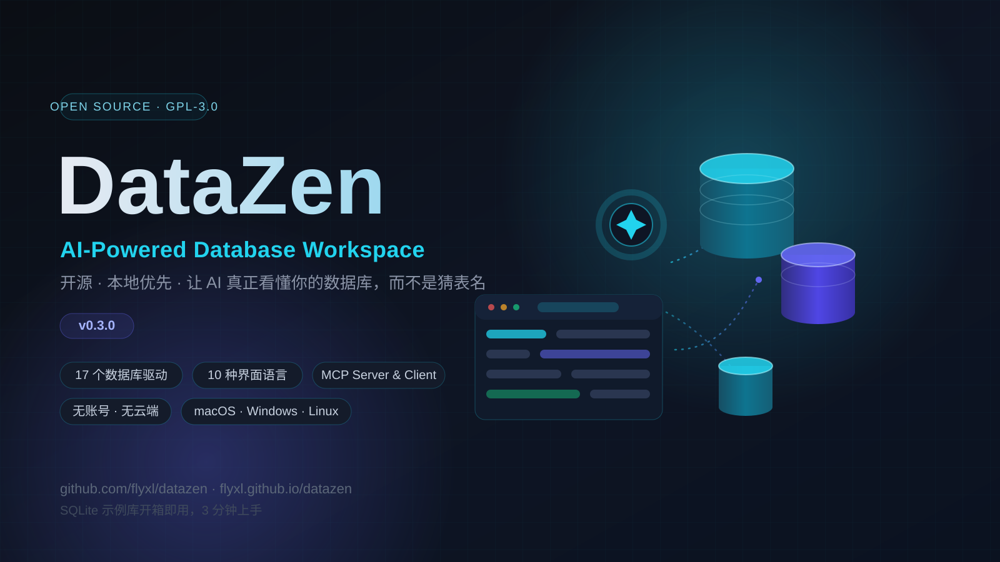

## 前言：数据库客户端的几个老大难

如果你是后端、数据开发或 DBA，下面这些坑大概率踩过：

1. **Navicat 太贵**：买断价格高昂，采购走不通，不少公司直接禁用；功能解锁按版本分层，团队协作还要额外花钱。
2. **DBeaver 太重**：基于 Java，捆绑 JRE，几百 MB 起步，启动慢、内存占用高，低配笔记本上打开就要等半天。
3. **工具割裂**：MySQL 用一个客户端，MongoDB 装一个 Compass，Redis 再装一个 RDM，桌面上堆满软件，连接配置各存一份。
4. **AI 用不上力**：想让大模型帮忙写 SQL，它既不知道你的真实表结构，生成的 SQL 全靠猜；直接把连接交给 AI 编辑器，又担心数据被上传泄露。
5. **改数据提心吊胆**：改一格数据要手写 UPDATE，NULL 和空字符串分不清，改错了表没有后悔药。

DataZen 就是为这些问题而来：**一款开源免费的本地优先数据库工作台，把 AI、Agent 生态和专业数据库能力放进同一个应用**。今天发布的 v0.3.0，更是把数据浏览与编辑、导入导出、AI 助手三块核心体验全部重做了一遍。

## 一句话认识 DataZen

DataZen 基于 **Tauri v2 + Rust + React 18 + TypeScript** 构建（前端不是 Electron，后端没有 JVM），运行在 **macOS / Windows / Linux** 三端。核心数字：

| | |
|---|---|
| 数据库驱动 | **17 个**（PostgreSQL、MySQL/MariaDB、SQLite、Redis、MongoDB、SQL Server、ClickHouse、DuckDB、Elasticsearch、InfluxDB、VictoriaMetrics、RQLite、Turso、HBase、向量数据库 HTTP、Kiwi、Superset） |
| 协议兼容复乘 | QuestDB / Cloudberry 走 PostgreSQL wire，Doris / StarRocks / OceanBase 走 MySQL wire |
| 界面语言 | **10 种**（简繁中文、英、日、韩、德、西、法、葡、俄），v0.3.0 起支持安装外部语言包 |
| AI | NL2SQL · 错误诊断 · EXPLAIN 分析 · Ask/Agent 双模式 · AI 记忆 · 多 Provider（含本地 Ollama） |
| Agent 生态 | **MCP Server + MCP Client 双向** · `datazen` CLI（只读优先）· 官方 Agent Skill |
| 隐私 | 无账号 · 无云端 · 无遥测 · 凭据 AES-256-GCM + 系统钥匙串 |
| 开源协议 | 核心 GPLv3+（驱动/插件/扩展链接例外），`datazen-driver-api` 单独 MIT |

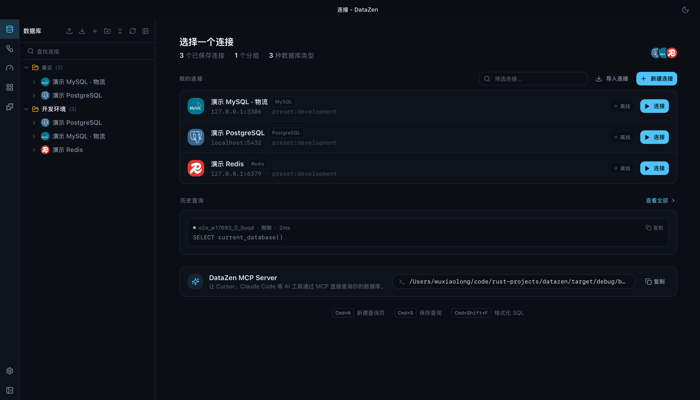

首次启动内置示例 SQLite 库和演示连接，跟着向导 3 分钟就能上手。

## 一、AI 是第一公民：看得到真实 Schema 的 AI

市面上很多"AI 写 SQL"的本质是：把表结构手动复制粘贴给模型，或者干脆让模型瞎猜。DataZen 的 AI 从第一行代码起就建立在**当前连接的真实元数据**之上：SchemaContextBuilder 会把当前库的真实表、列、类型、注释压缩成上下文喂给模型，`.ctx.yaml` 表组和 `@` 引用还能进一步控制喂什么。

### 自然语言生成 SQL（NL2SQL）

输入一句中文业务描述，生成的是**针对你当前连接方言**的 SQL，流式回填到编辑器里，你可以先改再执行：

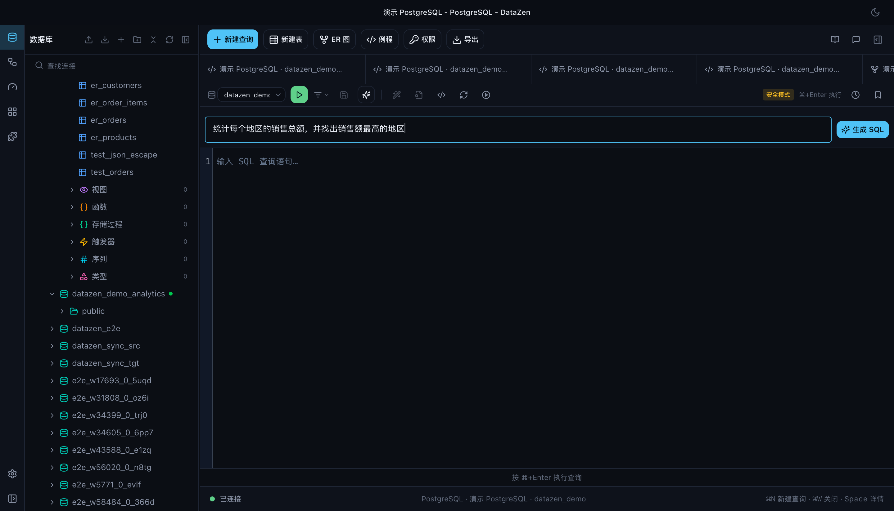

### 报错一键诊断、EXPLAIN 一键解读

SQL 执行报错时，AI 拿到错误信息和真实 Schema，给出原因和可直接运行的修正 SQL；慢查询贴进来，AI 解读执行计划，指出昂贵扫描和缺失索引：

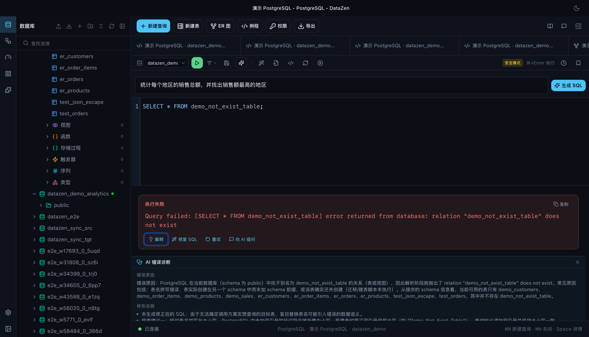

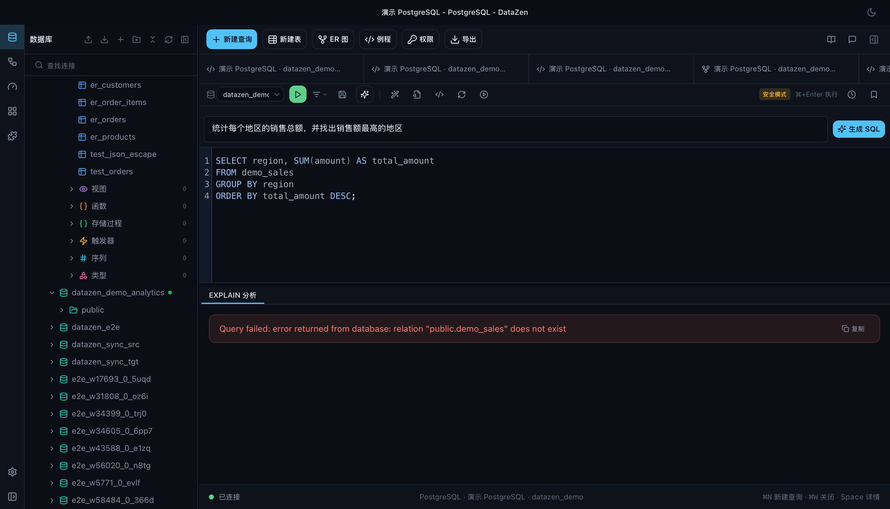

### v0.3.0 新增：Ask / Agent 双模式 + AI 记忆

- **Ask 模式**：问答与生成 SQL，结果由你审核后执行；
- **Agent 模式**：AI 可以自主调用只读查询与采样工具，多步完成"看结构 → 写查询 → 执行 → 迭代"；未绑定连接时 fail-closed，宁可拒绝也不越权；
- **AI 记忆**：记住你的表间关系、业务口径和修正偏好，检索注入到对话与 NL2SQL；支持连接笔记和记忆管理 UI，下次提问不用重复交代背景。

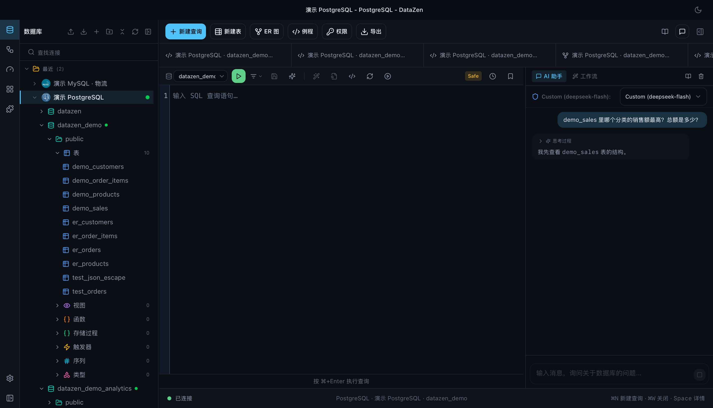

### 模型随便换，数据不外泄

Provider 支持 OpenAI、Anthropic、DeepSeek、**Ollama（全本地）**、任意 OpenAI/Anthropic 兼容端点，v0.3.0 还支持把 **Claude Code、Codex、Cursor 等本地 CLI Agent 当作模型后端**。AI 出网默认开启 strict egress，流量只去你自己配置的 Provider，每次生成可取消，响应里有 `egress_summary` 用量摘要——用 Ollama 时数据完全不出本机。

## 二、把数据库接进 Agent 生态：MCP 双向 + CLI + Agent Skill

这是 DataZen 最与众不同的部分：它不只是"被人用"，还能**被 Agent 用**。

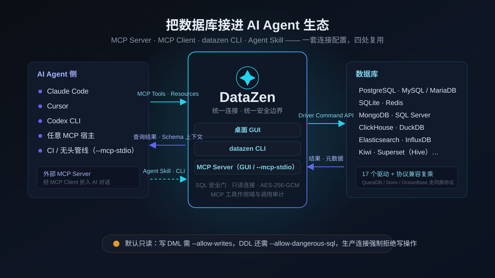

### 作为 MCP Server

DataZen 内置 MCP Server，把你的数据库暴露成结构化工具：`list_connections`、`list_databases`、`list_tables`、`search_tables`、`get_schema`、`describe_table`、`query`、`explain_query`、`list_workflows`、`run_workflow`，以及有状态会话工具。Claude Code、Cursor 等 AI 编辑器可以直接查你的库——Agent 不再幻觉表名，因为它**读得到真实 Schema**。桌面连接页有一键复制的 MCP Server 注册卡片；CI 和无人值守场景用 `--mcp-stdio` 无头模式，把数据库能力挂进 Agent 管线。

v0.3.0 补齐了 MCP 工具治理：工具调用有作用域与审计，Streamable HTTP 传输 opt-in，Redis 批量读工具也进了工具箱。

### 作为 MCP Client

反过来，DataZen 的 AI 对话也能接入你配置的**外部 MCP Server**，把外部工具和上下文折进对话——一个入口同时编排数据库和你的其他工具链。

### `datazen` CLI：只读优先，天生为 Agent 设计

```bash
datazen doctor --json                                # 体检：驱动、存储、连接状态
datazen connections --json                           # 列出连接（不输出任何凭据）
datazen context prod-pg --database app --json        # 生成给 LLM 的紧凑 Schema 快照
datazen query prod-pg "SELECT * FROM orders LIMIT 10" --limit 100 --json
datazen open prod-pg --query "SELECT 1" --json       # 一键唤起桌面并打开查询
```

安全模型非常克制：

- **默认只读**：写语句一律 `E_READ_ONLY`；
- `--allow-writes` 只放行 DML；DDL 还要再加 `--allow-dangerous-sql`；
- **生产连接（名称/分组含 prod）即使两个 flag 全开也拒绝写入**（`E_PRODUCTION_WRITE`）；
- `--limit` 在驱动执行前改写 SQL（SQL Server 则做客户端行数上限），粗心的 `SELECT *` 不会撑爆上下文。

### 官方 Agent Skill

```bash
datazen agent setup
# 安装官方 SKILL.md → ~/.agents/skills/datazen/
```

一条命令教会你的编码 Agent 正确使用 CLI：默认只读、显式选连接、始终带 limit、永不索要密码。MCP 负责结构化工具调用，Skill 负责使用姿势，双保险。

> CLI 当前链接 PostgreSQL、MySQL（含兼容驱动）与 SQLite 驱动；其他引擎经桌面端能力访问。`datazen capabilities --json` 可查看本机构建实际注册的驱动。

## 三、v0.3.0 主线：数据浏览与编辑全链路重做

这是本次发布投入最大的部分，目标是把"改数据"这件事做到 Navicat 的手感，同时比它更安全：

- **完整键盘导航**：方向键 / Enter / Escape / ⌘A 全套快捷键，手不离键盘就能过完整张表；
- **类型化单元格编辑**：列类型归一化为 11 种 `CellType`，每种类型一个专用编辑控件——时间用时间控件，枚举用下拉，UUID 有校验，JSON 非法输入直接阻止提交并给出行内原因；
- **写入意图三态**：`NULL`、空值、"不写这一列"是三个明确不同的意图，不再互相折叠——这是手写 UPDATE 时最容易出错的地方；
- **跨类型剪贴板**：复制粘贴带"来源"绑定，陈旧来源不会静默写错列；`⌘D` 复制当前行；
- **外键跳转**：单元格上的 FK 箭头一键跳到目标表，面包屑与返回栈都齐了；
- **行数三态**：`≈` 估算（PostgreSQL 走 `pg_class` 统计）、"估不出来"如实提示、需要时一键精确统计；
- **筛选与分页重做**：逐条 AND/OR 条件、算子按列类型分派（几何/数组/二进制各有正确的算子集）、keyset 分页按驱动能力启用、表头单击三态循环排序；
- **查询结果直接编辑**：含主键列的查询结果可进入 live 编辑——暂存修改 → 预览 SQL → 显式提交/回滚，一次提交多处修改，Navicat 式体验。

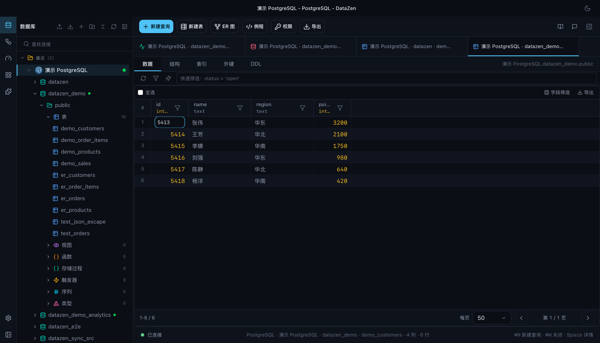

## 四、导入导出：XLSX 和 Parquet 都来了

v0.3.0 把导入导出补成了全家桶：

- **导出**：CSV / TSV / **XLSX** / **Parquet**（按方言与列值做 schema 推断，并经读回验收）/ JSON / Markdown / SQL INSERT / **SQL UPDATE**；
- **导入向导**：RFC-4180 解析器、列映射、分批事务执行、可解释的错误报告；
- **体验一致**：列选择、不可用格式禁用并说明原因、流式进度、**中途随时取消**、`.part` 中转原子保存（失败保留原文件）；
- **安全细节**：CSV 公式注入防护统一到 Rust 流式写出路径，防止 `=HYPERLINK(...)` 之类的表格注入攻击。

无会话导出也补上了：只依赖已加载数据的导出不再要求打开数据库会话。

## 五、SQL 编辑器与查询体验

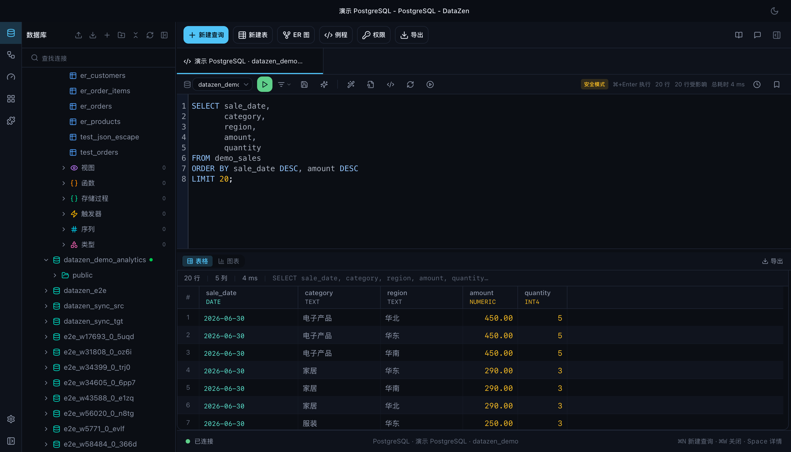

- **Schema 感知补全**：基于真实表/列元数据，不是关键字联想；悬浮提示、函数签名帮助齐全；
- **实时 Linter 与 Alt+Enter 快速修复**：写错即提示，一键修；
- **SQL 安全门**：`DELETE` / `UPDATE` / `DROP` 等高危语句执行前强制预览，可配置拦截规则；
- **类型化参数绑定**与 4 种运行模式（全部/选中/当前语句/静默批量）；
- **多光标**（⌘/Ctrl+点击）、粘贴转 IN 子句、代码片段、事务工具栏、流式结果集。

### 可视化查询构建器

不写 SQL 也能查：三区布局，拖拽连线生成 JOIN，外键关系自动推断，随时切回 SQL 视图。

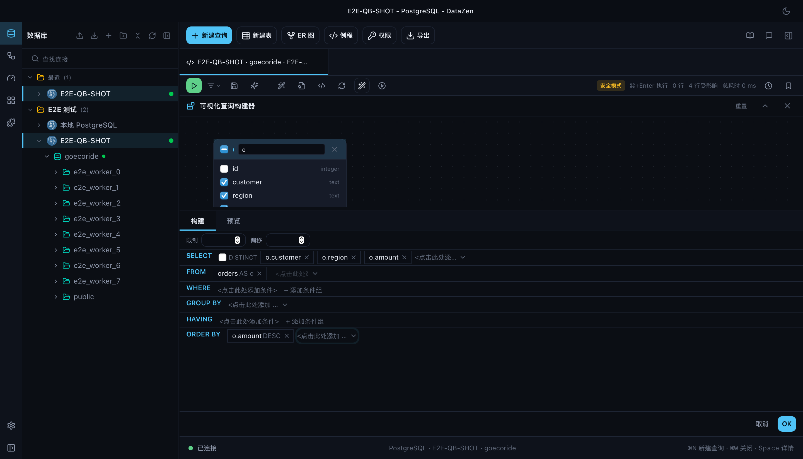

### ER 图与对象浏览

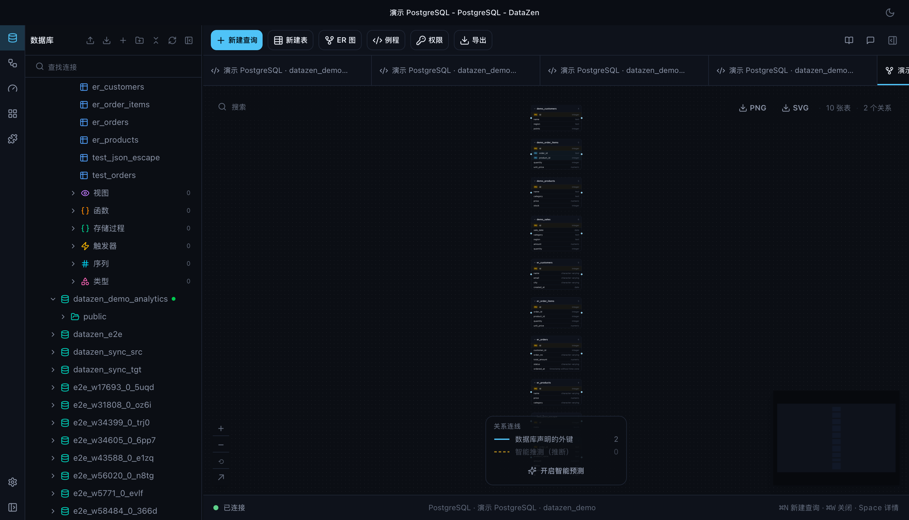

## 六、迁移三件套：Schema Diff / Data Sync / Data Transfer

结构对比、数据同步、异构迁移，全部做到"**先预览审阅，再执行**"：

- **Schema Diff**：依赖 DAG 排序的 DDL 部署计划——视图、存储过程、触发器、外键按正确顺序迁移，不会出现"先建外键后建主键"的翻车现场；支持正向同步与审阅对象持久化；
- **Data Sync**：同族数据库行级同步，大体量比较溢写磁盘、流式执行、稳定读快照、冲突策略显式声明；
- **Data Transfer**：异构迁移带外键依赖写入排序、检查点续传（断了能接着传）、SQL 文件目标；PostgreSQL 序列身份连续性也照顾到了。

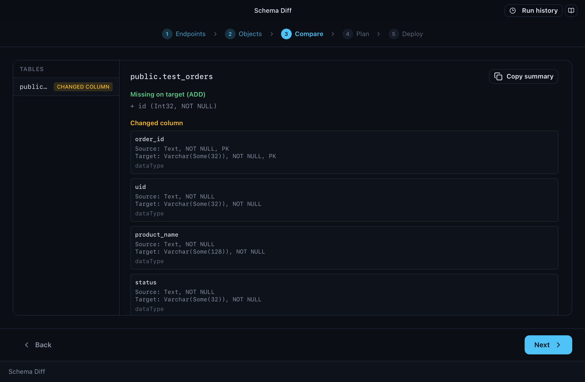

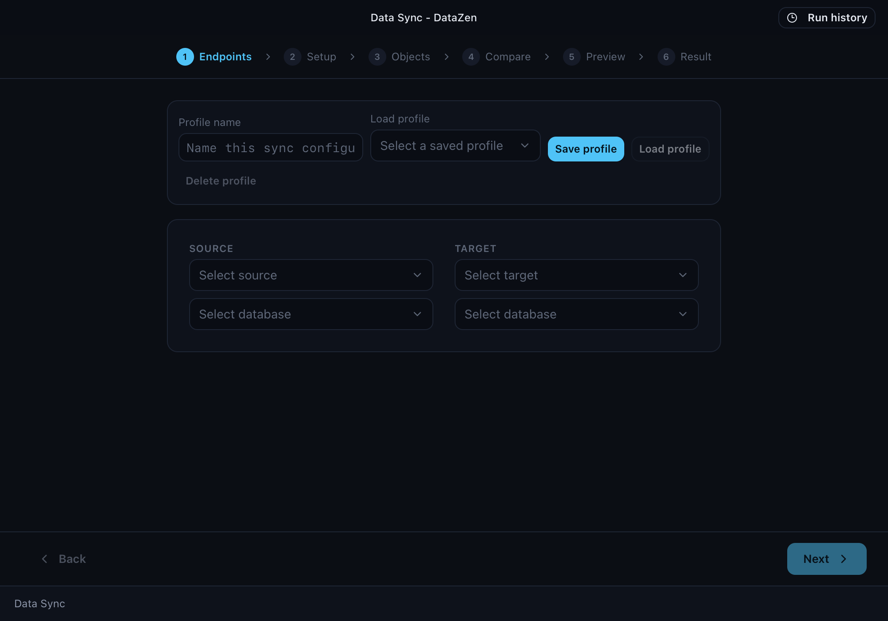

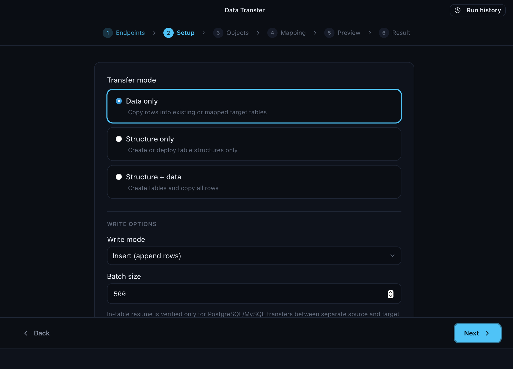

三件套共享运行历史与可复用 Profile（AES-GCM 加密），可挂到 Workflow 调度器定时执行。

## 七、不止 SQL：Redis 工作台、Workflow、看板、隧道

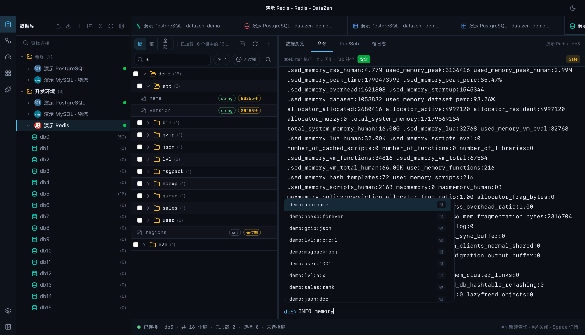

- **Redis 工作台**：键树/扁平双模式浏览（SCAN 游标保持位置）、类型过滤、MEMORY USAGE、压缩值解码（gzip/zlib/deflate/base64）、Console 危险命令分类 fail-closed、Slowlog、Pub/Sub、MONITOR、集群与哨兵感知；
- **YAML Workflow**：把 Query、Command、AI、Condition、ForEach 编排成可复用工作流，从 GUI、MCP 或无头模式运行，可定时调度；
- **Ops Dashboards**：运营看板定时刷新、阈值告警走桌面通知或 webhook；
- **数据库隧道**：SSH / HTTP CONNECT / WebSocket 隧道直连内网库，不用额外工具。

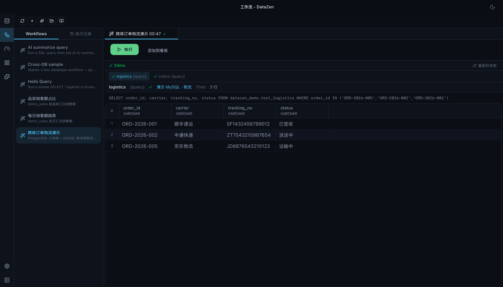

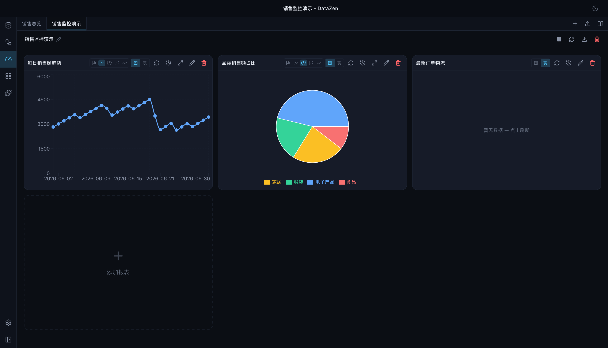

## 八、安全与隐私：数据库工具的底线

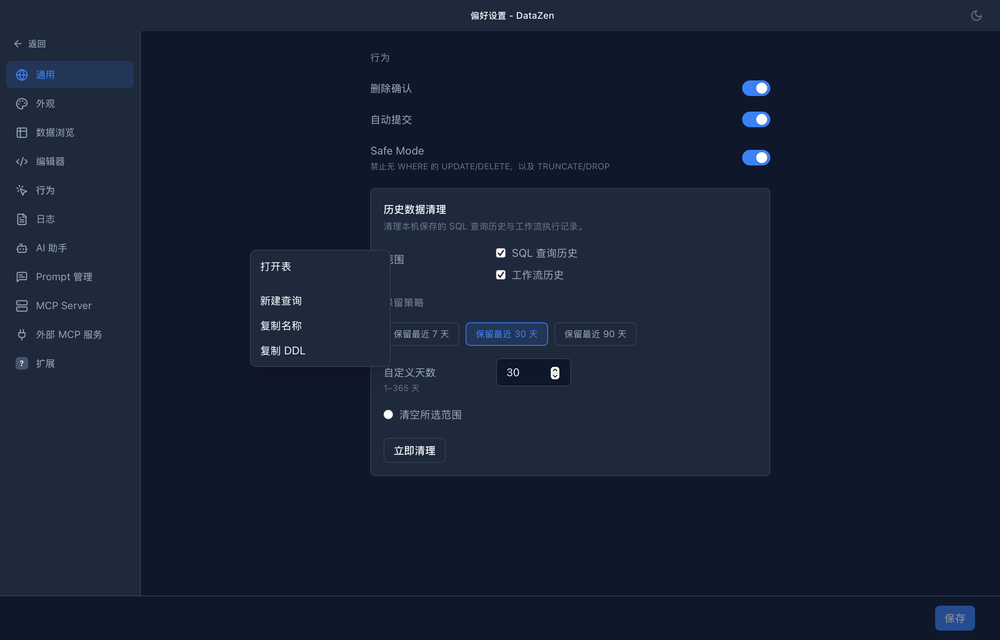

- **无账号、无云端、无遥测**：不收集查询、连接与数据；
- **凭据 AES-256-GCM 加密**：macOS 走登录钥匙串，Windows 走 DPAPI，密钥明文文件默认不落盘；
- **只读连接** + SQL 安全门 + Agent 默认只读，多层防线；
- **AI 出网可控**：strict egress 默认开启，流量只去你配置的 Provider，本地 Ollama 完全离线；
- 日志与错误信息不包含凭据、敏感路径与原始连接串。

## 九、团队 Web 服务首版落地

v0.3.0 同步交付了服务端半边（`crates/datazen-server`）：axum HTTP 宿主的 `/api/v1` 十五域 108 条路由（settings、identity、connection、session、execution、job、artifact、events SSE、tableData、driverGateway、queryAssets、schemaDiff、workflow、dashboard、dataSync），浏览器壳 `packages/web` 与桌面端共享同一个业务内核——同一套用例既是 Tauri command 也是 HTTP API。

- 团队认证基于 **OIDC**（授权码 + PKCE）；`deploy/dev/` 提供一键开发栈（dex + seed）；
- 生产部署提供 Dockerfile 与 docker-compose。

> 口径说明：本版是团队 Web 服务**首版**；桌面端团队认证接入（P8）与多 worker 协调（P9）仍在后续切片中。想在生产环境评估团队部署，建议从 `deploy/dev` 冒烟栈开始。

## 十、与 Navicat / DBeaver / TablePlus 怎么选？

| 维度 | DataZen | Navicat | DBeaver CE | TablePlus |
| --- | --- | --- | --- | --- |
| 开源与价格 | GPLv3+ 完全免费 | 商业付费 | Apache-2.0 免费 | 免费版受限 |
| 技术栈 | Rust + Tauri（无 JVM、无 Electron） | 原生 | Java（需 JVM） | 原生 |
| 数据库覆盖 | 17 驱动 + wire 协议复乘 | 广（付费分层） | 最广（JDBC） | 中等 |
| AI 助手 | 内置，多 Provider + 本地 Ollama + Ask/Agent + 记忆 | 较新版本提供，以云服务为主 | PRO 版提供 | 无内置 |
| MCP | **Server + Client 双向**，GUI/无头 stdio | 无 | 无 | 无 |
| CLI / Agent Skill | `datazen` CLI 只读优先 + 官方 Skill | 无 | 无官方 CLI | 无 |
| 数据编辑 | 类型化单元格、三态写入意图、查询结果 live 编辑 | 强 | 一般 | 一般 |
| 迁移三件套 | Diff DAG / Sync / Transfer，先审后执行 | 强（付费） | 有 | 弱 |
| 团队网页端 | 服务端首版（OIDC + HTTP API） | 无官方 | 无官方（有商业 Cloud） | 无 |
| 隐私 | 无账号、无遥测、本地优先 | 需许可 | — | — |

一句话选型：**重度 Oracle 老项目或需要小众 JDBC 驱动，DBeaver 依然是稳妥选择；预算充足只做单机开发，TablePlus 体验精致；要 AI、要 Agent、要数据编辑手感、不想花钱也不想泄露数据——用 DataZen。**

## 十一、安装：3 分钟上手

从官网下载对应平台的安装包，或到 GitHub Releases：

| 平台 | 安装包 |
| --- | --- |
| macOS（Apple Silicon / Intel） | `.dmg` |
| Windows | NSIS `.exe` / 便携 `.zip` |
| Linux x86_64 | `.deb` / `.rpm` / `.AppImage` |

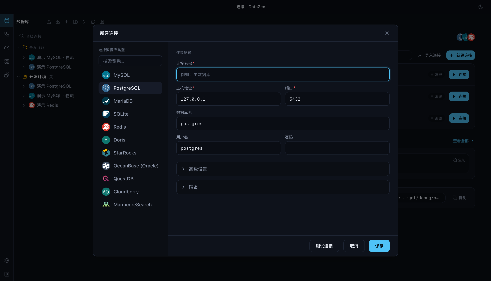

- 免费、无需注册账号，自动更新可关闭；
- **macOS 提示"已损坏"或无法验证开发者**：应用尚未公证，执行 `xattr -cr /Applications/DataZen.app` 或右键 → 打开一次即可；
- 从源码构建：Node 24 + pnpm 11 + Rust stable，`pnpm tauri:build:community --drivers=all` 可以自由选择打包哪些驱动。

## 十二、三个真实工作场景

### 场景 1：接手陌生库

新接手一个几十张表的库：先用对象浏览器和 ER 图理清表关系，再把关键表组成 `.ctx.yaml` 表组喂给 AI——之后所有 NL2SQL 和对话都带着正确上下文，生成的 SQL 引用的是真实列名而不是模型幻觉。

### 场景 2：线上慢 SQL 排查

慢查询贴进编辑器 → EXPLAIN 可视化定位昂贵扫描 → AI 给出索引与改写建议 → 修正后的 SQL 在测试连接验证 → 危险 SQL 门确认影响行数后才敢在生产执行。全程一个应用，不切窗口。

### 场景 3：让编码 Agent 查真实数据

```bash
# 终端里装好官方 Skill
datazen agent setup
```

然后在 Claude Code / Cursor 里直接说："查一下 demo_sales 里销售额最高的分类，顺便看看对应商品库存够不够"。Agent 通过 MCP（或 CLI）读到真实 Schema，自己写 SQL、自己执行、返回真实数据——你不需要复制任何表结构，也不会把数据发给来路不明的服务。

## FAQ

**Q：完全免费吗？商用有没有限制？**
A：核心 GPLv3+ 开源，附带插件/驱动/扩展链接例外；独立驱动 SDK（`datazen-driver-api`）单独 MIT。个人与企业均可免费使用，无功能付费墙。

**Q：会偷偷上传我的数据吗？**
A：无遥测、无埋点。AI 流量只去你自己配置的 Provider 或本地 Ollama，每次出网有 `egress_summary`，可随时取消。

**Q：MCP / CLI 模式下 AI 会不会改我的数据？**
A：默认只读。CLI 写 DML 要 `--allow-writes`，DDL 还要 `--allow-dangerous-sql`，生产连接强制拒绝；MCP 工具有作用域与审计。

**Q：完全离线能用吗？**
A：桌面端本体离线可用；AI 用 Ollama 全本地跑；10 种界面语言内置，外部语言包可通过设置页安装。

**Q：支持哪些数据库？**
A：PostgreSQL、MySQL/MariaDB、SQLite、Redis（basic 集）；MongoDB、SQL Server（Azure SQL 活体验证）、ClickHouse、DuckDB、Elasticsearch、InfluxDB、VictoriaMetrics、RQLite、Turso、HBase、通用向量库（all 集）；Kiwi、Superset（git 驱动）；QuestDB/Cloudberry、Doris/StarRocks/OceanBase 经 wire 协议兼容直接可连。

**Q：团队协作呢？**
A：v0.3.0 起服务端 HTTP API 与浏览器壳首版落地（OIDC 认证、Docker 部署）；桌面端团队认证在后续版本。

## 总结

DataZen 的差异化不是某一个大功能，而是三件事叠在一起：

1. **AI 看得到真实 Schema**：NL2SQL、诊断、EXPLAIN、Ask/Agent、记忆，全部建立在当前连接的元数据之上，且有严格出网边界；
2. **Agent 生态双向打通**：MCP Server + Client、只读优先的 CLI、官方 Agent Skill、无头 stdio——数据库第一次能安全地"上岗"给 AI 用；
3. **专业内核不打折**：类型化数据编辑、迁移三件套、Redis 工作台、Workflow、看板、加密与只读防线，是按 Navicat 的标准做出来的开源实现。

如果你正在忍受 Navicat 的价格、DBeaver 的重量，或者一直想让 AI 真正帮你查库写 SQL——下载试一试，示例库开箱即用。

**项目归档**

- 官网：https://flyxl.github.io/datazen/
- 下载：https://flyxl.github.io/datazen/download.html
- GitHub：https://github.com/flyxl/datazen
- 架构系列文章：[docs/blogs/README.md](README.md)
- v0.3.0 完整变更：[CHANGELOG.md](../CHANGELOG.md)

> 觉得有用的话，去 GitHub 点个 Star ⭐，或者提一个 Issue / PR——驱动开发有单独的 MIT API 和开发指南，欢迎把你的数据库接进来。
