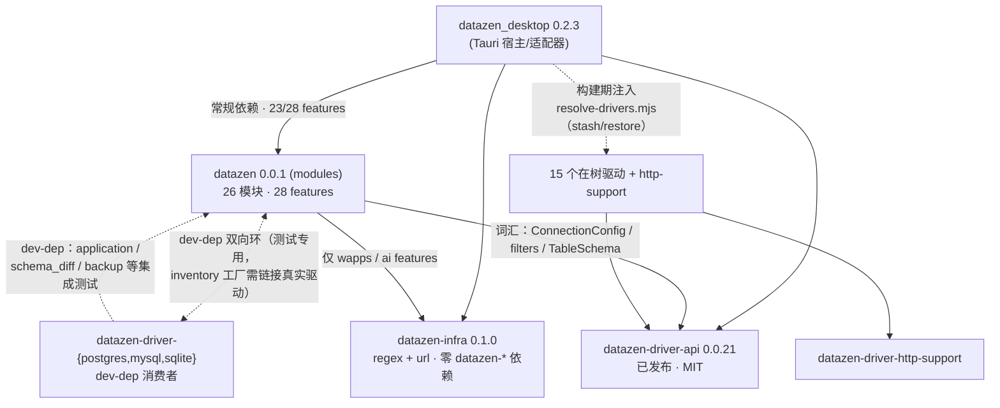
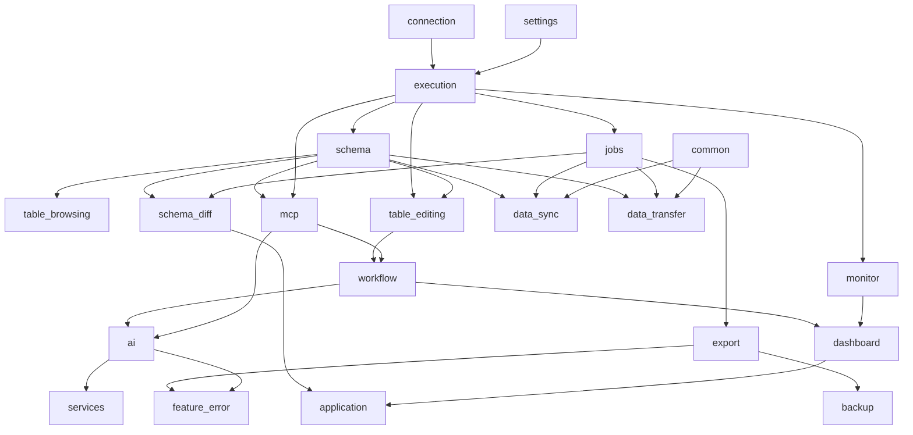

# 代码组织评审与优化方案（2026-10）

> 外部评审快照，基准 `main @ abeca63`（2026-10-30，含 PR #145）。评审范围：crate / package
> 拆分、依赖与分层、API 封装、工程配置与代码细节；基准为 Cargo workspace 与 pnpm monorepo
> 社区惯例（cargo 依赖/lint 继承、tauri / zed / typst 一类的 core + host 组织、feature 门控
> 与单 feature CI 矩阵实践）。
>
> 本文遵循仓库纪律区分**当前事实**与**建议**：§2–§3 为已核实事实（均给出文件级证据），
> §4 为分阶段建议，§6 标注本分支（`review/code-organization-2026-10`）已实施的部分。
> 长期结论按纪律逐步改写入 `docs/architecture/`，本文件是评审快照而非长期规范。
>
> **2026-10-30 二次更新**：本分支已并入维护者的宿主边界后续方案
> `docs/development/host-boundary-followups.md`（下称**边界方案**，F0–F4），并把两份计划
> 合并为统一路线图（§4）；其中 F0（桌面 feature 显式全集）已在本分支落地并经 cargo 等价验证。

## 1. 总体判断

DDD 重构（D0–D8）与 form-split（F1–F6）刚收口后的整体判断：**方向正确、执行纪律罕见地好，
当前主要问题不在 crate 拆分本身，而在 workspace 卫生（依赖规格分散重复）、feature 图深度、
构建期改写 manifest 的注入机制，以及少量迁移残留。**

| 维度 | 评价 | 依据 |
|---|---|---|
| 架构方向 | 好 | 形态中立内核（`modules`）+ 薄宿主（`apps/desktop/src-tauri`）+ 契约 crate（`driver-api`），依赖单向，`shared-boundaries-and-ports.md` §2.4 规则表有脚本门禁背书 |
| crate 拆分粒度 | 好 | 20 个成员各层有存在理由；不提前为 Web 宿主拆 crate 的决策有书面记录（modules/Cargo.toml `ai` feature 注释） |
| workspace 卫生 | 待改进 | `[workspace.dependencies]` 仅 2 项 path 条目被使用；约 25 个共享依赖在 modules / desktop / drivers 间各写一份，已现漂移（§3 F-2） |
| feature 组织 | 可接受 | 28 个 feature、最深 8 层链；`feature_error` 依赖方向倒挂（§3 F-5）；桌面清单已按边界方案 F0 补全（本分支） |
| 前端 package 拆分 | 好（一处埋雷） | F6-c2 已退役三张 alias 表，exports + workspace 链接解析；`frontend` 子路径 exports 指向不存在的 `.js`（§3 F-8） |
| 架构治理 | 突出 | 14 个 `check-*.mjs` 门禁 + `platform-arch-selfcheck` 变异自测；`check-platform-crate-boundaries` 用 cargo metadata + 目录分层 + 规格表三源交叉验证 |
| 仓库卫生 | 待改进 | `.d31_events_block.txt` 草稿误提交；AGENTS.md 仓库地图停留在 F6 前布局（本分支已修） |

## 2. 现状结构（已核实事实）

### 2.1 Rust workspace 成员（20 个）

| 成员 | 版本 | 角色 | 发布状态 |
|---|---|---|---|
| `modules`（crate `datazen`） | 0.0.1 | 形态中立内核：领域词汇、仓储端口、应用用例，feature 门控 | 不发布 |
| `apps/desktop/src-tauri`（`datazen_desktop`） | 0.2.3 | Tauri 宿主/适配器，开 23 个 `datazen` features | 应用 |
| `packages/driver-api`（`datazen-driver-api`） | 0.0.21 | 驱动契约（traits + 类型），MIT 双许可 | **已发布 crates.io**（`publish-driver-api.yml`） |
| `packages/infra`（`datazen-infra`） | 0.1.0 | 脱敏 / 路径安全原语，零 datazen-* 依赖（F-11） | 不发布 |
| `packages/drivers/*` ×16 | 各自 0.0.x | 15 个驱动 + `http-support` 共享件 | 驱动独立版本 |

版本观察：`driver-api` 高频迭代（0.0.21）而核心 crate 零迭代（0.0.1）符合"契约 vs 内核"的
节奏差；但六套版本号（含 `@datazen/frontend` 0.1.0、宿主 0.2.3、驱动 0.0.10 等）目前无任何
集中声明，建议后续用 `[workspace.package]` 或文档统一口径。

### 2.2 crate 依赖图

要点：常规依赖无环、方向单向收敛；唯一的环是 **dev-dependency 环**（`datazen` dev 依赖三个
基础驱动做 inventory 工厂测试，驱动 dev 依赖 `datazen` 做集成测试），cargo 允许且已在
modules/Cargo.toml 注释中说明理由——建议将该事实从注释提升进 `docs/architecture/`。

### 2.3 `modules` feature DAG（从 Cargo.toml 还原）

最深链 `services → feature_error → ai → workflow → mcp → schema → execution → connection/settings`
达 8 层。无环，但两条结构性观察：

- `execution` 是事实上的汇聚点（11 个 feature 直接或间接依赖），它是"领域词汇 + 机制内核
  （会话 actor / 账本 / 产物 / 隧道）"的混合体（D3-3b 迁入），未来若再拆，第一刀应落在
  execution 的 domain / mechanism 分离上；
- `feature_error = ["ai", "table-editing", "export"]` 方向倒挂：错误分类学本应是最底层叶子
  词汇，现在却拖动整个 AI provider 栈（reqwest、inventory）。

实测注记（2026-10-30，cargo 1.99.1）：`cargo tree -p datazen_desktop -e normal,build,features
-i datazen` 解析出的启用集合为 26 个 feature，其中 `common` / `jobs` / `workflow` / `mcp`
四个由传递链打开而未在桌面清单声明——即边界方案 F0 所指问题，已在本分支修复。

## 3. 发现清单

| # | 级别 | 发现 | 证据 | 影响 |
|---|---|---|---|---|
| F-1 | 高 | workspace 依赖继承基本未使用：根表仅 `datazen-driver-api`、`datazen` 两条，其余约 25 个共享依赖在成员间逐份重复 | 根 `Cargo.toml` vs `modules/Cargo.toml` / `apps/desktop/src-tauri/Cargo.toml` / 驱动 manifests | 规格漂移无结构性防线；每次升级要改多处 |
| F-2 | 高 | 版本/规格漂移已发生：`serde_yaml` "0.9" vs "0.9.34"；`regex` "1" vs "1.13.1"；**`dirs` 5 与 6 并存**（Cargo.lock 同时锁 5.0.1 与 6.0.0，modules 用 5、desktop 用 6） | `Cargo.lock` | dirs 双版本意味着同一语义两套实现共存，行为差异风险 |
| F-3 | 中 | `packages/infra` 注释腐化：声称根表 "carries only the seven path crates"，实际两条 | `packages/infra/Cargo.toml` 依赖区注释 | "为什么不继承"的辩护词本身过期，误导后续维护者 |
| F-4 | 中 | 构建期改写 VCS 跟踪的 manifest：`resolve-drivers.mjs` 在根/desktop 的 `<<driver-*>>` 标记间注入依赖与 feature，`driver-file-stash.mjs` stash/restore 整文件；desktop 曾因 macOS 依赖插入位置错误导致跨平台构建失败（现注释记录该事故） | `scripts/resolve-drivers.mjs`、desktop `Cargo.toml` L74–80 注释 | 有状态构建；CI 中断留脏树；标记顺序敏感 |
| F-5 | 中 | feature 图结构问题：`feature_error` 倒挂（见 §2.3）；`services` 与 `application` 两个伞 feature 的划分边界需要读注释才能解释——边界是 D 序号迁移批次的化石，尚非领域语义 | `modules/Cargo.toml` features 区 | 最小构建推理成本高；开"错误诊断"链接整个 AI 栈违反直觉（桌面清单可见性问题已由边界方案 F0 在本分支修复，图结构本身仍待 P3） |
| F-6 | 中 | AGENTS.md 仓库地图过期：仍描述 `src/`、`src-tauri/` 顶层布局与已合并的 `runtime`、`application`、`platform-api` 包；生成文件路径 `src/extensions/generated*.ts` 等未更新 | `AGENTS.md` §项目与目录（本分支已修） | 对 agent 协作是直接误导——地图错比没有更糟 |
| F-7 | 低 | `.d31_events_block.txt`（1.6KB Rust 草稿）误提交在根目录 | git tree（本分支已删） | 噪音 |
| F-8 | 中 | `@datazen/frontend` 子路径 exports 指向不存在的文件：`"./src/*": "./src/*.js"`，而源码树全是 `.ts`；兄弟包（ui / wapp-sdk 等）全部直接指向 `.ts`。当前 tsc / vite / vitest 靠解析器回退行为正常工作，但任何严格按 exports 解析的消费者（Node ESM 直载、未来 bundler 严格模式）会断 | `packages/frontend/package.json` vs `packages/frontend/src/platform/env.ts`（本分支已修） | 埋雷型问题：平时无感，切换工具链时爆炸 |
| F-9 | 中 | `xlsx@^0.18.5` 已知漏洞：CVE-2023-30533（原型污染）与 CVE-2024-22363（ReDoS）；修复版只经 cdn.sheetjs.com 分发，npm 源冻结在 0.18.5。导入链路解析用户提供的表格文件（正是触发场景；纯导出不受影响） | `packages/frontend/package.json` dependencies；Snyk / SheetJS 官方安装文档 | 依赖安全问题，建议尽快处置 |
| F-10 | 低 | README 宣称 "18 database drivers"，`drivers-registry.json` 为 17（15 path + kiwi / superset git） | `README.md` L20 vs `drivers-registry.json` | 口径差，建议注明计数方式或对齐 |
| F-11 | 低 | `modules/src/lib.rs` 根部 `pub use execution::*` 等 glob 再导出，注释自辩"避免重建水平 platform-api 命名空间"——glob 恰恰在 crate 根重建了一个隐式水平命名空间 | `modules/src/lib.rs` 尾部 | 命名冲突面；团队在 D3 评审修复中已有"glob 改命名再导出"先例，可复用 |
| F-12 | 低 | `hub.md` 头部"全局状态"仍写"D3 基本完成、下一步 D4"，正文表格显示 D5 收官、D6 item 1–5 已完成 | `hub.md` | 协调文件头部落后正文两个阶段；建议头部摘要由脚本生成或明确更新责任 |

正向确认（无需动作）：`@datazen/ui` 零宿主依赖、peers 声明规范；`non_ascii_idents = "deny"`
有完整书面理由；panic 政策有专门门禁；`unexpected_cfgs` check-cfg 把 17 个注入 feature 全部
静态声明；`check-platform-crate-boundaries` 的三源交叉验证设计；`driver-api` 的 MIT 双许可
+ 发布流水线构成的第三方插件生态策略。

## 4. 分阶段优化方案

> **统一路线图（2026-10-30 起）**：本评审的 P 系列与边界方案的 F 系列合并为一条执行线
> （边界方案 = `docs/development/host-boundary-followups.md`，聚焦宿主瘦身：租约、前端入口、
> driver-support、命令体下沉；本评审聚焦 workspace 卫生与构建机制）。两份计划无冲突项，
> 交叠点在 P3/P4/P5 各节标注。
>
> | 步 | 来源 | 内容 | 状态（本分支） |
> |---|---|---|---|
> | 1 | F0 | 桌面 feature 显式全集 | ✅ 已实施，cargo 等价验证 26=26 |
> | 2 | P0 | 卫生清欠 | ✅ 已实施（hub.md 头部刷新、README 计数对齐 17；xlsx 已从 npm 0.18.5 换 cdn.sheetjs.com 0.20.3 tarball（CVE-2023-30533 / CVE-2024-22363，API 面仅 read/write/utils 六调用点，升级后 import/export 测试全绿）；附带把四处 `isMac ? '⌘' : 'Ctrl'` 内联收敛到 `keymap.formatModKey(platform)`，顺带统一了同文件内 `⌘ Enter`/`⌘+Enter` 的格式漂移） |
> | 3 | P1 | workspace 依赖继承 | ✅ 机械部分已实施 |
> | 4 | F1 | 比对租约 flock 化，data_sync 去 rusqlite | ✅ 已实施：fd-lock 4 替换 SQLite 排他事务，锁住不回收/放锁后回收双向测试，45/45 comparison_store + 244/244 data_sync 全绿；遗留 .sqlite 租约不读不删（fail closed，见提交说明） |
> | 5 | F2 | 前端稳定入口 + 门禁 | ✅ 已实施（含三处偏差，见边界方案 §6 实施记录：新增 `./app` 轻入口、`./testing/*` 测试镜像、镜像导入带扩展名） |
> | 6 | P2 ∥ F3 | 驱动注入静态化 ∥ 新建 driver-support | F3 第一刀已实施：`sql_split` + `sql_identifiers`（仅有的零依赖纯模块，780 行）下沉新 crate，模块级 re-export 保下游路径，三级 cargo check + 14 内嵌测试全绿，`PROTOCOL_VERSION` 不变；后续候选（filters/keyset/dialect）拖着 `Value`/`DatabaseDriver`，留待后续刀。P2 待做，两项无耦合可并行 |
> | 7 | F4a…F4n | 命令体按用例下沉各 feature `api` 模块 | 待做 |
> | 8 | P3 / P5 | feature 图修剪 / 目录语义化 | 记录方向，见各自触发条件 |
>
> 附带发现（本地实测）：裸 `--features connection_import` 在 main 上即编译失败
> （connection_import 使用 `crate::feature_error` 但其 feature 列表未声明该依赖，
> 9 处 E0432；stash 基线复现）——F-5 feature 图卫生问题的又一实证，归 P3。

### P0 — 卫生清欠（半天，零风险）

1. 删除 `.d31_events_block.txt`。✅ 本分支已实施
2. AGENTS.md 仓库地图与生成文件路径刷新到 F6 后布局。✅ 本分支已实施
3. `xlsx` 处置：按 SheetJS 官方 vendoring 方案（tarball 入仓 + `file:vendor/` 安装）或迁移
   exceljs。⚠️ 涉及供应链与代码改动，留给维护者决策，本分支不动。
4. `hub.md` 头部状态刷新（理想解：头部摘要由脚本从表格生成）。
5. README 驱动计数口径对齐（17 vs 18）。

### P1 — workspace 依赖继承（1–2 天，机械改动）✅ 本分支已实施机械部分

根表扩为 path crates + 共享外部规格两类；成员一律 `workspace = true` 继承。仅收录**各消费者
完全一致**的规格；`chrono` / `tokio` / `tracing-subscriber` / `dirs` 特意留在成员侧，因其
feature 集 / 主版本合理地不同（`dirs` 5 vs 6 是真问题，见 F-2，收敛需要代码适配，不靠静默
统一）。同时把 `non_ascii_idents = "deny"` 上收 `[workspace.lints.rust]`。预期效果：漂移在
结构上不可能发生；新增依赖时"该不该进根表" forced 一次决策。

后续项（本分支未做）：`dirs` 5→6 收敛；`serde_yaml` 已弃用（0.9.34+deprecated），规划迁移。

### P2 — 驱动注入静态化（2–3 天，消除最大构建脆弱性）

`unexpected_cfgs` 已静态声明全部 17 个 driver feature，说明清单是闭集。把驱动声明为 desktop
的 optional 依赖 + feature，`resolve-drivers.mjs` 退化为生成 `--features` 参数与前端
codegen，不再改写任何 Cargo.toml；`driver-file-stash` 的 stash/restore 机制随之整体删除。
git 驱动（kiwi / superset）继续走 `[patch]`（那部分本来就得动态）。验收：`git status` 在
任一构建路径后保持干净；`--drivers=all` 与 `--drivers=stub` 两极构建等价性测试。

### P3 — feature 图修剪（随下一个大版本）

与 F0 的分工：F0 只解决**可见性**（把传递打开的 feature 写显式，已在本分支落地），
P3 才动图的结构。F0 留下的守护注释（未列出的 feature 不得被桌面意外打开）在 P3 落地后
升格为回归防线：feature_error 反转等改动若意外改变了桌面启用集，cargo tree 核对会立即暴露。

1. `feature_error` 反转为叶子：错误分类学词汇下沉 `shared`，`ai` 依赖它而非反之；
2. 书面定义 `application` vs `services` 判据（建议按用户旅程而非迁移批次），或显式声明
   两者为过渡态、D8 后合并；
3. feature DAG 的 mermaid 源入 `docs/architecture/`，由脚本从 Cargo.toml 生成防腐化
   （可挂进既有 `check-ci-docs-consistency`）。

### P4 — 前端源码包解析收尾（执行主体并入边界方案 F2）

1. exports 埋雷修复：`"./src/*": "./src/*"`（与兄弟包一致的源码直引语义）。✅ 本分支已实施
   ——定位为**过渡态**：F2 落地时 exports 收成 `.` / `./shell` / `./styles.css` 三说明符，
   整条 `./src/*` 随之删除。本次修复的价值是消除「指向不存在 .js」的中间态埋雷，
   不让 F2 之前的任何严格消费者踩坑。
2. （建议并入 F2 的 PR 一并做）tsconfig project references 评估：当前单程序 include 全部
   包源码、tsrs/tsc 单程序 typecheck，包间边界靠约定不靠编译器；F2 门禁脚本
   （`check-frontend-public-entry.mjs`）给出运行时检查后，project references 作为编译期
   补强再评估优先级。
3. （建议并入 F2 的 PR 一并做）根 package.json 的 react / zustand 等 devDependencies
   下放至真实消费者。

### P5 — 目录语义化（Web 宿主重新立项时一并做，当前不动）

`modules/` → `crates/datazen/`、`packages/drivers/` → `crates/drivers/`（目录与 crate 同名，
对齐 tauri / zed 惯例）；`packages/` 收敛为纯 TS 包，pnpm glob 从 `packages/drivers/*` 收紧，
避免未来驱动目录加 package.json 被静默吸入 TS workspace。D7 已移出重构范围（hub.md 范围
决策），本阶段无触发条件，仅记录方向。注：边界方案 F3 会新增 `packages/driver-support`
（Rust crate），加深 packages/ 混装现状——接受为过渡态，本阶段迁移时随 `packages/drivers/*`
一并挪入 `crates/`。

## 5. 社区基准对照

| 基准 | DataZen 现状 | 对照结论 |
|---|---|---|
| Cargo Book workspace 依赖/lints 继承 | P1 前仅 2 项使用 | 落后 → 本分支补齐 |
| typst：core 库 + 薄 CLI 宿主 | datazen + datazen_desktop | 同构，方向正确 |
| zed：crates/ 分层 + import 边界工具 | packages + modules + 14 门禁脚本 | 同构且更重（自研三源交叉验证） |
| tokio：feature 门控 + 单 feature CI 矩阵 | 28 features + `run-platform-crate-tests.mjs` | 意识到位，图更深 |
| pnpm monorepo：packages/* 纯 TS | packages/ 混装 Rust crate 与 TS 包 | 偏离 → P5 方向（不急） |

## 6. 本分支已实施内容

| 提交 | 内容 | 风险 |
|---|---|---|
| docs | 本文件 | 无 |
| chore | 删 `.d31_events_block.txt` | 无 |
| docs(agents) | AGENTS.md 地图 / 生成文件路径 / 宿主路径刷新 | 无 |
| build(workspace) | 根表扩容（path crates + 24 个一致规格共享依赖）+ `[workspace.lints.rust]`；modules / desktop / postgres-driver 继承改写；16 个驱动 + http-support 的 `driver-api` 行统一 `workspace = true`；infra 陈旧注释修正；modules / desktop dev-deps 三个基础驱动路径改继承 | 等价改写：版本 floor 只收紧不放宽（regex "1"→"1.13.1"、serde_yaml "0.9"→"0.9.34"，Cargo.lock 均已满足）；feature 集逐项比对一致；`<<driver-*>>` 注入标记原样保留 |
| fix(frontend) | 子路径 exports `.js` → 源码直引 | 与兄弟包语义对齐；当前消费者经解析器回退已工作，改后走正路 |
| docs(merge) | 并入 `docs/path-facts-after-form-split`：AGENTS.md 地图取双方之长（含补回 `packages/wapps` 目录）、架构 README、pnpm-workspace 注释、`host-boundary-followups.md` 全文 | 无 |
| feat(desktop) | 边界方案 F0：桌面 datazen feature 显式全集（补 `common` / `jobs` / `workflow` / `mcp`）+ 守护注释 | cargo tree 等价验证：改前/改后启用集合 26=26 逐项一致；声明与启用完全对齐（无传递打开、无死声明） |
| feat(frontend) | 边界方案 F2：`startSharedApp` 吸收桌面启动链（marks/CSS/PRO 表/E2E 桥/locale/设置预载/React root）；`tauriEventCompat` 归位桌面；`src/shell.ts` 壳层切片；exports 收成 `.` / `./app` / `./shell` / `./styles.css` / `./testing/*`；24 个消费文件改写；门禁 `check-frontend-public-entry.mjs` 接入 CI；AGENTS.md 不变量条目 | typecheck（tsrs/TS7）通过；全量 vitest 见提交说明；三处与方案的偏差及买测见边界方案 §6 实施记录 |
| docs | P0 清欠：hub.md 头部全局状态对齐正文（D6 收尾中、D7 已移出）、README 驱动计数 18→17 | 无 |
| feat(data_sync) | 边界方案 F1：比对租约换 fd-lock（flock/LockFileEx），`data_sync` 去 `dep:rusqlite`（cargo tree 验证不在图中）；新增「锁住不回收/放锁后回收」双向测试；锁文件内容不再参与存活证明 | cargo 1.99.1：45/45 comparison_store + 244/244 data_sync lib 测试全绿；比对正文格式未动；遗留 `.sqlite` 租约不读不删（fail closed） |

待 CI 验证的原因：沙箱已装 cargo 1.99.1，可做 metadata / tree 级验证（F0 等价性已验证），
但无法编译桌面宿主（缺 GTK/WebKit 系统库）。已做的本地验证：tomllib 全量解析、
`workspace = true` 引用与根表闭环核对、新旧规格逐项 diff、注入
标记与 stash 管理文件（root / desktop / Cargo.lock）逐字节保留。**合并前请跑完整 CI**
（rust 矩阵 + typecheck + vitest + 三道架构门禁）。

## 7. 验证与回滚

- 全部改动为等价变换（依赖继承不改解析结果）或纯文档/一行 exports 修正；F0 的等价性已由
  `cargo tree -p datazen_desktop -e normal,build,features -i datazen` 前后对比实证（26=26）；
- `check-platform-crate-boundaries` / `check-ddd-layers` 走 cargo metadata 与声明名解析，
  对 `workspace = true` 透明（`declaredDependencies` 只读依赖名与 `package` 重命名键）；
- `check-version-consistency` 只读 `[package] version` 字段，本分支未触碰任何版本字段；
- 回滚 = revert 对应提交，无数据 / 格式迁移。
