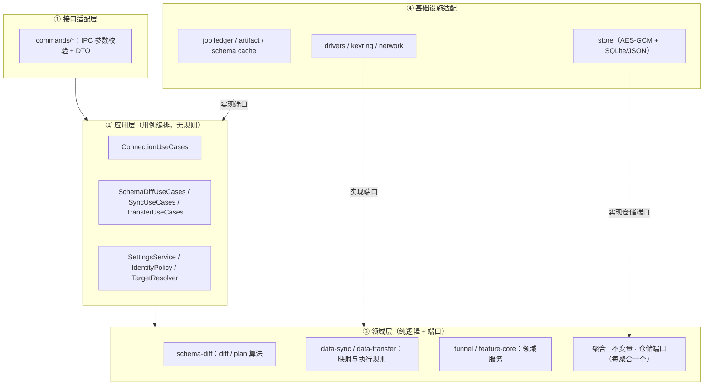

# DDD 分层收敛计划（PRD）

> 状态：**P0 已落地**（2026-10-23，见 §5.1）；P1–P5 待推进。
> 范围：分层归属、依赖方向、依赖环、编排位置、装配根。
> 关系：[分阶段开发计划](platform-development-plan.md) 仍是「形态演进与端口归属」的唯一权威，本文件只负责「层与依赖」这一轴；两者交叉处在各自正文互引。
> 基线：`main` = `2a5bef0af`（2026-10-22），#105 第六期计划已入库；§4 的数字是在该提交上测的。
> P0 落地基于 `main` = `bbe743e30`（2026-10-23）。§4 的 `Cargo 环` 与 `application → 领域包` 两行已被 P0 改写，见 §5.1 与 §7。

## 1. 问题陈述

### 1.1 一句话

端口与适配器的骨架是真的（platform-api + 注入 + 桌面/无头两形态已验证），但**内层是空的**：应用层被抽空成契约包，领域层被基础设施反向绑住，真正的编排住在接口层。

### 1.2 实测证据

依赖边（`Cargo.toml` 生产依赖，已排除 dev-dependencies）——**P0 前基线**，P0 后 `runtime` 一行已无 `application`（§5.1）：

| 包 | 生产依赖（内部） |
|---|---|
| `driver-api` / `ai-api` / `platform-infra` | 无 |
| `platform-api` | `driver-api` |
| `application` | `driver-api`、`platform-api` |
| `runtime` | **`application`**、`driver-api`、`platform-api` |
| `schema-diff` | `driver-api`、`platform-api`、**`runtime`** |
| `data-sync` / `data-transfer` | `driver-api`、`migration-common`、`platform-api`、**`runtime`**（具体驱动仅 dev-dep） |
| `feature-core` | `ai-api`、**`application`**、`driver-api`、`platform-api`、`platform-infra`、**`runtime`**、`schema-diff` |
| `src-tauri`（宿主） | 以上全部 |

**环**（实测，非推断）：把 `datazen-schema-diff` 加进 `packages/application/Cargo.toml` 的 `[dependencies]` 后：

```text
$ cargo metadata --offline --format-version 1
error: cyclic package dependency: package `datazen-application v0.0.1` depends on itself. Cycle:
  package `datazen-application v0.0.1`
   ... which satisfies path dependency `datazen-application` of package `datazen-runtime v0.0.1`
EXIT=101
```

⇒ `application → schema-diff → runtime → application`。**应用层物理上无法依赖领域层**，这是「应用层只能当契约包」的机械原因。

### 1.3 规模与位置错位

行数为 `wc -l` 全量（含内联测试；「生产」列指不含 `#[cfg(test)]` 模块的文件，两种口径都给出以免误导）：

| 层（DDD 角色） | 包 | 行数 | 真实角色 |
|---|---|---|---|
| 接口/适配 | `src-tauri/src/commands` | 53,350（宿主 104,677） | **实际编排层**，276 个 IPC，118 处直读 `state.store.` |
| 应用 | `packages/application` | 5,618（生产口径 1,595） | 契约包：真用例仅 `SettingsService`(59)、`IdentityPolicy`(373)、`TargetResolver`(598)；`sessions.rs` 只有 trait |
| 领域 | `schema-diff` / `data-sync` / `data-transfer` / `feature-core` / `tunnel` | 18,747 / 17,409 / 26,518 / 31,335 / 2,784 | 逻辑真实，但**生产依赖 runtime**（共 76 处引用：34+32+6+4） |
| 基础设施 | `runtime` / `src-tauri/src/store` | 68,458 / 17,804 | `runtime` 同时是 infra、应用服务实现（唯一 `RuntimeConnectionUseCases` impl）与部分业务规则（`sql_guard`） |
| 端口/契约 | `platform-api` / `driver-api` | 13,737 / 28,280 | 唯一干净的一层 |

关键比例：**编排在接口层 53k 行，应用层 1.6k 生产行（约 3%）**；领域包合计约 9.4 万行，**没有一行被应用层编排**——全部被宿主直接调用。

### 1.4 为什么现在做

1. 形态复用（Web / MCP）的产品目标要求用例层可复用；现状下复用单位是「宿主 commands」，不可搬。
2. #105 已把 `ApplicationServices` 放进 `AppState` 并修好装配目标状态，应用层有了落点；环不拆，第二期起的用例无处安放。
3. 领域包对 `runtime` 的引用是 76 处的小尾巴，越晚拆成本越高（`feature-core` 已达 31k 行）。

## 2. 目标与非目标

### 2.1 目标

- **G1 断环**：`application` 可依赖领域包，`cargo metadata` 全绿。
- **G2 领域纯化**：四个领域包对 `runtime` 的生产依赖降为 0，改用各自端口。
- **G3 编排归位**：`commands` 只做 IPC 参数校验 + DTO 映射；用例编排进 `application`。
- **G4 装配根收敛**：请求期不再直读装配对象；`AppState` 的字段只出现在装配与入口。
- **G5 仓储按聚合**：一个聚合一个仓储端口，存储实现按聚合拆分，而非按落盘文件。
- **G6 可度量**：每期有可执行验收命令；新增依赖方向门禁脚本。

### 2.2 非目标

- 不改 IPC 协议、不改前端、不改驱动机制、不改迁移算法语义。
- 不新增进程/服务边界（不拆微服务、不引入事件总线）。
- 不重写领域算法（schema-diff / data-sync / data-transfer 的逻辑原样保留，只移动依赖与归属）。
- 不以「层名好看」为目标：`runtime` 是否物理拆分（P1）允许裁定为「不拆」。

## 3. 目标架构与分层规则



规则（全部进 §7 门禁）：

| # | 规则 |
|---|---|
| R1 | 领域包不得依赖 `runtime`、`src-tauri`、任何驱动 crate（dev-dep 除外） |
| R2 | `application` 不得依赖 `runtime`；`runtime` 不得依赖 `application`（P0 后） |
| R3 | 端口只定义在内层：跨形态技术端口（identity / settings / job / artifact / clock / policy / network）归 `platform-api`；聚合仓储端口归领域包 |
| R4 | `commands` 不得直读装配对象：只经用例服务或请求上下文 |
| R5 | 一个聚合一个仓储端口；实现按聚合拆文件，不按落盘文件 |
| R6 | 接口层不含业务规则：出现分支规则即搬去领域服务 |
| R7 | 单文件 ≤ 800 行（**纪律，不转 CI 门禁**——2026-10-23 按 AGENTS.md 订正） |
| R8 | 新增端口必须有实现或用例引用，否则不入库（治「半截端口」） |
| R9 | 依赖方向门禁脚本纳入 CI，与现有 boundary 门禁同级 |

## 4. 现状基线（可复现）

| 度量 | 基线 | 复现命令 |
|---|---|---|
| Cargo 环 | 1（试加即 101） | 附录 A.1 |
| `application → 领域包` | 0（被环阻塞） | `grep -c datazen-schema-diff packages/application/Cargo.toml` |
| 领域包 `runtime` 生产引用 | 76 处 | 附录 A.2 |
| `commands` 直读 `state.store.` | 118 处 | 附录 A.3 |
| `commands` 直读 `.app_db()` | 22 处 | 同上 |
| `AppState` 字段 | 25 个 `pub` | 附录 A.4 |
| `AppState` 全仓直读 | 397 处（store 145） | 同上 |
| 无外部实现的端口 | 12 / 24（其中 `Clock` 端口文件内自带实现、`ProfileReader` 仅测试桩 ⇒ 真缺口约 10） | 附录 A.5 |
| 端口散落 | `platform-api` 24 个 + 领域包 5 个 | 附录 A.5 |
| 超 800 行文件 | 6 个（最大 `data-sync/execute.rs` 1,858） | 附录 A.6 |
| 全量 vitest | 614 文件 / 6,420 用例全绿 | `npx vitest run` |

## 5. 分期交付

每期一个可独立回滚的 PR 系列；每期只做本期的移动，不夹带行为变更。

### P0 断环（唯一硬阻塞，先做）——**已落地 2026-10-23**

实际搬了什么（比原计划多两处，理由逐条给出）：

| 搬走的东西 | 落在哪 | 为什么必须搬 |
| --- | --- | --- |
| `ApiError` | `platform-api/src/error.rs` | 用例端口方法签名返回它，实现方是 `runtime` |
| `ApiErrorCode` / `RetryDisposition` | 同上（此前已在 platform-api） | 同一份 cross-boundary wire 词汇 |
| 用例端口 **trait** `ConnectionUseCases` | `platform-api/src/use_cases/connection.rs` | 原计划写的是 `RuntimeConnectionUseCases`——那是 `runtime` 侧的**唯一实现**，留在原地；被两端共享的是 trait |
| 请求 DTO `dto/requests.rs` | `platform-api/src/dto/requests.rs` | 它们出现在端口签名上 |
| `check_owner` 纯函数 | `platform-api/src/policy.rs` | `runtime` 的请求转换（`packages/runtime/src/application/convert.rs`）要调它；`IdentityPolicy::check_owner` 改成一行委托，宿主既有 5 处调用点逐字不变 |
| `runtime/Cargo.toml` 的 `datazen-application` | 删除 | 含两个集成测试（`tests/p3_live_port.rs`、`tests/p4_usecase_journeys.rs`）的 import 一并改到 platform-api |

`application` 侧全部留下**再导出壳 + 同类型证明测试**（`error.rs` 的 `the_api_error_is_the_platform_api_type_not_a_local_copy`、`sessions.rs` 的 `the_use_case_trait_is_the_platform_api_type_not_a_local_copy`）：宿主 179 处与 runtime 的引用路径逐字不变，而双向赋值只有在两侧同类型时才编译得过——若哪天有人在 application 里重新定义一份，那两个测试第一时间红。

**口径修正（原计划第 2 条）**：原文要求「`application` 增加对领域包的依赖以证明环已解」。落地时改成**门禁断言**：装饰性的生产依赖会把领域包（进而 `runtime`）拉进 `application` 的依赖闭包，让 `cargo build -p datazen-application` 编出整个运行时却一行不用——用构建成本换一句"证明"。而同一条边是否**加得进去**可以不建边就验证：`scripts/check-ddd-layers.mjs`（`pnpm test:ddd-layers`，已进 rust job）从 `cargo metadata` 派生三条断言：

1. workspace 生产依赖图**无环**（并打印完整环路径，而不是只报 "cyclic package dependency"）；
2. **R2**：`datazen-application` 与 `datazen-runtime` 互不直接依赖；
3. **P0 可行性**：5 个领域包（`schema-diff` / `data-sync` / `data-transfer` / `migration-common` / `tunnel`）的传递闭包里没有 `datazen-application` ⇒ 「`application → 领域包`」这条边今天加得进去；另加镜像断言：`application` 的闭包里没有 `datazen-feature-core` / `datazen`（F-12 允许 `feature-core → application`，方向只能单向）。
   门禁带三处自证（成员数下限、合成环必须报警、合成无环图不得误报），并已实测鉴别力：把 `datazen-application` 加回 `runtime/Cargo.toml` ⇒ 立刻红 4 条（R2 1 条 + 领域包可行性 3 条）。

- **验收（实测）**：`node scripts/check-ddd-layers.mjs` → `PASS: 30 个 workspace 生产 crate，无环…EXIT=0`；`cargo test -p datazen-platform-api --lib` 285 passed；`cargo test -p datazen-application --lib` 95 passed；`cargo test -p datazen-runtime`（含 lib 与全部集成套件）0 failed；`cargo test -p datazen --lib` 见 §7；`cargo check --workspace --all-targets` EXIT=0。
- **回滚**：单 PR revert，无行为变更。
- **风险**：已消化——`ApiError` 是全仓最被复用的应用层身份（宿主 179 处），迁移是机械改动但面广；`cargo check --workspace --all-targets` 全量验证通过。

### P1 `runtime` 拆分（有裁定分支，见 D1）

- 方案 A（推荐）：拆成 `runtime-infra`（job ledger、artifact、schema cache、sql_guard）与 `runtime-session`（session actor、driver registry），两者都只依赖端口。
- 方案 B（不拆）：保持单包，但用 `mod` 边界 + 门禁限制跨层引用。
- **验收**：拆分后各 crate 依赖闭包满足 R1/R2；`cargo test` 全绿。
- **风险**：39k 生产行的移动面；建议先做 A 的目录切分、后改 crate，分两步。

### P2 领域纯化（工作量最大且最机械）

**口径订正（2026-10-23 实测）**：计划写的「4 个包共 76 处」是**含测试半边**的宽口径。
生产半边的口径是：`*.rs` 里 `#[cfg(test)]` 之前的部分，排除 `tests/` 目录与 `*_tests.rs`，
按**出现次数**记 `datazen_runtime::<module>`。实测 **50 处**：`feature-core` 32、
`data-transfer` 8、`schema-diff` 6、`data-sync` 4；按模块 `job` 21、`sql_guard` 12、
`schema_cache` 10、`application` 5、`artifact` 1、`connection` 1。
第一个 PR 之后剩 **48 处**；内核拆分 PR 之后剩 **8 处**，全部在 `feature-core`
（`application` 6、`artifact` 1、再 `application` 1 —— 其中一处是文档链接）。

- **已落地（2026-10-23，PR「feature-core 只认契约」）**：`feature-core` 的
  `[dependencies]` **摘掉 `datazen-application`**（12 处引用改指 `platform-api` 的
  `use_cases::ConnectionUseCases` / `dto::requests` / `error::{ApiError, ApiErrorCode}`）；
  `services/schema_context/source.rs` 不再命名 `runtime::application::RuntimeConnectionUseCases`
  与 `runtime::connection::DbSessionId`，改为**消费者定义的端口**
  `services::ports::SessionConnectionLookup`（trait 在共享层、实现在宿主
  `src-tauri/src/services/schema_context_source.rs` 的 `RuntimeSessionLookup` 薄壳）；
  `ARTIFACT_BYTE_QUOTA` 从 `runtime::artifact` 移到 `platform_api::ports::artifact`
  （契约值），runtime 再导出。门禁：`scripts/check-ddd-layers.mjs` 增一条
  「`feature-core` 不得直接依赖 `datazen-application`」。
- **已落地（2026-10-23，PR「runtime 机制内核拆分」）**：新建 `packages/kernel`（`datazen-kernel`），
  把 `job` / `budget` / `sql_guard` / `schema_cache` / `driver_registry` 整体迁入，`runtime`
  用 `pub use datazen_kernel::{…}` 再导出**保持 `datazen_runtime::job::…` 等既有路径不变**；
  `fnv1a64_hex` 一并归位到 `kernel::hash`（Job 内核与连接运行时共用的稳定指纹），
  `runtime::connection::types` 再导出。领域包改指 `datazen_kernel::…` 并**摘掉 `datazen-runtime`**：
  `schema-diff` / `data-sync` / `data-transfer` 三个包的 `[dependencies]` 与源码里与 `runtime` 的边
  **双双归零**（生产半边 `datazen_runtime::` 残留：这三个包 0 处，`feature-core` 8 处）。
  形态中立闸门 `runtime/src/tunnel/form_neutrality.rs` 扩成**同时扫两个 crate**
  （`runtime:src/…` / `kernel:src/…`），否则拆分会让那一片悄悄移出覆盖而闸门照旧报绿。
  门禁同步：`scripts/lib/cargoWorkspace.mjs` 的 `LAYERS` 增 `kernel`，
  `check-platform-crate-boundaries.mjs` 的 F-02 / F-03 / F-05 主体与 F-12 允许层增 `kernel`，
  本文 §2.4 与 §2.1 / §2.3 同步。
- **已落地（2026-10-23，PR「制品与备份用例端口化」）**：P2 生产半边**代码**引用归零。
  - 结果块 DTO 归契约层：`RuntimeArtifactChunk` 的定义移到
    `datazen_platform_api::dto::execution::ResultChunk`。它与字节型的
    `dto::artifact::ArtifactChunk` 是**两个概念**（一个按字节寻址、一个按
    `published_chunk_count` 分页），不合并。runtime 保留 `RuntimeArtifactChunk` 别名，
    宿主既有引用逐字不变。
  - 两条能力改成**消费者定义端口**（`packages/feature-core/src/services/ports.rs`）：
    `ArtifactChunkReader::read_chunk` 与 `BackupOutputBinder::bind`（返回
    `Box<dyn BackupOutputGuard>`，drop 即撤销，实现方负责等完 in-flight 写并拒收迟到
    输出）。宿主实现是薄壳：`src-tauri/src/platform/feature_ports.rs` 的
    `HostArtifactChunks` / `HostBackupBindings`，逻辑一行不落薄壳。
  - 连带把「Workflow 派发需要什么」从具体类型改成端口集合：`PreparedExecution`
    现在持 `use_cases: Arc<dyn ConnectionUseCases>` + `artifacts: Arc<dyn ArtifactChunkReader>`；
    `commit_changes` / `execute_plan` / `backup_to_path` 同步收口。
  - `feature-core` 的 `datazen-runtime` 从 `[dependencies]` 移到 `[dev-dependencies]`：
    **只有测试**可以点名门面（`schema_context` 的行为用例需要真实
    `RuntimeConnectionUseCases`，fakes 覆盖不了分页与可见性语义）。
  - 口径：生产半边仍有 3 处**文档链接**写着 `datazen_runtime::application::…`（解释
    「当初为何被钉住」），是说明不是依赖；验收按**代码引用**为零，不按 grep 行数。
- **验收**：附录 A.2 输出 0；4 个 `Cargo.toml` 的 `[dependencies]` 无 `datazen-runtime`（4 个全部达成）；
  `cargo test -p datazen-schema-diff -p datazen-data-sync -p datazen-data-transfer -p datazen-feature-core` 绿。
- **回滚**：按包分 PR，逐个可回滚。
- **风险**：端口定义反复 → 先冻结端口清单（R3/R8）再改。

### P3 编排归位（长尾，按 feature 切）

- 顺序建议：连接管理（契约最全、测试最多）→ schema-diff → sync → transfer → ai/workflow。
- 每个 feature：commands 里抽出用例服务到 `application`，宿主只保留 IPC 壳。
- **已落地的第一条命令族（2026-10-23，命名视图）**：`ApplicationServices` 增加
  `named_views: Arc<dyn NamedViewRepository>`，`commands/named_views.rs` 的三处
  `state.store.as_ref()` 全部改走聚合，**宿主 store 在该文件的生产半边出现 0 次**
  （新增断言 `the_command_shell_reads_the_aggregate_not_the_host_store` 钉住）。
  连带的两条结构性事实：
  - `application` 现在**依赖** `datazen-feature-core`。这不是回摆：P0 断环 + P2 收官之后
    `APP → feature-core → kernel/platform-api` 是正确方向，而「用例层不得依赖领域包」
    那条 manifest 禁令的理由（`APP → 领域包 → RT → APP` 的 Cargo 环）已经不存在。
    该禁令改写成新断言 `the_crate_may_depend_on_the_shared_feature_layer_but_not_on_the_runtime`
    —— 保留 `datazen-runtime` / `tauri` 两条真禁令，环的判定交给门禁按**当前**图求值。
  - `scripts/check-ddd-layers.mjs` 的镜像不变量不再硬编码「消费者一定依赖 application」，
    而是**按当前图求值**（消费者此刻确实依赖 application 时才判环），并补了双向自证
    （仍互依赖的合成图必须报警、单向图必须不报警）。
- **第二条命令族（2026-10-23，仪表盘）**：聚合增加
  `dashboard: Arc<dyn DashboardRepository>` 与 `dashboard_runs: Arc<dyn DashboardRunRepository>`
  （两个端口都由 `packages/feature-core/src/dashboard/` 定义，桌面实现都是 `AppDb` ⇒
  端口定义在领域包、实现在宿主，聚合只拿 trait 对象）。`commands/dashboard.rs` 的 14 处
  `state.store.app_db()` 中 **8 处归位聚合**（仓储 6 + 运行历史 2），残留 6 处**有名字**的
  形态专属用途（组件创建 3、导入导出 2、手工执行 1），由断言
  `the_command_shell_reads_the_aggregate_and_names_the_host_residue` 钉住。
  全仓生产半边计数 101 → 93。
- **第三条命令族（2026-10-23，连接目录）**：这一族与上两族的差别是**端口住在哪里**。
  连接配置的形状 `ConnectionConfig` 住在 `datazen-driver-api`（每个形态都已链接的那一份，
  且是 IPC 载荷与前端表单的唯一形状），所以端口没有进领域包，而是进
  `datazen_platform_api::ports::connection_catalog`——`platform-api` 本来就依赖 driver-api
  （`TunnelRepository` 同理），端口里出现 `ConnectionConfig` 不构成新依赖。
  `ApplicationServices` 增加 `connections: Arc<dyn ConnectionCatalog>`，桌面实现是
  `DesktopRepository`；`commands/connection.rs` 与 `commands/connection_import/ipc.rs`
  生产半边 `state.store` 归 0（断言 `the_command_shell_reads_the_aggregate_not_the_host_store`
  钉住 8 处取聚合、12 处端口调用），全仓生产半边 93 → 84。
  两条**当时没被写进表格的隐账**在本族被结清：`duplicate_connection_impl` 与
  `reorder_connections` 的 `state.store` 是跨行书写的，逐行 grep 数不到；真实处数是 11 + 2。
   另外把「端口调用 → 命令错误」的映射收口成 `commands/port_call.rs::port_cmd`
   （`tunnel.rs` 的同名助手改为转调它），避免每个命令族各抄一份 `PortError` 映射。
- **第四条命令族（2026-10-23，设置与分组）**：分组读写复用连接目录聚合的
  `ConnectionCatalog::groups/save_groups`；完整 `AppSettings` 读写复用设置仓储的 opaque
  document 方法，typed 的 `SharedSettings` 仍由同一仓储提供。这样主题、键位、执行策略等
  跨形态字段继续走 `SharedSettings`，而路径、onboarding 等桌面字段不被复制进中立 DTO。
  `commands/config.rs` 的生产半边 `state.store` **12 → 4**，`app_archive.rs` **3 → 2**，
  `window.rs` **2 → 0**；保留的六处仅为 §5.1.3 的 `data_dir()`，另有一处钥匙导出仍待
  宿主密钥门面。全仓生产半边 **84 → 73**。`shared_settings_commands_read_the_aggregate_not_the_host_store`
  同时钉住设置/分组不得直读 store 与四条设置读写路径必须经过聚合。
- **验收**：该 feature 的 `commands` 文件行数下降 ≥50%；`grep state.store.` 在该 feature 目录降为 0；IPC 签名与返回类型不变（用既有前端类型做回归）。
- **回滚**：按 feature 分批，每批独立 PR。
- **风险**：双轨期重复逻辑 → 冻结规则：新代码必须进用例层，旧代码只减不增。

### P4 装配根收敛

- `AppState` 24 字段（P0 后隧道仓储已移出；P4 前再随命令族搬迁收缩）→ 请求上下文（context）门面；`store` 145 处直读逐步改为仓储端口调用（与 P3 合并推进）。
- **验收**：请求期直读计数下降；`app_state_shape_tests.rs` 的字段不变式随迁移更新。
- **风险**：`AppState` 被 397 处引用，需按命令模块分批。

### P5 仓储规整 + 巨型文件按职责拆分

> **R7 的口径在 2026-10-23 改过一次，这里记下为什么改。** 原计划把「单文件 ≤ 800 行」做成
> CI 行数门禁；后来项目规则（`AGENTS.md`「单文件规模与模块拆分」）明确写了**不设行数门禁**：
> 超长文件是耦合度信号，属于评审判断，行数硬门禁只会逼出「拆成两个互相补位的大文件」这种
> 假拆分。因此 R7 保留为**纪律**，P5 的验收改成「按职责拆 + 拆完的模块有独立测试与文档」。

- `DesktopRepository` 按聚合拆（settings / tunnels / history / app_db 各自仓储实现）。
- 6 个超 800 行文件按职责拆分（最大 `packages/data-sync/src/execute.rs` 1,858 行）。
- **验收**：`src-tauri/src/store/*.rs` 每个文件只承载一个聚合；拆分后的模块各自有测试，
  且 `docs/architecture/` 里的职责表述与实际文件一致。**不新增行数门禁脚本**。

## 6. 不变量与禁区

- IPC 命令清单、参数、返回类型不变（前端 `src/commands/` 为对照）。
- 既有测试不许删；可迁移但断言强度不得降低。
- `scope-gate` 白名单不扩大。
- 门禁清单（全部保持绿）：`cargo test -p datazen --lib`、`cargo test -p datazen-ai-api --lib`、`npx vitest run`、`pnpm typecheck`、`node scripts/check-platform-crate-boundaries.mjs`、`check-module-layers.mjs`、`check-id-terminology.mjs`、prettier。
- 提交纪律沿用 AGENTS.md：验证方与提交方不同树、门禁首尾记录 HEAD 与工作区 sha。

## 7. 度量与验收

| 指标 | 基线 | P0 后 | P2 后 | 目标 | 采集 |
|---|---|---|---|---|---|
| Cargo 环 | 1（试加即 101） | **0**（`pnpm test:ddd-layers` 守；实测 30 crate 无环） | 0 | 0 | 附录 A.1 |
| `application → 领域包` 这条边的**可行性** | 不可行（环） | **可行**（门禁断言领域包闭包内无 application；不建装饰性边，理由见 P0） | 可行 | 真的用上（≥3） | `pnpm test:ddd-layers` |
| 领域包 `runtime` 引用 | 76 | 76 | 0 | 0 | 附录 A.2 |
| `commands` 直读 `state.store.` | 118 | 118 | 118 | 0 | 附录 A.3 |
| `commands` 行数 | 53,350 | — | — | 降 ≥50% | `wc -l` |
| 请求期 `AppState` 直读 | 397 | 397 | — | 0 | 附录 A.4 |
| 无实现端口 | 12 | 裁定 | — | 0 | 附录 A.5 |
| 超 800 行文件 | 6 | — | — | 0 | 附录 A.6 |

新增门禁建议（P0 随行）：`scripts/check-ddd-layers.mjs` —— 解析 `cargo metadata` 断言 R1/R2/R3 + 行数门禁 R7；与 `check-platform-crate-boundaries.mjs` 同级挂进 CI。

## 8. 风险与缓解

| 风险 | 缓解 |
|---|---|
| P2 面大（76 处）导致长期分支 | 按包拆 4 个 PR，主线不冻结 |
| P3 双轨期逻辑重复 | 冻结规则：新代码只进用例层；每 feature 完成即删旧路径 |
| 断环后 `application` 反向依赖 `runtime` | R2 门禁脚本直接阻断 |
| 端口定义反复推翻 | 先冻结端口清单（P2 前置），R8 |
| 大规模移动引入行为回归 | 每期不夹带行为变更；IPC 契约测试 + 6,420 用例兜底 |
| `runtime` 拆分失败（P1 方案 A） | 允许退到方案 B，不阻塞 P2/P3 |

## 9. 需裁定决策点

1. **D1 `runtime` 是否物理拆分**：拆（`runtime-infra` + `runtime-session`，代价中，收益是层身份清晰）vs 不拆（代价零，靠门禁约束）。建议拆。
2. **D2 端口归属规则**：R3 提案（跨形态→`platform-api`，聚合仓储→领域包）与现有 §2.8「端口 trait 统一归 platform-api」冲突——采纳哪条？若采纳现有规则，领域包需反向依赖 `platform-api` 的新仓储端口，P2 的改法随之变化。
3. **D3 12 个无实现端口处置**：删（契约噪音）/ 降级为文档 / 排期实现。建议：`Clock` 保留（已实现），`ProfileReader` 仅测试桩→删或标注，其余逐个裁定。
4. **D4 P3 首批 feature**：连接管理 vs schema-diff。建议连接管理（有 74 用例契约与详细设计背书）。
5. **D5 是否承诺第二形态**：承诺→P3 全量投入；不承诺→只做 P0/P2/P4（本地痛点），P3 降级为「新功能一律进用例层」的增量规则。
6. **D6 行数门禁**：R7 转 CI 硬门禁会让当前 6 个文件立即红——先修后加，还是加白名单渐进？

## 10. 开放问题

- ~~`KnownHostsRepository` 归属（`packages/tunnel` 自持 vs `platform-api`）——与 D2 同源。~~
  **已裁定并落地（S5，2026-10-23）：归 `platform-api`。** 理由是最初三条理由里唯一可验证的那条
  输了：留在机制包会让端口族不可清单化（`PORT_TRAITS` 只收 `src/ports/`），「词汇表跟着机制走」
  却站不住——`KnownHostEntry` 是三个字符串，不依赖 `russh` 类型。搬家只动契约，文件 I/O 仍在
  宿主；`load` 不失败与同步形状作为契约差异保留并写进模块头。
- `DesktopRepository` 拆分粒度：按聚合（settings/tunnels/history/app_db）是否引入跨仓储事务问题。
- `feature-core` 31k 行同时是 domain + 应用协作 + 宿主适配，是否需要按 feature 再拆包。
- 60+ 处 `AppState` 直读中哪些可立即降级（不依赖 P3 的先行项）。

## 附录 A 实测命令与原始结论

### A.1 环

```bash
git worktree add --detach /tmp/dz-cycle <base>
awk 'BEGIN{d=0} /^\[dependencies\]$/ && !d {print; print "datazen-schema-diff = { workspace = true }"; d=1; next} {print}' \
  packages/application/Cargo.toml > /tmp/t && mv /tmp/t packages/application/Cargo.toml
cargo metadata --offline --format-version 1 >/dev/null   # EXIT=101, "cyclic package dependency"
```

### A.2 领域包对 runtime 的生产引用

```bash
for p in schema-diff data-sync data-transfer tunnel feature-core; do
  printf '%s ' "$p"; grep -rh "datazen_runtime::" --include='*.rs' packages/$p/src | wc -l
done
# schema-diff 6 / data-sync 4 / data-transfer 34 / tunnel 0 / feature-core 32
```

### A.3 命令层直读

```bash
grep -rE 'state\.store\.' --include='*.rs' src-tauri/src/commands | wc -l      # 118
grep -rE '\.app_db\(\)'   --include='*.rs' src-tauri/src/commands | wc -l      # 22
grep -rE 'state\.driver_registry' --include='*.rs' src-tauri/src/commands | wc -l  # 14
```

### A.4 装配对象

```bash
# 字段数
awk '/^pub struct AppState/,/^}/' src-tauri/src/bootstrap/app_state.rs | grep -cE '^\s+pub [a-z_]+:'
# 全仓直读
grep -rE '\bstate\.(store|tunnels|driver_registry|platform|wapps|sync_adapters|desktop_job_host)\b' \
  --include='*.rs' src-tauri/src | wc -l
```

### A.5 端口

```bash
traits=$(grep -rhoE 'pub trait [A-Za-z0-9_]{3,}' packages/platform-api/src/ports | awk '{print $3}' | sort -u)
for t in $traits; do
  hit=$(grep -rlE "\b$t for [A-Za-z_]" src-tauri/src packages/*/src | grep -v '/ports/' | wc -l)
  [ "$hit" = 0 ] && echo "无实现: $t"
done
# 24 个 trait 中 12 个无外部 impl：ClusterNodeBudgetPort / ControlResourcePort /
# DriverPoolBudgetPort / EventSink / ExecutionSettingsReader / ExecutionTargetResolver /
# MasterKeyProvider / MigrationProfileReader / MonitorGrantReader / ProfileReader /
# SubmissionTokenIssuer / Clock（Clock 在端口文件内自带 SystemClock/FixedClock；
# ProfileReader 仅有测试桩 StubProfiles）
```

### A.6 超 800 行

```bash
find src-tauri/src packages/*/src -name '*.rs' -size +40k | while read f; do
  printf '%s %s\n' "$(wc -l < "$f")" "$f"
done
# 1,858 data-sync/execute.rs；1,444 data-sync/plan_store/mod.rs；1,419 data-transfer/plan_store/tests.rs；
# 1,228 src-tauri/src/commands/sync/exec.rs；1,180 src-tauri/src/commands/connection.rs；
# 1,176 src-tauri/src/commands/sync/apply.rs
```
