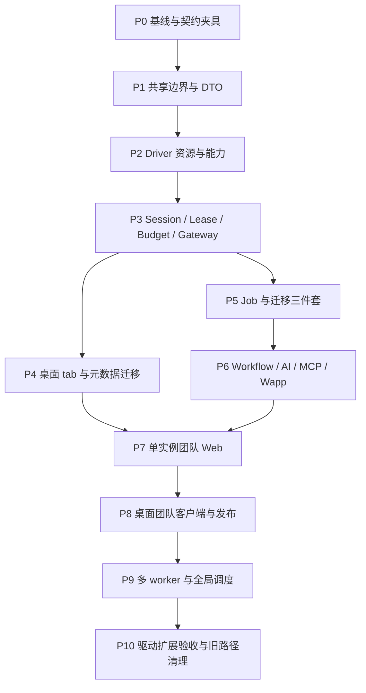

# 连接管理重构与桌面 / Web 多形态开发计划

> 状态：P4、P5 已完成（P4 于 2026-10-16、P5 于 2026-10-09），P6 可启动；P6 及后续阶段仍为计划。当前基线：`main`，`c84f21237`（共享层下沉 PR #68 的合并提交，2026-10-16；P6 从此提交起算）。本文按用户明确要求入库，不记录每日进度。
> 设计依据：[系统概要](../architecture/platform/system-overview.md)、[连接管理详细设计](../architecture/platform/connection-management.md)。

## 1. 交付目标与实施原则

最终交付桌面本地、浏览器团队、桌面团队三种方式，共享 Rust 业务内核和 React 产品。连接管理对用户、会话、物理资源和任务分别建模；新增已有能力的 driver 不要求修改宿主业务流程。

先验证资源语义，再迁移 consumer，再增加团队入口和多实例。初期采用模块化单体；远程 agent、独立 driver runner、跨 backend 迁移是独立后续版本，不阻塞首版。

代码变更按阶段拆为可验收的小 PR。每个 PR 包含实现、相关测试和已落地事实文档；不创建进度台账、Bug List 或新方案副本。本计划是阶段顺序与交付门槛，完成的阶段应改为实施事实或合并到开发流程，不无限保留历史方案。

不能把后端重构、Driver API 协议迁移、所有 UI 和 Web 服务一次性切换。旧路径只做有截止点的窄兼容；同一 consumer 同一请求只使用一种资源管理器。

## 2. 阶段依赖



P4 与 P5 代码边界独立后可以分别推进，但必须共享已稳定的 P3 契约；图表示依赖，不要求自动启用多个代理。没有用户明确授权时不派发其他聊天任务。

## 3. 每个阶段的统一完成定义

1. 所需 API、DTO、错误和生命周期都有实现，不能只交接口骨架。
2. 详细设计对应测试编号通过；Unsupported 能力有拒绝断言。
3. 生产路径不新增裸 unwrap/expect；测试文件通过 typecheck，无 any 绕过。
4. driver 方言实现及测试在 driver 目录；host 无数据库名称分支。
5. 新协议兼容声明真实，所有参与构建的 path/Git driver 已迁移或明确禁用对应新能力。**自 2026-10 起 P2 第一轮范围收窄为 `basic` 四个驱动**（postgres、mysql、sqlite、redis，即 CI 与默认构建实际编译的集合）；其余 path/Git 驱动移入 P10，由 P10 门槛统一断言。
6. Agent 不读取 `.env` / `.env.test` 内容进入上下文；测试程序读取合法且输出不得泄密，不提交凭据、生成文件或外部子仓库内容。
7. 当前架构文档同步描述已经实现的部分；未实现功能仍标记目标设计。
8. 评审看到清楚的启用条件、关闭/失败行为和回退边界。

## 4. P0：现状基线与契约测试夹具

**目的**：在移动代码前识别逻辑 session、pool handle、transaction handle 的真实语义，建立可比较的行为基线。

输入为当前 ConnectionManager、Driver API、Query/Table consumer、三件套和 Workflow。重点代码链接见详细设计第 2 节。

交付：

- 清点各 consumer 的连接创建、复用、关闭、取消和配置目标路径；结论放进代码测试与当前服务文档，不写调查台账。
- 建立 transport-neutral fake resource，支持 resourceId、owner、命令 journal、屏障、fake clock 和每阶段失败注入。
- 在 driver 目录建立真实固定会话/事务/目标/清理契约测试；确认不能保证的能力。
- 确定测试环境注入方式，检查启动器/失败输出不回显受保护 env 内容。
- 记录现有 DTO 与持久化格式兼容范围；旧 session ID 不作为迁移数据。
- 用 CM-73 复现并留存“空闲淘汰关闭物理连接、同 ID 重连、事务 map 未清理”的基线；测试作为 P3 强制回归门槛，其断言只依赖行为，不得随旧管理器删除。

负责边界：runtime 负责人定义 fake 契约，driver 维护者验证真实协议，前端负责人验证 tab 行为。

退出门槛：CM-01、04、07 的基线测试，以及 CM-73 对当前事务句柄生命周期的可复现证据；真实 driver CM-08～19 的能力验证能区分已支持和缺失。已知失败作为本轮后续阶段要修复的测试，不能删除断言。

回退：仅增加夹具和测试；不改变生产执行路径。

## 5. P1：抽取共享应用边界和前端传输契约

**目的**：业务可在没有 Tauri 的测试进程中调用。

交付：

- 创建并注册拟新增 application/runtime/platform-api/backend-client 包，明确依赖方向。
- 定义 RequestContext、ID newtype、CanonicalTarget、namespaceShape/操作级 targetRequirements、会话、执行、Job、Artifact DTO 和 ApiError。
- 分开 DurableExecutionRecord 与实时 runtimeBinding，定义能力快照、CancelReceipt 和签名幂等令牌 port；所有持久化路径排除运行时句柄。
- 定义 repositories、SecretProvider、NetworkProvider、ArtifactStore、EventSink ports。
- Tauri adapter 组装本地身份，调用应用服务；保留现有 IPC 外观的窄适配。
- BackendClient 和 PlatformServices 注入，迁移 SDK 中 invoke/Channel，存量调用用薄再导出过渡。
- 加入依赖护栏：core 不引用 Tauri/HTTP，driver 不引用 host，前端领域不直接绑定平台传输。
- 加入 CI 架构检查：对 server crate 的 normal/build 依赖闭包验证不含 Tauri crate 和 UI runtime，并验证 server 独立构建；依赖检查失败即阻断合并。

退出门槛：CM-01、03～07 的**类型与 schema 断言**、DTO 往返与内核无 Tauri 编译、CI 依赖图检查通过；旧桌面基本连接/查询流程保持可用。同一批用例的 H 层行为断言归 §7（P3）、CM-05～07 的 W1 断言归 §11（P7），阶段归属见 §17，本条不重复计。

回退：Tauri adapter 可仍调用原用例实现，但不得把新 owner 和权限语义伪映射为旧共享 session。新 frontend bridge 在未注入时明确报错。

## 6. P2：Driver 固定资源与可选能力契约

**目的**：把“执行在同一真实资源上”变成可测试保证。

交付：

- opaque resource、ResourceProvider、固定执行、状态观察、reset、close 和精确 cancel 契约。
- namespace/session/transaction/snapshot/data/backup 可选能力注册与运行时能力降低机制。
- 所有实际建连的预算 port，包括 driver pool、集群节点和控制资源。
- 现有 Command 和迁移接口保持领域语义；资源获得方式通过 adapter 演进。
- **第一轮只迁移 `basic` 四个驱动**（postgres、mysql、sqlite、redis —— CI 与默认构建实际编译的集合）：先迁移具有真实会话与事务的代表 driver，再迁移该集合内其余驱动；不支持能力明确拒绝。**其余 path/Git 驱动不在 P2 门槛内**，按 P10 补齐；未迁移的驱动必须在能力注册处显式声明未支持，不得静默回退到旧 Command 路径。
- 修改公共契约时核对 crate SemVer、PROTOCOL_VERSION 和 minimum compatible；同步 path/Git driver、factory、ReuseDriver、生成选型路径。判定规则与门禁见 [driver-capability-migration.md §5.3](../architecture/platform/driver-capability-migration.md)：任何 breaking 改动强制升 `PROTOCOL_VERSION`（`pnpm test:driver-protocol`，CI 硬门禁），升 `MIN` 是主动放弃老驱动兼容性的独立决定，不是 breaking 的处理方式。

退出门槛：D 层 CM-07～19、22～26、30、45、48；不同 driver 不共享实现库类型；新增能力缺失不会 no-op 成功。**本门槛只对第一轮四个基本驱动断言**；其余驱动的对应断言属于 P10，不得在 P2 记录为已通过。

回退：过渡 adapter 可以支持旧 driver 的独立受控 Command，但不能开放未证明的 statefulSession。

「协议升级与驱动发布是原子兼容门槛，不允许用下调最低版本掩盖 breaking change」这句回退约定分两半落地，现状（`scripts/check-driver-protocol-compat.mjs`，由 `pnpm test:driver-protocol` 接入 CI 硬门禁，28 个单测）：

- **已实现——"不允许下调最低版本"这半**。脚本把它写成两条不变量并直接阻断：`min-protocol-never-lowered`（`MIN_PROTOCOL_VERSION` 不得下降，报错文案即回指本节）与 `protocol-window-non-empty`（`MIN_PROTOCOL_VERSION <= PROTOCOL_VERSION`）；另外对 20 条受管契约（`CONTRACT_RULES`，规则表在 `scripts/lib/driver-protocol-rules.mjs`）内的增删改强制 `PROTOCOL_VERSION` 上移。最初受管的 10 条是 `database-driver` / `key-value-driver` / `driver-factory` / `resource-provider` / `budget-port` / `resource-error` / `driver-command-definition` / `capability-set` / `capability-registry` / `reuse-driver`，其后补入 `availability` / `namespace-switch` / `context-observation` / `transaction-observation` / `session-continuity` / `session-scoped-handles` / `reset-for-reuse` / `precise-cancel` / `snapshots` 与 `legacy-resource-adapter`。当前窗口是 `PROTOCOL_VERSION = 6`、`MIN_PROTOCOL_VERSION = 1`。
- **已实现——"原子"那半**。`scripts/check-driver-protocol-release.mjs`（`pnpm test:driver-protocol-release`，CI 硬门禁，紧随 strict guards 一步）只读 `drivers-registry.json` 与各 crate 的 `Cargo.toml`/`lib.rs`，不依赖 codegen，因此无需等驱动注入完成即可判定一次交付里协议号与驱动发布是否绑定在同一 commit。它与数字那半互不重叠：`check-driver-protocol-compat.mjs` 判定契约改动**是否需要**升协议号，本脚本判定**是否真的升了、升了之后该跟着发什么**。六条规则按 fail-closed 报出：`driver-release-state-unreadable`（基线 ref 与工作区之间的驱动发布态不可读，例如 registry 指向的 crate 在基线上不存在）、`protocol-moved-without-driver-release`、`protocol-moved-without-driver-api-release`、`driver-released-without-driver-api-release`、`released-driver-outside-delivered-protocol-window`（已发布驱动的 `protocol_version()` 落在本次交付声明的 `MIN..=PROTOCOL` 窗口之外）、`recompiled-driver-not-released`（驱动声明的协议号随本次交付上移却没有跟着发布）。path 驱动以 `[package] version` 前进计一次发布，Git 驱动以 `drivers-registry.json` 的 `ref` 移动计；未钉 `ref` 的 Git 驱动（当前 `kiwi` / `superset`）发布决策发生在 clone 时，脚本只报告、从不计数。
- **已实现——`LegacyResourceAdapter` 纳入受管契约**。`legacy-resource-adapter` 规则锚在 `impl LegacyResourceAdapter {`（`packages/driver-api/src/resource_adapter.rs:111`）而不是 `pub struct LegacyResourceAdapter`（`:76`）：宿主为每个未迁移驱动调用一次 `LegacyResourceAdapter::new(driver, driver_id, driver_version)`，被治理的是这条构造 ABI，而结构体本身只有六个私有字段，改它们在 crate 外不触发任何重编译。`scripts/__tests__/driver-protocol-legacy-adapter.test.ts` 同时断言被否决的那个锚点确实覆盖不到构造签名，并断言只有这一条规则覆盖它，以免日后悄悄变成"两个锚点都行"。

## 7. P3：统一 Session / Lease / Budget / ExecutionGateway

**状态：已完成**（2026-10-13）。单进程 runtime 实现及 CM-02～07、20～32、37～39、54～56、60 单机部分、61～74 的 H 层断言已在 `datazen-runtime` 验收。CM-60 按逐请求总开销 p95 ≤10 ms、失败数为 0、事件无重复/丢失判定，并记录实测环境；不要求固定 CPU / 内存参考规格。桌面旧 consumer 仍由 P4/P5/P6 迁移，ConnectionManager 仅在所有 consumer 迁完后删除，不属于 P3 关闭条件。

**目的**：建立桌面与 server 都能用的资源运行时。

交付：

- SessionRegistry actor、状态机、owner/runtimeEpoch/contextRevision、独立 attachment 与内部 resourceBindingId。
- ResourceManager lease、pool、cleanup/quarantine、隧道引用。
- 多维单机预算、control/interactive/metadata/job 保留与公平队列、逻辑 session/已连接编辑器额度、真实物理资源计数。
- attachment 令牌与 TTL 最早期限裁决；无消费者有界产物、discard/drain、取消与协议恢复；PoolKey 版本生产者与缓存失效。
- 单进程 SessionDirectory、候选替换提交屏障、过期令牌拒绝与 Clean 双重检查。
- ExecutionGateway：授权、目标校验、schema、幂等 receipt、状态、来源、事件。
- 独立取消路径，取消和关闭先等待执行/协议结束；所有失败阶段 cleanup。
- 显式 session 失效和新 session 恢复；禁止原 ID 透明重连。
- 指标：物理资源数、lease state、预算等待、执行队列、取消耗时、cleanup 失败、Unknown outcome。

退出门槛（已满足）：H 层 CM-02～07、20～32、37～39、54～56、60 单机部分及 CM-61～74 的 H 断言；CM-73、CM-74 转绿，证明会话级句柄（事务/游标）在物理资源释放前已注销，事务状态、物理资源和 session ID 同步失效。race 测试使用 barrier/fake clock，不靠任意 sleep 猜顺序。CM-60 不绑定固定 CPU/内存规格。

回退：新 runtime 仅给已迁移 consumer 使用；不同时维护一条资源的旧 refs 和新 lease。服务暂停/重启前关闭新 session，不能将活事务移回旧 manager。

P3 前置阶段同步修订的 DTO/port 契约现已由 runtime 实现：`ArtifactStore` 由 `packages/runtime/src/artifact/` 的 `FileArtifactStore` 实现并接入桌面结果发布；写入期已发布块可读且不可覆盖，取消/失败可显式截断并保留恢复元数据。取消请求与执行终态分离，由 `ExecutionState::resolve_cancel` / `CancelOutcome` 表达并覆盖 CM-22 竞态。CM-60 基准按每个请求的两段附加耗时先求和，再以 nearest-rank 计算 p95；失败样本不从分母剔除。上述行为分别由 runtime artifact journey、CM-22 取消测试与 `cm60-bench` 实现和验证，详见共享边界 §4.6、夹具 §6.3/§11。

P3 收尾不删除旧的 `ConnectionManager`：Tauri 仍有活跃生产调用方。待这些 consumer 迁移完成后再删除，并保留 CM-73/74 的行为测试，避免把仍在使用的连接生命周期路径误删。

## 8. P4（已完成）：桌面 QueryPanel、TablePanel、元数据迁移

**状态：已完成**（2026-10-16，`main` @ `918d82902`）。关闭结论见本节末尾，F 断言的逐项证据见 §8.1；两条首版发布限制（空闲池在真实驱动上恒为空、首版不提供查询结果原地写回）也记在那里。桌面旧 consumer 仍由 P5/P6 迁移，`ConnectionManager` 仅在所有 consumer 迁完后删除，**不属于 P4 关闭条件**。

**目的**：先在现有产品中完成连接正确性，不等待 Web。

已实现的桌面接线：`QueryPanelSessionRegistry` 按 pane 管理独立 session；编辑器执行与上下文切换经过统一 runtime；TablePanel 的对象读取、ChangeSet 和显式事务分别使用目标操作与表面板 session；元数据缓存绑定身份、配置版本和目标。`ExecutionProjection` 按不可变块身份恢复结果，流重置先清除订阅游标，再读取权威状态和已发布块。页面销毁使用 `rollbackAndClose` 释放所属 session，避免活跃、失败或未知事务令无主 session 的关闭永久被拒；实际回滚与释放结果仍由 runtime 判定。

QueryPanel Explain 已通过同一 pane 的 `EditorSessionController` 提交 `explain` Command，结果通过统一 execution/artifact 读取；旧 `get_explain` IPC 与前端入口已删除。PostgreSQL、MySQL 显式声明该 Command，并在原 retained handle 上生成计划；PG/MySQL 不再为 Explain 从池另借连接。未声明该 Command 的驱动明确拒绝，不回落到旧池路径。SQLite 的底层 driver 仍有池级 `explain()`，但未声明 session-bound Explain 且 QueryPanel 固定 session 被 CM-19 拒绝，因此新 runtime 不会调用该池级入口。未来可通过 ResourceManager 借用一次性 SQLite 执行资源，在借用期间执行 `EXPLAIN QUERY PLAN`、发布 artifact/provenance 并确认释放；不得借此宣称 SQLite 支持跨命令固定 session。Explain 仅规划一条语句，不运行 ANALYZE，也不通过计划执行其中的 DML。

本轮聚焦验证：Host 相关前端 34 个文件/430 个用例、runtime P4 use-case 11 个旅程、Explain 相关 Rust 6 个用例通过。Community 实际应用的通用 SQL 27 个用例及 PG/MySQL retained-resource 旅程各 1 个通过；另有 PostgreSQL 实际 WebDriver UI 旅程在同一编辑器内切换两个可连接数据库 6 次，并在每次切换后执行 `current_database()`，证明会话替换释放没有耗尽默认五个编辑器额度。Pro 实际应用 SQL 27 个、statement 6 个、参数面板 9 个用例分别通过，SQL Editor Pro 包内单元测试 71 个文件/894 个用例通过。参数面板验收按 PostgreSQL 声明的方言策略检查：不将未声明的 `?` / `@name` 当作绑定参数。

补充确定性验收：`p4_usecase_journeys` 通过公开 application API 记录候选失败、旧资源继续执行、候选成功建立、旧资源关闭的物理 journal，并交错双编辑器读取 100 轮（200 次），逐次验证数据库和固定 resource；替换后产物/来源保留、旧 runtimeBinding 失效。另以真实 runtime artifact store 验证漏读已发布块→取消→补块/重读去重→原资源显式新读，只提交原命令一次。CM-72 的 unsupported/requested/alreadyFinished 回执与执行效果分离，registry 非敏感能力版本审计通过；前端拒绝旧 `accepted` 回执、无效大小写、无效状态和异 executionId。结果视图在 binding 失效或换 execution 时关闭已打开输入，并在提交入口再检查可写性。补充前端聚焦 17 文件/218 用例、registry audit 11 用例、SQLite 当前 resource 契约 36 用例与最终 typecheck 通过；这些不能替代相同旅程的真实 UI/驱动层验收。

**关闭依据**（2026-10-16：F 断言已有逐项映射，见 §8.1；下列是本轮补齐的真实旅程与边界结论）：

- §12.1 的「实际 UI 丢块/断线→取消→恢复→再次执行」已有真实故障注入验收：`e2e/specs/journeys/query-fault-recovery-journey.ts`（PostgreSQL，用独立的第二会话执行 `pg_terminate_backend` 杀掉编辑器正在使用的后端）。同一条连续旅程断言：多批部分结果先落地 → 精确取消（取消成功不显示失败，`errorBeforeKill=false`）→ 断线后失败**必须可见**（错误面板非空 **且** 显式「打开新会话」横幅同时出现，静默结束或两者只出现一个都判红）→ 用户显式开新会话（禁止原 ID 透明重连）→ 同一编辑器再次执行成功，且新后端 `backend_start` 严格晚于被杀后端（证明是替代而不是复用）。实测两次均 `1 passing`、EXIT=0。
- SQLite Explain 的拒绝边界由驱动 crate 内 `explain_is_pooled_only_and_not_a_declared_session_command` 钉住（`packages/drivers/sqlite/src/lib.rs`）：池级 `supports_explain()` 仍为真，session-bound `explain` Command 未声明，`execute_command` 对它明确返回 `Unsupported`。
- CM-67 的收口结论见 §17.1 与连接管理 CM-67：H 层已落地并有实测，空闲池在首版真实驱动上恒为空是**能力事实**（全部 path 驱动 `ResetForReuse::Unsupported`）而不是实现缺失，那两条不作为 D 层断言。
- F 断言不再只有汇总：§8.1 逐条给出证据，本轮补齐 5 个真实 UI 旅程（编辑器会话隔离、结果视图消失不取消、查询故障恢复、查询结果写回边界、表格并发与池计数）与 1 个真实驱动旅程（池键与轮换），全部实测通过。同时确认 CM-35/36/61 的**正向**写法在首版不可达：`WritableMapping::Verified` 要求 `context_before.confidence == Confirmed`，而确认要求驱动声明 `ContextObservation::Full`——**当前没有任何内置驱动声明**（postgres / mysql / sqlite / redis 均 `Partial`，其余 `Unsupported`）。真实 UI 层因此只能断言可达的那一半（只读、替换后仍可阅读），"可写结果在替换后失效"留在组件层。
- P4 自己引入的旧取消路径已清理：`panelExecCleanup` 不再向旧 `cancel_query` IPC 发取消，改走该 pane 自己的 `EditorSessionController`；`cancel_query` IPC 本体仍留给旧 `execute_query*` 消费者。
- CM-33 的 F 半补上了：新增只读观测口 `runtime_observability_snapshot`（runtime 侧 `resource/observability.rs`，经 `SessionBackend::observability_snapshot` 投影自有台账），真实 UI 旅程 `e2e/specs/journeys/table-pool-contention-journey.ts` 用它断言"4 个表 tab 逐个刷新期间物理资源不越预算、不随 tab 数增长，编辑器随后仍可执行且观察上下文不变"。在做它之前，那个数字在外部无法归因——同库上旧 `ConnectionManager` 会话与 runtime 会话在 `pg_stat_activity` 里分不开。

**关闭结论（2026-10-16）**：

1. §8.1 的 F 断言映射完成，每一类都有明确落点：`F 已覆盖` / `组件级（已定级）` / `桌面不适用（移交 P7）` / `用例无 F` / `首版发布限制`。
2. 三条残余都已定级（见 §8.1「残余处置」）：CM-16 组件级、CM-63 桌面不适用移交 W1、CM-35/36/61 正向 = 首版不提供查询结果原地写回的产品决定。
3. 受控 WDIO 子集已实跑并逐条归因：`--suite smoke` 26 passed / 2 failed（28 文件）、`--suite db` 20 passed / 7 failed（27 文件）、`--suite connection-pool` 1 passed。本轮新增/修改的旅程全绿；子集内的失败**不属本轮改动**——3 个文件在基线 `f06ad7e5b` 上同样失败（`data-types`、`data-transfer-window`、`host-contract-matrix`），4 个仅套件内失败且隔离跑通过，`export-import` 重复 3 次为 2 通过 / 1 失败（测试自身"文件已建但未 flush"的竞态）。CI 不跑 E2E，这些证据只来自本地实跑。

**关闭时记录的两条首版发布限制**（详见连接管理 CM-67 与 CM-36）：空闲池在真实驱动上恒为空（全部 path 驱动 `ResetForReuse::Unsupported`，不进池、直接关闭）；首版不提供查询结果的原地写回（无驱动声明 `ContextObservation::Full`，`WritableMapping::Verified` 因此不产生）。

**不属 P4（后续阶段或独立清理项）**：旧管理器（`ConnectionManager`）的删除按消费者迁移决定，属 P6/P10；Workflow 非 SQL 步骤、Monitor、AI、MCP、迁移三件套、backup/export、旧 `execute_driver_command` 网关仍在其上；`main` 基线自身的三个失败 E2E 文件与 `export-import` 的测试竞态是独立清理项，不阻塞 P4。已存在的单元测试或新 runtime 接线不代表全部验收通过——§8.1 的"F 已覆盖"只表示证据存在且实跑通过，适用层与限制逐条列在该节。

#### 8.1 P4 F 断言逐项证据映射（2026-10 实测）

把 §8 退出门槛列出的 F 断言逐条落到具体证据。`F 已覆盖` = 真实 UI 层有可执行断言；`组件级` = 组件/单测覆盖但未做真实旅程；`用例无 F` = 连接管理 §16 该条本身不含 F 层断言。五个 Host 旅程与一个驱动旅程（全部实测 `1 passing` / `EXIT=0`，跑测于 2026-10）的运行方式：

```bash
pnpm e2e:skip-build -- --spec e2e/specs/journeys/editor-session-isolation-journey.ts      # CM-08/09/11/12/17
pnpm e2e:skip-build -- --spec e2e/specs/journeys/result-view-loss-journey.ts             # CM-64 无消费者
pnpm e2e:skip-build -- --spec e2e/specs/journeys/query-fault-recovery-journey.ts         # CM-56/64 断线→替代→再执行
pnpm e2e:skip-build -- --spec e2e/specs/journeys/temporary-result-writeback-journey.ts   # CM-35/36/61 写回能力边界
pnpm e2e:skip-build -- --spec e2e/specs/journeys/table-pool-contention-journey.ts        # CM-33 表格并发与池计数
pnpm e2e:skip-build -- --spec packages/drivers/postgres/e2e/connection-pool-rotation.ts  # CM-38/67 D 层（或 --suite connection-pool）
```

| 用例 | F 断言落点 | 证据 | 结论 |
| --- | --- | --- | --- |
| CM-08 两个编辑器隔离 | UI 上下文独立、交错读取各自固定 | **新增** `editor-session-isolation-journey`（同一连接两个 tab 各切一库，交错读 5 轮，两个 selector 各保持自己的库）；H：`p4_usecase_journeys::cm08_cm15_cm16_replacement_journal_and_100_interleaved_reads` | F 已覆盖 |
| CM-09 跨调用临时状态 | 原会话可读、另一会话不可访问 | **新增** 同一旅程（同库 temp 表在自身 tab 读到 42，兄弟 tab 明确报缺失关系且之后仍可用）；D：`packages/drivers/postgres/e2e/retained-resource-journey.ts` | F 已覆盖 |
| CM-11 USE 失败 / CM-12 成功后失败 | 失败不移动已观察上下文 | **新增** 同一旅程（限定名读取与失败语句后，selector 与 `current_database()` 仍是原库）；E2E `sql-query.ts SQ-CTX-001`。产品已无 `USE` 切换路径，等价断言即 CM-13 形态 | F 已覆盖（等价形态） |
| CM-13 限定名与补全不切库 | 补全可变、observedContext 不变 | E2E `sql-query.ts` `SQ-CTX-001`（限定名查询后编辑器上下文不变） | F 已覆盖 |
| CM-15 PG 切 database 替换 | 先成功后替换、旧 ID 不能执行 | E2E `sql-query.ts` `SQ-LIFECYCLE-001`（6 次替换 + 每次 `current_database()`，证明旧资源释放）；单测 `sessionReplacement.test.ts` | F 已覆盖 |
| CM-16 替换失败保留旧连接 | UI 不显示 B、旧会话仍有效 | 单测 `sessionReplacement.test.ts::leaves the previous handle bound …`；组件 `queryPanelSessionSwitch.test.tsx::prompts a revision conflict and keeps the previous database`；H：`p4_usecase_journeys::replacement_rollback_revision_commit_and_replay` | **组件级（已定级）**：不做真实 UI 候选失败注入，理由见下 |
| CM-17 手写事务旅程 | UI 同步事务、另一会话不可见 | **新增** 同一旅程（SQL `BEGIN`→`INSERT`→本 tab 读到 1→独立会话读到 0→`ROLLBACK`→两侧 0）；E2E `client-parity.ts`（旧 IPC 三件套）；单测 `TableView.test.tsx` | F 已覆盖 |
| CM-18 aborted/unknown | 不显示为 none、切库被阻止 | 组件 `query.modules.test.tsx`（unclosed/aborted 对话框）、`sqlTransactionGuard.test.ts`；单测 `pageUnload.test.ts`（页面死亡按事务态回滚）；E2E `table-session-loss-recovery.ts`（`resourceLost`+`unknown` 回执→显式新会话） | F 已覆盖 |
| CM-21 切库与执行竞态 | 冲突不吞、提示明确 | 组件 `queryPanelSessionSwitch.test.tsx`（revision 冲突保留旧库）、`sessionPrompts.test.ts`；H：`p4_usecase_journeys` | F 已覆盖 |
| CM-33 多表 tab 共用短操作池 | 编辑器资源/上下文不受表格刷新影响 | **新增** `table-pool-contention-journey.ts`（真实 UI：4 个表 tab 逐个打开并刷新，每次采样都断言物理资源 ≤ 预算且 ≤ 基线 + 2，编辑器随后仍可执行且观察上下文不变）；计数来自 **新增只读口** `runtime_observability_snapshot`（`packages/runtime/src/resource/observability.rs` + `SessionBackend::observability_snapshot`），因为同库上旧 `ConnectionManager` 会话与 runtime 会话无法用 `pg_stat_activity` 区分；H：`pool_capacity_budget.rs`（池容量与预算台账一致） | F 已覆盖 |
| CM-34 表编辑事务范围 | 暂存/预览/回滚/提交、失败两条同回滚 | E2E `table-edit.ts`（`DE-006~DE-008` 暂存/预览/回滚/提交）；组件 `TableView.test.tsx`（显式事务开关） | F 已覆盖 |
| CM-35 旧结果正确归属 | 可写映射提交原目标、任意 SQL 只读 | 组件 `ResultTableView.test.tsx`（verified 结果在 binding 刷新前只读）；单测 `executionRecoveryJourney.test.ts`（切库使绑定失效并再次执行）、`metadata.test.ts::isProvenanceCurrent`；E2E `query-artifact-export.ts`；**新增** `temporary-result-writeback-journey.ts`（`SELECT * FROM <单关系>` 的真实结果在替换前后都不可编辑） | F 已覆盖（只读方向；正向在首版不可达，见下） |
| CM-36 临时对象结果失效 | 关闭 S 后编辑旧结果即 `SessionLost`、结果仍可读 | 组件 `ResultTableView.test.tsx`（标注 CM-36/61：原绑定失效时关闭已打开编辑器且绝不提交过期编辑）；**新增** `temporary-result-writeback-journey.ts`（真实 UI：会话替换后结果仍可阅读、仍不可编辑、无错误面板） | 组件级（正向）+ 真实 UI（可读方向）；正向在首版不可达，见下 |
| CM-37 缓存竞态与权限隔离 | —（用例标 H） | 前端最接近证据：`metadataCache.test.ts`（乱序读被拒、失效、epoch）、`metadata.test.ts`（按 connection/config/target/dbSession 隔离） | 用例无 F；H 见左 |
| CM-38 配置修改与凭据轮换 | —（用例标 H/W） | **新增 D**：`packages/drivers/postgres/e2e/connection-pool-rotation.ts`（真实 PG：CAS 轮换后 `get_session` 与 `execute_in_session` 报 `configRevisionMismatch`，`close_session` 仍 `confirmed`，新会话可用且物理后端归零） | 用例无 F；D 本轮补齐 |
| CM-39 配置禁用/删除 | —（用例标 H/W） | H：`resource_rotation_and_disable.rs::disabling_a_connection_drops_queued_requests_and_records_the_actual_cancellation`；W 属 P7 | 用例无 F |
| CM-55 事件重复/乱序/超大 revision | 旧事件不覆盖、不重复、缺口重读 | 单测 `sessionJourney.test.ts`（`rebuilds and clears the cursor for stream reset …`、`deduplicates large sequences, retries unread blocks, recovers gaps…`、`rejects a mismatched first chunk…`）、`executionRecoveryJourney.test.ts`、`runEditorQueryArtifacts.test.ts` | F 已覆盖（单测）；超大 Counter 的 W 属 P7 |
| CM-56 网络掉线与事务 TTL | 掉线不伪恢复、下一执行要求新 session | E2E `table-session-loss-recovery.ts`（杀掉后端→回执→显式新会话→再事务）；**新增** `query-fault-recovery-journey.ts`（流中杀后端→失败可见→替代 session→再执行，新 `backend_start` 严格更新）；TTL/心跳为 H（fake clock） | F 已覆盖（掉线）；TTL 属 H |
| CM-61 持久化白名单与临时结果恢复 | 普通表重授权可写、临时结果只读 | 组件 `ResultTableView.test.tsx`（CM-36/61 同条）、`metadata.test.ts`（provenance 过期判据）；**新增** `temporary-result-writeback-journey.ts`；白名单本体 H：`p4_usecase_journeys` artifact 旅程 | F 已覆盖（只读方向）；重授权后可写在首版不可达，见下 |
| CM-63 Attachment、TTL 与竞态 | —（桌面无第二 attach 方） | F 侧仅页面死亡：`pageUnload.test.ts`（页面死亡按活跃/aborted/unknown 事务请求回滚）；attach/TTL/竞态为 H（`directory_attachment_ttl.rs`）与 W1 | **桌面不适用（已定级）**：F 半在桌面没有可触发的第二 attach 方，attach/TTL/竞态移交 W1（P7） |
| CM-64 无消费者、截断与有界 drain | 视图消失不取消、返回可读、截断可见 | **新增** `result-view-loss-journey.ts`（切走标签页=视图消失：语句仍在跑→跑完→返回后 300 行恢复且 `data-execution-seq` 不变，证明未重投）；**新增** `query-fault-recovery-journey.ts`；截断文案 E2E `edge-cases.ts`（`query.resultTruncated`）；协议 barrier/配额为 H/D 夹具 | F 已覆盖（无消费者与恢复）；"有界"的量值属 H/D |
| CM-72 错误、控制回执与能力审计 | 回执/错误码一致、effectOutcome 不被覆盖、失效绑定不提交 | 单测 `packages/backend-client/__tests__/{client,errors}.test.ts`（拒绝旧 `accepted`、大小写与状态、异 executionId）、`ResultTableView.test.tsx`（失效绑定不提交）；**新增** `query-fault-recovery-journey.ts`（替换后按执行状态与产物读取，失败可见且不静默）＋ `temporary-result-writeback-journey.ts`（替换后只读、编辑入口关闭） | F 已覆盖（回执与失效绑定）；durable provenance 的**能力快照字段**（driverId/version、protocolVersion、capabilityRevision、confirmed evidence）由 H `p4_usecase_journeys` 断言——它们在 UI 上没有稳定的 DOM 面，不写一条读不到的快照断言 |

**首版能力边界（不是待办）**

- **查询结果写回的正向断言（CM-35/36/61）在首版对所有发布驱动不可达。** `WritableMapping::Verified` 只在 `context_before.confidence == Confirmed` 时产生（`src-tauri/src/platform/session_backend/execution.rs`），而 `Confirmed` 要求驱动声明 `ContextObservation::Full`（`packages/driver-api/src/capabilities.rs::confirms_context`）。当前没有任何内置驱动声明它：postgres / mysql / sqlite / redis 为 `Partial`，hbase / mongodb / vector 为 `Unsupported`。因此"可写结果在会话替换后失效"没有可触发的真实状态，用真实 UI 写它只会得到一条永远为真的空断言；该断言留在组件层（`ResultTableView.test.tsx`，标注 CM-36/61）。真实 UI 层断言的是可达的那一半（只读、替换后仍可阅读），见 `temporary-result-writeback-journey.ts`。只有某个驱动能确证上下文后，这条正向断言才重新具备 F 层可验证性。

**残余处置（已定级，不再作为待办）**

- **CM-16（真实 UI 的候选失败注入）——组件级定级。** "替换失败保留旧会话"由组件测试（`sessionReplacement.test.ts`、`queryPanelSessionSwitch.test.tsx`）与 H 层物理 journal（`p4_usecase_journeys::replacement_rollback_revision_commit_and_replay`）覆盖。真实 UI 注入需要在切库过程中让候选连接失败（例如先把端口改错再切回），与 `edit-delete-connection` 的配置突变夹具重叠，收益低于已完成的 CM-08/09 隔离旅程；**决定不做**，理由与覆盖范围如上。
- **CM-63（另一 attach 方）——桌面不适用。** 桌面没有第二个 attach 方，F 侧只剩页面死亡回滚（`pageUnload.test.ts`）；attach / TTL / 竞态属 W1，**移交 P7**。
- **CM-35/36/61 的正向断言（可写结果在会话替换后失效）——首版发布限制。** 产品决定：**首版不提供查询结果的原地写回**（能力门见上一节）。因此这条正向断言在真实 UI 上不可触发，留在组件层；它不是"未做"，而是"首版不提供该能力"的记录。某驱动确证上下文后需重新评估该决定与断言。

交付：


- QueryPanel 每编辑器独立懒 session，复制 tab 不复制 runtime ID。
- 删除执行前从 SQL 推测已生效上下文的行为，保留补全与浏览推测。
- 下拉切库支持确认、revision 冲突、两阶段替换和事务处理。
- TablePanel 使用明确对象 target；ChangeSet 保存时短事务，手工事务显式开关。
- 元数据批量与缓存按身份/配置/目标隔离；临时对象绑定原 runtime handle。
- 旧结果 provenance、读写映射与临时结果失效规则。
- 关闭 tab、断线、错误后的继续操作和用户提示；开发只新增/修改 en.ts。

退出门槛：CM-08～18、21、33～39、55～56、61～64、72 的 F 断言；Host 通用 WDIO + driver 专属旅程；桌面 Community 与 Pro consumer 兼容验证。

回退：切换以 consumer 为单位，启用前 session 全部重新建立；不能在活动事务中切 feature path。存在数据写入未知时先核验，回退 UI 不等于数据库回滚。

补充交付与门槛：按连接设计 §12.1 实现块去重、缺块恢复与旧事件隔离；执行→部分结果→取消/断线→恢复→再次执行的连续旅程须覆盖切库、替代 session 和关闭结果视图。旧 consumer 在对应迁移验证完成的 PR 中删除；P10 只做最终残留核验。

## 9. P5（已完成）：JobRuntime 与数据迁移三件套

详细实现：[迁移三件套与 JobRuntime](../architecture/platform/data-migration-jobs.md)。P5 于 2026-10-09 通过数据迁移三件套独立测试与冒烟测试，阶段关闭，P6 前置条件满足。

已落地事实：

- 桌面 `AppDb` 使用 SQLite v2 Job 仓储；共享 `DesktopJobHost` 提供 durable accept、幂等 receipt、状态/进度/结果、取消、恢复核验和后台 dispatch。
- Schema Diff、Data Sync、Data Transfer 的准备与应用均接入 JobRuntime。领域实现位于 `packages/schema-diff`、`packages/data-sync`、`packages/data-transfer`；Tauri IPC 与桌面适配保留在 `src-tauri/src/commands/`。
- Job 结果记录提交边界和 `effectOutcome`，区分未开始、已回滚、部分提交、未知和完成；apply `planId` 单次消费，worker 写入受 claim 代次校验。
- 任务窗口关闭后，后台 Job 继续运行；窗口重开可读取任务状态和结果。应用重启不会自动重放旧 worker：运行中的任务进入待核验，未派发任务标记为未执行。
- 迁移三件套独立测试和冒烟测试通过，P5 退出门槛已关闭。

本阶段边界：完整计划正文与部分审阅态仍为桌面进程内状态；应用重启后需要重新准备计划或执行只读恢复核验。服务端 ArtifactStore、团队 Web、多 worker 自动接管仍属于后续阶段，不影响 P5 关闭。

## 10. P6：Workflow、AI、MCP、Wapp 与辅助任务

P5 退出门槛已关闭，P6 前置条件满足，可以启动。

2026-10-17 实施状态：Workflow/AI/MCP/Dashboard/metadata/export/backup 的共享领域代码与 settings 契约已抽入共享 packages；桌面保留 IPC、native/session identity、仓储和既有 P5 job adapter。表导出与数据库备份已接入桌面 Job/Artifact 交付；备份执行仍由现有桌面 driver adapter 提供，恢复已接单次消费的 apply Job，PostgreSQL/MySQL 的受限 SQL 格式走固定 Runtime session / ExecutionGateway。最终残余核对见 [feature-core](../architecture/platform/feature-core.md#final-residual-audit-2026-10-17) 与 [消费者边界 §8.1](../architecture/platform/consumer-adapters.md#81-当前共享实现与保留边界2026-10-17)。这不是 P6 关闭：block 已有派发前失败关闭；可信 WorkflowBlock owner/TTL、实际块执行、授权调度/native-tool 预算及真实驱动旅程验收仍有阶段工作；本轮提取已在隔离快照复验通过。

详细设计：[Workflow 资源模型](../architecture/platform/workflow-resource-model.md) 与 [消费者接入](../architecture/platform/consumer-adapters.md)。共享授权失效后拒绝绑定操作，MCP/Wapp 只释放自有资源，调度目标和服务授权显式保存，原生工具也计入完整预算。

**目的**：消除 GUI 外入口的隐式目标和共享状态。

交付：

- Workflow 独立 step、session block、transaction block 的模型、校验和执行。
- 明确 connection/namespace 继承、并行分支资源、重试范围、checkpoint 边界。
- AI 默认独立操作，显式授权当前 editor session 时同队列。
- MCP client/session owner 与 TTL，Wapp 实例和任务归属。
- Dashboard/Monitor 独立资源；导出、备份、恢复归 Job/Artifact；原生工具由环境 port 管理。
- 服务身份/委托权限用于调度，所有入口走 ExecutionGateway。

退出门槛：CM-50～53；辅助任务共享预算、不污染编辑器；原 Workflow 的 query/command 默认目标契约仍通过。

回退：旧 Workflow 定义按版本解析，默认独立 step 语义；新 block 格式不交旧 executor。后台任务取消与运行状态通过 Job 查证，不用 GUI 关闭推断。

实施前修正 Workflow §4.2/§6.2：显式目标不完整即拒绝，不回退另一连接；block 冲突检查先于任何目标返回；session block 清理后仍默认不自动重试。退出门槛增加已自动提交一步后失败不重复写入、未知提交不重试、已确认回滚后的受控重试与 block 目标冲突。AI/MCP/Wapp 各入口分别验证 owner、授权、TTL 和 Gateway 拒绝路径。

Monitor occurrence 当前状态：周期执行已先受理 SQLite durable `monitorOccurrence` Job，严格投影保存 schedule、定义版本、计划时间、授权身份与只读目标范围；`scheduleId + definitionRevision + scheduledAt` 对应幂等 receipt。SQLite 重开后重复提交返回原 receipt，重复 tick 不再派发；启动恢复将未完成 Job 标记为待验证并要求人工复核，不恢复 handler 或重放查询。已有 codec 身份一致性、SQLite 跨重开 receipt 和变更重放拒绝测试；PG/MySQL 的共享策略/Runtime 查询层现另有 live 证据，但不表示多 worker 接管或完整桌面 Monitor 调度旅程已验收。

恢复 Apply Job 当前状态：已接受控 Artifact 输入、冻结 target/revision/input digest、单次 plan 消费和 JobRuntime 写预算；SQLite admission 已验证真实 typed payload、拒绝未知/不一致元数据且失败不消费 plan；PostgreSQL/MySQL 已接固定 Runtime Session / ExecutionGateway 的受限 SQL 恢复与提交证据；COPY/客户端指令不在此格式内，其他驱动至 P10 明确 Unsupported/NotStarted。PostgreSQL 已有 driver 专属 live 旅程，复用共享 production RuntimeRestoreGateway/Runtime Session/ExecutionGateway/JobRuntime 并独立读回，覆盖单事务提交、自有 ROLLBACK 与无残表、COPY/客户端格式及冻结输入/目标/revision 拒绝；MySQL 也已有 driver 专属 live 旅程，覆盖非事务 CREATE/INSERT 的逐句提交和独立读回、LOAD DATA/SOURCE 整份拒绝，以及 DDL 后 SQL 失败保留已确认边界并独立证明残表；失败语句效果缺少驱动确定证据时总体保留 Unknown，不宣称跨 DDL/DML 原子性。桌面 picker/Store/DesktopSessionBackend 接线不在这些旅程验收范围，具体边界见 [Job §2.5](../architecture/platform/data-migration-jobs.md#25-restore-apply-job已接线驱动执行失败关闭)。

桌面 Restore 入口边界补充：Host 组合旅程复用生产 staging/upload helper，并使用真实 Store/PlatformAdapter 注入的 ArtifactStore、DesktopSessionBackend 与 SQLite DesktopJobHost，验证冻结文件输入、owner/组织隔离、实际 SQL 派发和提交边界、durable plan 重复消费拒绝，以及 revision/read-only/safe-mode 拒绝。provider 为宿主接线 fixture；原生 picker/Tauri 事件和真实数据库效果没有由该测试冒充覆盖，后者继续由 driver live 旅程负责。

## 11. P7：单实例团队 Web 服务

详细设计：[团队服务与认证](../architecture/platform/team-server-and-auth.md)、[持久化模型](../architecture/platform/persistence-model.md) 与 [部署、升级和恢复流程](team-service-operations.md)。运维验收使用发布镜像，备份恢复不得自动重放未知外部写入。

**目的**：先交付可部署、可授权的统一团队入口。

交付：

- server host，无 Tauri 依赖，初期同进程管理与执行。
- OIDC、membership、服务端登录会话、RBAC/资源 ACL、CSRF、同源 HTTPS 部署。
- ProfileRepository/JobRepository/Audit/ArtifactStore 的服务端实现和 schema migration。
- secretRef/轮换、个人/团队执行身份、出站网络政策。
- 概要设计 v1 HTTP API，幂等提交、SSE 重订阅、分页/大小限制、受控上传下载。
- React Web shell：窗口替换为页面/面板，文件和剪贴板使用 Web 平台实现。
- 配额、任务中心、结果 TTL、配置版本 CAS、权限撤销传播。
- API schema/client 生成或契约一致性门禁，桌面 IPC 与 HTTP 同用例测试。

退出门槛：CM-05～07、38～40、53～56、59、60 单实例部分及 CM-63、68、70、72 的 W1 断言；浏览器无需数据库凭据；组织隔离、CSRF、产物与事件越权全部拒绝。

发布门槛：部署文档明确管理数据库、SecretProvider、网络可达性、备份、迁移、TLS 和资源额度；管理员能恢复服务元数据，活动数据库会话不声称可恢复。

回退：保留上一版本镜像和向后兼容 schema；数据库 schema 采用 expand/contract，不先删字段。drain 活任务后回退；发生外部数据库写入不能通过回退镜像撤销。

上线前冻结并验收：实际授权变更与 permissionVersion 同事务提交；普通 DDL 与历史登记同事务，事务外索引迁移可核验恢复；schema 支持范围允许旧镜像运行于下一版 expand schema；授权可见性先于会话存活错误；SSE 缺失 Origin 有明确校验；Web Wapp 使用独立真实 origin、可嵌入 CSP 与真实 iframe 握手。每项均有对应浏览器/管理库故障测试，不以 fake 替代。

## 12. P8：桌面团队客户端与首版发布

详细设计：[团队服务 §4.6](../architecture/platform/team-server-and-auth.md#46-p8-桌面团队认证与传输目标设计) 定义桌面登录及原生传输；[运维设计](team-service-operations.md) 定义兼容、升级和恢复演练。

**目的**：同一客户端可选择本地或团队 backend，避免句柄和凭据混用。

交付：

- backendId、连接来源、版本握手与 per-backend client。
- 桌面登录团队服务、HTTPS/SSE 生命周期；团队 session 不经本地 Driver 执行。
- 本地 profile/session 与团队 profile/session 独立索引；服务退出不删除本地配置。
- API major/minor 兼容提示；不兼容阻止写操作，不能默默降级。
- 第一版同 backend 迁移限制，选择跨 backend endpoint 明确拒绝。
- Community/Pro 桌面及团队发行 capability 清单；高级扩展仍经原有 EP 契约。
- 发布前 en.ts source key 检查与翻译补齐、功能使用和部署文档。

退出门槛：桌面离线本地可用；桌面/浏览器团队同用例一致；本地 ID 发往团队服务拒绝；团队秘密不存入本地普通 profile；CM-55/56 与 backend 隔离旅程通过。

回退：移除远程 backend 绑定前显式关闭/保留远程任务；本地状态不受影响。不能把 remote SQL 转为本地执行来“降级”。

认证和传输以团队服务 §4.6 为权威：系统浏览器 OIDC 与 PKCE 一次性交接、native 不透明会话凭据、钥匙串分区、HTTP/SSE 共用 native adapter；浏览器 cookie 路径仍独立。补交付 backendId/clientGeneration 的迟到事件隔离、认证过期/撤销与证书错误处理、版本/能力握手。发布门槛增加交接重放/恶意回调/认证中服务重启、双 backend 同名 ID、登出后 SSE 重连与未知写入不重投的连续旅程。

## 13. P9：多 worker、网络分区与全局预算

详细设计：[多 worker 协调协议](../architecture/platform/multi-worker-coordination.md)。首版目录为单权威内存服务，Job/数量型节点预算在管理库持久化；目录切换先隔离旧实例，全部旧 session 失效。该控制面可用性限制必须进入发布说明。

**目的**：扩容不破坏会话连续性和总连接上限。

交付：

- RuntimeRouter、SessionDirectory、owner worker epoch、认证内部调用。
- worker 能力/版本/网络区域匹配，固定 session 路由，替代 session 新 ID。
- 总预算节点分配/许可机制，idle/控制/cluster 资源统计与分区保守回收。
- Job claim/renew/fencing、失租停止派发、接管前目标核验。
- worker drain、滚动升级、任务恢复和元数据/权限事件失效。
- 压力、故障注入、协调器失联、worker 暂停后恢复测试。

退出门槛：CM-57～60 的 WN 部分、CM-68/71 多 worker 断言；关闭 sticky 后仍正确；worker 故障不伪恢复事务；旧 worker 隔离未证明前不复用额度；提交未知不盲目接管。

回退：停止新任务/会话路由并 drain 至单 worker；不迁移 live session。多实例元数据可保留，但执行 owner 必须明确，不能把目录清空后继续使用旧 ID。

实施协议见 [多 worker 详细设计](../architecture/platform/multi-worker-coordination.md)，概要 §9.2 保留边界摘要：目录 owner/替换 CAS、仓储 claimGeneration、全局许可 generation 与保守核销、协调器失联、目录丢失和 drain 状态转换。P5 的管理库 fencing 与 P9 的全局预算许可分别验收，均不能自动撤回外部 SQL。退出门槛增加旧 worker 暂停超过租约后恢复、在途 commit、目录/协调器重启和许可未核销时禁止再分配。

## 14. P10：扩展性验收、旧路径删除与稳定化

详细验收：[驱动迁移 §10.2](../architecture/platform/driver-capability-migration.md#102-p10-目标通用-contract--driver-矩阵)。实际发布选型覆盖 path 与 Git driver，Git ref 冻结为 SHA，能力声明与逐层运行结果分别记录。

**目的**：验证架构目标，而不只验证代表驱动能工作。

交付：

- 选择一个实现既有能力的新增/适配 driver，限定改动在 driver 包、注册选型、schema/UI/文案和 driver 测试。
- 运行通用 contract × driver 矩阵，确认 unsupported 路径明确拒绝。
- **补齐 P2 第一轮未覆盖的 path/Git 驱动**：把其余驱动迁移到 ResourceProvider 与可选能力注册，或显式声明不支持对应能力；本项完成前 `--drivers=all` 不作为发布选型，只作为开发期验证入口。
- **迁移其余驱动的语句结果摘要**：MySQL/PostgreSQL 已由 ResourceProvider 的查询、流式查询和 execute ACK 路径直接发送 `StatementSummary`；其余 path/Git 驱动需将成功语句总计改为 typed summary，`ResultChunk` 只携带非空行批次。所有发布选型均迁移并通过对应 contract 后，删除 Host 对空旧 `ResultChunk` 的兼容归一化。
- 删除 consumer 的旧共享 session/reconnect/双执行路径，删除 SDK 重复实现。
- 更新 Driver 公共协议、独立驱动指南和已实现架构；平台计划及关联设计逐节转为事实/流程。
- 采集 fake runtime 基准、真实典型负载和资源计数，按实测调整默认预算，不承诺跨环境 SQL 延迟。

退出门槛：详细设计 CM-01～74 全部适用门槛，新增 driver 不改宿主数据库分支；未能执行的真实环境验证明确列入发布限制，不能称全部通过。**`--drivers=all` 下每个驱动的能力声明与 unsupported 拒绝路径逐个核对**，未迁移驱动必须以显式拒绝通过，不得以静默回退计入已通过。所有入选驱动的成功语句必须恰好发布一次 `StatementSummary`，不得用空 `ResultChunk` 表示摘要；该条件满足后才能移除 Host 兼容归一化。

回退：只回退新增驱动选型/包；已删除旧路径不为了兼容缺失能力重新引入。公共契约确有新语义需求时走版本化演进。

最终验收逐条列出 H/D/F/W1/WN 的适用性、实际执行结果与限制；unsupported 是显式拒绝成功验证，未运行是未验证，二者不得混同。性能使用 P3 的逐请求总开销 p95；真实驱动、浏览器、多 worker 各自产出证据，不能用 fake 或单实例结果替代。旧路径由 P4/P5/P6 分 consumer 删除，P10 检查注册、SDK、重连和资源释放路径无残留。

## 15. 验证命令与 CI 规划

### 15.1 当前已有命令

以下命令已核对 `package.json`/workspace；Agent 不读取受保护 env 内容进入上下文，测试程序运行时读取合法。执行前核对日志/失败输出不会回显凭据，长输出按 AGENTS.md 落系统临时文件。

```bash
pnpm typecheck
pnpm test:unit
pnpm test:unit:drivers
pnpm test:layers
pnpm test:boundaries
cargo test -p datazen --lib
cargo test -p datazen-driver-api
cargo test -p datazen-driver-postgres
pnpm tauri:build:webdriver
pnpm e2e:skip-build
pnpm e2e:contract:matrix
```

WDIO 必须使用已注入 driver 的构建；三件套可运行 app 已生成而仅 DMG 失败时继续功能验证。driver 专属 E2E 不放 Host。新 runtime/application/server crate 创建后，其 package 名和测试命令同步写入 CI；不把未创建命令列为现有脚本。

### 15.2 新增 CI 门禁

- application/runtime 无 Tauri/server/UI 依赖构建。
- Driver API 无实现类型泄漏，driver 不 import host。
- DTO 与 API schema 的生成漂移检查。
- runtime fake 故障/竞态/预算测试。
- IPC/HTTP 适配一致性测试。
- Web 身份/权限/CSRF/SSE/Artifact 集成。
- 真实 driver 契约矩阵（各 driver 内部测试）。
- 多 worker 分区/drain/接管测试。
- 本地 Community、Pro、Web 与桌面 remote 的核心旅程。

## 16. 工作拆分和交接

每阶段可按“公共契约 → runtime → driver → consumer → 验证”拆 PR；有依赖的实现基于已合并契约，不自行复制 DTO。公共能力变更由 API/runtime 负责人评审，driver 维护者评审真实协议，应用负责人评审用户下一步流程，团队权限由 server 安全负责人评审。

实习生先完成 fake/runtime 中不含凭据的类型、会计、actor 和状态投影任务，再在维护者指导下实现 driver 协议与真实数据写入路径。工作交接必须包含测试编号、执行命令、实际结果、未验证能力和回退边界；不需要新增交接文件，写入 PR 与正式代码文档。

不承诺未经估算的日期。P0/P1 完成后根据 driver 缺口、消费者数量和团队规模估算后续工期；任何阶段不能因赶进度跳过会话、权限或提交未知的验收门槛。

## 17. 补充契约的阶段归属

| 阶段 | 必须交付的补充契约 | 验收范围 |
| --- | --- | --- |
| P0/P1 | DTO、持久化白名单、目标规范化、错误/回执、能力快照、令牌 port | CM-61/62/72 的类型与 schema 断言 |
| P2 | namespaceShape、targetRequirements、规范化资源 key、driver 清理与协议 drain | CM-62 的 D 断言（CM-64/67 移交 P3，见本节末） |
| P3 | attachment、结果放弃、类别调度、逻辑配额、PoolKey/cache、替换发布、幂等过期、内存目录、事务失效回收与会话级句柄登记 | CM-61～74 的 H 断言，CM-60 基准 harness |
| P4 | 恢复结果只读/写回、TTL 与切库错误投影、关闭结果视图行为 | CM-61～64/72 的 F 断言 |
| P5/P6 | 能力快照计划核验、Job 多端预算、独立消费者政策 | CM-40～53 与 CM-65/67 的任务断言 |
| P7/P8 | 单实例认证重附着、HTTP 回执与持久化投影、签名令牌和 SSE | CM-63/68/70/72 的 W1 断言 |
| P7/P8 | 登出、权限撤销与 CSRF 跨站拒绝（撤销传播到本实例的订阅与排队执行） | CM-59 的 W1 断言 |
| P9 | 原子 owner 登记、碰撞/失效、跨节点替换发布、分区和全局预算 | CM-57/58/60/68/71 的 WN 断言 |

测试标签代表执行层，不代表整条用例只属于某阶段。P3/P4 必须完成 CM-54～56 的 runtime/前端部分；P7 完成单实例适配部分；只有 owner 路由、worker 分区及跨节点预算推迟到 P9。P10 逐层汇总全部 74 条适用用例，不能把未执行的 D/WN 断言计为已通过。

### 17.1 P2 验收范围的实际落地情况

本节记录 P2 结束时的移交状态；CM-64 / CM-67 后续进入 P3，其当前 runtime 实现见 §7。以下历史说明不代表这些 P3 类型或行为目前仍未实现。

P2 行原列的三条 D 断言中，**CM-62 的七步现已全部有断言覆盖**（①与⑦是本轮补齐的），**CM-64 / CM-67 移交 P3**：它们的实现对象是 P3 的 artifact 结果运行时与 pool / lease 管理器，P2 无法在不越过阶段边界的前提下交付。已落地的是它们各自的 **Host 侧测试夹具**，落在 `packages/runtime/src/connection/testing/`（`#[cfg(any(test, feature = "test-harness"))]`，`cargo test -p datazen-runtime --lib` → `139 passed` / 0 failed，EXIT=0（计数与退出码测于 `5b7c5b49c`）。逐条对照：

- **CM-64（无消费者、截断与有界 drain）**：`testing/barrier/` 下的协议 drain barrier 夹具已可用，`barrier/tests.rs` 内 19 个单测（计数测于 `5b7c5b49c`）覆盖"无消费者时写入阻塞 → FakeClock 越过 drain 期限 → 截断"（`write_without_consumer_blocks_then_truncates_after_the_drain_deadline`）、消费者恢复后不再截断、按执行字节上限独立截断、订阅额度与执行额度分别计数、sink 失败上报。**这是测试夹具而非生产实现**：artifact 配额、unsubscribe 不立即取消 SQL、协议 barrier 的 D 侧断言均未落地。
- **CM-67（PoolKey 版本和多 database）**：`packages/platform-api/src/ports/budget/pool.rs` 的 `PoolKey` 与 `datazen-runtime` 夹具的 `policy_isolation_key` 已能支撑"换键判据"（`pool_key_equality_covers_all_eight_components` 等单测）。P2 移交时的状态是"管理器只到数据与 port 层"：`ResourceManager`（`packages/runtime/src/resource/manager.rs`）与 `SessionRegistry`（`packages/runtime/src/registry/registry.rs`）已是生产类型，而 `LeaseManager` / `PoolManager` / `ConnectionPool` 尚无类型定义，只有 `LeaseRequest` / `LeaseState` / `LeaseRecord` / `QueuedLease`、`PoolAcquireRequest` / `PoolLease` / `DriverPoolBudgetPort` / `InMemoryDriverPoolBudget` 与 `BudgetCoordinator` **trait**。**该状态已被 P3 取代**：`LeaseManager` / `PoolManager` / `ConnectionPool` 定义在 `packages/runtime/src/resource/{lease_manager,pool}.rs`，桌面生产路径用的是 `ProductionLeaseManager`（`resource/production.rs`），由 `src-tauri/src/platform/session_backend.rs` 驱动开/执行/归池/关闭/空闲回收；空闲资源停发并关闭、旧缓存不回填、撤权即时生效、空池元数据受 LRU 约束四条的 H 层断言已落地并实测通过（逐条对应与 D 层限制见[连接管理 CM-67](../architecture/platform/connection-management.md#167-补充契约与边界用例)）。
- **CM-62（命名空间规范化矩阵）**：**「代码侧零覆盖」这个结论是错的，错在检索方法**。原结论用「按用例编号 `CM-62` 检索代码扩展名」得出命中 0；该检索**可复现但无效**——测试函数不按用例编号命名，一律按被断言的行为命名，所以按编号检索必然查不到任何断言。改按行为反查（`canonicalize` / `NamespaceShape` / `validate_requirements` / `TargetResolver` / `TargetConflict`）后，7 步中 **6 步有断言**，分属两个层面，**可达性不同**：

  - **driver-api 层：生产可达。** 实现是 `packages/driver-api/src/namespace.rs` 的 `NamespaceShape::canonicalize` 与 `validate_requirements`，单测在 `packages/driver-api/src/namespace_tests.rs`（经 `namespace.rs` 的 `#[path]` 挂为 `namespace::tests`）。②不存在层级非 null → `canonicalize_rejects_a_value_for_a_level_that_does_not_exist`（`NonexistentNamespaceLevel { kind: Schema }`）；③required null → `canonicalize_rejects_a_missing_required_level`（`MissingRequiredNamespaceLevel { kind: Catalog }`），操作级 required / forbidden 由 `requirements_reject_a_missing_required_level`、`requirements_reject_a_forbidden_level` 覆盖；④optional 按操作允许 → `requirements_reject_a_missing_required_level` 的 `is_ok()` 分支；⑤同义 path → `canonicalize_merges_aliases_to_a_fixed_point`（`canonical.path[0] == "sales_main"`）、`canonicalize_appends_driver_specific_path_segments`；⑥冲突 path → `canonicalize_rejects_an_alias_cycle_instead_of_picking_one`（`ResourceError::AliasConflict`，**错误类型不是 CM-62 写的 `TargetConflict`**）。

  - **①缺字段：已补齐。** 原先 `canonicalize` 只判 `None`，`Some("")` 照常进 `resolved`，产出一个空段。现按 application 层 `validate_namespace_target` 的同一判据在层级检查之前拒绝：`canonicalize_rejects_an_empty_field_value`（三层级各一条，错误信息含层级名）、`canonicalize_rejects_an_empty_path_segment`（含段序号）。`canonicalize_rejects_an_empty_field_before_the_level_check` 是这条修复的**非空洞守卫**：同一 shape 上 `schema: Some("public")` 报 `NonexistentNamespaceLevel`、`schema: Some("")` 报 `NamespaceTargetRejected`，若把新检查删掉该测试仍会失败，空串缺陷会无声回归。

  - **`canonicalize` 的生产调用点不止 redis / postgres。** 除 `packages/drivers/redis/src/resource/provider/contract.rs`、`packages/drivers/postgres/src/resource/provider/contract.rs` 与两者的 `provider.rs` 外，还有 `packages/driver-api/src/resource_adapter.rs`（`LegacyResourceAdapter`）以及 sqlite / mysql / mongodb / hbase / vector 各自的 `resource.rs` 或 `resource/provider.rs`。这直接决定 ⑦ 的改造半径：把 `CaseFolding::Unknown` 改成硬拒绝会同时打断这 6 个驱动的生产路径。

  - **application 层：已实现、已断言，且已接入生产调用链。** 实现是 `packages/application/src/target.rs` 的 `TargetResolver::compute` 六步流水线，12 个单测在同文件 `mod tests`（`:336`）。①`empty_field_values_are_rejected_before_anything_else` → `InvalidArgument`（第 1 步 `validate_namespace_target`，`target.rs:100` → `packages/application/src/dto/requests.rs:40`）；②`the_six_steps_run_in_the_documented_order` → `TargetUnsupported` 且信息含 `catalog`，`unknown_operation_or_connection_fails_closed` 覆盖失败关闭；③`a_missing_required_layer_is_target_required_not_a_backfill` → `TargetRequired`；④`session_defaults_apply_only_when_the_command_allows_them`（`execute_in_session` 可补、`query` 不可补）与 `object_identity_is_gated_by_the_command_requirements`（schema 可省）；⑤`a_successful_computation_yields_canonical_identity_only`（别名 `main` 与真名 `app` 落到同一身份）、`the_canonical_target_round_trips_and_carries_no_display_name`（别名不出现在序列化结果里）；⑥`alias_in_the_wrong_slot_is_a_target_conflict` → `ApiErrorCode::TargetConflict`，即 CM-62 所指的那个 `TargetConflict`。**该"生产不可达"结论已被后续接线取代**：生产调用点共三处，全部在组装层——`src-tauri/src/platform/target_metadata.rs:51` 的 `resolver()` 构造 `TargetResolver`，`src-tauri/src/platform/adapter.rs:326` 用它在 `PlatformAdapter::inject` 里组装 `ApplicationServices` 并 `set` 出去（`adapter.rs:327-352`），`adapter.rs:567` 在 `resolve_execution_target` 内调用 `compute()`；生产入口是 `execute_at_target`（`src-tauri/src/platform/session_commands.rs:130-138` 先 `compute` 再把规范目标写回请求），另有 `src-tauri/src/commands/table_target.rs:79` 与 `src-tauri/src/workflow/independent_sql.rs:155` 两个调用方。**仍未经过 `compute()` 的是会话打开路径**（`open_session` / `execute_in_session`）：它们的必填层校验由 runtime 自己做（`TargetRequired` / `TargetConflict`，`packages/runtime/src/connection/types.rs`），不是遗漏。

  - **⑦大小写别名：已实现，只覆盖已声明的驱动。** `canonicalize` 现在经内部的 `canonical_identifier` 折叠每个进入规范路径的标识符。引号按驱动既有的记录方式识别——引号是字符串的一部分（`"Sales"`），与 `datazen_driver_postgres::resource::observation` 一致——因此**无需改 DTO、无需 `PROTOCOL_VERSION` 升版**；剥离后规范路径仍是裸标识符，由驱动在拼 SQL 时重新加引号。折叠发生在别名查找**之前**、别名结果**之后**，所以 `Sales` / `SALES` 会命中同一条 alias 项。别名解析本身不动（`resolve_alias` 仍是 public）。

    断言：`an_unquoted_identifier_is_folded_by_the_drivers_case_rule` 断言的是一个**被改变**的值（`Sales` → `sales`），若折叠缺失它会照原值通过；`spellings_differing_only_in_case_reach_one_canonical_identity` 覆盖 CM-62 的"同义 ID 规范化一致"；`a_quoted_identifier_keeps_its_case_and_loses_its_quotes` 同时断言"引号内的规则生效"与"规范路径是裸的"，并断言 `"Sales"` 与 `Sales` 不合并；`a_doubled_quote_inside_an_identifier_is_unescaped`；`an_alias_is_reached_through_a_differently_cased_spelling`。

    **各驱动的声明现状**：只有 postgres 是 `unquoted: Lowercases, quoted: Preserved`，redis 是全 `Preserved`，mysql / sqlite / mongodb 显式填 `Unknown`，hbase / vector 走 `Default::default()` 也是 `Unknown`，sqlserver 未声明 `case_rules` 同为 `Unknown`。`Unknown` 的语义定为**不折叠**（`an_unknown_case_rule_folds_nothing_rather_than_guessing`），理由是它表示驱动尚未声明规则，替他折叠等于凭空造一个身份。这不等于这些驱动的大小写行为已经正确：sqlite 的标识符实际是大小写不敏感的，不折叠会让 `Users` 与 `users` 产生两份缓存身份，正是 CM-62 尾部断言要防的事。**该定论需要逐驱动查证并改声明，属 P2 遗留**，硬拒绝 `Unknown` 会同时打断上述 6 个驱动的生产路径，不能顺手做。

  - **尾部断言（缓存 / 权限 / 驱动共用同一份 `CanonicalTarget`）未落地**，因为没有消费方。`packages/application/src/target.rs` 全文无 `PathBuf` / `std::fs` / `Path::new`，这只说明该模块不碰文件系统，不构成「驱动拿到的就是这份 `CanonicalTarget`」的断言。

按 §3 的完成定义，P2 自身承担的 CM-62 D 断言已实现并被断言覆盖；**尾部断言与 `Unknown` 驱动的声明仍未落地**，两者都依赖 P3 的消费方，不能在 P2 内结清。CM-64 / CM-67 的 D 断言按上表移交 P3，随 P3 的 pool / lease 与结果运行时一并交付。

## 18. 阶段详细设计入口

| 阶段 | 权威设计与实施落点 |
| --- | --- |
| P0 | [假资源夹具](../architecture/platform/fake-runtime-fixtures.md) |
| P1 | [共享边界与端口](../architecture/platform/shared-boundaries-and-ports.md)、[持久化白名单](../architecture/platform/persistence-model.md) |
| P2 | [驱动能力迁移](../architecture/platform/driver-capability-migration.md) |
| P3/P4 | [连接管理](../architecture/platform/connection-management.md)：actor/lease/budget、Gateway 与 §12.1 结果消费 |
| P5 | [迁移任务](../architecture/platform/data-migration-jobs.md)、持久化 §3.6、共享端口 §4.3 |
| P6 | [Workflow](../architecture/platform/workflow-resource-model.md)、[消费者接入](../architecture/platform/consumer-adapters.md) |
| P7/P8 | [团队服务与认证](../architecture/platform/team-server-and-auth.md)、[运维流程](team-service-operations.md)、持久化 §5/§7 |
| P9 | [多 worker 协议](../architecture/platform/multi-worker-coordination.md)、持久化 §3.11 |
| P10 | 驱动能力迁移 §10.2；各消费者退役条件与本计划逐层门槛 |

本表是设计入口，不是完成进度。目标设计、现有实现和实际运行证据分别标明；阶段完成后同步将对应内容改写为事实。


### 2026-10-17 Workflow v2 派发安全边界

共享 `WorkflowExecutor` 在任何步骤派发前执行版本分派和完整 v2 目标预检。v1 保留调用方连接兼容；v2 只接受 step / block / workflow 的完整声明，不从 GUI/MCP 调用参数补连接。显式目标层缺命令/驱动元数据要求的字段、块内跨连接或跨库目标均拒绝，条件和循环内的目标也先检查。database 要求保留命令 target requirements 的 Required / Optional / Forbidden 三态；Forbidden 在派发前拒绝已选目标中的 database，且不被驱动 has_multi_database 的通用 SQL 要求覆盖。Optional 才可按该驱动元数据提升为 Required，单库驱动不因 SQL 命令名被强制要求 database；缺元数据明确 CapabilityUnsupported，不猜测其他驱动能力。目标变量仅取本次运行输入与默认值，不能依赖尚未执行步骤或循环变量来改变资源身份。

桌面用户发起的 `workflow_execute` 对含 block 的 v2 定义经 `workflow::job` 执行：先冻结定义和输入、完成整个定义的目标/冲突/命令元数据预检，再由 `DesktopJobHost` 持久受理 `workflowRun` 并经 JobRuntime claim 派发。普通步骤与 sessionBlock 限定 PostgreSQL/MySQL 的 query/execute/explain 与条件/循环；transactionBlock 另按下述 driver proof 合同限制，当前仅 PostgreSQL 窄子集 opt-in。block 的 schema override 明确拒绝。v1 与无 block 的 v2 独立步骤保持原路径。MCP、旧 Workflow 定时入口及其他默认 host 仍拒绝 blocks，不能借桌面用户身份获得后台授权。

JobRuntime 在记录活动 stage 后生成不可序列化、无公开构造器的 `StageOwnerPermit`。独立步骤资源使用真实 `OwnerRef::Job`，session block 使用真实 `OwnerRef::WorkflowBlock { jobId, blockId }`；所有 owner/身份均由后端生成，普通 session 请求即使携带有效 Job ID 仍拒绝。Runtime 在资源获取、enqueue 与物理 dispatch 前核验活动 claim/阶段/取消与固定 profile revision。session block 步骤串行共用同一显式目标和物理 session，块末 RollbackAndClose；下一块另取资源。获取期间的 guard 覆盖回执丢失/超时，块截止时间触发独立于 GUI attachment/idle policy 的清理，取消信号传入运行中 SQL 的终态等待。关闭或结果未确认保留 Unknown，不自动重放。

持久 Job plan 只含版本和冻结定义摘要，不落盘 SQL、变量、令牌、session handle 或资源；实时 Workflow 结果仍沿原 IPC 返回；`workflow_list_jobs` / `workflow_cancel_job` 以当前桌面身份查询和取消此类 Job。重启不会恢复 handler 或重放 Workflow。失败结果保守记录 Unknown；Job handler v2 已提供有界 runtime phase/ID/state/effect 和已确认事务边界投影，尚无专用 Workflow Job 控制 UI 或跨重启 Workflow receipt；真实驱动临时对象/外部效果旅程仍须独立验收。

#### 2026-10-18 transactionBlock 当前实现边界

`transactionBlock` 现提供 PostgreSQL 的 `pgLockedPlainHeapLiteralDmlV1` 窄执行路径。`DatabaseDriver::workflow_transaction_plan` 是可选、默认不支持的驱动合同：先用 PostgreSQL 方言 AST 对整块最终插值 SQL 做严格形状检查，并把裸 relation 重写为固定 profile schema 的全限定名称；冻结 connection/database/schema、config revision、driver proof profile/version 与完整计划/guard 摘要，再进行 Job admission。静态不可证明的形状返回 `UnsupportedPlan`，缺能力返回 `CapabilityUnsupported`，发生在任何独立步骤或其他块派发之前。不接受残余模板，因此前序步骤不能改变已冻结事务 SQL。

动态目录条件由同一 Job-owned retained Runtime transaction 内的 guard 证明：确认 BEGIN 后事务状态为 Active，按稳定顺序执行 `LOCK TABLE ONLY ... IN SHARE ROW EXCLUSIVE MODE`，再通过 `pg_catalog` 检查目标是普通持久 heap，无分区/继承、RLS、rules、triggers、任何 constraints（包括入站 FK）、indexes、default/generated/identity 列，列类型仅 bool/int2/int4/int8/text/varchar。SQL 子集为 literal INSERT/UPDATE、DELETE 与受限 SELECT；谓词仅 NULL 检查/布尔组合，拒绝函数、重载运算、过程、CTE、子查询、join、输入中的限定 relation、DDL、事务控制、多语句、注释及反斜杠。不承诺支持普通带主键表或任意 DML。目录查询显式限定 pg_catalog 运算符与函数，锁保持到 COMMIT/ROLLBACK，避免目录核验与实际 DML 之间的 DDL 竞态。guard 不通过只回滚该块，绝不派发该块应用 SQL；前序独立步骤/已提交块不受回滚承诺覆盖。

每次 retained dispatch 再核对真实事务状态、已锁定 proof 与冻结 SQL，Runtime 继续核验 profile revision/owner/claim。现有 BEGIN/COMMIT/ROLLBACK 原语与 SQL 白名单、非零整块 retry 拒绝规则保持。Job handler v2 将真实 execution ID、固定 phase、terminal/effect code 写入 bounded `JobDomainResult`，确认 BEGIN + guard + COMMIT 才写 durable `CommitBoundary`，带固定目标/版本/计划摘要及 begin/commit execution 证据；确认 rollback 的块记录 rolledBack，guard 未通过而已 rollback 记录 notStarted。未知提交或回滚保持 unknown，不自动重放；整体失败仍保守 Unknown，不据某个块回滚推断整个 Workflow 原子。证据不含 SQL、变量、credential 或 live session/handle。进程在阶段结果持久化前退出仍需人工核验，尚无跨重启自动恢复/重放。

MySQL/MariaDB 的此合同仍默认 `CapabilityUnsupported`，不表示 P6 transactionBlock 已全部交付。MySQL 8.4 的事务级 MDL 可保护已触达表，但当前安全缺口具体包括：TRIGGERS 的 absence 需要证明当前用户有效 TRIGGER 可见性；入站 FK 可来自当前用户无 SELECT 权限的其他 schema；在未知 table/view 上 SELECT LIMIT 0 取得 MDL 前的对象类型替换与 view 表达式/优化执行路径尚无无副作用证明。仅检查 ENGINE=InnoDB 或空目录结果不足以 opt-in。此外当前 MySQL fixed-session observer 依赖控制连接和 performance_schema 本线程 instrumentation/consumer，缺失时为 Unknown；MariaDB 使用另一观察路径，不能按 MySQL 8.4 范围静默放行。后续须限定实际 server/version、完整目录可见性、无应用代码执行的锁获取、InnoDB/trigger/FK/default/generated 条件及可靠 Active/commit/rollback 观察，再独立 opt-in。真实 PostgreSQL 成功提交、失败回滚、DDL 锁竞态和 unknown commit/rollback 旅程仍须 tester 验收；单测/编译不代替这些旅程。

#### 桌面 Monitor 定时授权（已实现，2026-10-17）

Monitor 周期轮询与手动刷新现已使用不同入口。手动刷新沿用当前桌面用户上下文；周期 tick 必须取得后端保存的 widget grant，不能因 `connection_id=None`、工作流可运行或桌面用户仍在线而获得授权。用户在报表编辑器中保存 interval 配置后，显式授权一小时或撤销；授权 IPC 仅接受 dashboard/widget ID 与 60～86400 秒有效期，不接受 principal、delegation token 或用户提供的 grant。

后端从当前桌面 RequestContext 取得批准者，并生成独立 service principal / delegation ID。AppDb schema v3 的 `monitor_schedule_grants` 仅保存批准者、服务身份、dashboard/widget/workflow ID、工作流 YAML SHA-256 revision、固定 canonical connection/database/schema 与配置版本、connect/query 动作及命令范围、readOnly、到期时间、撤销状态与版本。不保存 SQL 副本、session、attachment、bearer token、秘密或凭据。新授权取代同 widget 的旧授权；变更 workflow 定义或 profile 配置必须重新授权。

当前授权范围限 PostgreSQL/MySQL 的静态独立 `query` 步骤，要求保存的 workflow 明确声明 connection/database；不接受变量、循环、条件、AI、migration 或资源块。Monitor 使用独立的只读查询 AST 校验（单查询，拒绝 writable CTE、SELECT INTO、行锁及非查询；函数仅允许明确的内置聚合/数值/文本/空值/时钟函数白名单，未知、带 schema、引号名称及表值函数失败关闭，因此序列推进/状态、命名锁获取/状态/释放和会话配置函数不能借 SELECT 派发），不使用会禁止所有 SQL 工具的 MCP ReadOnly 模式。其他驱动和写动作均失败关闭。

共享 MonitorEngine 在入队前及 semaphore / workflow lock 之后重载 dashboard/widget enabled、pause 与 grant，冻结并比较 workflow revision 和目标范围。桌面 scheduled adapter 使用同一冻结定义与 service RequestContext；Runtime 从 PolicyService 后端解析完整 grant、核对主体/客户端/有效期/动作，在 admission 与物理 dispatch 前重新核对 grant、schedule、workflow hash、目标、配置版本、enabled 和只读 SQL。delegation 不能降级为本地用户；撤销后仍允许 owner 关闭其自有资源，不能因撤权遗留短会话。原同 widget in-flight 合并保持。

撤销/禁用阻止后续派发，不伪造已在途执行的取消或回滚。每个 grant 版本、dashboard/widget、workflow revision 与 refresh slot 对应一个带稳定幂等键的 `monitorOccurrence` Job；Job 受理后才派发 scheduled workflow，WidgetRun 与有界 JobDomainResult 记录实际结果。启动恢复按持久化 service principal 扫描 occurrence：未派发 Job 标为未启动，运行中 Job 转为待核验，不重放查询。撤权后无法继续读取 receipt 时保留 SqlUnconfirmed/Unknown；完整桌面 scheduler / occurrence / 真实驱动链路仍须独立验收，P6 未整体关闭。

Monitor 真实驱动查询层补充：PostgreSQL/MySQL `tests/monitor_scheduled_query.rs` 运行生产只读策略、grant scope、Workflow resource execution 和 Runtime / 真实 Provider，并用独立连接核对结果；它不覆盖 AppState、grant 持久化、SQLite occurrence 或重复 tick receipt。live 旅程发现 SQL 成功但 delegated Artifact 发布失败的 P6 阻塞，已通过只针对 admitted execution 的内部结果 scope 修复；普通 Artifact API 的委托拒绝不变，受限结果不跨重启恢复，隔离/撤权/任意 Artifact/TTL 回归已补齐。详见 [消费者边界 §6](../architecture/platform/consumer-adapters.md#6-dashboardmonitor-与调度身份)。


MySQL transaction proof 的后续验收仍开放：本轮已将 driver admission 显式固定为不支持，并以无网络/无凭据测试断言常量、literal DML、FORCE INDEX 锁候选及跨 namespace/危险 SQL 均拿不到 recipe。固定 MySQL 8.4.7 源码显示 index hint 可在读取 view 定义前拒绝 view，但 grant 目录与 retained session 的有效 static global 权限可能不同步；普通客户端又不能调用内部 `CAN_ACCESS_TRIGGER`。缺失的是 session-effective trigger/incoming-FK 完整目录可见性 witness，不能将空目录或 SHOW GRANTS 视为完成证明。详见 [当前 MySQL 阻塞](../architecture/platform/workflow-resource-model.md#mysql-847session-effective-目录可见性仍阻塞-opt-in)。本轮没有启用 MySQL 执行候选，PG+MySQL 双驱动 P6 条件仍未关闭。
