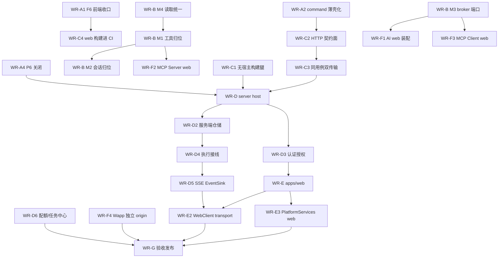

# Web Ready 完整计划：从当前基线到团队 Web 交付

> **状态：已确认的计划（拼装既有切片 + 补齐无既有文档覆盖的缺口），代码尚未按本文改动。**
> 立项日期：2026-10-31。基线：`review/code-organization-2026-10` @ `08a92d5`。
>
> 「web ready」分两级门槛，本文同时管理两者：
>
> - **可开工（ready-to-build）**：共享层形态中立、端口完整、契约可测——P7 开工后不因架构返工。
> - **已交付（delivered）**：[平台计划 §11 P7](platform-development-plan.md#11-p7单实例团队-web-服务) 退出门槛达成。
>
> 本文不复制既有方案的内容，只做三件事：**核对现状、列全差距、排定顺序**。切片编号 **WR-A…WR-G**（Web Ready 轨道），
> 与 F（宿主边界）、M（跨形态收敛）、P（平台产品 P0–P10）、D（DDD）、R（闸门）互不冲突。
> 既有文档保持权威：P7 交付项以[平台计划](platform-development-plan.md)为准；M 系列刀法以
> [边界方案 §8](host-boundary-followups.md#8-跨形态一致性收敛m-系列)为准；端口适配差异以
> [共享边界 §4.7](../architecture/platform/shared-boundaries-and-ports.md#47-三种交付形态的适配差异)为准；
> server 形态与认证以[团队服务设计](../architecture/platform/team-server-and-auth.md)为准。

## 1. 现状基线（2026-10-31 @ `08a92d5` 已核实）

| # | 层 | 现状 | web ready 判定 |
|---|---|---|---|
| 1 | Rust 内核 `modules` | 无 `tauri`/`axum` 依赖；F-14 闭包断言禁宿主 crate 与 web 框架 | ✅ 形态中立达成 |
| 2 | 端口矩阵 | 共享边界 §4.7 已定义桌面 / server 单进程 / 多 worker 三形态差异（`ProfileRepository`、`EventSink`、`SessionDirectory`、`BudgetCoordinator` 等） | ✅ 设计就绪；服务端适配器零实现 |
| 3 | MCP 共享层 | 策略层 751 行在 `modules/src/mcp`；13 个工具 + 有状态会话协议 + Resources/Prompts + MCP Client 约 4,200 行在桌面宿主 | ❌ M1 / M2 未动 |
| 4 | AI 工具面 | 工具定义/循环/守卫/schema 上下文全部共享（`modules/src/ai`）；providers 是 modules 内 HTTP 客户端；缺口 = MCP 工具面直绑桌面 `McpClientManager` | ⚠️ 差 M3 |
| 5 | runtime 读取路径 | 同一能力两条路径：AI 走 `ResourceExecutionHost` 端口，MCP 直连桌面 `RuntimeCommandSource` | ❌ 差 M4 |
| 6 | 桌面 command 层 | `commands/` 169 个 pub fn、IPC 面 215 簇；薄壳化重构已立项未完成 | ⚠️ WR-A2 |
| 7 | 前端 | 形态拆分 F1–F5 落地（编译期同形、域客户端契约测试、web stub 全 throw、`platform-extension-playbook`）；F6 收口中（workspace 协议已建、生产/测试树 `@tauri-apps` 归零、R6/R7 shim 焚烧完成） | ⚠️ F6 收口 = WR-A1 |
| 8 | web 宿主 | 不存在。`apps/` 只有 `desktop`；前端 `src/platform/web/` 只有全 throw transport stub（`CapabilityUnsupported`，编译期同形验证用） | ❌ WR-E |
| 9 | server 详细设计 | `team-server-and-auth.md`（server crate 形态、中间件链、OIDC、CSRF、授权模型）、`persistence-model.md`、`team-service-operations.md` 已就绪 | ✅ 设计就绪 |
| 10 | 跨端能力 | 导出 web 半边已示范（`createBlobTablesExporter`，Blob 下载）；Wapp 沙箱 iframe + `datazen://` 双源 CSP（桌面形态）；Tunnel 实现在 `modules` tunnel feature（共用）；AI providers 为 modules 内 HTTP 客户端 | 部分就绪，WR-F 逐项 |
| 11 | CI | 无 web 构建腿；modules 测试经桌面宿主腿编译（宿主 feature 集 = 共享 feature 集），无「无宿主独立构建」腿 | ❌ WR-C |
| 12 | P6 | 未关闭：Workflow v1 跨库 Runtime 路由、授权调度、真实驱动旅程验收、CM-53 F 层 e2e 未跑 | ⚠️ P7 的硬依赖 |

## 2. 轨道总览与依赖

关键路径：**WR-B（M 系列）与 WR-A4（P6 关闭）并行 → WR-C（契约/CI）→ WR-D（server host）→ WR-E（web 前端）→ WR-G（验收）**。
WR-F（能力落地）在 WR-D/WR-E 期间交叉插入，单项依赖见各节。

## 3. WR-A 收口轨（既有工作，web ready 的输入）

| 切片 | 内容 | 对 web ready 的意义 | 验收 |
|---|---|---|---|
| **WR-A1** | F6 前端包拆分收口：`apps/desktop` 宿主 app + `packages/frontend` 完整 workspace 包、目录迁移、R5 闸门（合法消费者只有 `apps/*`） | `apps/web` 是 F6 目标拓扑的第一位消费者；F6 不收口则 web app 无处落 | 形态拆分计划 §5.6 原验收 |
| **WR-A2** | host command 薄壳化（已立项）：command 层只做请求接线与转发，编排归 modules application；起点 `commands/ai/config.rs` | HTTP 端点镜像的是**用例**而非 IPC 命令；command 薄壳化完成后，server 的 HTTP handler 与桌面 command 是同一用例的两个薄绑定，不需要二次编排 | 每域验收：宿主 command 无业务编排；IPC 载荷不变 |
| **WR-A3** | P2 驱动注入静态化、P3 feature 图修剪 | P5 已裁决「Web 宿主重新立项时一并做」——即 WR-D1 的输入；P2/P3 降低 server 构建面的脆弱性 | 各自方案验收 |
| **WR-A4** | P6 关闭：Workflow v1 跨库 Runtime 路由、授权调度、真实驱动旅程验收、CM-53 F 层 e2e（`pnpm e2e` 实测回写）。**授权调度已落地（2026-11-01，见进度区）：调度链「上膛冻结 → 触发比对」的服务身份/授权单闸门 + 桌面确定性派生**；剩余 = live 验收、CM-53 e2e 回写、服务身份执行上下文接线 | 平台计划依赖图 P6 → P7 的硬边；AI/MCP/Wapp 的 GUI 外入口资源语义先在此关闭 | 平台计划 §10 退出门槛 |

## 4. WR-B 一致性轨（= M 系列，刀法引用边界方案 §8）

原则（2026-10-31 用户指令）：**AI 的 tool 是 web 与 desktop 共同能力——实现方式可以不同，基础能力必须一致；MCP 差异只允许是 Server 形态（stdio 子进程 / 内嵌 duplex / streamable HTTP + 服务端身份），其余完全一致；runtime 读取路径不允许「同一能力、两条适配」。**

| 切片 | 内容 | 引用 |
|---|---|---|
| **WR-B1 = M4** | 元数据读取统一：MCP 的 `runtime_schema.rs` 改走共享用例 + `ResourceExecutionHost` 端口 | 边界方案 §8.3 |
| **WR-B2 = M3** | AI 的 MCP 工具面端口化：`McpToolBroker` 消费者端口，`commands/ai/chat.rs` 两函数改走端口；桌面实现 = 现有 `McpClientManager` | 边界方案 §8.3 |
| **WR-B3 = M1** | MCP 工具分发归位：`modules/src/mcp/application/tools/`（13 工具定义 + 分发 + 无状态用例），宿主 `tools.rs` 变 rmcp 薄绑定 | 边界方案 §8.3 |
| **WR-B4 = M2** | 有状态会话语义归位：TTL、归属校验、cleanup 退避策略进 `modules/src/mcp/application/session/` | 边界方案 §8.3 |

顺序与理由沿边界方案：M4 先行消除双路径并给 M1 铺路；M3 独立且小；M1 主体；M2 可后置。

## 5. WR-C 契约与 CI 轨（新增缺口，无既有文档覆盖）

| 切片 | 内容 | 验收 |
|---|---|---|
| **WR-C1（核实后收窄，无需新刀）** | ~~modules 无宿主独立构建腿~~ 立项时误判：`pnpm test:platform-crates`（`scripts/run-platform-crate-tests.mjs`，CI rust job 既有步骤）已独立编译并测试 modules——无选择器腿用 27/29 显式 feature 清单（与宿主腿对齐，rust-cache 共享），另有 `FEATURE_TESTS` 分 feature profile 腿（settings/ai/connection+execution/named_views/monitor/dashboard/tunnel）。服务器 crate 落地后由同一腿自动覆盖（`TESTED_LAYERS` 已含 `'server'`，按目录发现，无需改 CI） | 已达成（既有）；本文记录核实修正 |
| **WR-C2（已完成 2026-10-31）** | HTTP API 契约面定义。**已裁决**：HTTP 面镜像 `packages/backend-client` 的域客户端面（十个域、43 方法，42 上 HTTP、1 排除），**不镜像 IPC 命令面**。完整契约见 [http-api-contract](../../architecture/platform/http-api-contract.md)：收编概要 §6.3 骨架，补齐 settings / identity / tableData（14 方法）/ driverGateway（4+1 排除）；裁决命名视图上 HTTP（服务端存储）、`DELETE` 唯一例外、流式驱动命令走 SSE、`CapabilityUnsupported` → 405/501 | 已达成：逐方法可点到路由（§4 总账）；多余端点为零（uploads 在账带收口动作）；`WEB_CAPABILITIES` 不含桌面专属项 |
| **WR-C3** | 同用例双传输测试基础设施：同一用例（组装 request → 调 application → 断言）在 IPC 与 HTTP 两绑定下跑（P7 交付项「桌面 IPC 与 HTTP 同用例测试」的前置抽离）。**第一刀已落地（2026-11-01，见进度区）：规格基建落 modules test-harness 门控，named_views 试点三腿同绿** | 新用例测试两腿同绿；形态差异只允许出现在装配层断言 |
| **WR-C4** | `apps/web` 建立后 web 构建腿进 CI（typecheck + vite build + 域契约测试） | CI 腿绿；web stub 的全 throw 语义不被绕过（能力未实现时显式 `CapabilityUnsupported`） |

## 6. WR-D server host 轨（P7 服务端本体）

形态与组装以[团队服务设计 §2](../architecture/platform/team-server-and-auth.md#2-server-crate-形态与-composition-root) 为权威（目录树、依赖闭包检查、组装顺序、进程模式）。

| 切片 | 内容 | 引用 / 验收 |
|---|---|---|
| **WR-D1（骨架已落地 2026-10-31；P5 拆出）** | `server/` crate 骨架：composition root（`bootstrap.rs`，serve | migrate | check-schema 三子命令，后两者显式拒绝待 WR-D2）、中间件链 L0 requestId + L1 字节闸（Content-Length 自研 + tower-http 流式）已上线、L2–L6 落点已记录、`ApiError` wire 复用 modules 定义 + 状态码表（§9.2 + 405/501 裁决）、依赖闭包门禁 `scripts/check-server-deps.mjs`（自测全绿）进 CI。**P5 目录语义化拆为独立切片**：仓库级目录大迁移（modules→crates/datazen 等，50+ 路径引用）必须跟 14 道门禁脚本一起机器验证，盲迁会把全仓 CI 推红，不盲随本刀 | §2.2 依赖闭包检查已上 CI；无 Tauri 依赖 ✓（沙箱无 cargo，编译验证由 CI 首跑，Cargo.lock 待首个有 cargo 的机器提交） |
| **WR-D2** | 服务端仓储适配器：`ProfileRepository` / `JobRepository` / `Audit` / `ArtifactRepository` / `TunnelRepository` / `KnownHostsRepository` / `ConnectionRepository` 的服务端 SQLite 实现 + schema migration（expand/contract，不先删字段） | 同一 domain trait、另一适配器；不复用宿主 AES 落盘实现（§4.7 既定）；migration 可核验恢复 |
| **WR-D3** | 认证授权：OIDC 登录、membership、服务端登录会话、RBAC/资源 ACL、CSRF、同源 HTTPS；授权变更与 `permissionVersion` 同事务提交。**第一刀已落地（2026-11-01，见进度区）：v5/v6 迁移、Audit 端口 + ServerAudit（WR-D2 第 5/7 片）、policy 引擎、登录会话、CSRF、L2-L4/L6 中间件**；余 OIDC IdP 端点（PKCE/JWKS）、L5 速率限制、TLS | 团队服务 §4–§6；越权/CSRF/组织隔离全部拒绝断言 |
| **WR-D4** | 执行接线：`ExecutionGateway`、`SessionDirectory`（单进程实现）、`BudgetCoordinator`（节点额度）、`SubmissionTokenIssuer`（服务端签名密钥 + `keyVersion`）、`SecretProvider`（服务端密钥管理 + secretRef 轮换）、`NetworkProvider`（出站白名单）、`IdentityResolver`（数据库侧服务身份 + 委托） | §4.7 端口表逐项「同一端口、另一适配器」；全部入口走 ExecutionGateway |
| **WR-D5** | `EventSink` SSE 适配：SSE 重订阅、分页/大小限制、Origin 校验、revision 缺口重读。**前置已落地（2026-11-01）：MemoryEventSink 单进程内存实现（重放/缺口/容量语义 15 钉）** | CM-55 的 W1 断言（超大 revision、乱序、重连） |
| **WR-D6** | 配额、任务中心、结果 TTL、配置版本 CAS、权限撤销传播 | 平台计划 §11 交付项 |
| **WR-D7** | 幂等提交、受控上传下载 | 平台计划 §11 交付项 |

## 7. WR-E web 前端轨

| 切片 | 内容 | 验收 |
|---|---|---|
| **WR-E1** | `apps/web` 宿主应用：vite + 路由；窗口能力替换为页面/面板（形态拆分既定形态） | 与 `apps/desktop` 同用 `@datazen/frontend`；无 `@tauri-apps` import（R5/R6 闸门天然合规） |
| **WR-E2** | `WebClient` transport：`BackendTransport` 的 HTTP/SSE 实现，替换 `src/platform/web/` 全 throw stub；域客户端（F3）零改动 | 域契约表 `domainContractTables` 测试在 HTTP 腿同绿 |
| **WR-E3** | `PlatformServices` web 实现：文件/剪贴板/对话框走浏览器原生；导出走 Blob 半边（已示范）；宿主叠加能力（`platform.host.config.get()`）web 注入空缺省 | F5 契约测试 `platformContracts` 在 web 腿绿 |
| **WR-E4** | capabilities 激活：`WEB_CAPABILITIES` 静态表（F5 已建）成为 web 装配的实际输入；updater/versionSource 等桌面专属项按表降级 | 无运行时形态探测（编译期同形原则不破） |
| **WR-E5** | 部署形态：静态资源由 server host 同源服务（SSE 缺失 Origin 有明确校验的前提） | 同源 HTTPS 部署验收 |

## 8. WR-F 能力落地轨（跨端能力，逐项「能力一致、仅形态差异」）

| 切片 | 内容 | 形态差异（允许的部分） | 验收 |
|---|---|---|---|
| **WR-F1** | AI 落地 web：providers 已是 modules 内 HTTP 客户端（服务端可跑）；装配点 = `AiRequestHost` web 实现、`McpToolBroker` web 实现（WR-B2 端口）、AI 密钥经 `SecretProvider` | 密钥存放（钥匙串 → 服务端密钥管理） | AI 工具循环测试不感知形态（M3 验收的延伸） |
| **WR-F2** | MCP Server web 形态：M1/M2 完成后宿主只剩 rmcp 传输绑定，web 侧实现 streamable HTTP（或内嵌 duplex）传输 + 服务端身份 | **仅 Server 形态**：stdio 子进程 → streamable HTTP | golden 契约 `mcp_external_contract.json` 两形态逐字节一致 |
| **WR-F3** | MCP Client web：`McpClientManager` 端口的 HTTP/SSE 客户端实现；stdio spawn 白名单、token 校验留桌面 | 仅传输与进程模型 | 同一 broker 端口两形态测试 |
| **WR-F4** | Wapp web：独立真实 origin + 可嵌入 CSP + 真实 iframe 握手（P7 上线前冻结验收项）；`wappBridge` postMessage 协议不变；`datazen://` 资产服务替换为真实 origin 静态服务 | 仅资产服务协议（自定义 scheme → 真实 origin）；CSP 双源约束随之简化为单源 | 桥契约测试两形态同绿；审计（`wapp_audit_log`）等价 |
| **WR-F5** | Tunnel：实现已在 `modules` tunnel feature 共用；web 宿主只注入存储根、凭据、监听点 | 仅注入来源 | 桌面/Web 同隧道语义测试 |
| **WR-F6** | 导出/备份/恢复 web：服务端 `ArtifactRepository` + 受控下载；前端 Blob 下载半边已示范 | 仅字节出口（本机路径 → 受控下载） | 产物越权拒绝断言 |
| **WR-F7** | 驱动执行：全部服务端执行；浏览器零数据库凭据；`NetworkProvider` 出站网络政策 | 无（执行位置由架构决定，非形态差异） | P7 门槛「浏览器无需数据库凭据」 |

## 9. WR-G 验收与发布轨

| 切片 | 内容 | 引用 |
|---|---|---|
| **WR-G1** | CM W1 断言：CM-05～07、38～40、53～56、59、60 单实例部分及 CM-63、68、70、72 的 W1 断言 | 平台计划 §11 退出门槛 |
| **WR-G2** | 上线前冻结验收：授权同事务、DDL 与历史登记同事务、expand schema 兼容、授权可见性先于会话存活错误、SSE Origin 校验、Wapp 独立 origin/CSP/iframe 握手——每项配浏览器/管理库故障测试，不以 fake 替代 | 平台计划 §11 冻结清单 |
| **WR-G3** | 部署运维：发布镜像、管理数据库、SecretProvider、网络可达性、备份恢复（不自动重放未知外部写入）、TLS、资源额度、drain 回退 | `team-service-operations.md` |
| **WR-G4** | P8 衔接：桌面团队客户端（backendId、版本握手、per-backend client）不在本文展开，P7 交付后按平台计划 §12 | 平台计划 §12 |

## 10. 推荐执行顺序

1. **并行启动（当前即可）**：WR-B1（M4，最小刀）∥ WR-A2（command 薄壳化，逐域推进）∥ WR-A1（F6 收口）∥ WR-A4（P6 关闭项）。
2. **第二波**：WR-B2（M3）→ WR-B3（M1）→ WR-B4（M2）；同期 WR-C1（无宿主构建腿）、WR-C2（HTTP 契约面决策与定义）。
3. **第三波**：WR-D1（server 骨架 + P5 目录语义化）→ WR-D2/D3/D4 并行 → WR-D5/D6/D7；WR-C3（同用例双传输）随 D1 落地。
4. **第四波**：WR-E1 → WR-E2/E3/E4 并行；WR-F 各切片在对应端口就绪后交叉插入（F1/F3 依赖 B2；F2 依赖 B3+B4；F4 随 E1）。
5. **收口**：WR-C4（web CI 腿，E1 建立即插）→ WR-G1–G3 验收发布。

**可开工门槛的判定**：WR-A（1/2/4）+ WR-B（全四刀）+ WR-C（1/2/3）完成即视为 ready-to-build——此后 P7 主体（WR-D/E/F/G）不再有架构性返工风险。

## 11. 进度回写区

- **2026-11-01 — 四切片并行落地：WR-D3 第一刀（认证授权核心）+ WR-C3 第一刀（双传输基建）+ WR-A4 授权调度 + WR-D5 前置（MemoryEventSink）**（`15a9512f` / `a8c153d4` / `263605b1` / `192e8e05`，四条无冲突轨道并行：server crate / workflow 域 / shared+server / execution application 各自独占文件，Cargo.toml 与进度区由主线统一收口）。

- **2026-11-01 — WR-D3 第一刀（server 认证授权核心，无 OIDC IdP 网络流）**：管理库 v5（`memberships`/`login_sessions`/`acl_entries`/`permission_versions`，DDL 以 persistence-model §3.10 为权威，含全部 CHECK/部分索引，expand-only）+ v6（`audit_events`，§3.7）；**WR-D2 第 5/7 片随刀完成**：`AuditSink` 端口落 modules `shared::audit`（事件 envelope 与 §3.7 字段对齐，形状中立）+ `ServerAudit` append-only 适配器（源码自检钉禁 UPDATE/DELETE）；policy 引擎（六内置角色基线 CHECK、ACL 求值「组织边界→deny→grant→角色→Denied」、permission_version 每组织单调、**授权变更与版本递增同事务**、policyIsolationKey HMAC §6.2）；登录会话存储（create/validate/touch 顺延 idle/revoke 四因 + 语义钉）；CSRF 会话绑定签名双提交（base64url(random)||"."||HMAC，subtle 常量时间比较）；中间件 L2 认证/L3 会话参数/L4 CSRF/L6 授权 probe + 独立构造器 `build_router_with_auth`（**`build_router()` 原样保留**——skeleton.rs 的 501/404/413/requestId 钉子不破）；config 增 server_secret 与会话 TTL 覆盖。验证：`cargo test -p datazen-server` 89 lib + 6 集成全绿（新增 ~45 钉）；依赖门禁 255 crates 0 forbidden。**推迟登记**：OIDC IdP 端点（PKCE/JWKS）、L5 速率限制、TLS/rustls、P8 native 认证、SSE Origin 校验（随 D5）。

- **2026-11-01 — WR-C3 第一刀（同用例双传输基建，named_views 试点三腿同绿）**：规格基建落 modules test-harness 门控 `use_case_contracts`（规格 = setup → request 组装 → 调 application → 断言，参数化于传输装配；规格本体零 IPC/HTTP 词汇）；named_views 试点 7 scenario（5 正常 + 2 错误：规则拒绝 `grid.view.nameExists` / 校验拒绝），断言全落 application 词汇，含「宿主消息不携带用户输入」钉。三腿：modules 无宿主基线 7 钉（判据本体）；HTTP 腿 `server/tests/use_case_contracts.rs` 测试内自建最小 axum Router（WR-C2 §6.9 端点形态）+ oneshot，11 测，**server/src 零改动**，经 server 新 feature `use-case-contracts` + `[[test]] required-features` 门控（普通 cargo test 不编译它）；IPC 腿 desktop named_views 真实命令入口（mock_app 托管 TestAppState，静态自检九项过，编译由 CI 验证）。形态差异只出现在各腿装配 pin（信封/夹具落库/id 铸造），模块头登记后续域接入七步模板。

- **2026-11-01 — WR-A4 授权调度（P6 可代码化核心）**：modules `workflow::domain::grant`（`WorkflowScheduleGrant`/`WorkflowScheduleScope`/`service_principal`/`definition_revision`——对照 MonitorGrant 形态，feature 互相独立无依赖边）+ `application::grant_reader` 只读窄端口（对象安全钉）+ 引擎派发闸门（**上膛冻结 → 触发比对**：无单/撤销/过期/版本前移/端口故障一律拒绝；拒绝也推进时钟逐 interval 重评；未绑定 reader 整体不派发——失败关闭）。**桌面半边**（此前缺口 = `DesktopScheduleHost` 直调 `workflow_execute_impl` 无授权）：`workflow/schedule_grant.rs` `DesktopScheduleGrantReader` 按既有持久化形状（`workflows.definition_yaml` + profile `config_revision`，零 schema 迁移）确定性派生——`expires_at` 固定远期常量保证「整单相等比对」可判（`now+TTL` 会让派发永久被拒），AI 步骤/目标无法固定 ⇒ `Ok(None)` 事实，批准事实 = 带 schedule 的定义保存（不依赖 platform 身份）；`scheduler.rs` 装配 `core.start(host, grants)`（签名两参化）。行为钉子：modules 24（引擎 16 + grant 5 + reader 3）+ desktop 4（确定性/定义变更/AI 拒绝/缺失事实，编译由 CI 验证）；workflow feature 腿 1167 全绿。**P6 剩余（环境项）**：live 验收、CM-53 e2e 回写、服务身份执行上下文接线（剩余距离登记在 grant.rs 模块头）。

- **2026-11-01 — WR-D5 前置：`MemoryEventSink` 单进程内存实现**（`execution::application::event_sink_memory`，端口此前零实现；首版单实例 ⇒ 内存即 v1 形态）：每流单调 sequence（publish 分配）、`after_sequence` 重放（None ≡ Some(0)）、缺口最保守裁决（订阅缺口 → `Err(NotFound)`，交付缺口 → `None` 断流——SSE 层映射 `streamResetRequired`，不得当 404）、环形窗口 1024（`with_capacity` 承接部署配置）、std Mutex+Condvar 短临界区（订阅产物是阻塞迭代器，tokio 接收端不安全）。15 钉子；execution 腿 966 全绿。端口语义缺口 4 项登记（无缺口专用错误变体/无流生命周期终结/无服务端终止握手/publish 不感知归属），模块头给出 SSE 适配对接说明。

- **2026-11-01 — WR-D2 第三/四切片落地：`JobRepository` 与 `ArtifactRepository` 服务端适配器（`2e86fe27`）**：**第三切片 `ServerJobs`**（管理库 v3：`jobs` / `job_stages` / `job_checkpoints` / `job_commit_boundaries` 四表）——幂等受理（同键同指纹重放原 receipt、同键异指纹 `IdempotencyConflict`）、apply 计划同组织唯一消费（`consumed_plan_id` 部分唯一索引兜底，失败不释放资格）、受理组织盖章（INV-01）、CM-05 越组织读取按「不存在」/越组织写入按 `StaleClaim`、claim fencing（generation/worker/租约三重校验 + 过期接管 +1）、状态 CAS 与终态清 claim、checkpoint 以 `(organization_id, job_id, state_version)` 为键重复即冲突、恢复扫描只产出 queued/running/cancelled 或带 `pending_verification_reason` 的候选——语义与内核 `InMemoryJobRepository` **逐方法对齐**，两处已记录形状差异（job_id 全局唯一→按组织复合主键；`after` 游标两腿一致未消费）写在适配器模块头。**第四切片 `ServerArtifacts`**（管理库 v4：`artifact_metadata` / `expired_artifact` 墓碑表 + 受控目录字节半边 `<root>/<artifact_id>/<index>.chunk`）——create 绑定 ACL（spec 与 ctx 组织/owner 一致、拒绝委托、TTL 为正）、发布即追加（块文件 `create_new`，已发布块不可覆盖）、写入期已发布块可读、未发布索引是参数错误、finalize/abort 生命周期分岔（truncated 保留已发布块）、受控导出只走 `ServerAuthorizedPath`（HostHandle 无注册通道一律 `TokenInvalid`；truncated 确认通道随 WR-D7）、TTL 删除走一小时墓碑宽限（期内读取答 `ArtifactExpired`）、打开期恢复扫描三口径（writing→truncated WriterLost、孤儿块按目录清单回收、无元数据行目录整体移除）——与内核 `FileArtifactRepository` 同端口另一适配器；「写字节/发布元数据故障窗口」由先写文件后事务提交关闭（SQLite 提交原子，无需桌面 rename 窗口的保留前缀 dance，差异已登记）。`ck_artifact_final` 把 pending 钉在 writing/revoked/expired（写入中被吊销仍是未终结产物，与 §3.8 `finalized_at IS NULL` 同口径）。server 的 datazen features 增至 `connection,execution,tunnel,jobs`；Cargo.lock 随 server 新增 libc 依赖增量提交。验证：`cargo test -p datazen-server` 44 测全绿（38 lib——jobs 14 钉 + artifacts 8 钉 + profiles/known_hosts/migrations/bootstrap 既有 16——+ 6 集成）；`cargo test -p datazen --features jobs --lib` 内核 jobs 腿 39 钉不受影响。**WR-D2 进度 4/7**：余 `Audit`（端口尚未在共享层定义，随 WR-D3 认证授权一起立项）与 `ConnectionRepository`/`TunnelRepository`（维持 WR-D4 `SecretProvider` 裁决依赖的推迟登记）。

- **2026-11-01 — B3 编排巨石下沉 + B4 收口（commands 层重构计划全部批次收官）**：**B3**：`ai_chat`/`ai_generate_sql` 编排本体（schema 管线降级、pinned 表合成、上下文块装配、取消登记对称性、`attach_db_tools` 分流）下沉 modules 新用例 `ai::application::chat_session`（`adba9d89`），宿主命令只剩 IPC 形参提取 + 端口取值——WR-A2 既登记的最后一块遗留清零，桌面 chat.rs 476→161、generate.rs 491→322，IPC 契约零变化；modules 新增 10 颗编排裁决钉子（脚本化假体，无 HTTP），`chat.rs`/`util.rs` 内联钉子归位 `tools_tests`/`response_tests`（`parse_ai_json` 宿主包装删除），`mock_provider_tests` 复核改判 C4 保留，`integration_tests` 拆分完成（编排钉子进 modules，C1 事件/取消 IPC 钉子 + C4 宿主装配旅程留宿主）；`workflow_list_impl` 回收（ai 测试转真命令入口），`workflow_execute_impl` 保留（生产调用方 scheduler，调用方清单更新）；WR-F5 对照复核：sync/host 与 data_transfer 桥接面确认按「同一端口、另一适配器」成型（端口 `DataSyncHost`/`TargetExecutor` 等已在 modules），服务端第二适配器无需桌面返工。**B4**（`49b69a80`）：`result_mapping` 整文件下沉 `execution::application::result_mapping` 并补齐 11 颗行为钉子（此前零测试）；`MockAiProvider`（tauri-free）下沉 `ai::providers::testing`（test-harness 门控）——WR-C3「同用例双传输」的假体前提就位；`table_target` 复核改判保留（F4b 已下沉选择逻辑，残留为 `TargetCommandRunner` 端口适配 + 传输校验）；`port_call` 复核改判保留（C1 宿主信封映射，与 WR-C 错误词汇对齐核查完成：`NotFound` 保留、detail 脱敏透传）；`testing/` 基建清点收口（mock_driver 已共享、ai_wiremock/app_state/resource_provider 各归其位）。**批次总账**：`_impl` 115 → 21（生产文件；本批回收 `workflow_list_impl`，残余全部为文档化共享入口：wapps 9、data_transfer 6、driver_command 2、workflow/mcp/schema_diff/connection_import 各 1），commands 层测试分层四类判据全落地。验证：modules 侧 `cargo test -p datazen --features ai --lib`（ai 域 291 钉绿）+ `--features execution`（result_mapping 11 钉绿）+ CI 同形 no-selector feature 集 `cargo check --all-targets` 零 error；infra/server `cargo check` 全过；桌面侧静态全扫零悬挂引用、括号平衡与行首 `#[tauri::command]` 规则自检过；桌面编译由 CI 验证（`c48f8d14` 补 `AiProvider` trait 导入后 CI 全绿，PR #153 合并）。

- **2026-11-01 — B2 批次 4（杂域刀收官）+ CI 红转绿的两个沉睡失败修复**：**CI 修复**（`rust` 腿 2747 过 2 失败，均为批次 2/3 下沉测试时沙箱无法全 feature 真验的沉睡问题）：① `form_neutrality` 守卫抓住下沉测试夹具里的形态专名——`reviewed_single_tenant_tests.rs` 的组织 id 字面量 `datazen-desktop-local` 逐字搬自桌面规范常量，共享内核禁形态名，夹具改中性 `datazen-local-org`（存储对 id 取值无假设，语义不变）；② `privileges::incomplete_rows_are_rejected_by_the_wire_shape` 前提写错——`PrivilegeGrant::object_schema` 本就是 `Option<String>`（无 schema 对象是合法授权行），必填字段是 `grantee`/`objectName`/`privilege`，夹具改缺 `grantee` 并更正注释。**B2 批次 4（杂域九刀，`_impl` 40 → 21，残余全部为文档化共享入口）**：query_favorites（5 全拆 + 新 `query_favorites_command_test_host`，2 测转真命令入口）、named_views（3 全拆；源码守卫针脚随内联更新为 `require_named_views_service(&state)`，计数仍 3）、value_search（1）、result_origin（2）、fk_navigation（2 全拆 + 新宿主，4 个 C1/C4 钉子转真命令入口）、history（1 全拆 + 新宿主，2 测转真命令入口）、result_write（`commit_query_result_cell(State)` 中间人改为持有逻辑的 `&AppState` 域内函数，`data.rs` 命令直调；14 处测试调用 1:1 改名）、data（preview 内联、commit 的 1:1 转发删除——`commit_pending_changes_with_handle` 本就是域内核心；`data/tests.rs` 9 测 + `insert_guard_tests` 15 处 + `insert_tests` 24 处全部转真实命令入口，mock 经 `keep.mock` 存活；宿主文档预告的「数据刀未落」注记兑现移除）；workflow（`workflow_list_impl`/`workflow_execute_impl` 文档化保留——后者有生产调用方 `workflow/scheduler.rs` 后台调度器，前者调用方全在 B3 范围的 ai 测试，按 `mcp_client_connect_impl` 先例挂调用方清单）；connection_import（`apply_connection_import_impl` 文档化保留——三条导入命令共用的装配 API，data_transfer admission 拆分同款裁决）。三份新宿主与 data 宿主同形（mock_app 托管 AppState、keepalive 保 tempdir/store/mock）。IPC 契约零变化（命令名、参数、错误文案逐字保留；`platform/ipc.rs` 冻结表与 `ipc_surface_tests` 不涉及本批文件）。验证：modules 侧 CI 同形 feature 集 `cargo test -p datazen -p datazen-infra -p datazen-server` 沙箱真跑（2C/4G 分段构建）；桌面侧静态全扫零悬挂引用、行首 `#[tauri::command]` 规则自检 16/16、括号平衡 14 文件全过；桌面编译由 CI 验证。**残余 `_impl` 21 个全部有调用方清单注释**（wapps 9、data_transfer 5+1 变体、driver_command 2、workflow 2、mcp/schema_diff/connection_import 各 1）——回收路径：wapps/data_transfer 随各自域测试甄别、workflow 随 B3、其余为登记在案的跨域共享入口。**桌面编译修复**（CI 借用检查阶段暴露两处 use-after-move：insert_tests 的 manual-handle 转换漏 clone，指纹改经 `fingerprint_before_move` 在 plan 被按值消费前取出；E0382 属借用检查＝全 crate 类型检查已过，修复仅动这两处实参）。

- **2026-11-01 — B2 批次 3 落地（十域刀收官）+ 守卫两修**：批次 3 两域：**sync**（`833cae4e`，17 `_impl` 全拆——两个整文件下沉 `migration/data_sync/{artifact_view,keyset_source}`，纯 api 面测试迁 `modules/tests/data_sync_api_tests.rs`，域测试经 sync 域宿主走真命令入口）；**wapps+data_transfer**（`dc927e1f`——wapps 的驱动命令/包检查内联、`WappSummary` 投影与 `WappPackageKind` 词汇下沉 `workspace_apps::{summary,package_kind}`；registry/storage 九入口因 `src/wapps/integration_tests.rs`（协议桥只读钉子）直调而文档化保留；data_transfer 的 admission 拆分按 B1 甄别设计保留（prepare/inspect/preview 多调用方共享 API + 测试夹具），`history_outcome`/`run_selection` 下沉）。**CI 守卫两修**：`c1632010`（schema 刀漏一个 `&`——内联时 `State` 直传给要 `&AppState` 的共享入口，单字符修复）；`016eff3d`（org_scope 扫描器只认行首 `#[tauri::command]`——各域刀文档注释里的属性字样被裸文本匹配当成真属性、与后续私有 `fn` 配对成假命令，1306 过 1 失的唯一原因）。**B2 十域刀全部完成**：AI（前置）、query、dashboard、config、tunnel、connection、driver_command+mcp、schema、schema_diff、sync、wapps、data_transfer——commands 层 `_impl` 115 → 40（全部为文档化共享入口/测试夹具，无 1:1 转发残留；批次 4 杂域：query_favorites 5、named_views 3、workflow 2、data 2、fk_navigation 2、result_origin 2、history/value_search/result_write/connection_import 各 1）。**批次 3 收尾修复**（`695b1275`，72 错三簇）：data_transfer 的 mod.rs 被中断 agent 改成目标终态但 preview/inspect/execution/测试全在旧世界——恢复 `mod types;` 与历史名 re-export（`*_impl` 即域内命名核心，`run_driver_command` 同形职责）、命令体回调历史名、补建 `command_test_host.rs`（job_lifecycle 的 never-Ok(true) 钉子改走真命令入口）、tests.rs 的回滚口径断言直调 modules `history_outcome`；sync 测试一处 `&str→String`；wapps 两处借用期错误（spawn_blocking 前克隆路径、`app.state()` 先绑定）。验证：modules 侧 CI 同形 feature 集 `cargo check --all-targets` 零 error；桌面静态全扫零悬挂；CI 验证中。

- **2026-10-31 — B2 批次 2 落地 + CI 两轮修复 + 文档行号纪律**：批次 2 两域刀：**driver_command+mcp**（`feba929a`）——`discovery.rs` 整文件删除（两条发现命令接线内联 mod.rs，目录合成本体本就是 `command_policy::discovery_definitions`，钉子测试随归位）；`execute_driver_command_with_mode` 收编为 execute.rs 域内私有核心 `run_driver_command`；流式遥测聚合下沉 `execution::application::stream_telemetry`；mcp 四转发删三留一（`mcp_client_connect_impl` 是 bootstrap 启动自连的生产共享入口）。**schema+schema_diff**（`2d19a457`）——`get_privileges_impl`/`estimate_table_rows_impl` 拆除，三用例下沉 `schema::application`（`privileges::parse_grants_from_command`、`scope::table_read_database`/`metadata_schema`）；schema_diff 四转发内联、两仓储下沉（`migration/schema_diff/reviewed_single_tenant` 含内联测试、`job/recovery_targets` 恢复目标纯投影）；`compare_table_schemas_impl` 保留（sync 域测试跨域调用方）。**跨域共享入口台账**（全部有调用方清单注释）：`execute_driver_command_impl`（query/schema 生产 + 4 测试点）、`execute_driver_command_stream_impl`（query 五流测试 + 日志卫生守卫）、query.rs 三事务入口（connection/data 测试）、config.rs 两读取入口（`read_shared_settings`/`read_connection_groups`）、mcp 连接、compare。**CI 修复**：`a87a315d`（批次 1 遗留 10 处编译错——共享入口去 `_impl` 名、Listener trait、capabilities 预序列化、全限定消歧）；`c0f68029`（文档行号纪律：长期文档不引用行号，`workflow-resource-model.md` 十处行号改稳定锚点，`doc_reference_tests` 从钉行号改为钉内容存在——编译恢复后暴露 4 行漂移直接促成裁决）。**剩余 `_impl` 60 处**（sync 17、wapps 11、data_transfer 7、query_favorites 5、named_views 3、workflow 2、data 2、fk_navigation 2、result_origin 2、其余零星）→ B2 批次 3。验证：modules 侧以 CI 无选择器腿同形 feature 集 `cargo check --all-targets` 全过（3m13s 零 error）；桌面侧静态全扫零悬挂引用，CI 验证中。

- **2026-10-31 — B1 收口 + B2 五域刀落地（cargo 进沙箱后首批真验提交）**：沙箱装入 Rust 1.99.1（tuna 镜像直连）+ rsproxy crates 镜像；Cargo.lock 增量已生成待随刀提交。**B1 完成**：`driver_command/tests` 拆分（2 测迁 `execution/application/command_policy.rs`、1 测与 infra 重复删除、37 留）+ `job_api/tests` 五件甄别（`endpoint_identity` 12 测迁 `modules/tests/job_endpoint_identity.rs`；其余四件实测面为桌面编排，改判随 B2 data_transfer 刀）。**B2 五域刀**（刀法=WR-A2 同款，每提交逐项验证）：query（11 `_impl`，`5f668caf`）、dashboard+config（19，`1d41d247`，`save_and_fetch` 下沉 `dashboard::repository`）、tunnel（7，`5b4fce08`，脱敏映射/探测编排下沉 `tunnel::domain::projection`+`tunnel::probe`，tunnel 腿 104 测绿）、connection（14——最大域，`350027d4`，`session_info_payload`/`driver_category_label` 下沉 `connection::api`，connection,execution 腿 928 测绿）。**中央连带修复**（`80419d4a`）：test_harness 重写为 HostedApp（真实命令入口 + `tauri/test` 进 feature）、`platform/ipc.rs` 冻结表去 14 行 `_impl`（数量钉 14→0）、session_backend 与 data 测试 8 处调用全部转真实命令入口（新增 data 域测试宿主）。桌面 commands 层 `_impl` 115 → ~45。**分工现状**：modules/server 侧全部本地真验（cargo test/check）；桌面侧因沙箱缺 webkit2gtk 静态把关 + CI 验证（PR #152 滚动）。

> 纪律：每项切片完成 → 验证 → 提交推送 → 在此登记（日期、提交、一句话事实）。

- **2026-10-31 — B1 首片：`connection_import` 加密测试归位 + 复核改判**：`ipc_tests.rs` 的加密往返 2 测（`encrypt_decrypt_roundtrip`/`decrypt_rejects_wrong_password`，被测为 `datazen::connection_import::{derive_argon2_key,encrypt_field,decrypt_datazen_fields}`）迁入 `modules/src/connection_import/datazen.rs` 内联测试——该文件此前 173 行零测试。桌面留宿主面：文件对话框过滤（C3）、分享密码校验、merge/preview/export 构建逻辑（被困宿主，B2 刀处理）及导出格式往返。复核改判：`restore_job/tests.rs`（365 行）实为 C4 适配器烟测（宿主边界旅程：生产上传→SQLite 准入→桌面运行时接线，深度行为在 modules 驱动旅程）——**保留**，review 文档裁决已更正。B1 余项：`driver_command/tests` 拆分、`data_transfer/job_api/tests` 三件甄别。
- **2026-10-31 — 测试分层政策 + commands 层逐文件总账 + B0 迁移落地（`0e07f22e`）**：用户新指令三条（单元测试测 modules 不测 command 层；何场景必须直测 command 层；commands 层逐文件 review）。成文 [commands-layer-review.md](commands-layer-review.md)：§1 四类合法宿主测试（C1 IPC 线格式 / C2 装配守卫 / C3 宿主资源绑定 / C4 适配器烟测）+ 判据「换 axum 宿主还能原样过 → 位置错了」；§3 全部 150 文件逐个裁决（保留/守卫/瘦身/测试迁移/随刀下沉）；测量基线：51,793 行中测试相关 24,751 行（48%），`_impl` 残留 115 个。B0 执行：`filter_validation_tests`（501 行）整迁 `modules/src/migration/data_sync/`；`backup_tests` 纯逻辑 5 测迁 `modules/src/backup/options_tests.rs`；`ai/tests.rs` 纯逻辑 25 测迁 `modules/src/ai/`（response_tests 18 + tools_tests 4 + api 内联 1 + single_turn 内联 2，另删 1 个与 modules 既有覆盖重复的 provider_defaults 测试）——共 1,355 行测试归位，桌面 commands 层净减约 1,050 行；顺手消灭 `sync/mod.rs` 的 filter_validation 转发 re-export（使用方 `sync/host/mod.rs` 直连源头）。静态验证脚本全过（沙箱无 cargo，真实验证在用户机器）。B1–B4 批次见 review 文档 §4。
- **2026-10-31 — WR-D2 第二切片落地：`KnownHostsRepository` 服务端适配器**：v2 迁移加 `known_hosts` 表（复合主键 `(organization_id, host_key)`——端口无鉴权维度，组织隔离由「每组织一个仓储实例」实现，列是实例边界、端口形状不动）；`ServerKnownHosts` 钉住端口两条特殊语义：`load` 任何失败降级为空集合（TOFU：坏库不阻断隧道启动，warn 入日志）、`save` 单事务全表替换且失败如实报 `BackendUnavailable`。server 的 datazen features 增至 `connection,execution,tunnel`（端口在 tunnel::domain；WR-F5 本就要求服务端共用隧道机制）。4 个新测试（空默认、往返、全表替换、每组织实例隔离）。**推迟并记录理由**：`ConnectionRepository` 与 `TunnelRepository` 的端口语义是内存明文凭据（`get` 返回全量定义），服务端适配器的存储形状依赖 WR-D4 的 `SecretProvider` 裁决，不强行定形。
- **2026-10-31 — WR-D2 第一切片落地：管理库 + `ProfileRepository` 服务端适配器**：`server/src/storage/` 新增 `AdminStore`（SQLite，`Mutex<Connection>` + `spawn_blocking` 异步边界，与桌面 `AppDb` 同款并发模型）、expand-only 迁移执行器（`admin_schema_version` 版本表、逐迁移单事务、幂等；contract 步骤显式不执行，待 WR-G3 备份核验）与 v1 基线 `connection_profile` 表（复合主键 `(organization_id, connection_id)` 把 CM-05 落进存储层；`secret_ref` 只存引用，明文永不入行）；`ServerProfiles` 实现 `ProfileRepository` + `ProfileReader`，语义与桌面 `DesktopProfiles` 逐方法对齐（CAS 只承诺 `CasConflict`、create 幂等重放返回既有行、disable 递增 config_revision、credential 轮换只动凭据版本、敏感公开选项同词表拒绝）。`migrate`/`check-schema` 子命令从 fail-closed 拒绝变真实实现（落后退出码 3、超前退出码 4）；`serve` 组装根插入 §2.3 的 D 步（打开管理库 + 版本检查，不自动迁移）。server 的 datazen features 从零点亮为 `connection,execution`（CI FEATURE_TESTS 钉的最小有效组合）。9 个行为钉子测试 + 2 个迁移执行器测试。**裁决差异登记**：team-server §10.1 与系统概要 §6.4 推荐生产首版 PostgreSQL 管理库，本计划（用户已确认）裁决首版 SQLite、PostgreSQL 为后续生产化切片——差异已写进 `storage/mod.rs` 模块文档，trait 语义不动，届时只新增 adapter。**遗留**：`ConnectionRepository`/`JobRepository`/`Audit`/`ArtifactRepository`/`TunnelRepository` 适配器按同刀法后续切片（Connection/Tunnel 待 WR-D4）；server 依赖闭包门禁对 rusqlite/chrono/async-trait 放行（denylist 只禁宿主/UI crate）。
- **2026-10-31 — WR-A2 AI 域收口：`commands/ai` 转发层全数拆除**：`config.rs`（8 命令）、`prompts.rs`（1）、`generate.rs`（7）、`chat.rs`（1）的接线逻辑全部直接住进 `#[tauri::command]` 处理函数，24 个 `*_impl` 转发体删除（含 3 个 `#[allow(dead_code)]` 短版）；净 -107 行。命令测试改为**直调真实命令入口**——新增 `commands/ai/command_test_host.rs`（cfg(test)）：`tauri::test::mock_app()` 托管 harness 的 `AppState`（`TestAppState::into_state()` 拆出 state + keepalive），流式命令 `<R: Runtime>` 泛型化后注入 `WebviewWindow<MockRuntime>`，断言改走真实事件面（`window.listen("ai:stream-chunk")`，tauri 事件系统为纯进程内投递，已核实 2.11.5 源码）。IPC 契约零变化（命令名、载荷、`ai:config-changed`/`ai:stream-chunk` 事件、错误文案逐字保留）；`ipc_contract_guards` 参数提取适配泛型签名（新逻辑在本沙箱以脚本模拟验证全过）。遗留：`ai_chat`/`ai_generate_sql` 的编排本体（schema 管线 + 取消登记）仍在宿主命令层，待 WR-A2 后续刀下沉 modules 用例；其余域（connection 89 处、dashboard 35 处等）的 `_impl` 拆除按同刀法逐域推进。

- **2026-10-31 — WR-B1 = M4 完成**：runtime 读取路径统一。`read_target_command`/`driver_for_connection` 用例化进 `modules/src/workflow/application/runtime_reads.rs`（feature 环裁决：原计划 mcp 域不能反向依赖 workflow/ai，落点调整为 workflow + ai 两处），`connection_schema_context` 姊妹用例落 `ai/application/schema_context.rs`；宿主删 `mcp/runtime_schema.rs` 与 `RuntimeCommandSource` 的 inherent 捷径，`DataZenMcpServer` 以 `resource_host: Arc<dyn ResourceExecutionHost>` 端口字段装配；Wapp 读取同步换轨。验收达成：`mcp/` 不再引用 `RuntimeCommandSource`；MCP 错误文本逐字不变；modules 新增 6 个行为钉子测试。详见[边界方案 §8.3](host-boundary-followups.md#83-收敛切片每刀独立-pr) M4 行。
- **2026-10-31 — WR-B2 = M3 完成**：AI 的 MCP 工具面端口化。`McpToolBroker` 消费者端口 + `McpBrokeredTool` 中立结构落 `ai/application/ports.rs`，装配用例（qualified 命名、`ToolDefinition` 映射、`String` 执行契约与错误文案）落 `ai/application/mcp_tools.rs`；桌面 `AppState` 实现端口（`services/feature_ports.rs`，stdio/白名单/token 留桌面），`commands/ai/chat.rs` 两函数变薄壳，`mcp_qualified_name` 变共享规则转发。验收达成：工具循环测试不感知形态；桌面 MCP client 测试零改动；错误文案逐字保留；共享层 5 个用例测试。详见边界方案 §8.3 M3 行。
- **2026-10-31 — WR-B3 = M1 主体完成（10/13 工具）**：MCP 工具分发归位。前置刀把 `permission`/`command_policy` 迁入 execution 解开 feature 环（mcp 保持旧路径垫片）；十个无状态工具用例进 `mcp/application/tools.rs`（七个走 `ResourceExecutionHost`，list_connections 走新 `RedactedConnectionSource` 端口，workflows 二连走 `WorkflowCatalog` 端口 + 共享 executor）；错误通道中立化为 `ToolError` 两分；宿主 `tools.rs` 全部无状态函数变薄壳，`#[tool]`/JsonSchema/rmcp 错误留绑定层。会话三工具留 M2。详见边界方案 §8.3 M1 行。
- **2026-10-31 — WR-B4 = M2 完成，WR-B 轨道收口**：有状态会话映射语义（`McpSessionRegistry`/TTL/归属校验/清理登记 + 语义测试）整体迁 `mcp/application/session.rs`，宿主变垫片；cleanup worker 与 open 未交付守卫按传输驱动裁决留宿主。**M 系列四刀全部落地**。详见边界方案 §8.3 M2 行。
- **2026-10-31 — main 合并（冲突解决）**：PR #150（P2/P3/P5 轨）合入 main 后与本分支 M 系列工作分叉；唯一文本冲突 `modules/src/ai/application/ports.rs`（我们侧 M3 `McpToolBroker` vs main 侧 `AiConfigStore`）以双保留解决，双侧同改的另三文件（`chat.rs`/`ai/mod.rs`/followups 文档）逐一人工核验语义一致；合并提交 `1f325a6`。main 侧带入的 AI 配置用例下沉（`ai::api` + `AiConfigStore`）正好完成 WR-A2 的 AI 配置域起点。
- **2026-10-31 — WR-A1 状态核实（无需新刀）**：F6 机械工作全部完成——c1 目录分家、c2 workspace 协议 + alias 退役 + 源码包模式、c3 redis 集成测试归位 + R1 豁免注销；R5 闸门已上线；剩余仅退出标准验证（typecheck/全量测试/tauri build 三绿 + e2e 冒烟），属机器侧（CI/用户机器），不阻塞后续轨道。
- **2026-10-31 — WR-C2 完成**：HTTP 契约面冻结成文 [http-api-contract](../../architecture/platform/http-api-contract.md)（`docs/architecture/platform/`）。十域 43 方法总账：42 上 HTTP（41 路由，PATCH 双服务 update/disable）、1 排除（`open_base64_with_dialog` 对话框语义永不上 HTTP）；关键裁决：命名视图上 HTTP（服务端存储形态裁决，`DELETE` 唯一例外带理由）、流式驱动命令走 SSE（202+streamId）、`CapabilityUnsupported` 按 kind 分射 405/501、`artifacts/uploads` 为唯一在账待补方法端点；概要 §6.3 与 team-server §7.2 已挂指针，两表不再各自演化。
- **2026-10-31 — CI 全绿收口（fe8412d）**：WR-D1 落地过程共修四类破损——① M1 前置刀遗留的 feature 向上引用（execution 硬引 schema，`connection,execution` 腿编译失败，cfg 门控修复，行为在 schema 开启时逐字不变）；② 骨架盲写三处 Rust 修正（axum `Uri` 路径、match 字面量绑定、501 覆盖逻辑）；③ Cargo.lock 随 server 入 workspace（临时 snapshot 工作流取回 runner 算好的锁——纯增量 19 行，axum/tower/http 早已在图内；`--locked` 的 publish 工作流恢复安全）；④ platform-arch 自证 M6 适应 server/ 已存在（改走 M7 的备份覆写模式）并按注释预告把 server 入 `DEFAULT_REQUIRED_LAYERS`（F-06 从 vacuous 转武装），边界测试套件同步跟上。**附带发现记录在案**：共享词汇表 `NotFound` 的 `retryDisposition` 实际为 `safeRead`，与 team-server §9.2 表的 `never` 不一致——留给 WR-D4 逐行裁决，server 侧只断言 wire 真值不自行改写。
- **2026-10-31 — WR-D1 骨架落地**：`server/`（crate `datazen-server`）入 workspace。`bootstrap.rs` 唯一组装点（子命令 serve|migrate|check-schema，后两者 fail-closed 拒绝待 WR-D2）；中间件链 L0（requestId 透传/铸造，最外层裁决：413/500 也带 id）+ L1（Content-Length 自研闸带 `ApiError` 体 + tower-http 流式闸 + CatchPanic）上线，L2–L6 落点记录在 `http/middleware/mod.rs`；`/healthz` `/readyz` 真实、`/api/v1` 统一 501 `capabilityUnsupported`（契约 §7 映射）；错误 wire 复用 `datazen::shared::error::ApiError`（newtype 破 orphan 规则）+ `status_for` 全 31 变体映射（§9.2 未列 8 个 code 临时归 409，WR-D4 逐行确认）；门禁 `scripts/check-server-deps.mjs`（自测四案例全绿）+ `pnpm test:server-deps` + CI 步骤；集成测试 7 项钉住行为。既有门禁零改动接入：cargoWorkspace LAYERS 预置 server 路径、platform-arch F-06 随 crate 落地自动激活、platform-crates 腿自动发现。**待办**：Cargo.lock 未含新依赖（沙箱无 cargo），首个有 cargo 的机器跑任意 cargo 命令后提交锁文件；P5 目录语义化拆独立切片（盲迁风险）。
