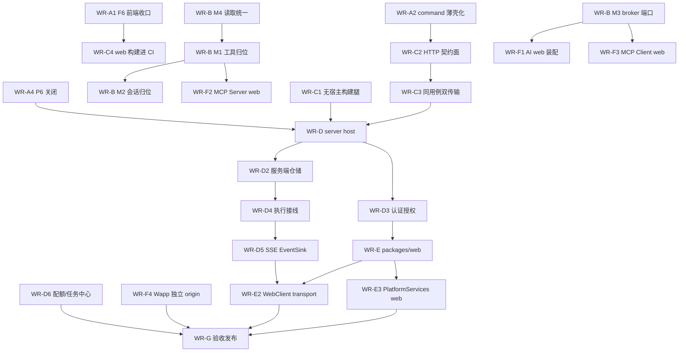

# Web Ready 完整计划：从当前基线到团队 Web 交付

> **状态：已确认的计划（拼装既有切片 + 补齐无既有文档覆盖的缺口），代码尚未按本文改动。**
> 立项日期：2026-10-31。基线：`review/code-organization-2026-10` @ `08a92d5`。
>
> 「web ready」分两级门槛，本文同时管理两者：
>
> - **可开工（ready-to-build）**：共享层形态中立、端口完整、契约可测——P7 开工后不因架构返工。
> - **已交付（delivered）**：[平台计划 §11 P7](platform-development-plan.md#11-p7单实例团队-web-服务) 退出门槛达成。
>
> 本文不复制既有方案的内容，只做三件事：**核对现状、列全差距、排定顺序**。切片编号 **WR-A…WR-G**（Web Ready 轨道），
> 与 F（宿主边界）、M（跨形态收敛）、P（平台产品 P0–P10）、D（DDD）、R（闸门）互不冲突。
> 既有文档保持权威：P7 交付项以[平台计划](platform-development-plan.md)为准；M 系列刀法以
> [边界方案 §8](host-boundary-followups.md#8-跨形态一致性收敛m-系列)为准；端口适配差异以
> [共享边界 §4.7](../architecture/platform/shared-boundaries-and-ports.md#47-三种交付形态的适配差异)为准；
> server 形态与认证以[团队服务设计](../architecture/platform/team-server-and-auth.md)为准。

## 1. 现状基线（2026-10-31 @ `08a92d5` 已核实）

| # | 层 | 现状 | web ready 判定 |
|---|---|---|---|
| 1 | Rust 内核 `modules` | 无 `tauri`/`axum` 依赖；F-14 闭包断言禁宿主 crate 与 web 框架 | ✅ 形态中立达成 |
| 2 | 端口矩阵 | 共享边界 §4.7 已定义桌面 / server 单进程 / 多 worker 三形态差异（`ProfileRepository`、`EventSink`、`SessionDirectory`、`BudgetCoordinator` 等） | ✅ 设计就绪；服务端适配器零实现 |
| 3 | MCP 共享层 | 策略层 751 行在 `crates/datazen/src/mcp`；13 个工具 + 有状态会话协议 + Resources/Prompts + MCP Client 约 4,200 行在桌面宿主 | ❌ M1 / M2 未动 |
| 4 | AI 工具面 | 工具定义/循环/守卫/schema 上下文全部共享（`crates/datazen/src/ai`）；providers 是 modules 内 HTTP 客户端；缺口 = MCP 工具面直绑桌面 `McpClientManager` | ⚠️ 差 M3 |
| 5 | runtime 读取路径 | 同一能力两条路径：AI 走 `ResourceExecutionHost` 端口，MCP 直连桌面 `RuntimeCommandSource` | ❌ 差 M4 |
| 6 | 桌面 command 层 | `commands/` 169 个 pub fn、IPC 面 215 簇；薄壳化重构已立项未完成 | ⚠️ WR-A2 |
| 7 | 前端 | 形态拆分 F1–F5 落地（编译期同形、域客户端契约测试、web stub 全 throw、`platform-extension-playbook`）；F6 收口中（workspace 协议已建、生产/测试树 `@tauri-apps` 归零、R6/R7 shim 焚烧完成） | ⚠️ F6 收口 = WR-A1 |
| 8 | web 宿主 | 不存在。`apps/` 只有 `desktop`；前端 `src/platform/web/` 只有全 throw transport stub（`CapabilityUnsupported`，编译期同形验证用） | ❌ WR-E |
| 9 | server 详细设计 | `team-server-and-auth.md`（server crate 形态、中间件链、OIDC、CSRF、授权模型）、`persistence-model.md`、`team-service-operations.md` 已就绪 | ✅ 设计就绪 |
| 10 | 跨端能力 | 导出 web 半边已示范（`createBlobTablesExporter`，Blob 下载）；Wapp 沙箱 iframe + `datazen://` 双源 CSP（桌面形态）；Tunnel 实现在 `modules` tunnel feature（共用）；AI providers 为 modules 内 HTTP 客户端 | 部分就绪，WR-F 逐项 |
| 11 | CI | 无 web 构建腿；modules 测试经桌面宿主腿编译（宿主 feature 集 = 共享 feature 集），无「无宿主独立构建」腿 | ❌ WR-C |
| 12 | P6 | 未关闭：Workflow v1 跨库 Runtime 路由、授权调度、真实驱动旅程验收、CM-53 F 层 e2e 未跑 | ⚠️ P7 的硬依赖 |

## 2. 轨道总览与依赖

关键路径：**WR-B（M 系列）与 WR-A4（P6 关闭）并行 → WR-C（契约/CI）→ WR-D（server host）→ WR-E（web 前端）→ WR-G（验收）**。
WR-F（能力落地）在 WR-D/WR-E 期间交叉插入，单项依赖见各节。

## 3. WR-A 收口轨（既有工作，web ready 的输入）

| 切片 | 内容 | 对 web ready 的意义 | 验收 |
|---|---|---|---|
| **WR-A1** | F6 前端包拆分收口：`packages/desktop` 宿主 app + `packages/frontend` 完整 workspace 包、目录迁移、R5 闸门（合法消费者只有 `apps/*`） | `packages/web` 是 F6 目标拓扑的第一位消费者；F6 不收口则 web app 无处落 | 形态拆分计划 §5.6 原验收 |
| **WR-A2（已达成，2026-11-04 核实收口）** | host command 薄壳化：command 层只做请求接线与转发，编排归 modules application。**达成证据：起点 `commands/ai/config.rs` 已是薄壳（host-boundary §3，F4a `connection/api` 先例——registry/`AiConfigStore` 端口/请求 DTO 交 `datazen::ai::api`，编排含供应商懒注册/持久化恢复/initialize 与 reset 顺序全在 modules 定稿，桌面只剩 `ai:config-changed` 事件与日志）；B2 十域刀 + 杂域刀把 commands 层 `_impl` 115 → 21（全部为文档化共享入口/测试夹具，无 1:1 转发残留，逐批次台账见 §11 2026-10-31 / 11-01 各条）——「宿主 command 无业务编排」的每域验收由各域刀的入库验证承载** | HTTP 端点镜像的是**用例**而非 IPC 命令；command 薄壳化完成后，server 的 HTTP handler 与桌面 command 是同一用例的两个薄绑定，不需要二次编排 | 每域验收：宿主 command 无业务编排；IPC 载荷不变 |
| **WR-A3** | P2 驱动注入静态化、P3 feature 图修剪。**P2 注入路径切片落地（2026-11-03：`DriverRegistry::with_factories` 静态构造器——构造期一次成型、协议闸门前置、未登记类型确定性显式失败；懒形态逐字节保留）**；**P2 构建期主手术面大部分落地（2026-11-04 W3-c：15 个 path 驱动在桌面 Cargo.toml 静态 optional 化 + `drivers` 聚合 feature（default 保持 `[]` 保零变化），resolve-drivers 对 path 驱动退化为纯 codegen（不再改写共享文件、不再 stash），CI rust job "Restore managed files" 步骤删除，check-managed-stubs 增 `--check-static-drivers` 一致性面；git 驱动（kiwi/superset，构建期克隆、路径不在仓）仍保留注入+stash，driver-file-stash 因此未删除，详见 §11 2026-11-04（二））**；余：`drivers` 提入 default（前置：ci-tauri-build/tauri-dev 先加 `--no-default-features`）、git 驱动注入的退役路径；**P3 已达成（2026-11-04 Wave6 第二刀：`FeatureError` 去域类型化——`Ai(#[from])` 变体删除，三域 From 映射反向搬入 `table_editing/error.rs` / `ai/application/error.rs` / `export/error.rs`（cfg 门控，消息逐字），feature_error feature 收窄为 `[driver-api, serde_json]`，裸 feature 编译零错；宿主 CommandError 的 Ai 臂随之删除（`From<AiError>`/`From<AiUseCaseError>` 独立路径不变、IPC 文案不变），connection_import 显式点名依赖）**；余 P2 构建期主手术面已大部落地（W3-c，见前段与 §11 2026-11-04（二））另刀 | P5 已裁决「Web 宿主重新立项时一并做」——即 WR-D1 的输入；P2/P3 降低 server 构建面的脆弱性；各自方案验收 |
| **WR-A4** | P6 关闭：Workflow v1 跨库 Runtime 路由、授权调度、真实驱动旅程验收、CM-53 F 层 e2e（`pnpm e2e` 实测回写）。**授权调度已落地（2026-11-01，见进度区）：调度链「上膛冻结 → 触发比对」的服务身份/授权单闸门 + 桌面确定性派生**；剩余 = live 验收（两条真实驱动方言旅程，`#[ignore]` + `run-live-contract.sh` 夹具环境）、`pnpm e2e` 实测回写（桌面/CI 环境）。**服务身份执行上下文接线已落地 + CM-53 F 层 e2e 登记已回写（2026-11-03：`workflow::application::execution_identity`——授权单派生服务身份（Service 主体/组织归属/无委托），调度宿主归属核对 fail-closed；`cm53_e2e_registration_tests` 钉住登记点存在性与三旅程腿覆盖；fake-driver 完整调度旅程用例常态 CI 真跑）** | 平台计划依赖图 P6 → P7 的硬边；AI/MCP/Wapp 的 GUI 外入口资源语义先在此关闭 | 平台计划 §10 退出门槛 |

## 4. WR-B 一致性轨（= M 系列，刀法引用边界方案 §8）

原则（2026-10-31 用户指令）：**AI 的 tool 是 web 与 desktop 共同能力——实现方式可以不同，基础能力必须一致；MCP 差异只允许是 Server 形态（stdio 子进程 / 内嵌 duplex / streamable HTTP + 服务端身份），其余完全一致；runtime 读取路径不允许「同一能力、两条适配」。**

| 切片 | 内容 | 引用 |
|---|---|---|
| **WR-B1 = M4（已达成，2026-11-04 核实收口）** | 元数据读取统一：MCP 的 `runtime_schema.rs` 改走共享用例 + `ResourceExecutionHost` 端口。**达成证据：`runtime_schema.rs` 已从树上消失（`rg runtime_schema` 零命中）；桌面 MCP server 持 `resource_host: Arc<dyn ResourceExecutionHost>`（`mcp/server.rs`），无状态工具经 `datazen::mcp::tools::*` 共享用例执行（`mcp/tools.rs`——`ensure_allowed` 白名单后直呼共享面）；server 侧同款（Wave6 第二刀七工具经 `TargetMachine.host`）——双路径合一在两形态同时成立** | 边界方案 §8.3 |
| **WR-B2 = M3（已达成，2026-11-04 核实收口）** | AI 的 MCP 工具面端口化：`McpToolBroker` 消费者端口，`commands/ai/chat.rs` 两函数改走端口。**达成证据：`chat.rs` 的 `mcp_tool_definitions`/`execute_mcp_tool` 是 `datazen::ai::mcp_tools`（形态中立共享面）的 IPC 侧薄壳（文件头登记「the form-neutral assembly lives in the shared layer; this is the IPC-side thin shell over the McpToolBroker implementation on AppState」）；桌面实现 = 现有 `McpClientManager` 经 `AppState` 的端口实现承接** | 边界方案 §8.3 |
| **WR-B3 = M1** | MCP 工具分发归位：`crates/datazen/src/mcp/application/tools/`（13 工具定义 + 分发 + 无状态用例），宿主 `tools.rs` 变 rmcp 薄绑定。**13/13 收官（2026-11-03：有状态三工具 open/use/close 经 `StatefulSessionHost` 端口归位 `application/session_tools.rs`，宿主 tools.rs 627→286 变纯 rmcp 绑定）** | 边界方案 §8.3 |
| **WR-B4 = M2** | 有状态会话语义归位：TTL、归属校验、cleanup 退避策略进 `crates/datazen/src/mcp/application/session/`。**主体归位达成（2026-11-03：`CleanupScheduler` 退避/睡眠判定 + `own_pending`/`sweep_pending` 清扫语义下沉，宿主 session_cleanup 只留 worker 循环调度与传输钩子；上波顺延的 4,658 行宿主面就此清零）** | 边界方案 §8.3 |

顺序与理由沿边界方案：M4 先行消除双路径并给 M1 铺路；M3 独立且小；M1 主体；M2 可后置。

## 5. WR-C 契约与 CI 轨（新增缺口，无既有文档覆盖）

| 切片 | 内容 | 验收 |
|---|---|---|
| **WR-C1（核实后收窄，无需新刀）** | ~~modules 无宿主独立构建腿~~ 立项时误判：`pnpm test:platform-crates`（`scripts/run-platform-crate-tests.mjs`，CI rust job 既有步骤）已独立编译并测试 modules——无选择器腿用 27/29 显式 feature 清单（与宿主腿对齐，rust-cache 共享），另有 `FEATURE_TESTS` 分 feature profile 腿（settings/ai/connection+execution/named_views/monitor/dashboard/tunnel）。服务器 crate 落地后由同一腿自动覆盖（`TESTED_LAYERS` 已含 `'server'`，按目录发现，无需改 CI） | 已达成（既有）；本文记录核实修正 |
| **WR-C2（已完成 2026-10-31）** | HTTP API 契约面定义。**driverGateway 过渡域四方法已落 HTTP（2026-11-04 Wave6 第三刀（三），见 §11 2026-11-04（四））——契约面 42 方法全部有真路由在账**。**已裁决**：HTTP 面镜像 `packages/backend-client` 的域客户端面（十个域、43 方法，42 上 HTTP、1 排除），**不镜像 IPC 命令面**。完整契约见 [http-api-contract](../../architecture/platform/http-api-contract.md)：收编概要 §6.3 骨架，补齐 settings / identity / tableData（14 方法）/ driverGateway（4+1 排除）；裁决命名视图上 HTTP（服务端存储）、`DELETE` 唯一例外、流式驱动命令走 SSE、`CapabilityUnsupported` → 405/501 | 已达成：逐方法可点到路由（§4 总账）；多余端点为零（uploads 在账带收口动作）；`WEB_CAPABILITIES` 不含桌面专属项 |
| **WR-C3** | 同用例双传输测试基础设施：同一用例（组装 request → 调 application → 断言）在 IPC 与 HTTP 两绑定下跑（P7 交付项「桌面 IPC 与 HTTP 同用例测试」的前置抽离）。**第一刀已落地（2026-11-01，named_views 试点三腿同绿）；第二刀已落地（2026-11-02，settings 域三腿，见进度区）**；**第三刀已落地（2026-11-03，connections/sessions 三腿同名同绿，`use_case_contracts` 28/28）；**桌面 IPC 腿已落地（2026-11-04 Wave6 第二刀：connections/sessions 七 scenario 三腿逐字同名 + 3 装配 pin（桌面信封句/宿主 uuid 铸造/内核 wire 对象），`connections_sessions_use_case_contract_ipc.rs`——桌面 crate 沙箱不可编译，CI `--test` 名单收口（ci.yml 与测试矩阵已同步））****；tableData 域服务端半边已落地（2026-11-04 Wave6 第三刀：命名视图三端点真实现（v9 表存储 + wire 形状与契约腿逐字一致）+ tableData 十一端点 fail-closed 501 登记 + `table_data_routes` 12 测（fixture 走真 `build_router_with_auth` 通道），见 §11 2026-11-04（三））** | 新用例测试两腿同绿；形态差异只允许出现在装配层断言 |
| **WR-C4** | `packages/web` 建立后 web 构建腿进 CI（typecheck + vite build + 域契约测试） | **已达成（2026-11-02，E2 套件落地后补「Web domain contract tables」vitest 步）**；web stub 的全 throw 语义不被绕过（能力未实现时显式 `CapabilityUnsupported`） |

## 6. WR-D server host 轨（P7 服务端本体）

形态与组装以[团队服务设计 §2](../architecture/platform/team-server-and-auth.md#2-server-crate-形态与-composition-root) 为权威（目录树、依赖闭包检查、组装顺序、进程模式）。

| 切片 | 内容 | 引用 / 验收 |
|---|---|---|
| **WR-D1（骨架已落地 2026-10-31；P5 拆出）** | `crates/datazen-server/` crate 骨架：composition root（`bootstrap.rs`，serve | migrate | check-schema 三子命令，后两者显式拒绝待 WR-D2）、中间件链 L0 requestId + L1 字节闸（Content-Length 自研 + tower-http 流式）已上线、L2–L6 落点已记录、`ApiError` wire 复用 modules 定义 + 状态码表（§9.2 + 405/501 裁决）、依赖闭包门禁 `scripts/check-server-deps.mjs`（自测全绿）进 CI。**P5 目录语义化拆为独立切片**：仓库级目录大迁移（modules→crates/datazen 等，50+ 路径引用）必须跟 14 道门禁脚本一起机器验证，盲迁会把全仓 CI 推红，不盲随本刀 | §2.2 依赖闭包检查已上 CI；无 Tauri 依赖 ✓（沙箱无 cargo，编译验证由 CI 首跑，Cargo.lock 待首个有 cargo 的机器提交） |
| **WR-D2** | 服务端仓储适配器：`ProfileRepository` / `JobRepository` / `Audit` / `ArtifactRepository` / `TunnelRepository` / `KnownHostsRepository` / `ConnectionRepository` 的服务端 SQLite 实现 + schema migration（expand/contract，不先删字段）| **已达成（2026-11-01 Audit/ServerAudit + 2026-11-02 收尾 connections/tunnels + v7 迁移五表，见进度区）**；migration 可核验恢复 |
| **WR-D3** | 认证授权：OIDC 登录、membership、服务端登录会话、RBAC/资源 ACL、CSRF、同源 HTTPS；授权变更与 `permissionVersion` 同事务提交。**第一刀已落地（2026-11-01）；余项（OIDC 登录面 + L5 速率限制）已落地（2026-11-02，见进度区）**；余 TLS → WR-G3 | 团队服务 §4–§6；越权/CSRF/组织隔离全部拒绝断言 |
| **WR-D4** | 执行接线：`ExecutionGateway`、`SessionDirectory`（单进程实现）、`BudgetCoordinator`（节点额度）、`SubmissionTokenIssuer`（服务端签名密钥 + `keyVersion`）、`SecretProvider`（服务端密钥管理 + secretRef 轮换）、`NetworkProvider`（出站白名单）、`IdentityResolver`（数据库侧服务身份 + 委托） | **已达成（2026-11-02 六适配器全落地，见进度区）**；bootstrap 装配随 WR-D6 执行入口接线；§4.7 端口表逐项「同一端口、另一适配器」；全部入口走 ExecutionGateway |
| **WR-D5** | `EventSink` SSE 适配：SSE 重订阅、分页/大小限制、Origin 校验、revision 缺口重读。**已达成（前置 MemoryEventSink 2026-11-01 + SSE 适配 2026-11-02，见进度区）**；余 SSE 连接 L6 复核随域路由点亮收口 | CM-55 的 W1 断言（超大 revision、乱序、重连） |
| **WR-D6** | 配额、任务中心、结果 TTL、配置版本 CAS、权限撤销传播。**已达成（2026-11-03：`crates/datazen-server/src/operations/` 五子件 + bootstrap 装配 + jobs/submission-tokens/artifacts 路由点亮，本地 server 腿 226/226，见进度区）**；余 L6 撤销复核与跨进程取消登记随执行域路由收口 | 平台计划 §11 交付项 |
| **WR-D7** | 幂等提交、受控上传下载。**已达成（2026-11-03：`crates/datazen-server/src/transfer/` 三服务（SubmissionService/UploadService/DownloadService）+ uploads 在账端点定形 + readArtifact 三取法 404/互斥钉，见进度区）**；分块流式写入器协议随 web 导出流两头合拢 | 平台计划 §11 交付项 |

## 7. WR-E web 前端轨

| 切片 | 内容 | 验收 |
|---|---|---|
| **WR-E1** | `packages/web` 宿主应用：vite + 路由；窗口能力替换为页面/面板（形态拆分既定形态） | **已达成（2026-11-02，见进度区）**；与 `packages/desktop` 同用 `@datazen/frontend`；无 `@tauri-apps` import（R5/R6 闸门天然合规） |
| **WR-E2** | `WebClient` transport：`BackendTransport` 的 HTTP/SSE 实现，替换 `src/platform/web/` 全 throw stub；域客户端（F3）零改动。**已落地（2026-11-02，见进度区）：42/42 方法分发表 + SSE 两步流水线 + 域契约表 76 钉** | 域契约表 `domainContractTables` 测试在 HTTP 腿同绿（✓ vitest 76/76，CI 已挂步） |
| **WR-E3** | `PlatformServices` web 实现：文件/剪贴板/对话框走浏览器原生；导出走 Blob 半边（已示范）；宿主叠加能力（`platform.host.config.get()`）web 注入空缺省。**已落地（2026-11-03：12/12 方法逐项实现账目 + tablesExporter 真绑定 + 13 颗新测试；Rust 腿本地全绿，前端三步 typecheck/vitest/vite build 由本刀 CI 复核）** | F5 契约测试 `platformContracts` 在 web 腿绿 |
| **WR-E4** | capabilities 激活：`WEB_CAPABILITIES` 静态表（F5 已建）成为 web 装配的实际输入；updater/versionSource 等桌面专属项按表降级。**已达成（2026-11-03：`capabilityBindings.ts` 表驱动装配——表行 false 的能力绑定为同错替身/结构性缺席，`WebUpdaterOffProof`/`WebVersionSourceProof` 编译期证明类型让表漂移即编译失败；settingsSections 与桌面七节零交集断言；5 测含 Tauri 引用全树扫描）** | 无运行时形态探测（编译期同形原则不破） |
| **WR-E5** | 部署形态：静态资源由 server host 同源服务（SSE 缺失 Origin 有明确校验的前提）。**已达成（2026-11-03：`DATAZEN_SERVER_WEB_ROOT` 配置键 + `ServeDir` 同源静态面（SPA fallback → `index.html`，`/api/` 与 `/mcp` 不受影响）；web_root 非目录 fail-closed 拒启；独立 origin/CDN 形态 = 不设键的显式部署形状；SSE Origin 校验为 D5 既有落地）** | 同源 HTTPS 部署验收 |

## 8. WR-F 能力落地轨（跨端能力，逐项「能力一致、仅形态差异」）

| 切片 | 内容 | 形态差异（允许的部分） | 验收 |
|---|---|---|---|
| **WR-F1** | AI 落地 web：providers 已是 modules 内 HTTP 客户端（服务端可跑）；装配点 = `AiRequestHost` web 实现、`McpToolBroker` web 实现（WR-B2 端口）、AI 密钥经 `SecretProvider`。**TS 半边闭合（2026-11-03：`mcpClient`/`securityClient` 两域客户端真实现（JSON-RPC over `/mcp`，`serverId` 固定 `"datazen"` 的 v1 语义登记）+ `webAiAssembly` 三工厂与 tunnelAssembly F5#1 全部换真装配 + `WR_F1_HTTP_ROUTES` 8 键登记（契约 v1.2）。服务端半边登记：secrets/ai-host 两组路由未点亮（部署未挂 = 显式形态），随执行域路由切片落地）** | AI 工具循环测试不感知形态（M3 验收的延伸） |
| **WR-F2** | MCP Server web 形态：M1/M2 完成后宿主只剩 rmcp 传输绑定，web 侧实现 streamable HTTP（或内嵌 duplex）传输 + 服务端身份。**已落地（2026-11-03：`crates/datazen-server/src/mcp/`——契约面 13 工具与桌面 golden fixture `include_str!` 逐字节 parity 测试、JSON-RPC wire 词汇、`POST/DELETE /mcp` 传输会话 + L2 cookie 认证器；**无状态工具分发已接**：`stateless_exec.rs`——`list_connections`（脱敏投影 + 白名单）与 `list_workflows`/`run_workflow`（空目录诚实形态）真分发，目标命令七工具已接目标机器（2026-11-04 Wave6 第二刀：`TargetMachine` + `execution::resource_host`——`ResourceExecutionHost` 端口 server 实现，profile/版本/连接/驱动四重闸后 `TargetResolver` 规范化目标；v1 空驱动目录下驱动闸显式答「Driver unavailable」，绿路径随部署构建切片）** | golden 契约 `mcp_external_contract.json` 两形态逐字节一致 |
| **WR-F3** | MCP Client web：`McpClientManager` 端口的 HTTP/SSE 客户端实现；stdio spawn 白名单、token 校验留桌面。**已落地（2026-11-03：`platform/shared/mcpClient.ts`——`WebMcpClient`/`WebMcpClientManager` streamable HTTP 传输 + 会话头 + 工具缓存 + 两通道错误文案与桌面 `format_call_tool_result` 同构 + 23 测假 fetch 零网络；packages/web 装配层适配（McpToolBroker web impl）登记收口刀）** | 仅传输与进程模型 | 同一 broker 端口两形态测试 |
| **WR-F4** | Wapp web：独立真实 origin + 可嵌入 CSP + 真实 iframe 握手（P7 上线前冻结验收项）；`wappBridge` postMessage 协议不变；`datazen://` 资产服务替换为真实 origin 静态服务。**已落地（2026-11-03：`wappAssetOrigin.ts` 解析器与桌面 `parse_datazen_uri` 同构（穿越/隐藏分量/NUL 同表拒绝）+ 装配期形态注入（零运行时探测）+ 单源 CSP 常量 + 桥契约 web 形 5 测（审计等价钉住）+ origin 契约 5 测）**；余 server 静态服务路由随 P7 部署切片（协议形状已冻结） | 仅资产服务协议（自定义 scheme → 真实 origin）；CSP 双源约束随之简化为单源 | 桥契约测试两形态同绿；审计（`wapp_audit_log`）等价 |
| **WR-F5** | Tunnel：实现已在 `modules` tunnel feature 共用；web 宿主只注入存储根、凭据、监听点。**已达成（2026-11-03：`crates/datazen/src/tunnel/web.rs` 注入点（内存存储根/SecretRef 引用解析/`ServerLoopback` 类型层唯一监听点）+ TS 注入半边 + Rust/TS 各 2 测同语义；凭据取值沿 WR-F1#2 缺口语义如实报缺）** | 仅注入来源 | 桌面/Web 同隧道语义测试 |
| **WR-F6** | 导出/备份/恢复 web：服务端 `ArtifactRepository` + 受控下载；前端 Blob 下载半边已示范。**已达成（2026-11-03：backend-client `artifactClient` 补 `createArtifactUpload`/`createUploadWriter`/`appendUploadChunk`/`finalizeUpload` + WebCrypto sha256（契约 §6.5 收口动作落地）+ `backupTransfer.ts` 导出/恢复/导入三流 + 11 测（含越权 403 原码传播、truncated 拒恢复）；上传=客户端聚合单请求落（与 wave1 envelope 逐字对齐））** | 仅字节出口（本机路径 → 受控下载） | 产物越权拒绝断言 |
| **WR-F7** | 驱动执行：全部服务端执行；浏览器零数据库凭据；`NetworkProvider` 出站网络政策。**主体达成（2026-11-03：Wave3 的 `driver_exec.rs` 服务端 v1 + Wave4 解除阻塞登记——modules `PolicyService` 服务端适配器（`policy_adapter.rs`：rbac/acl 求值 + v7 表委托 CM-06 + 隔离键 + 版本订阅内存广播）、`ServerBudgetCoordinator → dr::BudgetPort` 物理预算桥（全有全无 + INV-10）、结果发布钩子（`publisher.rs` 与租约源共享 `RuntimeResultSink`，`RuntimeConnectionUseCases::new_with_parts` 注入）、`LeaseConnectionUseCases` 租约委托用例面（执行域路由每调用现取）、出站白名单闸（`EGRESS_ALLOWED_HOSTS` 配置键）；**bootstrap v1 维持 FailClosed 空驱动目录**（`with_factories([])` 合法目录——server 不链接驱动 crate，链接闭包随部署构建切片）；**目标元数据切片已落地（2026-11-04 Wave6 第二刀：`resource_host.rs` 端口实现 + bootstrap 共享注册表/设置存储装配 + `f7_wiring_tests` 四条闸序钉子（profile/目录/驱动/参数闸）；登记差异：元数据直取无缓存门锁（v1 空目录无竞争面）、v1 合成服务主体 `server-mcp-tool`——身份传播随部署/身份切片）** | P7 门槛「浏览器无需数据库凭据」 |

## 9. WR-G 验收与发布轨

| 切片 | 内容 | 引用 |
|---|---|---|
| **WR-G1** | CM W1 断言：CM-05～07、38～40、53～56、59、60 单实例部分及 CM-63、68、70、72 的 W1 断言。**主体钉住（2026-11-03：`crates/datazen-server/tests/g1_cm_w1_assertions.rs` 可执行账目——CM-05/06/38/39/40/59/60/70 新增 6 组钉子 + 既有覆盖盘点；账目表内嵌测试文件头）。W1 缺口四项的执行面已就位（Wave4：connections/sessions 域路由 + MCP 会话归属真装配），断言补钉随 Wave5 收口：CM-07 请求体目标校验、CM-53 MCP 会话归属、CM-63 attach/detach HTTP 面、CM-68 替换发布 W1 面。**四缺口已钉（2026-11-03：`g1_w1_gaps` 7 测——CM-07 请求体目标校验、CM-53 会话归属（跨身份拒绝）、CM-63 attach/detach 往返 + 幂等、CM-68 configRevision 冲突 W1 可达部分）；**候选替换发布完整面已钉（2026-11-04 Wave6 第二刀：`g1_cm68_replacement_full` 8 测——两阶段候选→提交发布且旧 id 退役 404、expectedContextRevision 冲突不切换、回执令牌只绑定已发布候选、同键重放回执相等、指纹冲突无副作用、prepared 提交前不可路由、无 prepared 的 Committed 拒绝、RolledBack 不复活；真 SQLite 文件库 + 真登录会话/CSRF + 真路由 oneshot；不可达面（ResourceManager 宿主形状/pub(crate) 屏障/WN）文件头登记）** | 平台计划 §11 退出门槛 |
| **WR-G2** | 上线前冻结验收：授权同事务、DDL 与历史登记同事务、expand schema 兼容、授权可见性先于会话存活错误、SSE Origin 校验、Wapp 独立 origin/CSP/iframe 握手——每项配浏览器/管理库故障测试，不以 fake 替代。**可码化项已落地（2026-11-03：`crates/datazen-server/tests/g2_freeze_acceptance.rs`——授权同事务 + v6→v8 expand-only DDL 逐字节快照 + 幂等迁移 + 跨组织 NotVisible 先于存活错误（真 SQLite 文件 + 真 HTTP oneshot）；SSE Origin 故障补钉 4 组（等值边界/same-site 变体/Origin 独占裁决/重复头首值，`sse_events.rs`）；Wapp web 半边补钉（桌面攻击面表复刻 + CSP 字段级冻结 + 跨源零回答，`wappFreezeAcceptance.test.ts`）；expand-only 验收已随 v9 迁移演进更新（v6→v7+v8+v9 三步 + 新增对象清单追加 named_views 表/索引，2026-11-04 Wave6 第三刀）；真浏览器故障面（真实 iframe/CSP 执行）与镜像演练随环境侧 | 平台计划 §11 冻结清单 |
| **WR-G3** | 部署运维：发布镜像、管理数据库、SecretProvider、网络可达性、备份恢复（不自动重放未知外部写入）、TLS、资源额度、drain 回退。**形状落地（2026-11-03：`deploy/` 三阶段 Dockerfile + compose + config env 键账（含 Wave4 新键 `EGRESS_ALLOWED_HOSTS`/`WEB_ROOT`）+ backup/restore 脚本 + 九节手册；**SIGTERM 已接线（2026-11-03：`shutdown_signal` 双信号 SIGTERM+SIGINT，compose 折算行删除，drain 由 `with_graceful_shutdown` 承接）**；`:8443` TLS、镜像真实构建/演练属环境侧 | `team-service-operations.md` |
| **WR-G4** | P8 衔接：桌面团队客户端（backendId、版本握手、per-backend client）不在本文展开，P7 交付后按平台计划 §12 | 平台计划 §12 |

## 10. 推荐执行顺序

1. **并行启动（当前即可）**：WR-B1（M4，最小刀）∥ WR-A2（command 薄壳化，逐域推进）∥ WR-A1（F6 收口）∥ WR-A4（P6 关闭项）。
2. **第二波**：WR-B2（M3）→ WR-B3（M1）→ WR-B4（M2）；同期 WR-C1（无宿主构建腿）、WR-C2（HTTP 契约面决策与定义）。
3. **第三波**：WR-D1（server 骨架 + P5 目录语义化）→ WR-D2/D3/D4 并行 → WR-D5/D6/D7；WR-C3（同用例双传输）随 D1 落地。
4. **第四波**：WR-E1 → WR-E2/E3/E4 并行；WR-F 各切片在对应端口就绪后交叉插入（F1/F3 依赖 B2；F2 依赖 B3+B4；F4 随 E1）。
5. **收口**：WR-C4（web CI 腿，E1 建立即插）→ WR-G1–G3 验收发布。

**可开工门槛的判定**：WR-A（1/2/4）+ WR-B（全四刀）+ WR-C（1/2/3）完成即视为 ready-to-build——此后 P7 主体（WR-D/E/F/G）不再有架构性返工风险。

## 11. 进度回写区

- **2026-11-06（五）— W8 刀2 测试欠账清偿：`tests/table_data_live_routes.rs` 十用例落地（分支 `w8-knife2-test-debt`，PR #197，合并 `48a109cd`）**。清偿 #195 勘误所记欠账（#193 台账声称的测试文件从未创建）。t1–t10 逐字对齐刀2 台账规格：t1 认证链 401×4；t2 FK 跳转绿路径（`exists:true` + candidates + 目标档案逐字段 + `candidateLimit`）；t3 引用行已不在＝`exists:false` 成功答案；t4 未知约束 `grid.fk.unknownConstraint:` 400；t5 反向目录扫描（201 填充表推过 200 上限、`scannedTables:200`+`truncated:true` 诚实早停、已扫条目不丢）；t6 值搜索计数（COUNT(*) 经 MockDriver count 分支 + `query_log` 恰好一条语句的证据）；t7 空值 400 `value is required`；t8 origin 绿路径（契约默认 Undeterminable → 200 只读裁决 `unknownOrigin`，定位键半边走 SchemaCache 目录读、`get_columns` 恰好一次）；t9/t10 跨组织借出双面（FK 面 bind_session 授权链 → 404「DB session … is unavailable」；值搜索面 `borrow_live_for_session` 越组织/未知 id 两种防枚举口径同答固定 404）。夹具＝`wired_fixture` 同构 + **真租约源** `.with_live_source` + 真活连接源（绝不新建物理连接）＋先 resolve cell runtime 再经真 `open_session` 开会话（CM-63 cell 语义，刀4 夹具同构）。**零 src 改动**。验证：本套件 10 passed 0 failed；家族回归 5 套件 55 passed 0 failed（table_data_routes 20 / mutation_pair_routes 10 / result_cell_routes 10 / cm63_lease_continuity 6 / table_columns_source 9）；零新增告警；CI 4/4（head `2523de6` 逐项亲验）。**随刀如实登记**：`resolveResultOrigin` 的 `ResolveResultOriginBody`（table_data_live.rs:406）是 tableData 域唯一无 `rename_all = "camelCase"` 的请求 DTO（字段按 `db_session_id`/`result_columns` 反序列化），与其余端点 camelCase 词汇不一致——建议 web 前端接入该端点前以小刀统一。
- **2026-11-06（五）— IdleReclaimer 武装设计档落档（`docs/development/w8-idle-reclaimer-arming-design.md`，PR #196，docs-only，合并 `b489afb3`）**。按用户方向（内核共享、双形态薄适配、TTL 分开配置）成文，每个断言钉回真实 file:line。**事实修正**：共享内核（`IdlePolicy`/`IdleReclaimer`/`reclaim_idle`）已在共享层 `orchestration/idle.rs`、桌面已是薄适配器（策略覆盖/起停/退出停车）——server 病灶不是「没写期限」而是「没人扫描」（`open_session` 已随会话写 `idle_deadline_ms`，产线无人调 `evict_idle_at`）；刀0 台账「桌面有、server 未武装」指的正是共享件已就位、server bootstrap 没 spawn 驱动器。设计要点：server 三改动点（lease.rs `with_idle_policy` 随实例装配——镜像刀2 `with_live_source` 模式；新件 `execution/idle_reclaimer.rs`；config 两键 `DATAZEN_SERVER_RUNTIME_IDLE_TTL_SECS=1800` / `DATAZEN_SERVER_RUNTIME_IDLE_SCAN_SECS=60`，0=disabled）+ bootstrap 装配/停车/装配日志；**形状裁决**：server 不能直接用 `start_idle_reclaimer`（绑死实例 Arc——吊销后新实例没人扫、旧实例被钉死在空中），改为每 tick `resolve()` 现取当前实例（吊销后结构性跟随，触发点接线零改动红利）；revoke 触发点 T1-T6 逐项裁决（驱动热替换/后端重建/手动运维等全部「未定义即不触发」+ 接线前提）；风险护栏 R1-R7；测试计划 6 条 server 烟测（含 t3 吊销跟随红灯）；施工建议一把刀。开放问题 Q1-Q6 上交：Q1 server 默认 TTL（30/60/120 分钟，倾向 30）待拍板；Q4 共享目录 `sweep_expired` 产线缺口（`ServerSessionDirectory` 未接线）建议独立排刀。
- **2026-11-06（五）— 决策记录：写回前用户显式同意——暂不做**。result-cell/行变更写回维持现状安全面：Safe Mode 静态三规则（屏蔽 TRUNCATE/DROP、UPDATE/DELETE 强制 WHERE、防注释藏写动词，`sql_guard/safety.rs::check_sql`）＋只读连接三道闸（editability 首查 `SessionReadOnly` / 行变更路径只读闸 / 裸 SQL 拒写动词）＋窄路径五道闸（单行 / 非 NULL 主键 / 身份与服务端推导精确匹配 / 服务端现算可编辑性绝不信任客户端 / `affected==1`）。如未来重启该需求，按需求刀走，落点在变更用例边界。
- **2026-11-06（五）— W8 刀4：result-cell 二成对端点点亮（previewResultCellChange / commitQueryResultCell；分支 `w8-knife4-result-cell-impl`）——tableData 域 14 方法全部点亮，域内 fail-closed 面清零，11 条 501 逐刀点亮收口**。按 `w8-knife4-result-cell-design.md`（#194）落码。**共享层**（`table_editing`）：`write_exec.rs` 新增 `commit_result_cell_changes`（原会话绑定提交半边：五道闸经 `validate_commit_facts`/`validate_connection_facts`/`validate_table_context` 同 helper 同序复用，宿主不复制；执行半边 `execute_in_session` 落调用方会话——不开关事务（事务语义随会话，桌面写路径同权），会话永不被本半边关闭（客户端活会话）；会话复验按观察能力分流（#192 裁决同款：connection_id 是登记事实恒查，namespace/事务是观察、仅 Confirmed 才断言——server 形态全部驱动 unobservable，把缺席观察当漂移会结构性不可服务））+ `plan_writes` 抽取（两提交半边共享执行序与语句渲染）+ `stale_result_target_error`；`mod.rs` 的 `commit_changes` 五道闸段抽取为 `validate_commit_facts`（规则单家）。**server 层**（`table_data.rs`）：两条 handler 成对点亮——前闸 `resolve_result_cell_target`（①binding 复验：execution 台账跨请求可读，客户端携 `dbSessionId`+`executionId`，miss→404 固定文案 / 非 Succeeded / binding 缺席 / 会话漂移→409 `contextConflict`；②会话上下文比对（能力感知 `WriteTarget`）；③只读预检 `grid.result.writeDenied`（预览与提交同闸——result-cell 预览的出口是可写裁决，只读连接上是死答案）；profile/config/驱动闸从 session.connection_id 起算）→ preview ④origin 重读（刀2 读半边同源：`describe_result_origin`+`source_table_columns` schema cache+`evaluate_result_editability`，不信任客户端声明映射）+ 行定位（产物重读 + 结果集坐标 `rowIndex`，output `kind: rows` 优先 / typed `chunk.rows` 兜底——#191 词汇表）+ 单格 `PendingRowChange`（rowIdentity 从产物行主键列值构造，NULL→`rowNotAddressable`；目标列必须在 passthrough 投影，主键列写回归 ChangeSet 编辑器）→ `preview_changes` 共享层计划（与刀3 同一份同形状）；commit → `commit_result_cell_changes`（fingerprint 钉 plan↔origin 对应，行序漂移=诚实失败）。`manualHandle` 显式反序列化 501 明拒（刀3 同款）。`BorrowedLive` 增 `runtime` 字段（借出内部同一 `Arc` 随行——单次 resolve 是构造不复制 resolve）；`source_table_columns`/`nonblank` 升 `pub(crate)`（规则单家）。模块头 **14✅/0⛔**，`REASON_ORIGIN`/`REASON_COMMIT`/`fail_closed` 删除，`table_data_routes.rs` 的 501 探针退役（域内已无可探面）。
  - **MockDriver origin opt-in（driver-api，测试供血件）**：`MockDriver` 未接 `describe_result_origin_with_catalog`，吃 trait 默认 NotImplemented——**所有 mock 后盾的 origin 裁决结构性只读**（含刀2 origin 读端点的绿路径不可测、本刀预览全链不可走）。修法：mock 按真实 SQL 驱动同款 opt-in（共享语句读取器 + mock 自家目录 `opts.tables`）；钉子测试 `default_impl_is_undeterminable` 改打默认 helper 本体（`traits::result_origin` 升 `pub(crate)`）+ 新增 `the_mock_answers_the_contract_through_the_shared_helper`。**如实登记：全仓无任何真实驱动 opt-in origin 契约**（postgres/mysql/sqlite 全吃 trait 默认）——origin 写回在生产驱动上仍是诚实只读，驱动侧逐驱动 opt-in 是独立产品推进（与本刀端点点亮正交）。
  - **夹具同构修正（测试件事实，产品代码零改动）**：刀3 夹具的独立 `RuntimeConnectionUseCases` 实例与真租约源实例**分裂**——会话开在 X、借出走 Y → `sessionUnavailable`。刀4 夹具按生产 bootstrap 同构重接：`ServerLiveConnectionSource`（backend clone 同实例）→ `.with_live_source` → resolve 一次拿当前单元，会话开立/借出/写半边全落同一实例。
  - **两处语义裁决（设计档之外，如实登记）**：①t6 配置漂移——原会话模型下借出闸先答 **409 `configRevisionMismatch`**（INV-02：变更时该连接所有会话整体失效，客户端须重跑 query），非刀3 owned-session 的 400 stalePlan——同一条产品规则的两端；②t8 歧义写——autocommit 原会话上 affected=2 的写**已生效**（桌面同权），拒绝形 = 400 `grid.commit.affectedMismatch` + 恰好一次驱动写调用（拒绝后零补偿重试零追加写）。
  - **测试**：新集成测试 `tests/result_cell_routes.rs` 10 用例：t1 绿路径全链（开会话→会话内 query→preview 计划形状钉 planId/fingerprint/configRevision/updates/rowIdentity/table 回显→commit rowsAffected=1+驱动恰一次参数化写）；t2 行定位三腿（rowIndex 越界/statementIndex 无产物行→`rowNotAddressable`、列不在投影→`writeDenied`，零驱动写）；t3 只读连接双端点同码 400；t4 binding 复验双腿（陌生 executionId→404 固定文案；第二会话+第一会话 executionId→409 `contextConflict`）；t5 manualHandle 501+零执行触碰；t6 配置漂移 409（INV-02）；t7 跨组织 404 固定文案+无 cookie 401；t8 歧义写（见上）；t9 幂等重放全链（同 plan 提交两次都 200、原会话 get_session 存活、提交后仍可再预览）。**回归全绿（本地分轮真实编译）**：driver-api 434（lib 428 + 集成 6）；datazen lib（execution,test-harness）982；datazen lib（default）42；datazen-server lib 206；mutation_pair_routes 10（刀3 零回归）；table_data_routes 9；table_columns_source 20；result_cell_routes 10。
  - **刀2 台账勘误（本轮核实发现，如实登记）**：#193 台账所记「新集成测试 `tests/table_data_live_routes.rs` 10 用例」与仓库不符——该文件从未创建（`git show f895041 --stat` 仅 docs 一文件；tests/ 目录 24 文件无此名），刀2 四读端点（FK 二/值搜索/origin）至今**零专项测试覆盖**；其活句柄借出闸序由本刀 `result_cell_routes` 夹具全链走过（borrow_live_for_session 每用例必经）。欠账登记，随后续测试刀补齐。

- **2026-11-06（五）— W8-a 绿路径收尾 + 三处共享层真缺陷修正（`mcp_green_path.rs` 1163 行 + `mcp_live_postgres.rs` 406 行；分支 `w8-a-green-path`，#191）**。WIP 接手：E0308（bogus-ref 断言臂按 Result 拆解）后，platform-crate 全 feature 腿暴露 5 个断言失败，逐一定根因——**三处是产品缺陷（修 src，共享层）**：① `resource_execution` 装配器只认 `statementMetadata`，而共享 `LegacyResourceAdapter` 的流式产出是 `statementColumns`（desktop export 与 sql_dump 两个既有消费者都双认）→ MCP 元数据工具 columns 恒空，装配器双认；② `session_tools::read_rows` 读 `chunk.rows` 结构体字段，但两侧宿主发布器把全部语句载荷放 output 通道（kind: rows/statementColumns）→ `use_session` 恒答 rows:[]，改读 output 词汇表（与装配器同源）+ typed 通道回退；③ `tools::{list_tables,search_tables,get_schema,describe_table}` 缺契约语义「database 缺席 → 连接默认库」的落地 → 调用方省略即 HostRejected，补 `default_database` 助手（档案无默认库 → 参数类错误，绝不猜库）。**两处是测试件笔误（对齐真实 wire 形状）**：open 回执 state 是会话态 `SessionState::Ready`（"ready"）非执行态；`contextRevision` 是 CM-01 十进制字符串非 u64；另有 search_tables pattern 语义、跑过命令的 close 需显式 `rollbackAndClose`（`transactionResolutionRequired` 的设计语义即客户端裁决——mock 事务观测不可证无事务）、explain 经 `command_results` 编程（extra_commands echo 分支会遮蔽真 explain 驱动方法）、describe_table 文本型工具走原文助手。本地验证：mcp_green_path 5/5；datazen 全 feature lib 2869 passed 0 failed；datazen-server 25 套件 428 passed 0 failed；CI 4/4 绿（rust 腿 = platform-crate 全 feature 并集实跑）。

- **2026-11-06（五）— W8 刀2：活句柄面 + FK 二 / 值搜索 / origin 四读端点点亮（resolveForeignKeyTargets / listInboundForeignKeys / searchTableValues / resolveResultOrigin；分支 `w8-knife2-live-handle`）**。按 `w8-knife2-live-handle-design.md`（#188）落码，agent WIP 接手收尾（补测试 + 台账 + CI）：`live_source.rs`（517 行，`ServerLiveConnectionSource`——桌面 `platform/live_source.rs` 四步映射的 server 投影：`by_session` 反查 → 连接目录权威 driver type → registry 同实例 `Arc` → `Resource::driver_handle`；**绝不新建物理连接**，epoch 比对在第①步内完成）+ `table_data_live.rs`（561 行，四 handler + `ServerForeignKeyNavigationSource`——guard 即租约本体，「binding must outlive every driver call」结构性满足）+ `lease.rs` 增 `with_live_source`（慢路构造的每个 runtime 实例出生即接活连接端口，覆盖语义、吊销→重建天然重接；缺省 None 保持 unwired fail-closed，既有构造器零改动）+ bootstrap 装配（`SchemaCache` 全局单例，TTL 300s 与桌面同口径）+ `datazen` 的 `services` feature 与 `ai` 解耦（services 不再硬编码 imply ai——ai 系三条 re-export 与端口 re-export 挂回自己的门，server 按需开门，不被动拖入 reqwest/flate2；开门消费者补 feature 清单）。模块头状态表 8✅/2⛔（result-cell 二保留成对封条，`REASON_ORIGIN` 登记真实剩余 blocker）。
  - **实施级要点**：借出闸序 = estimate 会话面闸序的活句柄版（可见性 404 防枚举 → 单次 resolve → `borrow_live_connection_by_id`：授权 → 会话视图 → 实例登记行 → epoch 校验 → 端口借出）；origin 的「驱动答不出」两形分流——驱动**报错** → 400 `grid.result.originUnavailable`，驱动答 `Undeterminable`（Ok）→ 200 只读裁决带 reason（不是错误）；`table_read_database`/`metadata_schema` 梯子与 estimate 爬同一份共享实现，零规则复制。
  - **测试**：新集成测试 `tests/table_data_live_routes.rs` 10 用例——夹具与 `table_data_routes.rs` 的 `wired_fixture` 同构 + 刀2 接线本体（真租约源 `.with_live_source`；**先 resolve cell runtime 再经真 `open_session` 用例开会话**，签发/登记与借出读同一实例事实）。t1 认证链 401 ×4；t2 FK 跳转绿路径（源表 FK 元数据 → 目标校验 → 探针命中，exists:true + candidates）；t3 引用行已不在 = exists:false 成功答案；t4 未知约束 `grid.fk.unknownConstraint:` 400；t5 反向目录扫描（orders→users 约束条目 + truncated 如实）；t6 值搜索计数（COUNT(*) 单格语句经 MockDriver count 分支）；t7 空值 400；t8 origin 绿路径（MockDriver 契约默认 Undeterminable → 200 只读裁决 `unknownOrigin` + 定位键半边走 SchemaCache 目录读）；t9/t10 跨组织借出双面（FK 面 bind_session 的 authorize 层 → 404「DB session … is unavailable」；值搜索面 `borrow_live_for_session` → 404 固定文案，两种防枚举口径都钉住）。
  - **MockDriver 供血要点（后续写测试的登记）**：FK 元数据经 `table_schemas_by_database` 整表注入（map 命中即原样返回，外键随 `TableSchema.foreign_keys` 到位）；目录列/主键经 `columns_by_database` 供 `SchemaCache`；bound 参数词汇表 = `parameterized_writes` 开关（`parameter_placeholder` 缺省 Unsupported，FK 探针与值搜索的 bound 路径都靠它）；含 `COUNT(*)` 的 SQL 走 `count_total` 专门分支（不走 `query_rows`）。

- **2026-11-05（四）— W8 刀3：变更二成对端点点亮（previewPendingChanges / commitPendingChanges；分支 `w8-knife3-mutation-pair`）**。按 `w8-knife3-mutation-pair-design.md`（#187）落码：两条 handler（`resolve_read_target` 同款闸序 → 列源现查 → `preview_changes`/`commit_changes` 共享层全闸）+ 请求 DTO 两个（`CommitPendingChangesBody` 的 `manualHandle` **显式反序列化并 501 明拒**——serde 默认忽略未知字段，省掉它会静默把 manual 提交降级为 owned-session）+ `TableEditingError` → wire 映射 fn（Validation→400 / NotFound→404 / 其余→503，`From<ApiError>` 桶投影的状态码漂移如实登记随 WR-D4）+ `TableDataState` 加 `lease` 字段（commit 写半边经**单次 resolve** 的 runtime 实例贯穿 open/token/execute/close 提交序列，CM-63 cell 语义）。模块头状态表 2✅/6⛔，REASON_PLAN 删除、REASON_COMMIT 保留（result-cell 封条）。
  - **四个实施级发现（设计档之外，全部如实落码/登记）**：
    1. **owned-session 目标复验按观察能力分流（共享层 1 处）**：`write_exec.rs` 复验曾无条件比对 `observed_context.namespace` 与 plan 目标——而 `LegacyResourceAdapter::observe_session` 对 legacy 驱动返回 `SessionObservation::unobservable()`（「无读回 API，不拿 acquisition target 假装确认」是 `SessionContext::unobserved` 的可检查裁决），server 形态全部驱动走这条路 → **owned-session 提交结构性必拒**。修正：复验只在 `ContextConfidence::Confirmed` 时拿 namespace 说话（Unknown = 观察能力缺失 ≠ 目标漂移）；config_revision 复验（非观察事实）不动。桌面（Confirmed 观察）语义不变。
    2. **rowsAffected 读取兼容两种产物形状（共享层 1 处）**：`write_exec.rs` 曾只读产物顶层 `rowsAffected`——`LegacyResourceAdapter` 非 query 命令的产物是 `{"kind":"commandResult","data":{"rowsAffected":N}}`（`execute_standard_sql_command` 应答被 adapter 原样包裹）。修正：`rows_affected_of_output` 兼容顶层与 `data` 内两种历史形状，不做形状裁决。
    3. **写执行授权基线（测试主体 OrgAdmin；开放问题上交）**：写命令（`platform.beginTransaction`/`execute`）经 `enqueue` 的 action 判定归 `Write` → `(Write, Execution)` 组织闸 + `(Write, Connection)` 目标闸——RBAC 基线里 OrgMember 的 Execution 只有 Read/Execute/Cancel（rbac.rs 钉子测试逐格钉住，改矩阵 = 改授权基线，非本刀权限）。「OrgMember 能否提交变更」是前端产品授权决策，登记为开放问题；本刀端点对有写权主体（OrgAdmin/ACL grant）正确服务、对无权主体诚实拒绝。
    4. **legacy adapter 的 `commit_transaction` 裁决与测试装配**：adapter 的 commit/rollback 是 legacy 形态拒绝（「legacy 驱动在自家命令里解决事务，宿主读不回」）——生产 PostgreSQL provider 的 `commit_transaction` 是完整实现（`finish_transaction`），生产主链 commit 全链可用。测试装配新件 `TransactionalMockProvider`（包装 adapter：全方法委托，仅事务三方法覆盖为 MockDriver 真实现——「进程内驱动 provider」的最小测试形，与生产 PG provider 同构）。
  - **测试**：新集成测试 `tests/mutation_pair_routes.rs` 10 用例（t1 preview 绿路径含 `configRevision` 十进制字符串钉；t2 commit 绿路径 owned-session 全链 + `execute_with_params_calls==1` + `commit_calls==1`；t3 manualHandle 501 明拒（拒绝先于一切执行触碰）+ `manualHandle:null` 与缺省同义绿路径；t4 指纹篡改/revision 漂移双护栏 + 驱动零写调用；t5 只读连接 preview 200 / commit 400 `grid.cell.readOnly`；t6 提交期 CAS（profile revision 1→2 → 400 stalePlan；重新 preview → 200 对照腿）；t7 歧义写 400 `grid.commit.affectedMismatch` + `commit_calls==0`；t8 跨组织 404 固定文案 / 无 cookie 401；t10 幂等重放全链 + 事务计数）+ `table_data.rs` 组件级错误映射臂钉 3 用例（t11）；t9 探针收窄落 `table_data_routes.rs`（change-commits 移出，文案断言一字不改）。t10 对设计档的偏离如实登记：owned session handle 不出响应，SessionLost 臂由 cm63 t2 覆盖，落成可达断言（commit_calls + 重放成功）。
  - **验证**（本地分轮全绿）：`cargo test -p datazen-server --features mcp,use-case-contracts --no-fail-fast` 全量 **24 套件 423 passed 0 failed**（含新套件 10、table_data_routes 21、cm63 6、table_columns_source 9、use_case_contracts 28）；`cargo test -p datazen --lib` 42 passed（共享层 table_editing 单测随 lib 绿）。
  - **边界**：共享层改动 = `write_exec.rs` 两处（发现 1/2，均最小增量 + 语义注释）；server crate = `table_data.rs`（+332）+ `bootstrap.rs`（+1 接线）；既有测试装配面翻新 = `table_data_routes.rs`（探针收窄 + lease 字段）+ `cm63_lease_continuity.rs`（lease 字段一行）；Cargo.toml 零改动；其余六条 501 handler 与探针文案零改动。
- **2026-11-05（四）— W8-b：driver_gateway 执行面两处 501 点亮（流投递桥 + driverType 直取；分支 `w8-b-execution-face`，#189）**。`w8-fk-mutation-assessment.md`（#182）裁定的 W8-b 三件中前两件落码（命令历史落账不在本刀）：
  - **① 流投递桥**：`POST /api/v1/driver-gateway/stream-executions` 从「501（闸后）」点亮为真实现——同款闸序跑到驱动闸 → `EventStreamRegistry` 登记 SSE 订阅（归属盖章 CM-05）→ **202 + `{streamId}`** → tokio spawn 执行（与非流路径同一编排）→ 事件经 `EventSink` 按 SSE 帧语义投递，客户端 `GET /api/v1/events/{streamId}` 消费（WR-D5 统一事件端点）；**终态必达**（完成帧 `done` / 错误帧 `executionChanged`（state=failed + errorCode）），不留悬挂流；词汇映射（`executionStarted`/`statementStart`/`rows`/`statementEnd`/`done` 五种桌面 `QueryStreamEvent` 词汇原样，错误终态复用统一事件既有 `executionChanged`，不发明新事件词）全貌登记在 `driver_gateway.rs` 模块文档，唯一落地点 `http/sse.rs::frame_of`；流投递 honor `applyResultLimit`。配套加法改动：`datazen_driver_api::QueryStreamEvent` 派生 `PartialEq`（随 `ConnectionEvent::QueryStream` 进统一事件信封，wire 形态逐字不变）。
  - **② driverType 直取（无连接执行）**：`POST /api/v1/driver-gateway/executions` 的 driverType 路径点亮——registry 直取驱动 → **ephemeral 会话注册表**（新件 `execution/ephemeral.rs`：CSPRNG 句柄 id（`eph-` 前缀，熵形仿 `EventStreamRegistry::mint_stream_id`）+ 归属盖章（organization/principal，CM-05：资源事实绑定请求主体）+ TTL 30 分钟（对齐 §9.2 业务空闲期限）+ 容量 1024 表满 fail-closed 拒绝不逐出 + `take` 一次有效（命中核对归属，不一致 `None` 不区分「不存在/不是你的」，防枚举口径与 CM-05 的 404 合并同源）+ 惰性清扫无后台线程、进程退出即全丢）→ 桌面同形 `ConnectionHandle` 空句柄由注册表代铸（桌面是驱动自 mint，服务端不能照抄——CM-05 归属约束）→ 同一份 `command_policy` 编排（`bound=false`，SQL 守卫与桌面 unbound 同口径跳过）→ `driver.execute_command` 直执行。
  - **测试**：`tests/driver_gateway_routes.rs` 扩用例（`stream_executions_frame_only_sql_commands`——流桥只对 SQL 类命令建流 + `direct_driver_executions_answer_the_registry_404`——直取面 registry 404 文案对齐桌面），既有闸序/策略测试装配面随 bootstrap 组装翻新。
  - **边界**：共享层仅 `datazen-driver-api` 两文件加法派生/文档注释（wire 零变化）；桌面 crate `events.rs` 仅信封适配 +4 行；四个 501 fail-closed 探针语义不受影响（点亮的是不同路由）。**CI 4/4 绿**（ci/rust/frontend/detect-changes，head `ba1c2a4ec`）。
- **2026-11-07（五）— W8 刀1：`ServerTableColumnSource` 备料件（变更二端点的命令面列源；分支 `w8-knife1-colsrc`）**。按 `w8-mutation-knife0-1-design.md` §2 落码：共享层端口 `table_editing::TableColumnSource` 的 server 实现新件 `crates/datazen-server/src/execution/table_columns.rs`——**命令面**列源（`get_table_schema` 经 `TargetCommandRunner` target 分支，`manual_handle: None`，无会话解析；CM-63 与刀2 活句柄面正交），六步执行流：①registry 方言驱动解析（未知 → `NotConfigured("Driver unavailable")`）→ ②schema 梯子（`has_schema_level()` 过滤——无 schema 级的驱动连 target 命名空间都不携带 schema 值）→ ③铸造 TargetBinding（**object target 是 `get_table_schema` 的硬准入要求** `requires_object`；revision = 调用方已读 config_revision）→ ④runner 跑命令（input 的 table+database 必填，有效 schema 在场才携带 schema 键）→ ⑤解析产物（`kind=="commandResult"` 块 → `parse_table_schema_from_command`；缺块/坏形状 → `Validation("Table schema unavailable for '<table>'…")`，桌面文案同族）→ ⑥`TableSchema` → `CachedColumns`（primary_keys 字段优先、空则回退 `is_primary_key` 列标记；**columns.is_empty() → 显式 Validation**——端口硬规则「空答案≠无主键」）。错误面零新码（runner 的 `ApiError` 走共享层现成 `From<ApiError> for TableEditingError`）；组件按请求构造（ctx/revision 是每请求事实），**bootstrap 零改动**、共享层零改动、两个变更端点 handler 保持 501 零改动、Cargo.toml 零改动。**测试**：`tests/table_columns_source.rs` 9 用例（t1 命中路径两腿：字段逐项断言 + primary_keys 回退；t2 空列显式报错；t3 schema 级过滤两腿：录音 runner 直接观察命令 input 键形状 + schema-aware 驱动全栈收到 schema；t4 未知驱动；t5 revision CAS 漂移 → Validation；t6 产物形状防御三腿：data.schema 缺失/无 commandResult 块/空 outputs；t7 既有 8 条 501 探针不改一字照旧覆盖）。夹具沿 `table_data_routes.rs` wired_fixture 同构（真 SQLite 管理库 + WireMockFactory + LegacyResourceAdapter + 真 ServerResourceExecutionHost/ServerTargetRunner，去 HTTP 面——组件边界直调，刀3 接线时换 handler 组装）。**验证**（本地分轮全绿）：①`cargo check -p datazen-server --features mcp,use-case-contracts` 绿；②`cargo test -p datazen-server --test table_columns_source` 9 passed 0 failed（无本件新增告警）；③`cargo test -p datazen-server --features mcp,use-case-contracts --no-fail-fast` 全量 22 套件 0 failed（lib 194 + 集成 21 套件，含 `table_data_routes` 21——t7 的 8 条 501 fail-closed 探针不改一字照旧绿）。**教训**：分轮验证揪出两处潜伏编译错（产物映射 partial move E0382、测试 `types` 私有模块导入 E0603）——上会话提交未经真实编译轮，共享 target 缓存的陈旧指纹（mtime 判新鲜）曾让 check 假绿，强制 touch 全 crate 源后真实重建才暴露真相；交接须以「本轮真实编译输出」而非「上轮缓存通过」为绿标准。
- **2026-11-05（日）— Wave8 刀0：CM-63 偿还——租约源持「当前 runtime 单元直至吊销」，跨 resolve 会话/令牌/回执连续（分支 `w8-knife0-cm63`）**。**病灶**：主线 `ServerRuntimeLeaseSource::resolve()` 每调用现构造新 `RuntimeConnectionUseCases`，而 `new_with_parts` 每构造一整套实例私有账（sessions/tokens map、每实例随机 keyring、幂等回执、每实例 registry/gateway）——请求 A 开的会话对 B 必然 `SessionNotFound`、签发令牌跨 resolve「不在账 + 验不过签」双失联、幂等重放失效、estimate 生产口径必然 `SessionNotFound`（W8-a 接线刀教训①预存缺口，g1 CM-63 登记债务；测试夹具 `FixedLeaseSource` 此前靠单例租约源绕开）。**修法**（`lease.rs` 单文件，共享层零改动、Cargo.toml 零改动、8 条 501 handler 零改动）：租约源内部持 `current: std::sync::Mutex<Option<Arc<RuntimeConnectionUseCases>>>`——`resolve()` 快路 clone 返回当前实例，慢路（未建/已吊销）锁内 `new_with_parts`（逐参与修复前一致，`SystemRuntimeClock` 语义不变）存 cell 返回；新增 `pub fn revoke()` 置空 cell（v1 仅暴露 API，bootstrap 不接线——profiles/policy/backend 全长生命周期 Arc、配置漂移由每请求 CAS 拒绝，不存在「实例整体过期」的现实触发点；吊销语义裁决＝旧实例整体作废，旧会话按既有 SessionLost 语义失效，结果落共享 sink 不受影响）。**语义重塑**：「每调用现取，禁止缓存」禁令改约束**消费者**（`LeaseConnectionUseCases`/`ServerTargetRunner`/`ServerResourceExecutionHost`/MCP 后端仍每调用 resolve，一行不改），租约源自身是「当前实例」的唯一归属者、cell 是被认可的归属——模块文档（lease.rs 头部）随刀改写。共享粒度＝整个实例而非逐 map 迁移（session_view 依赖每实例 registry、验签依赖每实例 keyring、幂等重放依赖每实例幂等仓——逐 map 打补丁要动共享层四处语义）；内存护栏复用共享层既有实现（tokens 容量 4096、会话墓碑 86400s/4095、回执回收），单例化后从「随 resolve 生灭」变为「随进程生灭」、开始真正生效。**测试**：新集成测试 `tests/cm63_lease_continuity.rs`（t1-t6，全部跨「两个独立 `LeaseConnectionUseCases` 实例」＝两个独立 HTTP 请求的 resolve 链）：t1 会话连续（connection_id/config_revision/namespace 一致）、t2 关闭幂等回执回放（关闭后任意 resolve 查会话 SessionLost）、t3 令牌签发/消费双层验证（tokens map + keyring 同实例，会话内执行落共享 sink）、t4 执行视图+产物块跨 resolve（target 执行行集走语句输出 `kind=rows` 的产物形状钉住）、t5 `revoke()` 后 resolve 换新实例（`Arc::ptr_eq` 反证）且旧 dbSessionId → SessionNotFound、t6 HTTP 全链真租约源（真登录会话+CSRF+sessions/tableData 域路由：POST /api/v1/sessions → POST /api/v1/table-data/row-count-estimates → 200＝12345——夹具沿 `table_data_routes.rs` 的 `WireMockFactory` 装配模式但用**真** `ServerRuntimeLeaseSource`，不再 FixedLeaseSource 绕行）；t7＝`table_data_routes.rs` fail-closed 探针与读三端点绿腿不改一字仍绿。**预期内基线断言核对**（设计档 §1.5 风险 1）：`driver_exec_lease.rs` 的 `resolve_returns_a_fresh_runtime_per_call` 钉的是修复前病灶语义，翻新为 `resolve_returns_the_current_runtime_until_revoked`（同 Arc 断言 + revoke 换新断言，revoke 首次获得测试覆盖），模块文档第 1 条同步改写。**验证**：`cargo test -p datazen-server --features mcp,use-case-contracts --no-fail-fast` 全量 22 套件 395 passed 0 failed（含 cm63 6、table_data_routes 21 探针不改一字仍绿）。**遗留登记**：server 武装 IdleReclaimer + TTL 策略（会话现在可查可关、物理资源可清理，运维可见性先行；`IdlePolicy::default()` 30 分钟已存在，桌面有、server 未武装）登记为后续刀；`revoke()` 的现实触发点（驱动注册表热替换/后端重建）同样留待后续需求出现再接线。

- **2026-11-05（日）— Wave8-a 接线刀：tableData 读三端点 501 → 真用例接线（分支 `w8-a-wire`）**。**选型裁决**：读三端点按契约面分两形——`getTableData`/`previewTableReadSql` 是**目标面**（`TableDataRequest` 上下文），走 P2 `ServerTargetRunner` target 分支；`estimateTableRows` 是**会话面**（`EstimateTableRowsRequest` 的 `dbSessionId` 契约，桌面走活句柄直查），server 无直连句柄面 → 共享层新增 `estimate_table_rows` 用例（`table_browsing/api.rs`，**无精确计数回退**语义——驱动 `count_estimate_sql` 为 `None` 即答 `Ok(None)`，估算语句经 runner manual 分支在会话内执行，`estimated_count_cell` 判定负数无效）+ handler 会话面闸序：目录可见性闸（`lookup_owner` + 越组织/未知 404 固定文案，sessions 域同一条）→ `get_session` → profile/config → 驱动 → database/schema 梯子（`schema::application::scope` 共享三函数，与桌面估算爬同一份）→ 绑定从会话事实铸造（连接/版本/命名空间与 runner manual 三字段校验自洽）。授权语：`SessionIdentity.ctx` 真主体进 profile/config 读取与执行面（P3 语义延伸到 HTTP 面；router 提取器固定铸造 client_instance `http`——会话 owner 校验随此对齐）。**八端点 fail-closed 原因逐端口收窄**：FK 二 + `searchTableValues` + result-origin 二卡「活 `ConnectionHandle` 面」（`ForeignKeyNavigationSource.bind_session` 交活句柄、`value_search` 直吃句柄、`describe_result_origin(&handle)` + 目录缓存同句柄读——server 执行面命令经 runtime 派发、无直连句柄面）；变更四卡「`TableColumnSource` 目录源 + runtime 写半边（`execute_plan`）」——预览单独点亮是半能力（调用方永远无法 commit 的计划是半个答案），fail-closed 优先。**改动面**：`table_browsing/api.rs`（estimate 用例）+ `table_data.rs`（`TableDataState` 增 profiles/connections/directory/sessions 四共享实例字段；读三 handler；收窄原因常量；模块头状态表 3✅/8⛔）+ `bootstrap.rs`（`TableDataState` 四字段接线，sessions 域改 clone 共享 `LeaseConnectionUseCases`）+ `Cargo.toml`（dev-deps `datazen/test-harness`——`register_test_factory` 门后面，dev-deps feature 叠加不影响生产闭包）。**测试**：`table_data_routes.rs` 21（+7 绿路径腿）：绿路径夹具 = 真 `ServerTargetRunner` + MockDriver（`register_test_driver`+`register_test_factory` 静态形并存）+ `LegacyResourceAdapter` 资源提供者（共享层件，adapter 的 `execute_on_resource` 应答形状与 `statement_row_sets` 逐字匹配）+ FixedLeaseSource（g1_w1_gaps 先例：主线每 resolve 新建 runtime 私有 sessions/tokens map，issue/consume 跨 resolve 必然失联——夹具定「未吊销 runtime」单例保会话连续性，执行后端/sink/directory 与主线同构）+ 真 `open_session`（预签发幂等令牌，用例层核验）。绿路径腿：读 200 行集（skip_count——MockDriver `query_multi` 单语句实现，双语句 batch 只应答 COUNT 拦截，桌面网格同款 mock 限制）、preview 200 语句文档、estimate 200 数字/null、404 三态（未知连接/未知会话/跨组织）、L2 401；501 探针翻新为四路由。**验证**：`cargo test -p datazen-server --features mcp,use-case-contracts` 全量 21 套件 389 passed 0 failed；`cargo test -p datazen --lib … table_browsing` 133；stub 双腿绿；缺省 `cargo check` 绿（deploy-drivers 聚合未本地复跑——本刀未动驱动面，CI rust job 覆盖）。**教训**：① server 会话面的跨 resolve 连续性是**预存架构缺口**（`LeaseConnectionUseCases` 每 resolve 新建 runtime——HTTP 面的 open→get/execute 同样跨实例失联，g1 CM-63 已登记；estimate 生产可用性挂 W8-b ②「ephemeral 会话句柄」切片），接线刀如实接线并把约束登记在域文件；② dev-dependencies 的 feature 叠加是给集成测试点亮 test-harness 面的合规通道；③ f7 测试裸 `cargo test -p datazen-server` 编不过是基线预存（mcp 导入无 required-features 门），全量本地验证须 `--features mcp,use-case-contracts`。

- **2026-11-05（日）— Wave8-a P3：授权种子——`CallIdentity` 真主体传播进七工具执行面（分支 `w8-a-p3`）**。**选型裁决**：登记缺口=传输层 `CallIdentity`（L2 登录会话的 org/principal/request_id，`mcp/http.rs`）在无状态分支被丢弃（`stateless.call(tool, args)` 无身份），七工具执行面落到 `server-mcp-tool` 合成主体；桌面端口签名手术（`ResourceExecutionHost` 四方法全带 ctx）波及 3 个桌面实现位 + 8 个 `execute()` 调用点（桌面 crate 沙箱不可编译，多轮 CI 回路风险高）——**种子刀取 server 局部**：复用会话工具 `PerCallHost`（每调用身份包装）的既有先例，无状态镜像 `PrincipalScopedHost { inner, context }` 落 `stateless_exec.rs`：四方法全委托共享宿主，`prepare` 返回后把 `PreparedExecution.context` 覆写为请求真主体——工作流执行面（token/execute/poll/collect）全链真主体化（`ServerExecutionPolicy` 按真实用户求值），modules `tools.rs` 签名零变化（wrapper 实现 `&dyn ResourceExecutionHost` 直插）。**接线**：`ModulesBackend::call_tool` 无状态分支 `stateless.call(self.host.request_context(identity), ...)`（`request_context` 与会话工具同源，org 正确 + 真主体 + 服务端 request_id）；tableData 读半边（P2 runner）执行面本就直接用 `run()` 真主体，不受影响。**残留登记（resource_host.rs 第 2 条收窄）**：闸序读半边（profile/driver/safe_mode/prepare 内部 profile 读取）仍合成主体（组织口径正确，仅审计行主体合成）；driverGateway 过渡域 execute 路径同残留，随接线刀收口；端口签名手术留后续刀。**改动面**：`stateless_exec.rs`（`call` 签名 +ctx、`PrincipalScopedHost`、七工具 arm 换包装宿主、模块头状态表更新）+ `runtime.rs`（无状态分支传 ctx）+ `resource_host.rs`（登记第 2 条收窄）+ `f7_wiring_tests.rs`（7 个 `.call` 位补 ctx 参数）。**新测试**：`principal_seed_tests::principal_scoped_host_overrides_the_prepared_context`（MarkerHost 替身返回合成主体 PreparedExecution → 包装后断言 principal=request-principal 且 ≠ server-mcp-tool；ConnectionUseCases 替身走 `LeaseConnectionUseCases`+`ErrLeaseSource` 三行假源，避免 15 方法手写）。**验证**：`cargo check -p datazen-server`（缺省+mcp）绿；lib 194（+1 种子钉子）；f7_wiring 14；全量集成 20 套件 0 failed；stub 双腿绿。**教训**：`ConnectionId::new` 是 `impl Into<String>` 泛型接口——feature 统一（unicase/bytes 入图）后 `"c".into()` 触发 E0283 多 impl 歧义，替身代码须用 `.to_owned()` 显式定型。

- **2026-11-05（日）— Wave8-a P2：`TargetCommandRunner` server 实现（tableData 读半边执行面点亮；分支 `w8-a-p2`）**。按上条目 P2 设计裁决落码：`crates/datazen-server/src/execution/target_runner.rs` 新文件，`ServerTargetRunner { host: Arc<dyn ResourceExecutionHost>, lease: Arc<dyn RuntimeLeaseSource> }` 实现端口 `datazen::table_browsing::api::TargetCommandRunner`（桌面 `DesktopTargetRunner` 的 server 同构投影，分支语义与文案逐字对齐）。**target 分支**：`host.prepare`（WR-F7 闸序：profile 存在→未禁用→配置版本闸→连接配置→驱动可用→目标规范化）→ `issue_submission_token(ExecuteAtTarget)` → `execute_at_target`（`prepared.target` 规范化目标 + `expected_config_revision` CAS）→ 轮询 `get_execution`（25ms）→ 要求 `Succeeded` → 逐 artifact 分块收集（`PreparedExecution.artifacts` 端口——`ConnectionUseCases` trait 无 `read_artifact_chunk`，target 分支走 artifacts 端口）。**manual_handle 分支**：`lease.resolve()` 每调用现取（租约纪律）→ `get_session` 三字段校验（connection_id / config_revision / observed_context.namespace，不符 ⇒ `InvalidArgument`「Manual table session target changed」）→ `execute_in_session`（带 `expected_context_revision` CAS）→ 经 `resource_host::ServerArtifactChunks`（本刀起 `pub(crate)`，字段同）投影到同一 `ArtifactChunkReader` 收集端口——两分支收敛到 `(receipt, Arc<dyn ConnectionUseCases>, Arc<dyn ArtifactChunkReader>)` 三元组后共享轮询/收集尾段。**授权语（P3 收口点登记在模块头）**：执行面（token/execute/poll/collect）全用 `run()` 的 `RequestContext`（请求真主体）；`prepare` 内部 profile 读取沿用 host 合成主体 `server-mcp-tool`；租约解析失败 → `ServiceUnavailable`（`lease_use_cases` 同款）；`WorkflowError`→`ApiError` 沿 driver_gateway 裁决（Driver/ConnectionFailed → ServiceUnavailable，其余 → InvalidArgument）。**装配**：`TableDataState` 扩展 `+registry +runner`（bootstrap 注入，与 driverGateway/MCP 同实例；十一端点 handler 本刀不读它们，501 行为不变）；server `Cargo.toml` datazen features 增 `"table-browsing"`（async-trait/serde_json/tracing/datazen-driver-api/schema 依赖全部已在图内，Cargo.lock 无变化）。测试夹具 `table_data_routes.rs` 增占位运行器 `FixtureRunner`（永不应答，fail-closed 同则）+ 空注册表。**验证**：`cargo check -p datazen-server`（缺省）绿；`cargo test -p datazen-server --features mcp,use-case-contracts` 全量绿（lib 193 + mcp_contract_parity 7 + use_case_contracts 28 + table_data_routes 12 + 全部集成套件 0 failed）；8 个 warning 逐一核对全部为既有文件历史遗留，零新增。**教训（本地编译揭示）**：`pub(crate)` 元组结构体的**字段**可见性不随结构体提升——构造器调用点要求字段可见，第二提交补 `pub(crate)` 字段。**余项**：P3 授权种子 + 十一端点真用例接线 + mcp seed-example/七工具绿路径（W8-a 剩余三刀）；W8-b 四项（stream 投递桥 / driverType 直取 / 命令历史落 audit_events / driver_gateway_routes 17 扩容 + 501 清零）。

- **2026-11-05（日）— Wave8-a P1：server 驱动工厂点亮（per-driver feature + `deploy-drivers` 聚合；分支 `w8-a`，交接档见 `docs/development/w8-handoff.md`）**。**机制链**（与桌面宿主同源）：驱动 crate 内 `datazen_driver_api::inventory::submit!`（如 `crates/drivers/postgres/src/sync_adapter.rs:14`）→ driver-api `factory.rs:64` 的 `inventory::collect!(&'static dyn DatabaseDriverFactory)` → server 经 `crates/datazen-server/src/driver_link.rs` 的 `extern crate` 闭包（每行挂同名 `driver-*` feature）强制链接入表 → bootstrap `DriverRegistry::with_factories([])` 改 `DriverRegistry::new()`（inventory 懒形，`ensure_type` 按需加载）。**改动面**：①根 `[workspace.dependencies]` 补其余 12 个驱动 path 条目（桌面宿主保持相对 path 写法不动，W3-c 形态）；②server `Cargo.toml` 16 个 `optional = true` workspace 依赖 + 16 个 `driver-*` feature + `deploy-drivers` 聚合（成员与桌面 `drivers` 聚合逐项一致，registry 顺序）；mysql crate 自带同源方言工厂（MariaDB/Doris/Starrocks/Manticore/OceanBase-Oracle）、postgres 自带 QuestDB 别名工厂，链接即随 crate 入表无需单列；③git 驱动（kiwi/superset）不在列（维持现状裁决：目录是构建期注入的 gitignored 位，静态声明会炸干净检出的 `cargo metadata`）；④`check-managed-stubs --check-static-drivers` 增 server 腿（`serverDepRe`：`workspace = true, optional = true` 形态 + `deploy-drivers` 聚合位 + git 红线），CI 守卫步自动覆盖；⑤测试 5 用例（scripts/__tests__/check-static-drivers.test.ts）。**缺省（不开任何 driver-*）语义不变**：inventory 无来源 = 注册表空表，任何连接目标照旧显式答「驱动不可用」（WR-F7 闸序 fail-closed 不动）。**验证**：stub 双腿断言绿（15 path / 2 git × 桌面+server）；scripts 测试 12/12；`cargo check -p datazen-server`（缺省）绿（5m57s）；`--features deploy-drivers`（15 驱动全链接）编译至驱动 crate 层无错（沙箱重置中断，CI 复验）。Cargo.lock 无变化（CI rust job 无 `--locked`，缺省形态零依赖边变化）。**P2–P4 设计裁决（上轮完成、随本条目入账防丢）**：P2 `TargetCommandRunner`（端口 `datazen::table_browsing::api.rs:196`，`TargetBinding = ExecutionTarget + revision + manual_handle`）server 实现落 `crates/datazen-server/src/execution/target_runner.rs`：结构 `ServerTargetRunner { host: Arc<dyn ResourceExecutionHost>, lease: Arc<dyn RuntimeLeaseSource> }`——target 分支 `host.prepare`（复用 WR-F7 闸序，返回 `PreparedExecution{use_cases,artifacts,context,target}`）→ `issue_submission_token(ExecuteAtTarget)` → `execute_at_target` → 轮询 `get_execution`（25ms）→ Succeeded 校验 → 逐 artifact 分块收集（`prepared.artifacts.read_chunk`）；manual_handle 分支 `lease.resolve()` 每调用现取（租约纪律：禁止缓存 runtime）→ `get_session` → 三字段校验（connection_id/config_revision/namespace，桌面 `table_target.rs:57-67` 同款）→ `ExecuteInSession` → 轮询收集（`runtime.read_artifact_chunk` 固有方法，`ConnectionUseCases` trait 无此法故 target 分支用 PreparedExecution.artifacts 端口）；授权语境义：执行面调用全用 `run()` 的 RequestContext（请求真主体），prepare 内部 profile 读取沿用 host 合成主体（P3 授权种子收口点）；`WorkflowError`→`ApiError` 映射沿用 driver_gateway.rs 既有裁决（Driver/ConnectionFailed → ServiceUnavailable，其余 → InvalidArgument）。装配：bootstrap `TableDataState` 扩展（+registry +runner），与 driverGateway/MCP 共享 host/lease 实例。P3 授权种子 + 十一端点真用例接线（读三端点需 `registry.get_sql_driver_by_name` + runner；FK/变更端点端口依赖见 table_data.rs 模块头状态表）+ mcp seed-example/七工具绿路径（常态 CI 用 fake-driver，真方言 `#[ignore]`）为 W8-a 余项；W8-b：stream 投递桥（QueryStreamEvent → events SSE 词汇，复用 WR-D5 生命周期）+ driverType 直取（内联临时连接 → 内存 ephemeral 会话句柄 TTL + principal 归属）+ 命令历史落 audit_events（v6 表）+ driver_gateway_routes 17 扩容 + 501 状态表清零。**教训**：W8-a 首版代码因沙箱重置 + 未 push 全失一次（本条目为完整复刻 + 唯一权威记录）——每刀落地立即 push 纪律再次入账。
- **2026-11-04（六）— Wave7-C：rust job 磁盘加固（main 容量 flake 收口）**。main（`a3febe1d`，#174 合并后）run 1376 rust job 红：链接 datazen-driver-mysql 测试二进制（migration_bound_writes / schema_dependency_catalog）时 `collect2: ld terminated with signal 7 (Bus error)`，job 日志尾部「Free space left: 16 MB」「No space left on device」——同一提交在 w7-b 分支腿（run 1375）全绿，纯 runner 磁盘耗尽，非代码回归（无 actions:write 权限不能 rerun-failed-jobs，以本加固 PR 对同代码重验）。**两项加固**：①ci.yml rust job 级 env `CARGO_PROFILE_DEV_DEBUG=0` + `CARGO_PROFILE_TEST_DEBUG=0` + `CARGO_INCREMENTAL=0`——本地冷构建纪律搬到 CI，debuginfo（dev/test 默认 debug=2 全量符号）是 target 头号膨胀源，本 job 一轮要编 4 驱动 tests + datazen 全量 lib（~20.9 万行）+ desktop 宿主，关掉后产物体积大幅缩水，增量产物对一次性 CI 无收益纯占盘（代价：panic 回溯无符号，排障用本地 debug 构建补齐）；②checkout 后新增 Free runner disk space 步，清除 ubuntu-latest 预装的本 job 用不到的大块工具链（dotnet/ghc/CodeQL/android/swift/ghcup，合计 10GB+ 量级），放最前使 pnpm/apt/rust-cache 写入全部受益。workflow-db-tests.yml（定时重编译面 + PG/MySQL 容器）env 同款补齐。余：W8 点亮路径两刀。
- **2026-11-04（六）— Wave7-B：`drivers` 提入 desktop default（SKU 特征集零变化，合并 #174）**。`crates/datazen-desktop/Cargo.toml` `default = ["drivers"]`：裸 `cargo check/test/build` 自带全部 15 个 path 驱动；git 驱动（kiwi/superset）仍由 resolve-drivers 构建期注入（维持现状裁决不变）。**脚本化构建特征集零变化**：`ci-tauri-build.mjs`（覆盖 tauri:build / e2e-tauri-build）与 `tauri-dev.mjs` 一律先 `--no-default-features` 再显式 `-f <.driver-features.json>`，basic/all/webdriver 三 SKU 特征集与 default=[] 时代逐项相同（彼时 default 本就为空）；`driver-deinject.mjs` 不再把 default 压回 []——default 是 tracked 真相，注入从不改写它。测试：ci-tauri-build 精确数组断言同步 + 新增守卫用例钉住 `--no-default-features` 恒为首参；`check-managed-stubs --check-static-drivers` 绿（15 path / 2 git）；ci-tauri-build + driver-deinject 两套件 24/24 绿。**CI 揭示的第一轮修复**（`9ad9d66e`）：mongodb 3.8.0 无 `shared` 模块，`crates/drivers/mongodb/src/mongodb.rs` `mongodb::shared::Error` → `mongodb::error::Error`（E0433，docs.rs 核实）——该驱动 lib 此前在 CI 零编译（resolve-drivers basic 口径只编 postgres/mysql/sqlite/redis 四驱动，desktop default=[] 时驱动从不进 desktop 依赖图），W7-B 首次让全部 15 个 path 驱动进依赖图暴露此潜伏错，desktop 测试步是全驱动的首个公共编译面；全仓 `::shared::` 复扫仅 datazen::shared（core 自有模块）合法命中。
- **2026-11-04（六）— Wave7-A：crates/packages 结构重构（纯移动，零行为变更，包名不动）**。**映射**（git mv 保历史，包名/crate 名全部不变——CI 的 `cargo test -p` 与 pnpm 包导入零改动）：`modules → crates/datazen`、`server → crates/datazen-server`、`apps/desktop/src-tauri → crates/datazen-desktop`、`packages/{infra,driver-api,driver-support} → crates/datazen-{infra,driver-api,driver-support}`、`packages/drivers/* → crates/drivers/*`（kiwi/superset 仍 gitignored 注入位）、`apps/desktop（前端部分） → packages/desktop`、`apps/web → packages/web`；`packages/backend-client/frontend/ui/wapp-sdk/wapps/extension-points` 不动。**裁决入账**：kiwi/superset git 驱动维持现状——私有仓约束，vendored 会把私有代码公开、submodule 让全 SKU 构建依赖子模块检出权限，注入机制与根 `[patch]` 长存，WR-A3 余项「git 驱动注入退役」登记为跨仓私有约束不做。**改动面**（2410 文件，5116+/3571-）：根 Cargo.toml members/path、desktop 相对驱动依赖（`../../../packages/drivers` → `../drivers`）、tauri.conf.json（frontendDist/beforeDevCommand/资源）、drivers-registry.json 15 条 path、globals.css @config/@source、scripts/workflows/tsconfig/vitest/e2e/deploy/packaging/docs 活跃面；守卫语义等价改写：cargoWorkspace LAYERS path、parseSpecRow 正则、specLayerId fallback、WORKSPACE_MEMBER_DIRS、check-driver-import-boundaries R2/R5 判定改为「非宿主非应用壳」全量覆盖、select-codegen alias 跨行容忍。**两个盲区修复**：①driver_env_injection_discipline 的分段 join 形态（`packages/drivers` 段位 join 在批量字符串替换的盲区外——教训入账：路径段位 join 需专项扫描，修复后全仓分段 join 残留复扫为零）；②check-managed-stubs 的 staticDepRe/fixture 旧前缀残留（15 path / 2 git 口径不变）。**CI 揭示的第二轮盲区**（首轮 CI frontend/rust 腿红，本刀收口）：③check-frontend-public-entry 的 SCAN_ROOTS 残留 `'apps'` 段位（scandir ENOENT 直接红——它排在守卫步第 5 位，后续 i18n-collision/test-module-naming 两守卫被连带跳跑，本轮已本地补跑全绿）；④tauri.conf.json resources 的 prompts 深度未随层级变化修正（`../../datazen/...` 是 apps/desktop/src-tauri 时代的深度，`crates/datazen-desktop` 应为 `../datazen/...`——desktop build.rs 资源校验红）；⑤check-ddd-layers 的 `join(ROOT,'modules','src')` 段位 join + walk 静默 return——守卫被静默失效（比红更危险，少扫等于没扫），修正为 `crates/datazen/src` 并实跑复绿（22 crate 无环）；⑥select-codegen 死 `walk('apps')`（有 try/catch 不崩，清理）。**第三轮：Rust 测试真跑揭示的 include/深度类**（教训入账：首轮本地验证只到 check 层，Rust 测试一次没跑——CI 资源允许时必须真跑测试再 push）：⑦desktop mcp `include!("server/…")` 局部目录被批量替换误改成 `crates/datazen-server/`（两处，恢复 `server/`——那是 desktop 内的提取块目录，不是 server crate）；⑧`ancestors().nth(3)` ×6（desktop 旧三层）/`nth(1)` ×2（datazen 旧一层）按新深度改 nth(2)，expect 文案同步；⑨bootstrap/run.rs 生产代码 `../../../modules/resources/prompts` → `../../crates/datazen/resources/prompts`（双重漏改：深度 + 模块名）；⑩`include_str!` 家族 34 处（owner_binding/cm70_no_disk/directory_no_disk/桌面 ipc+handles/server mcp_contract_parity/sql_guard×2/workflow model_tests/cm60-bench）按仓库根重解改写——修复器以「文件相对路径重解析 + 目标实存校验」自动改写，全部落定；⑪wapps fixture ×2、catalog_guard docs 引用、tunnel_wiring_contract 审计路径各一处同类。**本地补跑**：tunnel_wiring_contract 12/12、owner_binding 13 + cm70_no_disk 6 + directory_no_disk 21（test-harness）、mcp_contract_parity 7/7、datazen lib wapps 106、tableData 16 + redis 集成 2（TS）——全绿；三 crate 全量 CARGO_MANIFEST_DIR join 链（含跨行）解析复扫为零。**本地验证**：cargo metadata 解析过（22 包名零变化）；check `-p datazen -p datazen-server`（default+mcp 双 feature）零错误；pnpm install + build（vite 18s）全绿；守卫 9 项全绿；scripts TS 测试 832/832（50 文件）；desktop crate 编译面（需 GTK 系统库）照例交 CI。余：W7-B（`drivers` 提入 desktop default + ci-tauri-build/tauri-dev 先 `--no-default-features`）、W8 点亮路径两刀。
- **2026-11-04（五）— Wave6 收口：PR #171 合并（`de6bfcd`，CI 4/4 绿）+ 任务表全状态快照**。**合并账目**（`w6-2` → main，7 提交）：Wave6 第二刀（WR-F7 目标元数据切片 + C3 桌面 IPC 腿 + G1 CM-68 完整面 + A3 P3 反转）、第三刀（A3 P2 构建期主手术面 W3-c + C3 tableData 域路由 + C2 driverGateway 过渡域四方法 + G2 v9 演进 + A2/B1/B2 核实收口）。**本地验证总和**：server lib 193 + 集成七面（use_case_contracts 28、driver_gateway_routes 17、table_data_routes 12、f7_wiring 14、g1_w1_gaps 7、g1_cm68_replacement_full 8、g2_freeze_acceptance 9）+ modules lib 1505 + TS 7——全部真跑全绿；server default/mcp 双 feature check 零错。**任务表全状态快照**（逐轨一行）：**WR-A1** ✓（F6 收口）；**WR-A2** ✓（本段核实收口，证据入账）；**WR-A3** 大部达成——P3 ✓、P2 注入切片 ✓、P2 构建期主手术面 ✓（W3-c），余两子集：`drivers` 提入 default（前置 ci-tauri-build/tauri-dev 先 `--no-default-features`——构建图变更随独立刀+CI 轮次）、git 驱动（kiwi/superset）注入退役（前置 akulaku SKU 的 git 驱动转正式 workspace 成员或 crates.io——跨仓动作）；**WR-A4** 可码化项全部达成（授权调度 ✓、服务身份执行上下文 ✓、CM-53 F 层 e2e 登记 ✓、fake-driver 调度旅程常态 CI ✓），余环境侧：live 验收（`#[ignore]` + `run-live-contract.sh` 夹具环境，需两条真实驱动方言）与 `pnpm e2e` 实测回写（需桌面/CI GUI 环境）——**测试代码与夹具已就位，等环境**；**WR-B1–B4** ✓；**WR-C1–C3** ✓（C3 双传输三域三腿同名 + tableData 服务端半边）；**WR-D1–D7** ✓；**WR-E1–E5** ✓；**WR-F1–F7** ✓（F7 目标元数据切片 + v1 空驱动目录的诚实闸序；绿路径随部署构建切片）；**WR-G1** ✓（W1 断言全部钉住）；**WR-G2** 可码化项 ✓（v9 演进收口），余环境侧：真浏览器故障面（真实 iframe/CSP 执行）与镜像演练；**WR-G3** 形状 ✓（deploy/ + SIGTERM + 手册），余环境侧：`:8443` TLS 与镜像真实构建/演练；**WR-G4** 按 P8 不展开。**环境侧余项的共性**：依赖真实数据库驱动环境、桌面 GUI、真浏览器与镜像部署——代码可达面（路由、闸序、测试夹具、登记缺口）已全部钉住，每一项的入口都在案（`#[ignore]` 测试 / `run-live-contract.sh` / deploy 手册九节），环境就位后按既有入口执行，无代码前置。
- **2026-11-04（四）— Wave6 第三刀（三）：WR-C2 §6.9 driverGateway 过渡域四方法落 HTTP（主线件）**。`crates/datazen-server/src/http/domains/driver_gateway.rs`（467 行，四方法 × 状态表登记在文件头）：`get_driver_commands`（GET `?driverType=`，registry 直取 → `discovery_definitions`，v1 空目录下 404「Driver not found」是 registry 的真实答案——registry 点亮后自动变绿）、`get_connection_commands`（GET `?dbSessionId=`，会话目录反查 + 归属核对 CM-05 → `ResourceExecutionHost` 闸序 → 同一份目录合成）、`execute_driver_command`（POST `/executions`，dbSessionId 路径真实现——闸序 + 桌面同源 `command_policy` 编排（定义解析/调用校验（HTTP 无对话框 → 保存对话框命令被拒）/输入校验/HighRisk 档位访问分级（GUI 的 HTTP 对位，None 档位）/SQL 绑定/结果限额随执行设置/信封目标注入）+ `resource_execution::execute` 全量执行；driverType 直取 ⛔ 501——无连接执行的会话句柄生命周期未装配）、`execute_driver_command_stream`（POST `/stream-executions`，同款闸序跑到驱动闸；闸后 501——`QueryStreamEvent` → 统一事件端点的投递桥需要产物化语义裁决（桌面 Tauri Channel 行推送 ≠ ConnectionEventEnvelope 词汇），登记随部署构建切片，不假装 202 建流）。**裁决**：①闸序与 WR-F7 目标机器同一 `resource_host` 实例（`execution/mod.rs` 放宽 resource_host 门控——driverGateway 是第二个消费者，mcp 门控解除；server datazen features += workflow/table-editing/application，default 集保持可编译）；②`WorkflowError` → HTTP 首个映射定案（Validation/Target*/Missing*/UnsupportedCommand → 400，Driver/ConnectionFailed → 503，GlobalTimeout → 504，执行终态 → 500；域文件头登记全表）；③防枚举 404 复用 L6 共享常量 `NOT_VISIBLE_MESSAGE`（与 sessions 域同一条文案）；④`recordHistory` 透传接受但 v1 无命令历史半边（登记缺口）。测试：`driver_gateway_routes` 17 测（fixture 与 bootstrap 同构——真存储 + 空注册表 + 租约源 + 共享 resource_host + 真登录会话/CSRF；profile 闸先于驱动闸的断言用真 profile + 连接配置行落库，驱动闸 503 是闸序真跑出来的应答）——参数闸（缺参/双参互斥）、registry 诚实 404、防枚举 404（未知/跨组织 CM-05）、体解析/缺 command/缺绑定闸、profile 闸（missing connection → ConnectionFailed 503）先于驱动闸、驱动闸先于 501、未认证 401 / 无 CSRF 403。**本地验证：driver_gateway_routes 17/17 + lib 193 + use_case_contracts 28 + f7_wiring 14 + g1_w1_gaps 7 + g1_cm68 8 + table_data_routes 12 全绿；server default/mcp 双 feature check 零错**。余：事件投递桥的产物化裁决（stream 绿路径）、无连接执行面（driverType 直取 501 → 驱动自建会话句柄）、命令历史半边——全部随部署构建切片。
- **2026-11-04（三）— Wave6 第三刀（二）：WR-C3 §6.7–6.9 tableData 域路由落 HTTP（命名视图三端点真实现 + tableData 十一端点 fail-closed 登记）**。`crates/datazen-server/src/http/domains/table_data.rs`（373 行，域内 14 方法 × 状态表登记在文件头）：命名视图 `GET/PUT /api/v1/named-views` + `DELETE /api/v1/named-views/{id}` 真实现——经 `NamedViewService`，`ServerNamedViewStore`（`crates/datazen-server/src/storage/named_views.rs`，v9 `named_views` 表，整集合替换事务 + 跨边界主键碰撞显式 Storage 拒绝 + 损坏行跳过不致命 + per (org, principal) 实例口径）落库，空 id 铸造 → 201 / 更新 → 200 / DELETE 恒 200 返剩余集合，wire 形状与 WR-C3 契约腿逐字一致（`application` 契约码进 `code`，不折进 `ApiError`）；scope 装配裁决定为权威：`connectionId` 与 `table` 同时在场才成 scope 过滤，**查询串给的维度集合与存储 scope 全等匹配**（application 层 `retain` 全四元组相等——测试三处查询串补齐 database/schema 维度的教训：省略参数是 `None` 不是通配）；十一端点（§6.7 读与预览 / §6.8 变更两段式）fail-closed 501 `capabilityUnsupported`，逐方法不可服务原因（用例签名要求 `&dyn DatabaseDriver` + `TargetCommandRunner`，v1 空驱动目录 + 无执行半边）——路由照常挂载在账，handler 显式回答不实现，绝不返回看似成功的结果；点亮路径单点改动处已登记（`TargetCommandRunner` server 实现 + 驱动注册表点开后逐条换真用例接线）。存储面：v9 迁移（expand-only，`named_views` 九列 + 主键 + org/principal 索引）；`crates/datazen-server/Cargo.toml` 的 datazen features 追加 `named_views`（feature 链 = 既有依赖超集，无新拉包）；bootstrap `domain_routers` 追加 table_data_router（认证链 L2–L6 与 CSRF 由 merge 循环保证）。测试：`crates/datazen-server/tests/table_data_routes.rs` 596 行 12 测（fixture 复用 `build_router_with_auth` + `domain_routers` 真通道，真登录会话/CSRF/org 三主体）——命名视图 CRUD 往返、scope 过滤正负例、跨组织不可见 + 跨组织 DELETE 无操作（CM-05）、跨主体隔离、scope 列真实落库（新适配器实例回读）、十一 fail-closed 端点 501 状态码与 `capabilityUnsupported` 码逐条钉；lib 侧 named_views 存储单测 3 个（in-memory 端口语义）。**本地验证：lib 193 全绿、table_data_routes 12/12、use_case_contracts 28/28、f7_wiring 14/14；cargo metadata 解析过（drivers 聚合 15 feature、default=[] 红线）；resolve-drivers `--drivers=basic` 全流程对 tracked 文件零写入；check-managed-stubs `--check-static-drivers` 过（15 path / 2 git）；TS 测 7/7**。
- **2026-11-04（二）— Wave6 第三刀：WR-A3 P2 构建期主手术面（path 驱动静态化 + resolve-drivers 收缩为 path 纯 codegen）**。①桌面 `Cargo.toml` optional 化：15 个 path 驱动（registry source=path 全集）静态声明为 `optional = true` 的 path 依赖 + 对应 `driver-*` feature + `drivers` 聚合 feature，`default` 保持 `[]`（红线：默认构建特征集零变化——此前 default 由注入态决定且所有脚本化构建都显式传 `-f`；把 `drivers` 提进 default 会把 basic/all SKU 与 tauri:dev 的驱动集改成全量 15 个，登记为后续子集，前置是 ci-tauri-build/tauri-dev 先加 `--no-default-features`）；`<<driver-*>>` 标记块保留、只服务 git 驱动注入。②resolve-drivers.mjs：删除死代码 `updateCargoFiles`/`replaceMarkerSection`、`injectCargoToml` 的 `default =[...]` 改写与 path 驱动行输出（改为只收 git 驱动行），stash 生命周期与错误期 restore 仅在选了 git 驱动时启用——`--drivers=basic/all/stub` 全流程对 tracked 文件零写入（纯 codegen：generated.ts / driver_init.rs / capabilities / .driver-features.json 不变）。③stash 面收缩：ci.yml rust job "Restore managed files" 步骤删除（该 job 只跑 basic）；check-managed-stubs.mjs 增 `--check-static-drivers`（静态声明与 registry 一致性：path 驱动必须有 dep+feature+聚合位、git 驱动禁止静态声明）并接入 CI 守卫步；ci-test-matrix.md 两处 restore 记载同步。**未落地与理由**：driver-file-stash.mjs 未删除——git 驱动（kiwi/superset，release akulaku SKU `--drivers=postgres,...,kiwi,superset` 与 dev `--drivers=basic,kiwi` 流程在用）构建期克隆到 gitignored 的 crates/drivers/<id>，静态声明会让干净检出 `cargo metadata` 直接炸（path 依赖目录不存在，optional 也照样解析）；注入面（desktop 标记块 + 根 Cargo.toml `[patch]` 驱动同源 driver-api）随之必须保留，stash/restore、husky pre-commit、with-driver-inject、dev.mjs restore 调用全部仍活着，本刀不动（全引用面 10+ 文件 6 个测试，半删必留悬挂）。建议切法：后续先把 akulaku SKU 的 git 驱动改为正式 workspace 成员/或发布 crates.io 后去掉 [patch]，再删注入与 stash。dev.mjs 的 restore 调用保留同理（`pnpm dev --drivers=basic,kiwi` 需要退出时恢复）。codegen 产物消费链核实：driver_init.rs（extern crate 链接闭包 + tauri 插件注册）由 desktop `bootstrap/run.rs:116 driver_init::register_drivers(builder)` 消费，DriverRegistry 仍是懒形态（inventory），server 侧 `with_factories([])` 空表起步（bootstrap.rs:338）——DesktopProfiles 是档案仓储、非驱动工厂消费者，计划原文该处按事实修正。
- **2026-11-04（一）— Wave6 第二刀：WR-F7 目标元数据切片（无状态 MCP 七工具接线）+ WR-C3 桌面 IPC 腿 + WR-G1 CM-68 完整面 + WR-A3 P3 反向依赖反转**（三轨 subagent 交付 + 主线核心件与集成；中途沙箱回滚致首版全失，本刀为整体重做并即时推送——教训：**沙箱快照可能回滚到任意历史状态，长产出一落地就 commit+push，不等验证收口**）。文件面：`crates/datazen-server/src/execution/resource_host.rs`（`ResourceExecutionHost` 端口 server 实现——profile/版本/连接/驱动四重闸 + `TargetResolver` 规范化目标 + 租约每调用现取；登记差异：元数据直取无缓存门锁、v1 合成服务主体）、`stateless_exec` `TargetMachine` + 七工具真分发（未装配时保留 fail-closed 登记）、bootstrap 共享注册表/设置存储提升 + 目标机器装配（mcp 门控）、`connections_sessions_use_case_contract_ipc.rs`（541 行 7 scenario 三腿同名）、`g1_cm68_replacement_full.rs`（1040 行 8 测，真 SQLite 文件库 + 真登录会话/CSRF + 真路由 oneshot——修补两处：membership 外键种子、登录会话过期面改真实时钟戳，硬编码日期随真实时间腐烂成 401 的教训入档）、P3 三域 From 反向搬家 + feature 收窄 + 宿主 Ai 臂删除 + connection_import 显式依赖、CI 桌面腿 `--test` 名单与测试矩阵同步。**本地验证：server 全量（mcp feature）EXIT=0——lib 190 + 集成 17 target 全绿（含 f7_wiring 14、g1_cm68 8、use_case_contracts 28/28）；modules lib 1505/1505；裸 `--features feature_error` 与组合 feature 编译零错；server default feature check 零错**。关键裁决：① 七工具经 `read_target_command` 的闸序（profile → driver → 命令目录 → 执行）保证 v1 空驱动目录下驱动闸先于任何策略求值——「Driver unavailable」是机器真跑出来的诚实应答，不是登记文案；② `PreparedExecution.use_cases` 经租约源 resolve 每调用现取（与 MCP/sessions 域同一实例，共享 sink+目录）；③ 驱动闸后的绿路径（目标规范化→用例面执行）需要链接真实驱动 + 管理面授权种子，随部署构建切片；④ cm68 测试经 `LeaseConnectionUseCases` 用例面 + HTTP 两层断言同账目（回执回放/指纹冲突在 operations 层，目录闸序在 ServerSessionDirectory）。余：driverGateway 四方法（§6.9 过渡域）、tableData 生产点亮（§6.7–6.9，依赖同款目标机器）、WR-A3 P2 手术面（resolve-drivers.mjs codegen 化、driver-file-stash 删除、桌面 Cargo.toml optional 化）、A4/G3/G2 环境侧（live 验收、pnpm e2e 实测回写、TLS、镜像演练、真浏览器故障面）、总收口。

- **2026-11-03（六）— Wave6 第一刀：f7_wiring 专项测试落账（10 测全绿）**（Wave5 登记项收口：policy_adapter 基线/跨组织拒绝/隔离键稳定/版本订阅不轮询、budget_bridge 充放账目/超额全有全无/未知 permit 拒绝、publisher 未知执行拒绝、stateless 脱敏投影与目标命令 fail-closed 文案钉。裁决：std 通道订阅的迭代器读必须 spawn_blocking——sync recv 占住执行器线程的教训入档）。余：C3 桌面 IPC 腿、driverGateway 四方法、无状态 MCP 目标命令、WR-A3 余项、A4/G3 环境侧、总收口。

- **2026-11-03（五）— Wave5：WR-C3 余域双传输（connections/sessions 三腿）+ WR-F1 服务端半边（secrets/ai-host）+ WR-F3 MCP Client web + WR-G1 W1 缺口四项**（5-a/5-b/5-c/5-d 三轨 subagent 交付 + 主线集成修复；文件面：modules use_case_contracts_test_support 两新规格 + orchestration `new_with_parts` 扩共享目录参 + SessionDirectory 端口 `lookup_owner` / backend-client securityClient·mcpClient·httpRoutes 扩展账（Wave4 已带）/ frontend platform shared WebMcpClientManager / server domains security·ai_host + lease 共享目录 + close `ensure_owner` 闸 / server tests f1_security_aihost·g1_w1_gaps·use_case_contracts 追加。**本地验证：server 15 目标全绿（lib 190 + 集成 130+，use_case_contracts 28/28）、modules lib 982/982；desktop 与前端三步由 CI 复核**。关键裁决：① 幂等 close 墓碑闸需要已关闭会话的归属事实——SessionDirectory 端口扩 `lookup_owner`（不筛 routable），CM-05 防枚举 404 口径由闸保持；② sessions 域可见性闸与用例必须持**同一**目录实例（跨 resolve 共享，随 sink 同款纪律）——生产装配接缝缺陷（闸查独立实例 → GET 恒 404）由 wire 测试暴露并修复；③ close 路由换 `ensure_owner` 闸（真实域文件 + 测试路由同改）；④ 共享规格初值对齐真实 wire 语义（contextRevision 起点 1，views.rs 既有事实权威）。登记 Wave6：f7_wiring 专项测试、C3 桌面 IPC 腿（connections/sessions）、driverGateway 四方法、无状态 MCP 目标命令、WR-A3 余项、A4/G3 环境侧、总收口）。

- **2026-11-03（四）— Wave4：WR-F7 阻塞解除（真租约源三件套上线）+ WR-C2 读侧域路由点亮（§6.1–6.4）+ WR-E5 同源静态面 + WR-G2 冻结验收可码化项 + WR-G3 SIGTERM + WR-F1 TS 半边闭合**（主线自做 4-b 与集成；4-a/4-c/4-d 三轨 subagent 交付。文件面：modules orchestration（`new_with_parts` 共享 sink 构造器 + `SystemRuntimeClock` 提 pub）/ server execution（`policy_adapter`/`budget_bridge`/`publisher`/`lease`/`lease_use_cases` 五新件）/ server mcp（`stateless_exec` + 租约源移 execution 域 + `ModulesBackend.with_stateless`）/ server http（`domains/` 四域 + router `domain_routers` 挂载）/ server storage（v8 `server_settings`）/ config（egress + web_root 两键）/ apps+packages（F1 两客户端与装配）。**本地验证：server 全量 279/279（lib 190 + 集成 89，双 feature 编译零错）、modules lib 42/42；f7_wiring 专项测试未落（随 Wave5 补）**。关键裁决：① `RuntimeLeaseSource` 与 `ServerRuntimeLeaseSource` 移至 `execution::lease`（执行域中立归属，mcp 与 HTTP 域路由共用同一租约源实例）；② 会话域路由经 `LeaseConnectionUseCases` 每调用现取（撤销语义不破）；③ `RuntimeConnectionUseCases` 每次现构造但**共享 `RuntimeResultSink`**（结果落进准入执行时的那个 sink——`new_with_parts` 的存在理由）；④ 无状态 MCP 工具目标命令 fail-closed 登记（目标元数据机器 = 桌面 `resolve_execution_target` 的缓存/门锁，随 Wave5）；⑤ mcp 两测试从 `#[path]` 整树 include 改为 lib 公开面 + `required-features`（语义等价：未点亮即跳过）；⑥ sessions 域的 `ConnectionUseCases` 由租约适配器供给（修正：`RuntimeConnectionUseCases` **就是**该 trait 的实现——orchestration/operations.rs:363）。F1 服务端半边（secrets/ai-host 路由）与 F3（MCP Client web）、C3 余域双传输、driverGateway 四方法、G1 四缺口断言登记 Wave5）。

- **2026-11-03（三）— Wave3 四轨并行：WR-F4 Wapp origin + WR-F5 Tunnel 注入 + WR-F6 导出备份恢复 + WR-F7 驱动执行（部分）+ WR-G1 W1 断言主体 + WR-G3 部署形状**（四条无冲突轨道：modules tunnel+frontend lib / backend-client+packages/web / server execution+tests / server tests+deploy+docs；进度区由主线收口。本地验证：tunnel feature check ✓、server mcp feature check ✓、g1+driver_exec+transfer 测试链 ✓（j1，链接内存纪律）；F7 主线裁决：bootstrap v1 维持 FailClosedLeaseSource（真租约源阻塞 = modules PolicyService trait 适配器，登记 Wave4）；driver_exec_lease 测试补 ProfileReader 双实现与 ClientInstanceId 直引。G1 缺口四项（CM-07/53/63/68）与镜像构建属后续切片）。

- **2026-11-03（下）— Wave2 四轨并行：WR-A4 服务身份接线+CM-53 登记 + WR-A3 P2 注入路径切片 + WR-E4 capabilities 激活 + WR-F1 web 装配（部分）+ WR-F2 MCP streamable HTTP**（四条无冲突轨道：modules workflow+desktop workflow / modules driver_registry / server mcp 新目录 / packages/web+frontend platform；server Cargo feature 链、lib.rs、router `/mcp` 挂载、bootstrap 认证器与 fail-closed 租约源、进度区由主线统一收口。本地验证：`cargo check -p datazen --features execution` ✓、workflow lib 134/134 ✓、server 双 feature（default/mcp）✓；上一 PR（#162）CI 揭示的两处错误已修：桌面 session_cleanup 缺 `ConnectionUseCases` trait 导入（4×E0599）、web platformServices `Uint8Array<ArrayBuffer>` BlobPart 型变（TS2345）；F2 装配裁决：`McpBackend` 加 `#[async_trait]`（dyn 兼容）、`HttpMcpState` Arc 包裹会话表以获 Clone、server mcp feature 链 = `datazen/mcp + datazen/application`（IdentityPolicy 在 application 编排层））。

- **2026-11-03 — 四轨并行落地：WR-B3 收官（M1 13/13）+ WR-B4 宿主面归位 + WR-D6（运维五子件）+ WR-D7（幂等提交/受控上传下载）+ WR-E3（PlatformServices web）**（四条无冲突轨道：modules mcp + desktop 宿主 / server operations / server transfer / packages/web+frontend platform；config 键、bootstrap 装配、router 域路由、进度区与任务表由主线统一收口。本地验证：`cargo check -p datazen --features mcp` ✓、server 全量 226/226 ✓（lib 179 + 集成 47）；上波顺延的 WR-B4 宿主面（mcp/session_open/cleanup/tools 4,658 行）就此清零——**WR-B 一致性轨全部收官，可开工门槛仅余 WR-A4 三项**。接线要点：`QuotaPreSubmitGate` 把 D6 QuotaGate 适配进 D7 提交面（占位检查即归还，执行期额度随 ExecutionGateway 收取）；MemoryEventSink 同时供 SSE 订阅与撤销传播（EventSinkBridge 的 StreamResetRequired 近似语义已在 D6 登记）；uploads 端点 v1 envelope 定形为单请求 begin+append+finalize（契约 §6.5 在账项的收口动作落半，分块流式协议随 web 导出流合拢））。

- **2026-11-02 — 三线并行落地：WR-C3 第二刀（settings 双传输三腿）+ WR-E2（WebClient HTTP/SSE transport + 域契约表 76 钉）**（两条无冲突轨道并行：modules test-support+server tests+desktop commands / packages/web+CI；server manifest、ci.yml web 腿、进度区与任务表由主线统一收口。**顺延登记：WR-B4/M2 会话三工具归位**——共享语义层 `mcp/application/session.rs` 已就位，宿主面（mcp/session_open/cleanup/tools + tests_stateful）体量超单刀窗口，留下一波单独切刀（M1 13/13 与 M2 主体一并收官）。

- **2026-11-02 — WR-C3 第二刀（settings 域，三腿同名同绿）**：沿七步模板接入 settings——共享规格 `SettingsContractBinding`（seed/get/save，application 词汇入出参，失败出 `ContractFailure`）+ `MemorySettingsStore` 内存假体（写失败开关）+ 三 scenario 逐字同名落三腿：modules 无宿主基线（`saving_settings_normalizes_and_round_trips` / `invalid_enum_values_are_refused_before_the_repository` / `a_storage_failure_surfaces_without_a_contract_code`，cfg(test) 内联 + 基线 pin）；HTTP 腿（`crates/datazen-server/tests/use_case_contracts.rs` 追加 GET/PUT `/api/v1/settings` 最小 Router 逐字 §6.1、错误体 `{code:null,message}` 400/500 wire pin）；IPC 腿（新建 `settings_command_test_host.rs` + `settings_use_case_contract_tests.rs`：真实 `get_settings`/`save_settings` 命令入口、tempdir `DesktopRepository`、**写失败注入 = `settings.json` 换同名目录使原子 rename 必败**——只打写路径、缓存读路径不受影响的确定性注入）。**装配裁决**：settings 域无契约码（`SettingsError` 无 `code()`），三腿观测恒无码——「无码」本身即两腿一致的契约事实；存储失败文本两腿不逐字一致是既有宿主行为（宿主固定句 `Unable to persist settings`），scenario 只断言「无码 + 文本在场」，原文由各腿 pin 钉住。**主线收口**：server `use-case-contracts` feature 补 `datazen/settings`（此前隐式依赖 no-selector 大联合腿的 feature 扫描带上 settings，现为自洽显式依赖，CI 命令不变）。桌面编译由 CI 验证。

- **2026-11-02 — WR-E2（WebClient transport，`packages/web` 全 throw stub 替换）**：`backendTransport.ts`（`call/subscribe/cancel/unsupportedMethods` 四件套，`createWebBackendTransport(options?)` 导出面与 WR-E1 兼容、assembly 零改动）+ `httpRoutes.ts`（**RouteSpec 数据表 41 call 路由逐字对照 http-api-contract §6**，execution/job 用概要 §6.3 骨架；PATCH `/connections/{id}` 双服务判别、`readArtifact` metadata/chunk/offset 三取法、CSRF 头 `x-dz-csrf-token`（名取自 server `csrf.rs`）+ `__Host-dz_csrf` cookie 半边、非 2xx 四字段体 → `deserializeApiError`）+ `eventStreamSource.ts`（SSE 两步流水线：POST `subscriptions` 铸一次性 wire id → GET 流；`streamResetRequired` 无 id 行合成信封投递后流继续、`auth_required`/`permission_revoked`/`session_lost` 先 close 后终结防登录风暴；**信封 streamId 回写为调用方逻辑 id**——`ExecutionProjection.accept` 按 `event.streamId === receipt.streamId` 过滤，注册表的一次性 wire id 必须在传输层映射回逻辑 id，桌面/网页两传输对消费方呈现同一流身份）+ `webUnsupportedMethods.ts`（189 legacy 键 + `open_base64_with_dialog` 全 `capability`，编译期穷尽断言）。域客户端零改动（F3 ✓）、零 `@tauri-apps` import（R5/R6 ✓）。**域契约表套件**（`packages/web` 独立 vitest 程序，node 环境、fetch/EventSource 全注入假体零网络）：`domainContractTables` 63 测（41 路由逐条 method/路径插值/query/体形状/CSRF 有无/2xx 解析 + 全路由 403 四字段体 → ApiError 逐字段 + 405/501 → `CapabilityUnsupported`+`never` + unsupported ~180 键全 call 假 fetch 零调用 + 分发表与不支持名单不相交）+ `eventStreamSource` 13 测（两步握手/失败不铸造/映射/终态/取消幂等）。**CI**：frontend job 补「Web domain contract tables」步（`pnpm --filter datazen-web test`）为 E2 验收的常驻载体。**登记**：`ArtifactReadRequest` 无 metadata 模式（按 `payload.metadata === true` 扩展接受，WR-D2 artifact handler 落地时复核 `x-dz-*` 响应头名或改回 JSON 信封）；driver 流式命令的 SSE 泵与 session/job 域路由随 server 挂载联调；`getSession.runtimeEpoch` 不上 wire（§6.4 查询白名单，冲突由服务端 409 表达）。验证：本地 tsc 7.0.2 严格零错 + vitest 76/76。

- **2026-11-02 — 五切片并行落地：WR-D4 执行接线（六适配器）+ WR-D2 收尾（连接/隧道仓储）+ WR-D3 余项（OIDC + L5）+ WR-D5（SSE 适配）+ WR-E1/WR-C4（packages/web 宿主 + CI web 腿）**（四条无冲突轨道：server execution/storage / server auth+middleware / server http/sse / packages/web+CI；config、router、bootstrap 与进度区由主线统一收口）。

- **2026-11-02 — WR-D4 + WR-D2 收尾（server 执行接线全量落地）**：六端口适配器齐——`ServerSecretVault`（`SecretProvider` + 版本化材料存储：HMAC-SHA256 KDF 派生钥的 sealed box（nonce+密文+tag 三列 base64），明文永不入库，`sync_store_material`/`sync_purge` 原语向仓储开放）、`ServerSessionDirectory`（单进程内存，碰撞重生成/候选不可路由/释放幂等/过期清扫四钉）、`ServerBudgetCoordinator`（节点/组织额度内存计数器 + 配置注入限额）、`ServerSubmissionTokenIssuer`（HMAC 签名 + `keyVersion` 轮换，可注入时钟）、`ServerNetworkProvider`（出站白名单 fail-closed——空白名单全拒；路由表 + 整 `TunnelSpec` 键控隧道引用计数；白名单拒绝映射 `BackendUnavailable` 已登记——端口无专用禁止变体）、`ServerIdentityResolver`（身份键 = HMAC 派生钥（本人/委托双命名空间，CM-06 不同路径）；隔离键委托 `PolicyService`；`credential_revision` 跟踪 vault 版本；委托路径落 v7 `execution_service_identity` 表：行存在/未吊销/未过期/scope 逐字相等/目标连接以行内事实为准）。**WR-D2 收尾**：`ServerConnections`（表单词汇零二次投影；`extract_sensitive_fields`/`splice_sensitive_fields` 净化往返；save 换 ref 时清孤儿材料；reorder 提及者在前未提及垫后；groups = 自定义组 ∪ 连接行组；九方法语义对齐 + 8 钉）、`ServerTunnels`（名单档无秘密字段钉；usage 走 `tunnel_id` 投影列索引；kind 词表双侧校验；7 钉）。v7 迁移五表（stored_secret/stored_secret_version/connection_catalog/connection_catalog_group/tunnel_definition/execution_service_identity，expand-only，PostgreSQL 等价形登记）。**登记（推迟项）**：六适配器的 bootstrap 组装与 ExecutionGateway 装配随 WR-D6 执行入口接线一起落（本刀全部为独立可测构造函数，`identity` 的隔离键快照位 `policy_ref_revision=0`/`read_only=false` 随之改从执行上下文取值）。验证：`cargo test -p datazen-server` lib 172（基线 89 → +83）。

- **2026-11-02 — WR-D3 余项（OIDC 登录面 + L5 速率限制）**：**OIDC**（`crates/datazen-server/src/auth/`）：授权码 + PKCE S256（RFC 7636 Appendix B 向量钉）+ 发现文档缓存（TTL + issuer 精确等值）+ state/nonce 三重校验（cookie/query 常量时间相等 → 内存事务取出即焚 → TTL）+ token 交换（机密客户端 Post 形态）+ id_token 校验（jsonwebtoken crate：JWKS `kid` 缓存 + **TTL 过期视同 miss** + 未知 kid 触发一次刷新，iss/aud/azp/exp/nonce/sub/iat 全套 §4.2 表）→ membership 映射（不隐式开户）→ 会话行创建 → `__Host-dz_session` cookie 逐字一致。假 IdP = 进程内 axum（127.0.0.1:0，测试内嵌 RSA-2048），14 颗流程钉（全流程/state 重放/不匹配/过期/nonce/aud/exp/未知 kid 轮换两跳/membership 缺失/容量/发现不匹配/PKCE 强制/token 故障/权限快照）。**裁决**：待定授权事务内存形态（§4.6 先例口径）；jsonwebtoken 的 exp 走真实墙钟与 RP 侧 iat 手工校验走注入时钟**是两个时钟**（测试同时钉住两者）。**L5**（`http/middleware/ratelimit.rs`）：令牌桶按 (路由类, principal/IP) 分桶（严格档消耗不吃默认档余量——分桶键是行为钉），429 + `Retry-After`（整秒上取整，下限 1）+ `ApiError` 体；桶表 `max_entries` 上界逐出最久未活跃键；拒绝不扣令牌；时钟可注入；`/api/v1/auth/*` 不豁免 L5（§3.3 最小到达层）。**login_sessions 新增 `peek`**（只读校验面，不写回空闲窗——team-server §8.3「心跳不刷新登录空闲期」的存储侧承接）。中间件文档表 L5 行转「已落地」。**推迟登记**：TLS/rustls `:8443` 监听（随 WR-G3 部署切片）、反序列化/分页语义上限（随域 handler）。验证：auth 模块 34 测全绿。

- **2026-11-02 — WR-D5（EventSink 的 SSE 适配，`http/sse.rs`）**：**订阅建立** `POST /api/v1/events/subscriptions`（CSPRNG streamId + 归属盖章，注册表 TTL + 容量 fail-closed 不逐出；一次性握手消费——重连走新订阅；已按裁决登记进 http-api-contract §6.6 **v1.1**，域方法数 42 → 43）+ **事件流** `GET /api/v1/events/{streamId}`：Origin/Fetch-Metadata 证明逐字 §8.1（存在必须等值配置 origin、缺失要求 `Sec-Fetch-Site: same-origin`、两者都缺拒绝、`null`/`cross-site` 不豁免）；`Last-Event-ID` 头优先于 `?afterSequence=`（camelCase wire）；subscribe 任何 Err → 200 流内 `streamResetRequired`（无 `id` 行——端口不伪造 sequence）再关流，缺口不是 404；首波积压超上界（§7.7 的 256 建议值，构造注入）→ reset + 关流；心跳 `: keepalive`（§8.3 15s 建议值）与 §8.4 周期复核同一 select 循环驱动（登录行只读 `peek` + `permission_version` 比对；失败 → `auth_required`/`permission_revoked` 终态事件再关流）；阻塞迭代器由桥接线程搬进 `mpsc` 通道（端口模块头的线程模型登记）。wire 形态：`id: <sequence>` / `event: <payload kind>` / `data: <envelope JSON>`（信封与桌面 IPC 同形；`session_handle` 是运行时值不落盘，wire 保留——E2 消费者接入时复核）。18 颗集成钉（`crates/datazen-server/tests/sse_events.rs`）+ `peek` 存储钉。**登记**：SSE 连接的 L6 授权复核（§8.1 第 3 项）当前沿 L6 探针的「未登记形状放行」路径，随域路由点亮收口。

- **2026-11-02 — WR-E1 + WR-C4（packages/web 宿主 + CI web 腿）**：`packages/web`（vite 6 + react 18 + 共享 `@datazen/frontend` 源码包模式）：入口 = web 平台装配（`assembleWebPlatform`：all-throw 后端传输、`WEB_CAPABILITIES` 静态表、惰性 hostSettings、tablesExporter 有意不绑定——WR-E3 的 Blob 半边）→ `startSharedApp()`（与桌面同一条启动链）；路由 = 浏览器 tab 即窗口（共享 shell 的 `?window=` 映射，不引入第二套路由）；零 `@tauri-apps` import（R5/R6 闸门天然合规）；`base: './'` 预留 WR-E5 同源静态服务。**WR-C4**：frontend job 增两步（web 宿主 typecheck + vite build）；域契约测试（`domainContractTables`）在 web HTTP 腿同绿是 WR-E2 的验收（WebClient transport 替换 all-throw stub 之后），不在本刀硬造。验证：本地 `pnpm install`（lock +110/-44 含 packages/web importer）+ `--filter datazen-web typecheck`（tsc 7.0.2 零错）+ `vite build` 18s 产物完整；三守卫（module-layers/driver-boundaries/server-deps）全绿。**登记**：web 构建腿在 CI 的首跑由本 PR 验证（沙箱 typecheck 用 tsc、CI typecheck.mjs 的 tsrs 门禁不含 packages/web——package 级 tsc 自足）。

- **2026-11-02 — tunnel 域结构裁决落地（`refactor/tunnel-application` 刀）**：B2 隧道刀当初把 probe 编排落在 `tunnel/probe.rs`（机制兄弟层）、summary 投影落在 `domain/projection.rs`——用户质询两案差异后裁决**用例归 application**：`tunnel::probe` 整体迁 `tunnel/application/probe.rs`（探测是用例不是第四种机制，与 connection/mcp 的 `application/` 布局同构）；`get_tunnels` 宿主内联的两档组合（名单 × 单条取用、消失条目跳过）下沉 `application/full_definitions.rs`（替身两档永远一致变不出消失局面，包装替身按需让 `get` 落空钉住「跳过不报错」取舍，另钉顺序与端口错误原文透传）；**投影刻意留 domain**——消费者是仓储适配器（桌面 `store/tunnels.rs` 与 `MemoryTunnelStore` 的 `list`/`usage`）而非用例，端口承诺形状、映射贴端口住，此为两案差异中唯一被吸收进现状的方案二要点（触发条件「第二个实现方」已由桌面仓储成立）。IPC 契约零变化（7 命令签名/载荷/错误文案逐字不动）。验证：tunnel 腿 107 测绿（原 104 + full_definitions 新 3 钉）；CI 同形 no-selector feature 集（27 显式 feature）`cargo check --all-targets` 零 error；infra 59 + server 23 绿且两 crate 零引用旧路径；rustfmt 全文件干净（`test_support.rs`/`domain/mod.rs` 经 mod.rs 递归拾取规范化格式——远端落地时未格式化）；桌面侧静态把关（括号平衡、7/7 命令行首属性、零悬挂引用），编译归 CI。教训沉淀：下刀前先裁**归属轴**（用例 vs 机制 vs 端口投影），本案若在 B2 动刀前问一句「probe 的消费者是谁」，可免一次返工。

- **2026-11-01 — 四切片并行落地：WR-D3 第一刀（认证授权核心）+ WR-C3 第一刀（双传输基建）+ WR-A4 授权调度 + WR-D5 前置（MemoryEventSink）**（`15a9512f` / `a8c153d4` / `263605b1` / `192e8e05`，四条无冲突轨道并行：server crate / workflow 域 / shared+server / execution application 各自独占文件，Cargo.toml 与进度区由主线统一收口）。

- **2026-11-01 — WR-D3 第一刀（server 认证授权核心，无 OIDC IdP 网络流）**：管理库 v5（`memberships`/`login_sessions`/`acl_entries`/`permission_versions`，DDL 以 persistence-model §3.10 为权威，含全部 CHECK/部分索引，expand-only）+ v6（`audit_events`，§3.7）；**WR-D2 第 5/7 片随刀完成**：`AuditSink` 端口落 modules `shared::audit`（事件 envelope 与 §3.7 字段对齐，形状中立）+ `ServerAudit` append-only 适配器（源码自检钉禁 UPDATE/DELETE）；policy 引擎（六内置角色基线 CHECK、ACL 求值「组织边界→deny→grant→角色→Denied」、permission_version 每组织单调、**授权变更与版本递增同事务**、policyIsolationKey HMAC §6.2）；登录会话存储（create/validate/touch 顺延 idle/revoke 四因 + 语义钉）；CSRF 会话绑定签名双提交（base64url(random)||"."||HMAC，subtle 常量时间比较）；中间件 L2 认证/L3 会话参数/L4 CSRF/L6 授权 probe + 独立构造器 `build_router_with_auth`（**`build_router()` 原样保留**——skeleton.rs 的 501/404/413/requestId 钉子不破）；config 增 server_secret 与会话 TTL 覆盖。验证：`cargo test -p datazen-server` 89 lib + 6 集成全绿（新增 ~45 钉）；依赖门禁 255 crates 0 forbidden。**推迟登记**：OIDC IdP 端点（PKCE/JWKS）、L5 速率限制、TLS/rustls、P8 native 认证、SSE Origin 校验（随 D5）。

- **2026-11-01 — WR-C3 第一刀（同用例双传输基建，named_views 试点三腿同绿）**：规格基建落 modules test-harness 门控 `use_case_contracts`（规格 = setup → request 组装 → 调 application → 断言，参数化于传输装配；规格本体零 IPC/HTTP 词汇）；named_views 试点 7 scenario（5 正常 + 2 错误：规则拒绝 `grid.view.nameExists` / 校验拒绝），断言全落 application 词汇，含「宿主消息不携带用户输入」钉。三腿：modules 无宿主基线 7 钉（判据本体）；HTTP 腿 `crates/datazen-server/tests/use_case_contracts.rs` 测试内自建最小 axum Router（WR-C2 §6.9 端点形态）+ oneshot，11 测，**crates/datazen-server/src 零改动**，经 server 新 feature `use-case-contracts` + `[[test]] required-features` 门控（普通 cargo test 不编译它）；IPC 腿 desktop named_views 真实命令入口（mock_app 托管 TestAppState，静态自检九项过，编译由 CI 验证）。形态差异只出现在各腿装配 pin（信封/夹具落库/id 铸造），模块头登记后续域接入七步模板。

- **2026-11-01 — WR-A4 授权调度（P6 可代码化核心）**：modules `workflow::domain::grant`（`WorkflowScheduleGrant`/`WorkflowScheduleScope`/`service_principal`/`definition_revision`——对照 MonitorGrant 形态，feature 互相独立无依赖边）+ `application::grant_reader` 只读窄端口（对象安全钉）+ 引擎派发闸门（**上膛冻结 → 触发比对**：无单/撤销/过期/版本前移/端口故障一律拒绝；拒绝也推进时钟逐 interval 重评；未绑定 reader 整体不派发——失败关闭）。**桌面半边**（此前缺口 = `DesktopScheduleHost` 直调 `workflow_execute_impl` 无授权）：`workflow/schedule_grant.rs` `DesktopScheduleGrantReader` 按既有持久化形状（`workflows.definition_yaml` + profile `config_revision`，零 schema 迁移）确定性派生——`expires_at` 固定远期常量保证「整单相等比对」可判（`now+TTL` 会让派发永久被拒），AI 步骤/目标无法固定 ⇒ `Ok(None)` 事实，批准事实 = 带 schedule 的定义保存（不依赖 platform 身份）；`scheduler.rs` 装配 `core.start(host, grants)`（签名两参化）。行为钉子：modules 24（引擎 16 + grant 5 + reader 3）+ desktop 4（确定性/定义变更/AI 拒绝/缺失事实，编译由 CI 验证）；workflow feature 腿 1167 全绿。**P6 剩余（环境项）**：live 验收、CM-53 e2e 回写、服务身份执行上下文接线（剩余距离登记在 grant.rs 模块头）。

- **2026-11-01 — WR-D5 前置：`MemoryEventSink` 单进程内存实现**（`execution::application::event_sink_memory`，端口此前零实现；首版单实例 ⇒ 内存即 v1 形态）：每流单调 sequence（publish 分配）、`after_sequence` 重放（None ≡ Some(0)）、缺口最保守裁决（订阅缺口 → `Err(NotFound)`，交付缺口 → `None` 断流——SSE 层映射 `streamResetRequired`，不得当 404）、环形窗口 1024（`with_capacity` 承接部署配置）、std Mutex+Condvar 短临界区（订阅产物是阻塞迭代器，tokio 接收端不安全）。15 钉子；execution 腿 966 全绿。端口语义缺口 4 项登记（无缺口专用错误变体/无流生命周期终结/无服务端终止握手/publish 不感知归属），模块头给出 SSE 适配对接说明。

- **2026-11-01 — WR-D2 第三/四切片落地：`JobRepository` 与 `ArtifactRepository` 服务端适配器（`2e86fe27`）**：**第三切片 `ServerJobs`**（管理库 v3：`jobs` / `job_stages` / `job_checkpoints` / `job_commit_boundaries` 四表）——幂等受理（同键同指纹重放原 receipt、同键异指纹 `IdempotencyConflict`）、apply 计划同组织唯一消费（`consumed_plan_id` 部分唯一索引兜底，失败不释放资格）、受理组织盖章（INV-01）、CM-05 越组织读取按「不存在」/越组织写入按 `StaleClaim`、claim fencing（generation/worker/租约三重校验 + 过期接管 +1）、状态 CAS 与终态清 claim、checkpoint 以 `(organization_id, job_id, state_version)` 为键重复即冲突、恢复扫描只产出 queued/running/cancelled 或带 `pending_verification_reason` 的候选——语义与内核 `InMemoryJobRepository` **逐方法对齐**，两处已记录形状差异（job_id 全局唯一→按组织复合主键；`after` 游标两腿一致未消费）写在适配器模块头。**第四切片 `ServerArtifacts`**（管理库 v4：`artifact_metadata` / `expired_artifact` 墓碑表 + 受控目录字节半边 `<root>/<artifact_id>/<index>.chunk`）——create 绑定 ACL（spec 与 ctx 组织/owner 一致、拒绝委托、TTL 为正）、发布即追加（块文件 `create_new`，已发布块不可覆盖）、写入期已发布块可读、未发布索引是参数错误、finalize/abort 生命周期分岔（truncated 保留已发布块）、受控导出只走 `ServerAuthorizedPath`（HostHandle 无注册通道一律 `TokenInvalid`；truncated 确认通道随 WR-D7）、TTL 删除走一小时墓碑宽限（期内读取答 `ArtifactExpired`）、打开期恢复扫描三口径（writing→truncated WriterLost、孤儿块按目录清单回收、无元数据行目录整体移除）——与内核 `FileArtifactRepository` 同端口另一适配器；「写字节/发布元数据故障窗口」由先写文件后事务提交关闭（SQLite 提交原子，无需桌面 rename 窗口的保留前缀 dance，差异已登记）。`ck_artifact_final` 把 pending 钉在 writing/revoked/expired（写入中被吊销仍是未终结产物，与 §3.8 `finalized_at IS NULL` 同口径）。server 的 datazen features 增至 `connection,execution,tunnel,jobs`；Cargo.lock 随 server 新增 libc 依赖增量提交。验证：`cargo test -p datazen-server` 44 测全绿（38 lib——jobs 14 钉 + artifacts 8 钉 + profiles/known_hosts/migrations/bootstrap 既有 16——+ 6 集成）；`cargo test -p datazen --features jobs --lib` 内核 jobs 腿 39 钉不受影响。**WR-D2 进度 4/7**：余 `Audit`（端口尚未在共享层定义，随 WR-D3 认证授权一起立项）与 `ConnectionRepository`/`TunnelRepository`（维持 WR-D4 `SecretProvider` 裁决依赖的推迟登记）。

- **2026-11-01 — B3 编排巨石下沉 + B4 收口（commands 层重构计划全部批次收官）**：**B3**：`ai_chat`/`ai_generate_sql` 编排本体（schema 管线降级、pinned 表合成、上下文块装配、取消登记对称性、`attach_db_tools` 分流）下沉 modules 新用例 `ai::application::chat_session`（`adba9d89`），宿主命令只剩 IPC 形参提取 + 端口取值——WR-A2 既登记的最后一块遗留清零，桌面 chat.rs 476→161、generate.rs 491→322，IPC 契约零变化；modules 新增 10 颗编排裁决钉子（脚本化假体，无 HTTP），`chat.rs`/`util.rs` 内联钉子归位 `tools_tests`/`response_tests`（`parse_ai_json` 宿主包装删除），`mock_provider_tests` 复核改判 C4 保留，`integration_tests` 拆分完成（编排钉子进 modules，C1 事件/取消 IPC 钉子 + C4 宿主装配旅程留宿主）；`workflow_list_impl` 回收（ai 测试转真命令入口），`workflow_execute_impl` 保留（生产调用方 scheduler，调用方清单更新）；WR-F5 对照复核：sync/host 与 data_transfer 桥接面确认按「同一端口、另一适配器」成型（端口 `DataSyncHost`/`TargetExecutor` 等已在 modules），服务端第二适配器无需桌面返工。**B4**（`49b69a80`）：`result_mapping` 整文件下沉 `execution::application::result_mapping` 并补齐 11 颗行为钉子（此前零测试）；`MockAiProvider`（tauri-free）下沉 `ai::providers::testing`（test-harness 门控）——WR-C3「同用例双传输」的假体前提就位；`table_target` 复核改判保留（F4b 已下沉选择逻辑，残留为 `TargetCommandRunner` 端口适配 + 传输校验）；`port_call` 复核改判保留（C1 宿主信封映射，与 WR-C 错误词汇对齐核查完成：`NotFound` 保留、detail 脱敏透传）；`testing/` 基建清点收口（mock_driver 已共享、ai_wiremock/app_state/resource_provider 各归其位）。**批次总账**：`_impl` 115 → 21（生产文件；本批回收 `workflow_list_impl`，残余全部为文档化共享入口：wapps 9、data_transfer 6、driver_command 2、workflow/mcp/schema_diff/connection_import 各 1），commands 层测试分层四类判据全落地。验证：modules 侧 `cargo test -p datazen --features ai --lib`（ai 域 291 钉绿）+ `--features execution`（result_mapping 11 钉绿）+ CI 同形 no-selector feature 集 `cargo check --all-targets` 零 error；infra/server `cargo check` 全过；桌面侧静态全扫零悬挂引用、括号平衡与行首 `#[tauri::command]` 规则自检过；桌面编译由 CI 验证（`c48f8d14` 补 `AiProvider` trait 导入后 CI 全绿，PR #153 合并）。

- **2026-11-01 — B3 编排巨石下沉 + B4 收口（commands 层重构计划全部批次收官）**：**B3**：`ai_chat`/`ai_generate_sql` 编排本体（schema 管线降级、pinned 表合成、上下文块装配、取消登记对称性、`attach_db_tools` 分流）下沉 modules 新用例 `ai::application::chat_session`（`adba9d89`），宿主命令只剩 IPC 形参提取 + 端口取值——WR-A2 既登记的最后一块遗留清零，桌面 chat.rs 476→161、generate.rs 491→322，IPC 契约零变化；modules 新增 10 颗编排裁决钉子（脚本化假体，无 HTTP），`chat.rs`/`util.rs` 内联钉子归位 `tools_tests`/`response_tests`（`parse_ai_json` 宿主包装删除），`mock_provider_tests` 复核改判 C4 保留，`integration_tests` 拆分完成（编排钉子进 modules，C1 事件/取消 IPC 钉子 + C4 宿主装配旅程留宿主）；`workflow_list_impl` 回收（ai 测试转真命令入口），`workflow_execute_impl` 保留（生产调用方 scheduler，调用方清单更新）；WR-F5 对照复核：sync/host 与 data_transfer 桥接面确认按「同一端口、另一适配器」成型（端口 `DataSyncHost`/`TargetExecutor` 等已在 modules），服务端第二适配器无需桌面返工。**B4**（`49b69a80`）：`result_mapping` 整文件下沉 `execution::application::result_mapping` 并补齐 11 颗行为钉子（此前零测试）；`MockAiProvider`（tauri-free）下沉 `ai::providers::testing`（test-harness 门控）——WR-C3「同用例双传输」的假体前提就位；`table_target` 复核改判保留（F4b 已下沉选择逻辑，残留为 `TargetCommandRunner` 端口适配 + 传输校验）；`port_call` 复核改判保留（C1 宿主信封映射，与 WR-C 错误词汇对齐核查完成：`NotFound` 保留、detail 脱敏透传）；`testing/` 基建清点收口（mock_driver 已共享、ai_wiremock/app_state/resource_provider 各归其位）。**批次总账**：`_impl` 115 → 21（生产文件；本批回收 `workflow_list_impl`，残余全部为文档化共享入口：wapps 9、data_transfer 6、driver_command 2、workflow/mcp/schema_diff/connection_import 各 1），commands 层测试分层四类判据全落地。验证：modules 侧 `cargo test -p datazen --features ai --lib`（ai 域 291 钉绿）+ `--features execution`（result_mapping 11 钉绿）+ CI 同形 no-selector feature 集 `cargo check --all-targets` 零 error；infra/server `cargo check` 全过；桌面侧静态全扫零悬挂引用、括号平衡与行首 `#[tauri::command]` 规则自检过；桌面编译由 CI 验证。

- **2026-11-01 — B2 批次 4（杂域刀收官）+ CI 红转绿的两个沉睡失败修复**：**CI 修复**（`rust` 腿 2747 过 2 失败，均为批次 2/3 下沉测试时沙箱无法全 feature 真验的沉睡问题）：① `form_neutrality` 守卫抓住下沉测试夹具里的形态专名——`reviewed_single_tenant_tests.rs` 的组织 id 字面量 `datazen-desktop-local` 逐字搬自桌面规范常量，共享内核禁形态名，夹具改中性 `datazen-local-org`（存储对 id 取值无假设，语义不变）；② `privileges::incomplete_rows_are_rejected_by_the_wire_shape` 前提写错——`PrivilegeGrant::object_schema` 本就是 `Option<String>`（无 schema 对象是合法授权行），必填字段是 `grantee`/`objectName`/`privilege`，夹具改缺 `grantee` 并更正注释。**B2 批次 4（杂域九刀，`_impl` 40 → 21，残余全部为文档化共享入口）**：query_favorites（5 全拆 + 新 `query_favorites_command_test_host`，2 测转真命令入口）、named_views（3 全拆；源码守卫针脚随内联更新为 `require_named_views_service(&state)`，计数仍 3）、value_search（1）、result_origin（2）、fk_navigation（2 全拆 + 新宿主，4 个 C1/C4 钉子转真命令入口）、history（1 全拆 + 新宿主，2 测转真命令入口）、result_write（`commit_query_result_cell(State)` 中间人改为持有逻辑的 `&AppState` 域内函数，`data.rs` 命令直调；14 处测试调用 1:1 改名）、data（preview 内联、commit 的 1:1 转发删除——`commit_pending_changes_with_handle` 本就是域内核心；`data/tests.rs` 9 测 + `insert_guard_tests` 15 处 + `insert_tests` 24 处全部转真实命令入口，mock 经 `keep.mock` 存活；宿主文档预告的「数据刀未落」注记兑现移除）；workflow（`workflow_list_impl`/`workflow_execute_impl` 文档化保留——后者有生产调用方 `workflow/scheduler.rs` 后台调度器，前者调用方全在 B3 范围的 ai 测试，按 `mcp_client_connect_impl` 先例挂调用方清单）；connection_import（`apply_connection_import_impl` 文档化保留——三条导入命令共用的装配 API，data_transfer admission 拆分同款裁决）。三份新宿主与 data 宿主同形（mock_app 托管 AppState、keepalive 保 tempdir/store/mock）。IPC 契约零变化（命令名、参数、错误文案逐字保留；`platform/ipc.rs` 冻结表与 `ipc_surface_tests` 不涉及本批文件）。验证：modules 侧 CI 同形 feature 集 `cargo test -p datazen -p datazen-infra -p datazen-server` 沙箱真跑（2C/4G 分段构建）；桌面侧静态全扫零悬挂引用、行首 `#[tauri::command]` 规则自检 16/16、括号平衡 14 文件全过；桌面编译由 CI 验证。**残余 `_impl` 21 个全部有调用方清单注释**（wapps 9、data_transfer 5+1 变体、driver_command 2、workflow 2、mcp/schema_diff/connection_import 各 1）——回收路径：wapps/data_transfer 随各自域测试甄别、workflow 随 B3、其余为登记在案的跨域共享入口。**桌面编译修复**（CI 借用检查阶段暴露两处 use-after-move：insert_tests 的 manual-handle 转换漏 clone，指纹改经 `fingerprint_before_move` 在 plan 被按值消费前取出；E0382 属借用检查＝全 crate 类型检查已过，修复仅动这两处实参）。

- **2026-11-01 — B2 批次 3 落地（十域刀收官）+ 守卫两修**：批次 3 两域：**sync**（`833cae4e`，17 `_impl` 全拆——两个整文件下沉 `migration/data_sync/{artifact_view,keyset_source}`，纯 api 面测试迁 `crates/datazen/tests/data_sync_api_tests.rs`，域测试经 sync 域宿主走真命令入口）；**wapps+data_transfer**（`dc927e1f`——wapps 的驱动命令/包检查内联、`WappSummary` 投影与 `WappPackageKind` 词汇下沉 `workspace_apps::{summary,package_kind}`；registry/storage 九入口因 `src/wapps/integration_tests.rs`（协议桥只读钉子）直调而文档化保留；data_transfer 的 admission 拆分按 B1 甄别设计保留（prepare/inspect/preview 多调用方共享 API + 测试夹具），`history_outcome`/`run_selection` 下沉）。**CI 守卫两修**：`c1632010`（schema 刀漏一个 `&`——内联时 `State` 直传给要 `&AppState` 的共享入口，单字符修复）；`016eff3d`（org_scope 扫描器只认行首 `#[tauri::command]`——各域刀文档注释里的属性字样被裸文本匹配当成真属性、与后续私有 `fn` 配对成假命令，1306 过 1 失的唯一原因）。**B2 十域刀全部完成**：AI（前置）、query、dashboard、config、tunnel、connection、driver_command+mcp、schema、schema_diff、sync、wapps、data_transfer——commands 层 `_impl` 115 → 40（全部为文档化共享入口/测试夹具，无 1:1 转发残留；批次 4 杂域：query_favorites 5、named_views 3、workflow 2、data 2、fk_navigation 2、result_origin 2、history/value_search/result_write/connection_import 各 1）。**批次 3 收尾修复**（`695b1275`，72 错三簇）：data_transfer 的 mod.rs 被中断 agent 改成目标终态但 preview/inspect/execution/测试全在旧世界——恢复 `mod types;` 与历史名 re-export（`*_impl` 即域内命名核心，`run_driver_command` 同形职责）、命令体回调历史名、补建 `command_test_host.rs`（job_lifecycle 的 never-Ok(true) 钉子改走真命令入口）、tests.rs 的回滚口径断言直调 modules `history_outcome`；sync 测试一处 `&str→String`；wapps 两处借用期错误（spawn_blocking 前克隆路径、`app.state()` 先绑定）。验证：modules 侧 CI 同形 feature 集 `cargo check --all-targets` 零 error；桌面静态全扫零悬挂；CI 验证中。

- **2026-10-31 — B2 批次 2 落地 + CI 两轮修复 + 文档行号纪律**：批次 2 两域刀：**driver_command+mcp**（`feba929a`）——`discovery.rs` 整文件删除（两条发现命令接线内联 mod.rs，目录合成本体本就是 `command_policy::discovery_definitions`，钉子测试随归位）；`execute_driver_command_with_mode` 收编为 execute.rs 域内私有核心 `run_driver_command`；流式遥测聚合下沉 `execution::application::stream_telemetry`；mcp 四转发删三留一（`mcp_client_connect_impl` 是 bootstrap 启动自连的生产共享入口）。**schema+schema_diff**（`2d19a457`）——`get_privileges_impl`/`estimate_table_rows_impl` 拆除，三用例下沉 `schema::application`（`privileges::parse_grants_from_command`、`scope::table_read_database`/`metadata_schema`）；schema_diff 四转发内联、两仓储下沉（`migration/schema_diff/reviewed_single_tenant` 含内联测试、`job/recovery_targets` 恢复目标纯投影）；`compare_table_schemas_impl` 保留（sync 域测试跨域调用方）。**跨域共享入口台账**（全部有调用方清单注释）：`execute_driver_command_impl`（query/schema 生产 + 4 测试点）、`execute_driver_command_stream_impl`（query 五流测试 + 日志卫生守卫）、query.rs 三事务入口（connection/data 测试）、config.rs 两读取入口（`read_shared_settings`/`read_connection_groups`）、mcp 连接、compare。**CI 修复**：`a87a315d`（批次 1 遗留 10 处编译错——共享入口去 `_impl` 名、Listener trait、capabilities 预序列化、全限定消歧）；`c0f68029`（文档行号纪律：长期文档不引用行号，`workflow-resource-model.md` 十处行号改稳定锚点，`doc_reference_tests` 从钉行号改为钉内容存在——编译恢复后暴露 4 行漂移直接促成裁决）。**剩余 `_impl` 60 处**（sync 17、wapps 11、data_transfer 7、query_favorites 5、named_views 3、workflow 2、data 2、fk_navigation 2、result_origin 2、其余零星）→ B2 批次 3。验证：modules 侧以 CI 无选择器腿同形 feature 集 `cargo check --all-targets` 全过（3m13s 零 error）；桌面侧静态全扫零悬挂引用，CI 验证中。

- **2026-10-31 — B1 收口 + B2 五域刀落地（cargo 进沙箱后首批真验提交）**：沙箱装入 Rust 1.99.1（tuna 镜像直连）+ rsproxy crates 镜像；Cargo.lock 增量已生成待随刀提交。**B1 完成**：`driver_command/tests` 拆分（2 测迁 `execution/application/command_policy.rs`、1 测与 infra 重复删除、37 留）+ `job_api/tests` 五件甄别（`endpoint_identity` 12 测迁 `crates/datazen/tests/job_endpoint_identity.rs`；其余四件实测面为桌面编排，改判随 B2 data_transfer 刀）。**B2 五域刀**（刀法=WR-A2 同款，每提交逐项验证）：query（11 `_impl`，`5f668caf`）、dashboard+config（19，`1d41d247`，`save_and_fetch` 下沉 `dashboard::repository`）、tunnel（7，`5b4fce08`，脱敏映射/探测编排下沉 `tunnel::domain::projection`+`tunnel::probe`，tunnel 腿 104 测绿）、connection（14——最大域，`350027d4`，`session_info_payload`/`driver_category_label` 下沉 `connection::api`，connection,execution 腿 928 测绿）。**中央连带修复**（`80419d4a`）：test_harness 重写为 HostedApp（真实命令入口 + `tauri/test` 进 feature）、`platform/ipc.rs` 冻结表去 14 行 `_impl`（数量钉 14→0）、session_backend 与 data 测试 8 处调用全部转真实命令入口（新增 data 域测试宿主）。桌面 commands 层 `_impl` 115 → ~45。**分工现状**：modules/server 侧全部本地真验（cargo test/check）；桌面侧因沙箱缺 webkit2gtk 静态把关 + CI 验证（PR #152 滚动）。

> 纪律：每项切片完成 → 验证 → 提交推送 → 在此登记（日期、提交、一句话事实）。

- **2026-10-31 — B1 首片：`connection_import` 加密测试归位 + 复核改判**：`ipc_tests.rs` 的加密往返 2 测（`encrypt_decrypt_roundtrip`/`decrypt_rejects_wrong_password`，被测为 `datazen::connection_import::{derive_argon2_key,encrypt_field,decrypt_datazen_fields}`）迁入 `crates/datazen/src/connection_import/datazen.rs` 内联测试——该文件此前 173 行零测试。桌面留宿主面：文件对话框过滤（C3）、分享密码校验、merge/preview/export 构建逻辑（被困宿主，B2 刀处理）及导出格式往返。复核改判：`restore_job/tests.rs`（365 行）实为 C4 适配器烟测（宿主边界旅程：生产上传→SQLite 准入→桌面运行时接线，深度行为在 modules 驱动旅程）——**保留**，review 文档裁决已更正。B1 余项：`driver_command/tests` 拆分、`data_transfer/job_api/tests` 三件甄别。
- **2026-10-31 — 测试分层政策 + commands 层逐文件总账 + B0 迁移落地（`0e07f22e`）**：用户新指令三条（单元测试测 modules 不测 command 层；何场景必须直测 command 层；commands 层逐文件 review）。成文 [commands-layer-review.md](commands-layer-review.md)：§1 四类合法宿主测试（C1 IPC 线格式 / C2 装配守卫 / C3 宿主资源绑定 / C4 适配器烟测）+ 判据「换 axum 宿主还能原样过 → 位置错了」；§3 全部 150 文件逐个裁决（保留/守卫/瘦身/测试迁移/随刀下沉）；测量基线：51,793 行中测试相关 24,751 行（48%），`_impl` 残留 115 个。B0 执行：`filter_validation_tests`（501 行）整迁 `crates/datazen/src/migration/data_sync/`；`backup_tests` 纯逻辑 5 测迁 `crates/datazen/src/backup/options_tests.rs`；`ai/tests.rs` 纯逻辑 25 测迁 `crates/datazen/src/ai/`（response_tests 18 + tools_tests 4 + api 内联 1 + single_turn 内联 2，另删 1 个与 modules 既有覆盖重复的 provider_defaults 测试）——共 1,355 行测试归位，桌面 commands 层净减约 1,050 行；顺手消灭 `sync/mod.rs` 的 filter_validation 转发 re-export（使用方 `sync/host/mod.rs` 直连源头）。静态验证脚本全过（沙箱无 cargo，真实验证在用户机器）。B1–B4 批次见 review 文档 §4。
- **2026-10-31 — WR-D2 第二切片落地：`KnownHostsRepository` 服务端适配器**：v2 迁移加 `known_hosts` 表（复合主键 `(organization_id, host_key)`——端口无鉴权维度，组织隔离由「每组织一个仓储实例」实现，列是实例边界、端口形状不动）；`ServerKnownHosts` 钉住端口两条特殊语义：`load` 任何失败降级为空集合（TOFU：坏库不阻断隧道启动，warn 入日志）、`save` 单事务全表替换且失败如实报 `BackendUnavailable`。server 的 datazen features 增至 `connection,execution,tunnel`（端口在 tunnel::domain；WR-F5 本就要求服务端共用隧道机制）。4 个新测试（空默认、往返、全表替换、每组织实例隔离）。**推迟并记录理由**：`ConnectionRepository` 与 `TunnelRepository` 的端口语义是内存明文凭据（`get` 返回全量定义），服务端适配器的存储形状依赖 WR-D4 的 `SecretProvider` 裁决，不强行定形。
- **2026-10-31 — WR-D2 第一切片落地：管理库 + `ProfileRepository` 服务端适配器**：`crates/datazen-server/src/storage/` 新增 `AdminStore`（SQLite，`Mutex<Connection>` + `spawn_blocking` 异步边界，与桌面 `AppDb` 同款并发模型）、expand-only 迁移执行器（`admin_schema_version` 版本表、逐迁移单事务、幂等；contract 步骤显式不执行，待 WR-G3 备份核验）与 v1 基线 `connection_profile` 表（复合主键 `(organization_id, connection_id)` 把 CM-05 落进存储层；`secret_ref` 只存引用，明文永不入行）；`ServerProfiles` 实现 `ProfileRepository` + `ProfileReader`，语义与桌面 `DesktopProfiles` 逐方法对齐（CAS 只承诺 `CasConflict`、create 幂等重放返回既有行、disable 递增 config_revision、credential 轮换只动凭据版本、敏感公开选项同词表拒绝）。`migrate`/`check-schema` 子命令从 fail-closed 拒绝变真实实现（落后退出码 3、超前退出码 4）；`serve` 组装根插入 §2.3 的 D 步（打开管理库 + 版本检查，不自动迁移）。server 的 datazen features 从零点亮为 `connection,execution`（CI FEATURE_TESTS 钉的最小有效组合）。9 个行为钉子测试 + 2 个迁移执行器测试。**裁决差异登记**：team-server §10.1 与系统概要 §6.4 推荐生产首版 PostgreSQL 管理库，本计划（用户已确认）裁决首版 SQLite、PostgreSQL 为后续生产化切片——差异已写进 `storage/mod.rs` 模块文档，trait 语义不动，届时只新增 adapter。**遗留**：`ConnectionRepository`/`JobRepository`/`Audit`/`ArtifactRepository`/`TunnelRepository` 适配器按同刀法后续切片（Connection/Tunnel 待 WR-D4）；server 依赖闭包门禁对 rusqlite/chrono/async-trait 放行（denylist 只禁宿主/UI crate）。
- **2026-10-31 — WR-A2 AI 域收口：`commands/ai` 转发层全数拆除**：`config.rs`（8 命令）、`prompts.rs`（1）、`generate.rs`（7）、`chat.rs`（1）的接线逻辑全部直接住进 `#[tauri::command]` 处理函数，24 个 `*_impl` 转发体删除（含 3 个 `#[allow(dead_code)]` 短版）；净 -107 行。命令测试改为**直调真实命令入口**——新增 `commands/ai/command_test_host.rs`（cfg(test)）：`tauri::test::mock_app()` 托管 harness 的 `AppState`（`TestAppState::into_state()` 拆出 state + keepalive），流式命令 `<R: Runtime>` 泛型化后注入 `WebviewWindow<MockRuntime>`，断言改走真实事件面（`window.listen("ai:stream-chunk")`，tauri 事件系统为纯进程内投递，已核实 2.11.5 源码）。IPC 契约零变化（命令名、载荷、`ai:config-changed`/`ai:stream-chunk` 事件、错误文案逐字保留）；`ipc_contract_guards` 参数提取适配泛型签名（新逻辑在本沙箱以脚本模拟验证全过）。遗留：`ai_chat`/`ai_generate_sql` 的编排本体（schema 管线 + 取消登记）仍在宿主命令层，待 WR-A2 后续刀下沉 modules 用例；其余域（connection 89 处、dashboard 35 处等）的 `_impl` 拆除按同刀法逐域推进。

- **2026-10-31 — WR-B1 = M4 完成**：runtime 读取路径统一。`read_target_command`/`driver_for_connection` 用例化进 `crates/datazen/src/workflow/application/runtime_reads.rs`（feature 环裁决：原计划 mcp 域不能反向依赖 workflow/ai，落点调整为 workflow + ai 两处），`connection_schema_context` 姊妹用例落 `ai/application/schema_context.rs`；宿主删 `mcp/runtime_schema.rs` 与 `RuntimeCommandSource` 的 inherent 捷径，`DataZenMcpServer` 以 `resource_host: Arc<dyn ResourceExecutionHost>` 端口字段装配；Wapp 读取同步换轨。验收达成：`mcp/` 不再引用 `RuntimeCommandSource`；MCP 错误文本逐字不变；modules 新增 6 个行为钉子测试。详见[边界方案 §8.3](host-boundary-followups.md#83-收敛切片每刀独立-pr) M4 行。
- **2026-10-31 — WR-B2 = M3 完成**：AI 的 MCP 工具面端口化。`McpToolBroker` 消费者端口 + `McpBrokeredTool` 中立结构落 `ai/application/ports.rs`，装配用例（qualified 命名、`ToolDefinition` 映射、`String` 执行契约与错误文案）落 `ai/application/mcp_tools.rs`；桌面 `AppState` 实现端口（`services/feature_ports.rs`，stdio/白名单/token 留桌面），`commands/ai/chat.rs` 两函数变薄壳，`mcp_qualified_name` 变共享规则转发。验收达成：工具循环测试不感知形态；桌面 MCP client 测试零改动；错误文案逐字保留；共享层 5 个用例测试。详见边界方案 §8.3 M3 行。
- **2026-10-31 — WR-B3 = M1 主体完成（10/13 工具）**：MCP 工具分发归位。前置刀把 `permission`/`command_policy` 迁入 execution 解开 feature 环（mcp 保持旧路径垫片）；十个无状态工具用例进 `mcp/application/tools.rs`（七个走 `ResourceExecutionHost`，list_connections 走新 `RedactedConnectionSource` 端口，workflows 二连走 `WorkflowCatalog` 端口 + 共享 executor）；错误通道中立化为 `ToolError` 两分；宿主 `tools.rs` 全部无状态函数变薄壳，`#[tool]`/JsonSchema/rmcp 错误留绑定层。会话三工具留 M2。详见边界方案 §8.3 M1 行。
- **2026-10-31 — WR-B4 = M2 完成，WR-B 轨道收口**：有状态会话映射语义（`McpSessionRegistry`/TTL/归属校验/清理登记 + 语义测试）整体迁 `mcp/application/session.rs`，宿主变垫片；cleanup worker 与 open 未交付守卫按传输驱动裁决留宿主。**M 系列四刀全部落地**。详见边界方案 §8.3 M2 行。
- **2026-10-31 — main 合并（冲突解决）**：PR #150（P2/P3/P5 轨）合入 main 后与本分支 M 系列工作分叉；唯一文本冲突 `crates/datazen/src/ai/application/ports.rs`（我们侧 M3 `McpToolBroker` vs main 侧 `AiConfigStore`）以双保留解决，双侧同改的另三文件（`chat.rs`/`ai/mod.rs`/followups 文档）逐一人工核验语义一致；合并提交 `1f325a6`。main 侧带入的 AI 配置用例下沉（`ai::api` + `AiConfigStore`）正好完成 WR-A2 的 AI 配置域起点。
- **2026-10-31 — WR-A1 状态核实（无需新刀）**：F6 机械工作全部完成——c1 目录分家、c2 workspace 协议 + alias 退役 + 源码包模式、c3 redis 集成测试归位 + R1 豁免注销；R5 闸门已上线；剩余仅退出标准验证（typecheck/全量测试/tauri build 三绿 + e2e 冒烟），属机器侧（CI/用户机器），不阻塞后续轨道。
- **2026-10-31 — WR-C2 完成**：HTTP 契约面冻结成文 [http-api-contract](../../architecture/platform/http-api-contract.md)（`docs/architecture/platform/`）。十域 43 方法总账：42 上 HTTP（41 路由，PATCH 双服务 update/disable）、1 排除（`open_base64_with_dialog` 对话框语义永不上 HTTP）；关键裁决：命名视图上 HTTP（服务端存储形态裁决，`DELETE` 唯一例外带理由）、流式驱动命令走 SSE（202+streamId）、`CapabilityUnsupported` 按 kind 分射 405/501、`artifacts/uploads` 为唯一在账待补方法端点；概要 §6.3 与 team-server §7.2 已挂指针，两表不再各自演化。
- **2026-10-31 — CI 全绿收口（fe8412d）**：WR-D1 落地过程共修四类破损——① M1 前置刀遗留的 feature 向上引用（execution 硬引 schema，`connection,execution` 腿编译失败，cfg 门控修复，行为在 schema 开启时逐字不变）；② 骨架盲写三处 Rust 修正（axum `Uri` 路径、match 字面量绑定、501 覆盖逻辑）；③ Cargo.lock 随 server 入 workspace（临时 snapshot 工作流取回 runner 算好的锁——纯增量 19 行，axum/tower/http 早已在图内；`--locked` 的 publish 工作流恢复安全）；④ platform-arch 自证 M6 适应 server/ 已存在（改走 M7 的备份覆写模式）并按注释预告把 server 入 `DEFAULT_REQUIRED_LAYERS`（F-06 从 vacuous 转武装），边界测试套件同步跟上。**附带发现记录在案**：共享词汇表 `NotFound` 的 `retryDisposition` 实际为 `safeRead`，与 team-server §9.2 表的 `never` 不一致——留给 WR-D4 逐行裁决，server 侧只断言 wire 真值不自行改写。
- **2026-10-31 — WR-D1 骨架落地**：`crates/datazen-server/`（crate `datazen-server`）入 workspace。`bootstrap.rs` 唯一组装点（子命令 serve|migrate|check-schema，后两者 fail-closed 拒绝待 WR-D2）；中间件链 L0（requestId 透传/铸造，最外层裁决：413/500 也带 id）+ L1（Content-Length 自研闸带 `ApiError` 体 + tower-http 流式闸 + CatchPanic）上线，L2–L6 落点记录在 `http/middleware/mod.rs`；`/healthz` `/readyz` 真实、`/api/v1` 统一 501 `capabilityUnsupported`（契约 §7 映射）；错误 wire 复用 `datazen::shared::error::ApiError`（newtype 破 orphan 规则）+ `status_for` 全 31 变体映射（§9.2 未列 8 个 code 临时归 409，WR-D4 逐行确认）；门禁 `scripts/check-server-deps.mjs`（自测四案例全绿）+ `pnpm test:server-deps` + CI 步骤；集成测试 7 项钉住行为。既有门禁零改动接入：cargoWorkspace LAYERS 预置 server 路径、platform-arch F-06 随 crate 落地自动激活、platform-crates 腿自动发现。**待办**：Cargo.lock 未含新依赖（沙箱无 cargo），首个有 cargo 的机器跑任意 cargo 命令后提交锁文件；P5 目录语义化拆独立切片（盲迁风险）。
