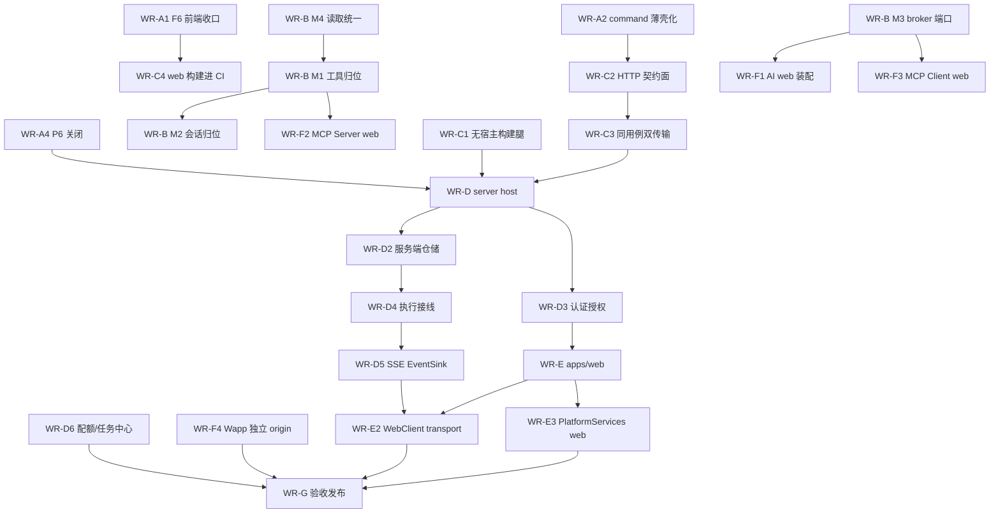

# Web Ready 完整计划：从当前基线到团队 Web 交付

> **状态：已确认的计划（拼装既有切片 + 补齐无既有文档覆盖的缺口），代码尚未按本文改动。**
> 立项日期：2026-10-31。基线：`review/code-organization-2026-10` @ `08a92d5`。
>
> 「web ready」分两级门槛，本文同时管理两者：
>
> - **可开工（ready-to-build）**：共享层形态中立、端口完整、契约可测——P7 开工后不因架构返工。
> - **已交付（delivered）**：[平台计划 §11 P7](platform-development-plan.md#11-p7单实例团队-web-服务) 退出门槛达成。
>
> 本文不复制既有方案的内容，只做三件事：**核对现状、列全差距、排定顺序**。切片编号 **WR-A…WR-G**（Web Ready 轨道），
> 与 F（宿主边界）、M（跨形态收敛）、P（平台产品 P0–P10）、D（DDD）、R（闸门）互不冲突。
> 既有文档保持权威：P7 交付项以[平台计划](platform-development-plan.md)为准；M 系列刀法以
> [边界方案 §8](host-boundary-followups.md#8-跨形态一致性收敛m-系列)为准；端口适配差异以
> [共享边界 §4.7](../architecture/platform/shared-boundaries-and-ports.md#47-三种交付形态的适配差异)为准；
> server 形态与认证以[团队服务设计](../architecture/platform/team-server-and-auth.md)为准。

## 1. 现状基线（2026-10-31 @ `08a92d5` 已核实）

| # | 层 | 现状 | web ready 判定 |
|---|---|---|---|
| 1 | Rust 内核 `modules` | 无 `tauri`/`axum` 依赖；F-14 闭包断言禁宿主 crate 与 web 框架 | ✅ 形态中立达成 |
| 2 | 端口矩阵 | 共享边界 §4.7 已定义桌面 / server 单进程 / 多 worker 三形态差异（`ProfileRepository`、`EventSink`、`SessionDirectory`、`BudgetCoordinator` 等） | ✅ 设计就绪；服务端适配器零实现 |
| 3 | MCP 共享层 | 策略层 751 行在 `modules/src/mcp`；13 个工具 + 有状态会话协议 + Resources/Prompts + MCP Client 约 4,200 行在桌面宿主 | ❌ M1 / M2 未动 |
| 4 | AI 工具面 | 工具定义/循环/守卫/schema 上下文全部共享（`modules/src/ai`）；providers 是 modules 内 HTTP 客户端；缺口 = MCP 工具面直绑桌面 `McpClientManager` | ⚠️ 差 M3 |
| 5 | runtime 读取路径 | 同一能力两条路径：AI 走 `ResourceExecutionHost` 端口，MCP 直连桌面 `RuntimeCommandSource` | ❌ 差 M4 |
| 6 | 桌面 command 层 | `commands/` 169 个 pub fn、IPC 面 215 簇；薄壳化重构已立项未完成 | ⚠️ WR-A2 |
| 7 | 前端 | 形态拆分 F1–F5 落地（编译期同形、域客户端契约测试、web stub 全 throw、`platform-extension-playbook`）；F6 收口中（workspace 协议已建、生产/测试树 `@tauri-apps` 归零、R6/R7 shim 焚烧完成） | ⚠️ F6 收口 = WR-A1 |
| 8 | web 宿主 | 不存在。`apps/` 只有 `desktop`；前端 `src/platform/web/` 只有全 throw transport stub（`CapabilityUnsupported`，编译期同形验证用） | ❌ WR-E |
| 9 | server 详细设计 | `team-server-and-auth.md`（server crate 形态、中间件链、OIDC、CSRF、授权模型）、`persistence-model.md`、`team-service-operations.md` 已就绪 | ✅ 设计就绪 |
| 10 | 跨端能力 | 导出 web 半边已示范（`createBlobTablesExporter`，Blob 下载）；Wapp 沙箱 iframe + `datazen://` 双源 CSP（桌面形态）；Tunnel 实现在 `modules` tunnel feature（共用）；AI providers 为 modules 内 HTTP 客户端 | 部分就绪，WR-F 逐项 |
| 11 | CI | 无 web 构建腿；modules 测试经桌面宿主腿编译（宿主 feature 集 = 共享 feature 集），无「无宿主独立构建」腿 | ❌ WR-C |
| 12 | P6 | 未关闭：Workflow v1 跨库 Runtime 路由、授权调度、真实驱动旅程验收、CM-53 F 层 e2e 未跑 | ⚠️ P7 的硬依赖 |

## 2. 轨道总览与依赖

关键路径：**WR-B（M 系列）与 WR-A4（P6 关闭）并行 → WR-C（契约/CI）→ WR-D（server host）→ WR-E（web 前端）→ WR-G（验收）**。
WR-F（能力落地）在 WR-D/WR-E 期间交叉插入，单项依赖见各节。

## 3. WR-A 收口轨（既有工作，web ready 的输入）

| 切片 | 内容 | 对 web ready 的意义 | 验收 |
|---|---|---|---|
| **WR-A1** | F6 前端包拆分收口：`apps/desktop` 宿主 app + `packages/frontend` 完整 workspace 包、目录迁移、R5 闸门（合法消费者只有 `apps/*`） | `apps/web` 是 F6 目标拓扑的第一位消费者；F6 不收口则 web app 无处落 | 形态拆分计划 §5.6 原验收 |
| **WR-A2** | host command 薄壳化（已立项）：command 层只做请求接线与转发，编排归 modules application；起点 `commands/ai/config.rs` | HTTP 端点镜像的是**用例**而非 IPC 命令；command 薄壳化完成后，server 的 HTTP handler 与桌面 command 是同一用例的两个薄绑定，不需要二次编排 | 每域验收：宿主 command 无业务编排；IPC 载荷不变 |
| **WR-A3** | P2 驱动注入静态化、P3 feature 图修剪 | P5 已裁决「Web 宿主重新立项时一并做」——即 WR-D1 的输入；P2/P3 降低 server 构建面的脆弱性 | 各自方案验收 |
| **WR-A4** | P6 关闭：Workflow v1 跨库 Runtime 路由、授权调度、真实驱动旅程验收、CM-53 F 层 e2e（`pnpm e2e` 实测回写） | 平台计划依赖图 P6 → P7 的硬边；AI/MCP/Wapp 的 GUI 外入口资源语义先在此关闭 | 平台计划 §10 退出门槛 |

## 4. WR-B 一致性轨（= M 系列，刀法引用边界方案 §8）

原则（2026-10-31 用户指令）：**AI 的 tool 是 web 与 desktop 共同能力——实现方式可以不同，基础能力必须一致；MCP 差异只允许是 Server 形态（stdio 子进程 / 内嵌 duplex / streamable HTTP + 服务端身份），其余完全一致；runtime 读取路径不允许「同一能力、两条适配」。**

| 切片 | 内容 | 引用 |
|---|---|---|
| **WR-B1 = M4** | 元数据读取统一：MCP 的 `runtime_schema.rs` 改走共享用例 + `ResourceExecutionHost` 端口 | 边界方案 §8.3 |
| **WR-B2 = M3** | AI 的 MCP 工具面端口化：`McpToolBroker` 消费者端口，`commands/ai/chat.rs` 两函数改走端口；桌面实现 = 现有 `McpClientManager` | 边界方案 §8.3 |
| **WR-B3 = M1** | MCP 工具分发归位：`modules/src/mcp/application/tools/`（13 工具定义 + 分发 + 无状态用例），宿主 `tools.rs` 变 rmcp 薄绑定 | 边界方案 §8.3 |
| **WR-B4 = M2** | 有状态会话语义归位：TTL、归属校验、cleanup 退避策略进 `modules/src/mcp/application/session/` | 边界方案 §8.3 |

顺序与理由沿边界方案：M4 先行消除双路径并给 M1 铺路；M3 独立且小；M1 主体；M2 可后置。

## 5. WR-C 契约与 CI 轨（新增缺口，无既有文档覆盖）

| 切片 | 内容 | 验收 |
|---|---|---|
| **WR-C1（核实后收窄，无需新刀）** | ~~modules 无宿主独立构建腿~~ 立项时误判：`pnpm test:platform-crates`（`scripts/run-platform-crate-tests.mjs`，CI rust job 既有步骤）已独立编译并测试 modules——无选择器腿用 27/29 显式 feature 清单（与宿主腿对齐，rust-cache 共享），另有 `FEATURE_TESTS` 分 feature profile 腿（settings/ai/connection+execution/named_views/monitor/dashboard/tunnel）。服务器 crate 落地后由同一腿自动覆盖（`TESTED_LAYERS` 已含 `'server'`，按目录发现，无需改 CI） | 已达成（既有）；本文记录核实修正 |
| **WR-C2** | HTTP API 契约面定义。**决策建议**：HTTP 面镜像 `packages/backend-client` 的域客户端面（`connectionClient` / `jobClient` / `executionClient` / `sessionClient` / `artifactClient` / `settingsClient`…，F3 已建 12+ 域客户端），**不镜像 IPC 命令面**（215 簇含 dialog/window/clipboard 等平台服务，不属于后端）。桌面专属能力（updater、window、native dialog）不出现在 HTTP 面，由 `capabilities` 表（F5）声明差异 | 每域 HTTP 端点与域客户端方法一一对应；多余端点为零；`WEB_CAPABILITIES` 不含桌面专属项 |
| **WR-C3** | 同用例双传输测试基础设施：同一用例（组装 request → 调 application → 断言）在 IPC 与 HTTP 两绑定下跑（P7 交付项「桌面 IPC 与 HTTP 同用例测试」的前置抽离） | 新用例测试两腿同绿；形态差异只允许出现在装配层断言 |
| **WR-C4** | `apps/web` 建立后 web 构建腿进 CI（typecheck + vite build + 域契约测试） | CI 腿绿；web stub 的全 throw 语义不被绕过（能力未实现时显式 `CapabilityUnsupported`） |

## 6. WR-D server host 轨（P7 服务端本体）

形态与组装以[团队服务设计 §2](../architecture/platform/team-server-and-auth.md#2-server-crate-形态与-composition-root) 为权威（目录树、依赖闭包检查、组装顺序、进程模式）。

| 切片 | 内容 | 引用 / 验收 |
|---|---|---|
| **WR-D1** | `apps/server`（或 `server/`）crate 骨架：composition root、中间件链（§3 进入顺序）、无 Tauri 依赖独立构建；**P5 目录语义化随本切片一并做**（code-organization-review §4 P5 既定安排） | §2.2 依赖闭包检查命中即失败；无 Tauri feature 也通过 |
| **WR-D2** | 服务端仓储适配器：`ProfileRepository` / `JobRepository` / `Audit` / `ArtifactRepository` / `TunnelRepository` / `KnownHostsRepository` / `ConnectionRepository` 的服务端 SQLite 实现 + schema migration（expand/contract，不先删字段） | 同一 domain trait、另一适配器；不复用宿主 AES 落盘实现（§4.7 既定）；migration 可核验恢复 |
| **WR-D3** | 认证授权：OIDC 登录、membership、服务端登录会话、RBAC/资源 ACL、CSRF、同源 HTTPS；授权变更与 `permissionVersion` 同事务提交 | 团队服务 §4–§6；越权/CSRF/组织隔离全部拒绝断言 |
| **WR-D4** | 执行接线：`ExecutionGateway`、`SessionDirectory`（单进程实现）、`BudgetCoordinator`（节点额度）、`SubmissionTokenIssuer`（服务端签名密钥 + `keyVersion`）、`SecretProvider`（服务端密钥管理 + secretRef 轮换）、`NetworkProvider`（出站白名单）、`IdentityResolver`（数据库侧服务身份 + 委托） | §4.7 端口表逐项「同一端口、另一适配器」；全部入口走 ExecutionGateway |
| **WR-D5** | `EventSink` SSE 适配：SSE 重订阅、分页/大小限制、Origin 校验、revision 缺口重读 | CM-55 的 W1 断言（超大 revision、乱序、重连） |
| **WR-D6** | 配额、任务中心、结果 TTL、配置版本 CAS、权限撤销传播 | 平台计划 §11 交付项 |
| **WR-D7** | 幂等提交、受控上传下载 | 平台计划 §11 交付项 |

## 7. WR-E web 前端轨

| 切片 | 内容 | 验收 |
|---|---|---|
| **WR-E1** | `apps/web` 宿主应用：vite + 路由；窗口能力替换为页面/面板（形态拆分既定形态） | 与 `apps/desktop` 同用 `@datazen/frontend`；无 `@tauri-apps` import（R5/R6 闸门天然合规） |
| **WR-E2** | `WebClient` transport：`BackendTransport` 的 HTTP/SSE 实现，替换 `src/platform/web/` 全 throw stub；域客户端（F3）零改动 | 域契约表 `domainContractTables` 测试在 HTTP 腿同绿 |
| **WR-E3** | `PlatformServices` web 实现：文件/剪贴板/对话框走浏览器原生；导出走 Blob 半边（已示范）；宿主叠加能力（`platform.host.config.get()`）web 注入空缺省 | F5 契约测试 `platformContracts` 在 web 腿绿 |
| **WR-E4** | capabilities 激活：`WEB_CAPABILITIES` 静态表（F5 已建）成为 web 装配的实际输入；updater/versionSource 等桌面专属项按表降级 | 无运行时形态探测（编译期同形原则不破） |
| **WR-E5** | 部署形态：静态资源由 server host 同源服务（SSE 缺失 Origin 有明确校验的前提） | 同源 HTTPS 部署验收 |

## 8. WR-F 能力落地轨（跨端能力，逐项「能力一致、仅形态差异」）

| 切片 | 内容 | 形态差异（允许的部分） | 验收 |
|---|---|---|---|
| **WR-F1** | AI 落地 web：providers 已是 modules 内 HTTP 客户端（服务端可跑）；装配点 = `AiRequestHost` web 实现、`McpToolBroker` web 实现（WR-B2 端口）、AI 密钥经 `SecretProvider` | 密钥存放（钥匙串 → 服务端密钥管理） | AI 工具循环测试不感知形态（M3 验收的延伸） |
| **WR-F2** | MCP Server web 形态：M1/M2 完成后宿主只剩 rmcp 传输绑定，web 侧实现 streamable HTTP（或内嵌 duplex）传输 + 服务端身份 | **仅 Server 形态**：stdio 子进程 → streamable HTTP | golden 契约 `mcp_external_contract.json` 两形态逐字节一致 |
| **WR-F3** | MCP Client web：`McpClientManager` 端口的 HTTP/SSE 客户端实现；stdio spawn 白名单、token 校验留桌面 | 仅传输与进程模型 | 同一 broker 端口两形态测试 |
| **WR-F4** | Wapp web：独立真实 origin + 可嵌入 CSP + 真实 iframe 握手（P7 上线前冻结验收项）；`wappBridge` postMessage 协议不变；`datazen://` 资产服务替换为真实 origin 静态服务 | 仅资产服务协议（自定义 scheme → 真实 origin）；CSP 双源约束随之简化为单源 | 桥契约测试两形态同绿；审计（`wapp_audit_log`）等价 |
| **WR-F5** | Tunnel：实现已在 `modules` tunnel feature 共用；web 宿主只注入存储根、凭据、监听点 | 仅注入来源 | 桌面/Web 同隧道语义测试 |
| **WR-F6** | 导出/备份/恢复 web：服务端 `ArtifactRepository` + 受控下载；前端 Blob 下载半边已示范 | 仅字节出口（本机路径 → 受控下载） | 产物越权拒绝断言 |
| **WR-F7** | 驱动执行：全部服务端执行；浏览器零数据库凭据；`NetworkProvider` 出站网络政策 | 无（执行位置由架构决定，非形态差异） | P7 门槛「浏览器无需数据库凭据」 |

## 9. WR-G 验收与发布轨

| 切片 | 内容 | 引用 |
|---|---|---|
| **WR-G1** | CM W1 断言：CM-05～07、38～40、53～56、59、60 单实例部分及 CM-63、68、70、72 的 W1 断言 | 平台计划 §11 退出门槛 |
| **WR-G2** | 上线前冻结验收：授权同事务、DDL 与历史登记同事务、expand schema 兼容、授权可见性先于会话存活错误、SSE Origin 校验、Wapp 独立 origin/CSP/iframe 握手——每项配浏览器/管理库故障测试，不以 fake 替代 | 平台计划 §11 冻结清单 |
| **WR-G3** | 部署运维：发布镜像、管理数据库、SecretProvider、网络可达性、备份恢复（不自动重放未知外部写入）、TLS、资源额度、drain 回退 | `team-service-operations.md` |
| **WR-G4** | P8 衔接：桌面团队客户端（backendId、版本握手、per-backend client）不在本文展开，P7 交付后按平台计划 §12 | 平台计划 §12 |

## 10. 推荐执行顺序

1. **并行启动（当前即可）**：WR-B1（M4，最小刀）∥ WR-A2（command 薄壳化，逐域推进）∥ WR-A1（F6 收口）∥ WR-A4（P6 关闭项）。
2. **第二波**：WR-B2（M3）→ WR-B3（M1）→ WR-B4（M2）；同期 WR-C1（无宿主构建腿）、WR-C2（HTTP 契约面决策与定义）。
3. **第三波**：WR-D1（server 骨架 + P5 目录语义化）→ WR-D2/D3/D4 并行 → WR-D5/D6/D7；WR-C3（同用例双传输）随 D1 落地。
4. **第四波**：WR-E1 → WR-E2/E3/E4 并行；WR-F 各切片在对应端口就绪后交叉插入（F1/F3 依赖 B2；F2 依赖 B3+B4；F4 随 E1）。
5. **收口**：WR-C4（web CI 腿，E1 建立即插）→ WR-G1–G3 验收发布。

**可开工门槛的判定**：WR-A（1/2/4）+ WR-B（全四刀）+ WR-C（1/2/3）完成即视为 ready-to-build——此后 P7 主体（WR-D/E/F/G）不再有架构性返工风险。

## 11. 进度回写区

> 纪律：每项切片完成 → 验证 → 提交推送 → 在此登记（日期、提交、一句话事实）。

- **2026-10-31 — WR-B1 = M4 完成**：runtime 读取路径统一。`read_target_command`/`driver_for_connection` 用例化进 `modules/src/workflow/application/runtime_reads.rs`（feature 环裁决：原计划 mcp 域不能反向依赖 workflow/ai，落点调整为 workflow + ai 两处），`connection_schema_context` 姊妹用例落 `ai/application/schema_context.rs`；宿主删 `mcp/runtime_schema.rs` 与 `RuntimeCommandSource` 的 inherent 捷径，`DataZenMcpServer` 以 `resource_host: Arc<dyn ResourceExecutionHost>` 端口字段装配；Wapp 读取同步换轨。验收达成：`mcp/` 不再引用 `RuntimeCommandSource`；MCP 错误文本逐字不变；modules 新增 6 个行为钉子测试。详见[边界方案 §8.3](host-boundary-followups.md#83-收敛切片每刀独立-pr) M4 行。
- **2026-10-31 — WR-B2 = M3 完成**：AI 的 MCP 工具面端口化。`McpToolBroker` 消费者端口 + `McpBrokeredTool` 中立结构落 `ai/application/ports.rs`，装配用例（qualified 命名、`ToolDefinition` 映射、`String` 执行契约与错误文案）落 `ai/application/mcp_tools.rs`；桌面 `AppState` 实现端口（`services/feature_ports.rs`，stdio/白名单/token 留桌面），`commands/ai/chat.rs` 两函数变薄壳，`mcp_qualified_name` 变共享规则转发。验收达成：工具循环测试不感知形态；桌面 MCP client 测试零改动；错误文案逐字保留；共享层 5 个用例测试。详见边界方案 §8.3 M3 行。
- **2026-10-31 — WR-B3 = M1 主体完成（10/13 工具）**：MCP 工具分发归位。前置刀把 `permission`/`command_policy` 迁入 execution 解开 feature 环（mcp 保持旧路径垫片）；十个无状态工具用例进 `mcp/application/tools.rs`（七个走 `ResourceExecutionHost`，list_connections 走新 `RedactedConnectionSource` 端口，workflows 二连走 `WorkflowCatalog` 端口 + 共享 executor）；错误通道中立化为 `ToolError` 两分；宿主 `tools.rs` 全部无状态函数变薄壳，`#[tool]`/JsonSchema/rmcp 错误留绑定层。会话三工具留 M2。详见边界方案 §8.3 M1 行。
