# DataZen 产品功能总览

> 本文是 DataZen 的完整功能清单（不含 Workspace App），目标是让用户快速了解「DataZen 能做什么」。
> 口径基于 **v0.3.0**（2026-11-14 发布）。逐步操作说明见 [DataZen 操作手册](user-manual.zh-CN.md)；领域深度文档见各功能指南（文末索引）。
>
> 官网：https://flyxl.github.io/datazen/ · 源码：https://github.com/flyxl/datazen

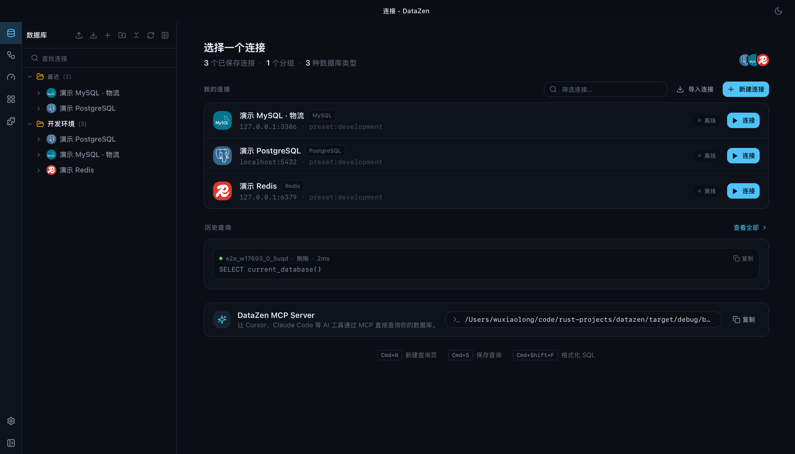

## 1. 产品定位

DataZen 是一款**开源免费的跨平台数据库工作台**，运行在 macOS / Windows / Linux，基于 Tauri v2 + Rust + React 构建（无 JVM、无 Electron）。除常规的连接管理、SQL 编辑、数据浏览之外，它把以下能力放进了同一个工作流：

| 维度 | 内容 |
| --- | --- |
| 数据库支持 | 17 个驱动（构建时选型）+ wire 协议兼容复乘 |
| SQL 编辑 | Schema 感知补全、实时诊断、语句级执行、意图修复、参数绑定、事务工具栏 |
| 数据操作 | 类型化单元格编辑、暂存-预览-提交、外键跳转、筛选/排序/分页全套 |
| AI | NL2SQL、错误诊断、EXPLAIN 分析、Ask/Agent 双模式、AI 记忆 |
| Agent 生态 | MCP Server + MCP Client、`datazen` CLI、官方 Agent Skill |
| 自动化 | YAML Workflow（query/command/ai/condition/foreach/merge/transform） |
| 监控 | 查询结果图表、运营看板（定时刷新 + 阈值告警） |
| 数据迁移 | Schema Diff（依赖 DAG）、Data Sync、Data Transfer、备份 |
| 导入导出 | CSV / TSV / XLSX / Parquet / JSON / Markdown / SQL INSERT / SQL UPDATE |
| 安全 | AES-256-GCM + 系统钥匙串、只读连接、Safe Mode、SQL 安全门、MCP 治理 |
| 隐私 | 无账号、无云端、无遥测；AI 只连你配置的 Provider |
| 界面语言 | 10 种内置 + 外部语言包安装 |

核心开源协议为 GPLv3+（附带插件/驱动/扩展链接例外）；独立驱动 SDK `datazen-driver-api` 单独以 MIT 发布。

## 2. 数据库支持

| 数据库 | 构建集 | 说明 |
| --- | --- | --- |
| PostgreSQL | basic | SQL、对象浏览、EXPLAIN、AI 上下文、多数据库 |
| MySQL / MariaDB | basic | SQL、对象浏览、EXPLAIN、多数据库 |
| SQLite | basic | 嵌入式与文件库工作流 |
| Redis | basic | 键浏览、Console、工作台、Slowlog、Pub/Sub、MONITOR |
| MongoDB | all | 文档库 |
| SQL Server | all | T-SQL 方言，已在 Azure SQL 上活体验证 |
| ClickHouse | all | HTTP 接口、多数据库 |
| DuckDB | all | 嵌入式分析 |
| Elasticsearch | all | 搜索引擎 |
| InfluxDB / VictoriaMetrics | all | 时序数据库 |
| RQLite / Turso | all | 分布式 / 边缘 SQLite |
| HBase | all | REST 接口 |
| 通用向量数据库 | all | HTTP 向量端点 |
| Kiwi（云数据库代理） | git 驱动 | 代理云实例 |
| Superset | git 驱动 | 数据探索平台（Hive） |

- **协议兼容复乘**：QuestDB / Cloudberry 走 PostgreSQL wire；Doris / StarRocks / OceanBase 走 MySQL wire，无需单独驱动。
- **构建时选型**：`basic` 是四个核心驱动，`all` 是全部注册的 path 驱动；git 驱动按需加入（如 `--drivers=basic,kiwi,superset`）。发行包无需自带所有引擎。
- 外部驱动基于 MIT 的 `datazen-driver-api` 独立开发，additive 升级无需重新编译。
- 注：v0.3.0 起移除了 `olap` 驱动（Presto/Trino 可经通用 HTTP/SQL 驱动或独立驱动接入）。

## 3. 连接与工作区

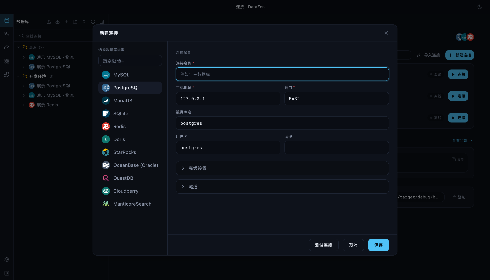

- **连接管理**：按类型建连（服务器型 / 文件型 / Redis 库索引 / TLS）、连接 URL / 连接串直接粘贴识别、测试连接、分组与颜色标记、环境命名（`prod` 等分组名会被 CLI 的生产保护识别）。
- **高级设置**：SSL 模式（禁用 / 首选 / 必须）、**只读连接**（驱动层拒绝写入）、颜色标记、分组。
- **连接导入**：从 TablePlus、Navicat（.ncx）、DataGrip、DBeaver、DBX 批量导入；应用数据 / 连接配置可经菜单导出导入（ZIP 档案，主密钥有意不打包并单独备份）。
- **数据库隧道**：SSH / HTTP CONNECT / WebSocket 隧道在设置页统一管理，可测试、可删除，连接时挂隧道直达内网库。
- **工作区形态**：主窗口统一承载连接、查询、设置；**备份、Data Sync、Data Transfer、Schema Diff、Workflow、看板**以独立窗口运行；多标签页 + 多数据库/多 Schema 并行。

## 4. SQL 编辑器

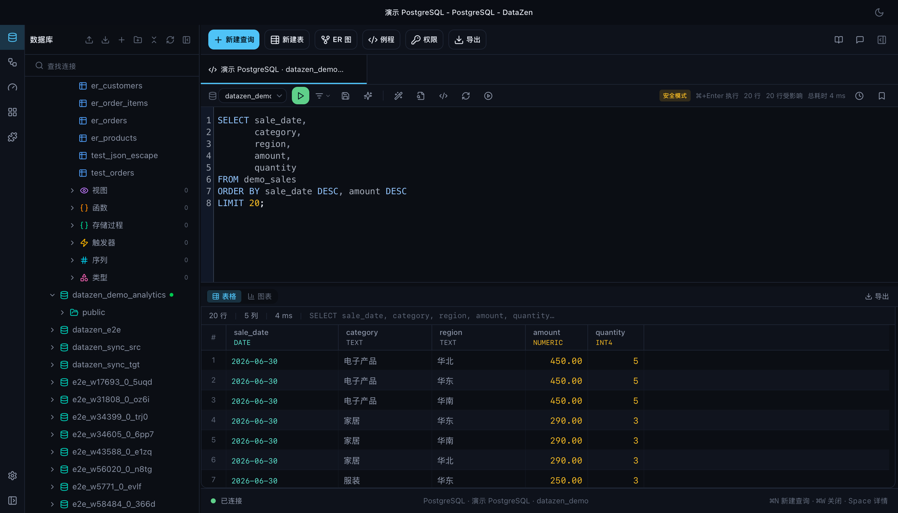

### 4.1 基础与补全

- 方言感知语法高亮（PG / MySQL / SQLite / SQL Server / ClickHouse 等），表/列/关键字/函数补全按当前上下文过滤；`Tab` 接受。
- **FK 感知 JOIN 补全**：输入 `JOIN` 时按外键推荐关联表，自动带别名与完整 `ON` 子句（支持复合键、自连接）。
- 悬浮卡片：悬停表名显示列清单/主键/索引/注释与快捷操作；悬停列名显示类型、默认值、外键；⌘/Ctrl+点击跳转到表数据或结构定位。
- 内联提示：INSERT VALUES 每个值前显示对应列名；函数调用显示参数名提示与签名帮助。
- 多光标、代码折叠、格式化（选中或全文）、注释切换、搜索替换、撤销栈。
- Schema 树拖拽表名/列名入编辑器，自动带方言引号；跨连接拖拽会被拦截。
- **粘贴转 IN**（⌘/Ctrl+Shift+V）：从 Excel 或文本复制一列值，自动生成合法 `IN (...)`，数字不加引号、字符串加引号。

### 4.2 执行与诊断

- **执行范围**：⌘/Ctrl+Enter 执行；遇到多语句脚本时弹出「选择执行范围」（仅当前语句 / 整段脚本），也可在执行策略中固定行为；选中即只执行所选。当前语句有背景高亮与行号栏 ▶ 单语句执行按钮。
- **实时诊断（Linter）**：未知表名 / 未知列名 / 类型不匹配 / 无 WHERE 的 UPDATE / DELETE 即时波浪线提示（400ms 防抖，大文档自动降级）。
- **Alt+Enter 意图（快速修复）**：展开/折叠 `SELECT *`、添加/移除表别名、INSERT 模板生成（列清单 + 类型化默认值）等。
- **SQL 安全门**：高危语句（TRUNCATE / DROP / 无 WHERE 更新删除）执行前强制确认；Safe Mode 开关拦截高危 SQL。
- **参数绑定面板**：识别 `:name` / `$1` / `?` 占位符，带类型提示与最近值历史（敏感参数名不入历史）。
- **事务工具栏**：Begin / Commit / Rollback，未闭合事务有提醒；自动提交可在设置切换。
- **执行 .sql 文件**：菜单选择文件对目标库执行，进度与破坏性二次确认。
- **查询历史**：状态 / 时间范围 / 数据库 / Schema 四维筛选，最新/最早/最慢排序，批量导出、复制 SQL、一键收藏；截断时明示「{shown} / {total}」。
- **SQL 片段收藏**：收藏以 ULID 命名的 `.sql` 文件存储（元数据在注释行），可用 iCloud / Dropbox / Git 同步。

## 5. 数据浏览与编辑

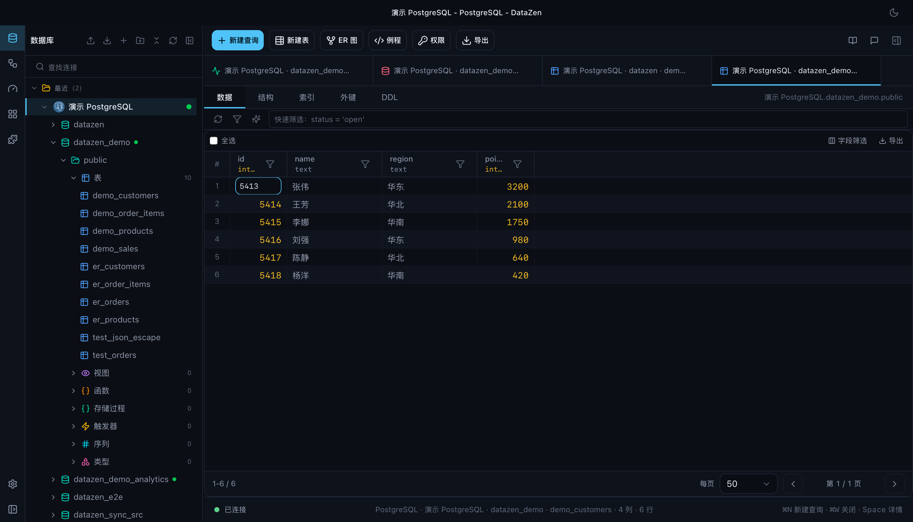

### 5.1 浏览

- 表数据标签页按页读取（默认 50 行，25/50/100/200/500 可调），虚拟滚动；查询结果流式加载。
- **行数三态**：精确总数 / `≈` 估算（PostgreSQL 走 `pg_class` 统计）/ 未知；估算不会钳制页码，可一键精确计数。
- **快速分页（keyset）**：按驱动能力启用，跨方言 seek 语法；不可用时的退化原因在页脚逐条说明。
- **筛选**：逐条条件（并且 / 或者），操作符按列类型分派（数字 / 文本 / 时间 / 几何 / 数组 / 二进制 / 枚举各有正确算子集）；未完成条件显式阻断而非发出错误 SQL；支持 Any Column / Raw SQL 谓词（后端校验、预览执行同链）。
- **AI 智能筛选**：直接输入「age > 18 and name contains John」这类自然语言条件。
- **全库值搜索**：跨表找值，Schema 感知的搜索范围与定位。
- **排序**：表头单击三态循环（升 → 降 → 无）；列头右键**多列排序**（追加式、带序号徽标、可改向/移除/清空）；排序按「连接+库+模式+表」持久化。
- **列工具**：拖拽换位、冻结前 N 列、列宽持久化（双击自适应也照记）、**列统计**（服务端聚合：行数 / 非空 / NULL / 去重 / 最小 / 最大 / 数值列均值）。
- **详情面板**：`Space` 开关，查看整行与 BLOB；单元格值过大走延迟展示。
- 外观：网格密度（紧凑/标准/宽松）、交替行、行号列、自动隐藏滚动条。

### 5.2 编辑（表数据标签页）

- **类型化单元格编辑**：11 种 `CellType`，每种类型族专用控件（文本 / 数字 / 布尔 / 日期时间 / JSON / UUID / 枚举 / 二进制 / 长文本等）；JSON 非法输入阻止提交并给出行内原因；枚举候选值按需加载（最多 200 个相异值）。
- **写入意图三态**：`NULL`、值、「不写这一列（默认值）」是三个明确意图，不再互相折叠；「设为 NULL」与「设为空字符串」严格区分。
- **暂存 → 预览 → 提交**：编辑先入暂存区（脏标记角标，悬停看「原值 → 新值」），预览列出待执行语句与参数指纹，提交前确认，整批在一个事务内执行；回滚丢弃全部暂存。可配合手动事务使用。
- **插入行**：⌘/Ctrl+I 或在末尾空白双击新增草稿行；⌘/Ctrl+D 复制行；每列可选「默认值」或「设为 NULL」；提交后能定位则高亮，不能定位则如实提示。
- **删除行**：需主键，Delete 触发并确认；被标记删除的行整行划掉，可撤销标记。
- **键盘优先**：方向键 / Shift 扩展 / Home / End / PageUp / PageDown / Enter / F2 / Esc 全套；⌘A 全选本页。
- **复制与粘贴**：选区复制（TSV / CSV / JSON / 纯文本 / HTML 表格 / Markdown 表格 / SQL INSERT / SQL UPDATE），复制出去与导出文件用同一序列化内核；粘贴按「同表按列名对齐、外部按位置对齐且必先确认」，大块（>2000 格）先确认，NULL/空串/自增列规则明确，粘贴入暂存区可预览回滚。
- **外键跳转**：FK 单元格箭头一键跳到目标表并按值筛选；面包屑 + 返回栈（⌘/Ctrl+⌥+←/→），历史 32 步；复合键整组跳转。
- **Set Value**：「设为当前时间」类型化写表达式、Quick Look 快捷入口、二进制从文件加载。
- **不能编辑时的原因**：只读连接 / 驱动不支持 / 视图 / 无主键 / 自增列 / 生成列 / 二进制过大等都会给出明确提示；无主键表提供「用 SQL 编辑」模板（先 SELECT 定位再写 UPDATE/DELETE）。

### 5.3 查询结果编辑（live 编辑）

- 含主键列的直接投影 `SELECT`（单表、无聚合/DISTINCT/UNION/跨表）可进入**窄写回映射**直接编辑。
- 修改先**暂存**（脏标记）→ **预览** → 显式**提交/回滚**，支持一次提交多处修改；提交后保留运行时绑定，可在同一 live 结果继续编辑（Navicat 式）。
- 其余结果（聚合 / 跨表 / DISTINCT / UNION / 视图来源 / 缺主键列等）为只读，并给出具体原因。

## 6. 导入与导出

- **导出**：CSV / TSV / **XLSX** / **Parquet**（按方言与列值做 schema 推断，读回验收）/ JSON / Markdown / SQL INSERT / **SQL UPDATE**；范围支持当前页 / 已选中行 / 整表流式导出；多表批量导出支持结构+数据、单文件或 ZIP；无会话导出（只依赖已加载数据不再要求打开连接）；流式进度与**中途取消**；`.part` 中转原子保存（失败保留原文件）；CSV 公式注入防护统一到 Rust 流式写出。
- **导入**：CSV / JSON / XLSX → 目标表；RFC-4180 解析器、列映射向导、分批事务执行、可解释的错误报告。
- 查询结果与已加载结果集都可作为导出源；「复制为 CSV」与导出文件共用同一转义规则。

## 7. 对象与结构

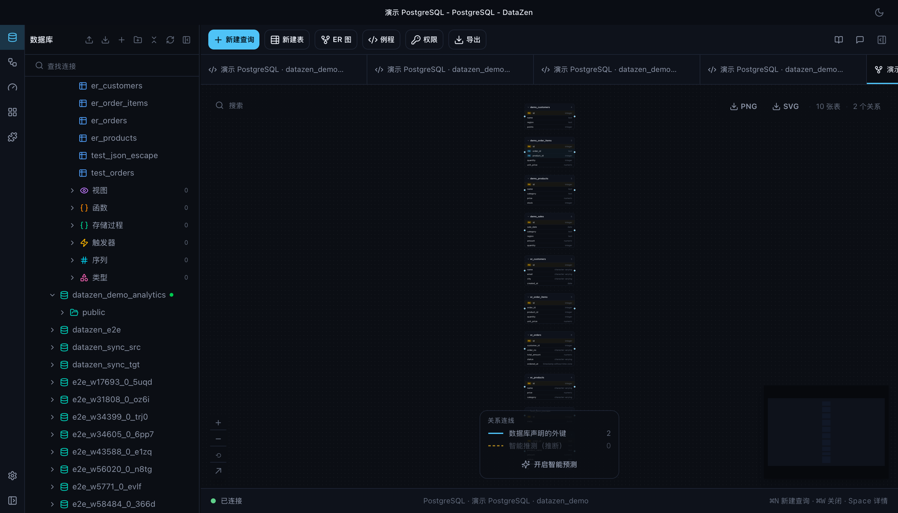

- **对象树**：数据库 / Schema / 表 / 视图 / 函数 / 存储过程 / 触发器 / 序列 / 类型；右键菜单提供建库、建 Schema、建用户、授权等管理命令（随驱动能力动态出现）。
- **表结构**：数据 / 结构 / 索引 / 外键 / DDL 五视图；结构编辑器可改列、索引、注释等（随驱动）；新建表向导；**权限视图**查看与授予 / 回收。
- **ER 图**：按外键关系自动生成，支持搜索、缩放适配、折叠列，导出 PNG / SVG。
- **服务器状态**：实时趋势图与进程列表（可 Kill 会话，视驱动支持）。
- **可视化查询构建器**：三区布局、拖拽连线生成 JOIN、外键自动推断、可切回 SQL 视图。

## 8. 查询结果图表

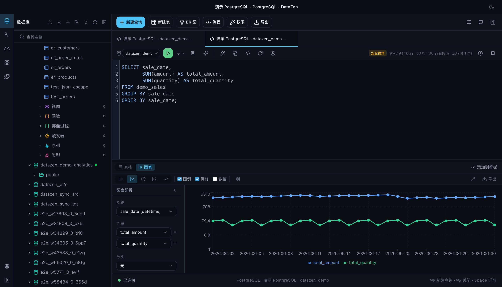

- 结果区表格 ⇄ 图表切换（可设置自动切换）；按结果集智能推荐类型并给理由（时间序列 → 折线、占比 → 饼图、对比 → 柱状、两组数值 → 散点）。
- 图表类型：折线 / 柱状 / 饼 / 散点 / 面积；多序列 X/Y、分组、聚合（求和/平均/计数/最值）、排序、配色、图例与数值标签。
- 可用自然语言指令调整（「改成柱状图」「按 X 升序」）；导出 PNG / SVG；一键「添加到看板」持续监控。

## 9. AI 助手

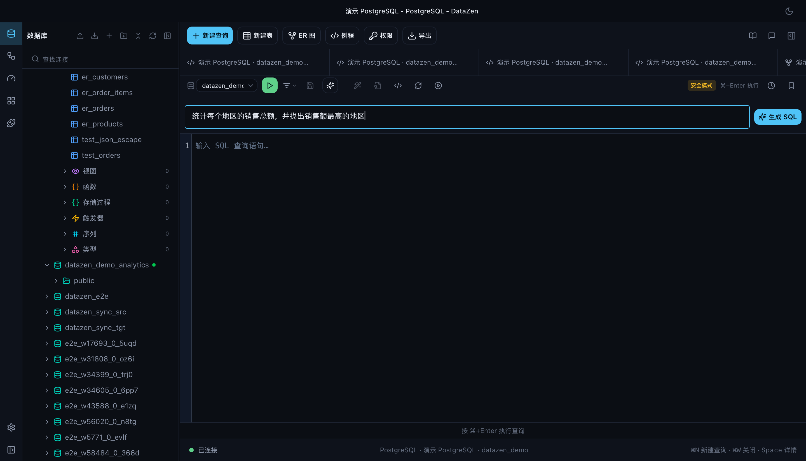

- **Provider**：OpenAI、Anthropic、DeepSeek、Ollama（全本地）、自定义 OpenAI/Anthropic 兼容端点；协议支持 OpenAI Chat Completions / Responses、Anthropic Messages；兼容性自动探测；API Key 加密存储（`ai_config.enc`），不出现在日志。
- **本地 CLI Agent Provider**：把 Claude Code、Codex、Cursor 等编码 CLI 作为模型后端。
- **NL2SQL**：基于当前连接的真实 Schema 生成，流式回填编辑器，可应用 / 复制 / 「应用并生成图表」。
- **错误诊断**：报错 + Schema → 原因 + 可直接运行的修正 SQL。
- **EXPLAIN 分析**：解读执行计划，指出昂贵扫描与缺失索引。
- **AI Chat / Ask / Agent 双模式**（v0.3.0）：Ask 回答并生成 SQL 由你执行；Agent 自主调用只读查询与采样工具多步完成（未绑定连接 fail-closed）。
- **AI 记忆**（v0.3.0）：记住表间关系、业务口径与修正偏好，检索注入对话与 NL2SQL；连接笔记优先；管理 UI 可增删查。
- **会话与上下文**：AI 会话绑定稳定连接 id 并持久化；编辑器选区可注入对话；`@` 引用当前连接的表与 AI Context 目录中的文件；回复中的 SQL 方言代码块可直接执行。
- **出网安全**：strict egress 默认开启，流量只去你配置的 Provider；生成可随时取消；响应带 `egress_summary` 用量摘要。
- **其他触点**：表格智能筛选、数据同步差异解读、Workflow AI 步骤与 AI Create、提示词多级覆盖（全局 / 每驱动）与 `.ctx.yaml` 表组。

## 10. MCP：Server 与 Client

### 10.1 MCP Server

- 工具：`list_connections`、`list_databases`、`list_tables`、`search_tables`、`get_schema`、`describe_table`、`query`、`explain_query`、`list_workflows`、`run_workflow`，以及有状态会话 `open_session` / `use_session` / `close_session`。
- 资源：`datazen://connections`、`datazen://query-history`、`datazen://schema/{connectionId}/{database}`、`datazen://workflows`。
- **权限模式**：只读 / **安全写入（默认，允许 DML、拒绝 DROP、TRUNCATE、ALTER、CREATE USER 等高危语句）** / 高危写入；非只读调用逐次确认；工具可逐个开关，连接可设 allowlist；工具调用有作用域与审计（v0.3.0）。
- 两种运行形态：桌面 GUI 内置（设置页一键复制 Cursor / Claude 配置）；**`--mcp-stdio` 无头模式**接入 CI 与 Agent 管线。

### 10.2 MCP Client

- 设置页添加外部 MCP Server（name / command / args），工具与上下文折入 AI 对话。
- Streamable HTTP 传输为 opt-in；插件与工作流工具经确认接入。

## 11. datazen CLI 与官方 Agent Skill

```bash
cargo build -p datazen-cli --release   # 二进制 target/release/datazen
datazen agent setup                    # 安装官方 SKILL.md → ~/.agents/skills/datazen/
```

- 命令：`doctor` / `capabilities` / `connections` / `schema` / `context` / `query` / `open` / `agent setup`；输出 `--json` / `--csv` / `--file`。
- **只读优先**：写语句默认 `E_READ_ONLY`；`--allow-writes` 放行 DML；DDL 还需 `--allow-dangerous-sql`；**生产连接（名称/分组含 prod）强制拒绝写入**；`--limit` 在驱动执行前改写（SQL Server 做客户端行数上限）；`--timeout` 支持超时。
- 复用桌面连接档案与 AES 密钥，不保存第二份凭据；输出不含密码、token、连接串。
- 本构建链接 PostgreSQL、MySQL（含兼容驱动）、SQLite 驱动；其余引擎经桌面端能力访问。
- `datazen open <connection> [--query "..."]` 通过 argv 契约唤起桌面应用并打开查询。

## 12. Workflow 自动化

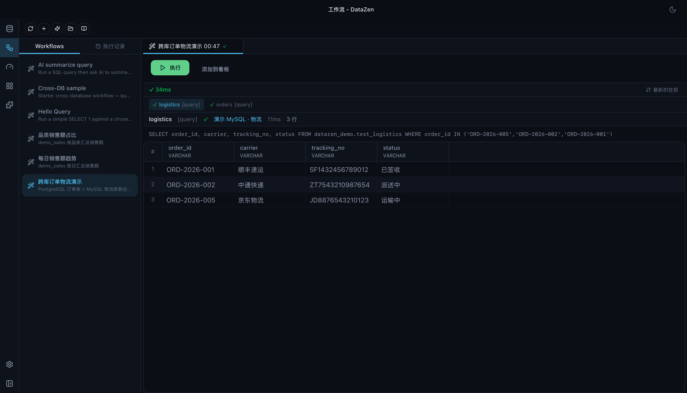

- **步骤类型**：`query` / `command`（驱动命令）/ `ai` / `condition` / `foreach`（默认上限 100 次）/ `merge` / `transform`（后两者为纯数据变换，不支持任意代码）。
- **变量与模板**：`string` / `number` / `connection` 类型入参，`{{...}}` 替换 SQL、prompt、连接与结果（`{{steps.xxx.result}}`）。
- **跨库**：Workflow 可设默认连接，Step 级覆盖 `connection` / `database`；多库结果可用 `merge` 并表。
- **错误策略**：`abort`（默认）/ `skip` / `fallback`，支持 Step 级覆盖与全局超时（默认 300 秒）。
- **编辑与创建**：可视化表单 + YAML 双模式（YAML 为 snake_case 字段）；「AI Create」自然语言生成草稿。
- **运行入口**：连接窗口 AI 侧栏、独立 Workflow 窗口、MCP `run_workflow`、无头模式；逐步显示每个 Step 的结果表、SQL 与耗时，执行历史可回看。
- 支持**定时调度**（可按迁移档案定时执行）；服务端形态有双端定时调度器。

## 13. 运营看板（Ops Dashboard）

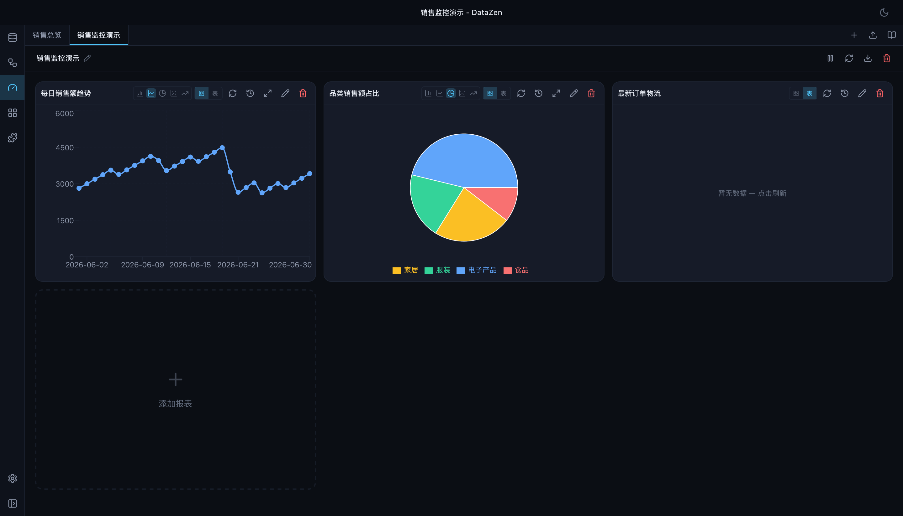

- 独立监控窗口：12 列网格画布，组件绑定已保存连接 + 监控 SQL + 图表配置。
- 后台 MonitorEngine 按间隔自动刷新（最低 30 秒）；关闭窗口不停止调度。
- **阈值告警**：指标列 + 聚合 + 比较符 + 阈值 + 冷却时间，通知渠道桌面通知 / Webhook（邮件暂未开放）。
- 每次运行的历史快照落盘，可在组件「历史」抽屉回放；看板定义可导入导出（不含凭据与历史）；全局暂停/恢复与托盘同步。

## 14. 数据迁移三件套

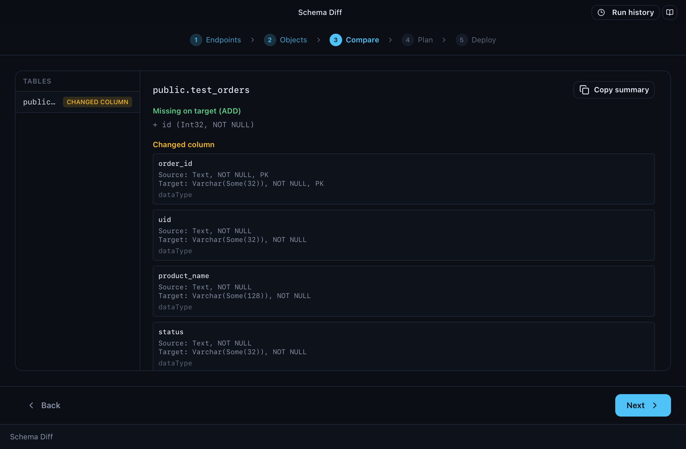

| 功能 | 场景 | 能力 |
| --- | --- | --- |
| Schema Diff | 结构对比与同步 | 统一对象规划器 + **依赖 DAG** 排序部署（视图/例程/触发器/外键按正确顺序）；可迁移对象覆盖视图、存储过程/函数、触发器、CHECK 约束、表选项、用户自定义类型、PG 序列、SQLite 安全表重建；审阅对象选择可持久化为 Profile；目标侧删表有外键目录守卫 |
| Data Sync | 同族库行级同步 | PostgreSQL ⇄ PostgreSQL、MySQL ⇄ MySQL 等同族配对；不可变比较计划（指纹锁定）、大体量比较**溢写磁盘**（进程退出可恢复）、流式比较、稳定读快照、显式冲突策略与乐观写冲突检测、跨页全选 |
| Data Transfer | 异构迁移 | 外键依赖写入排序、**有界可续传检查点**（空页续传、回滚围栏）、PG 序列身份保留、有损列映射拒绝、UTF-8 保真、SQL 文件目标（原子写入、gzip、按方言渲染、表映射 workflow） |

- 三件套共享**运行历史**与可复用 Profile（AES-GCM 加密持久化），可挂 Workflow 调度器定时执行。
- **先预览审阅再执行**是统一纪律；源/目标任一端非同族时在界面标注「实验性」。
- 数据库**备份/恢复**为独立子窗口：选连接与库、方言 dump 选项、可选 Gzip、分阶段进度与可复制执行日志；恢复模式重放备份文件，目标已有对象时要求破坏性覆盖确认。

## 15. Redis 工具

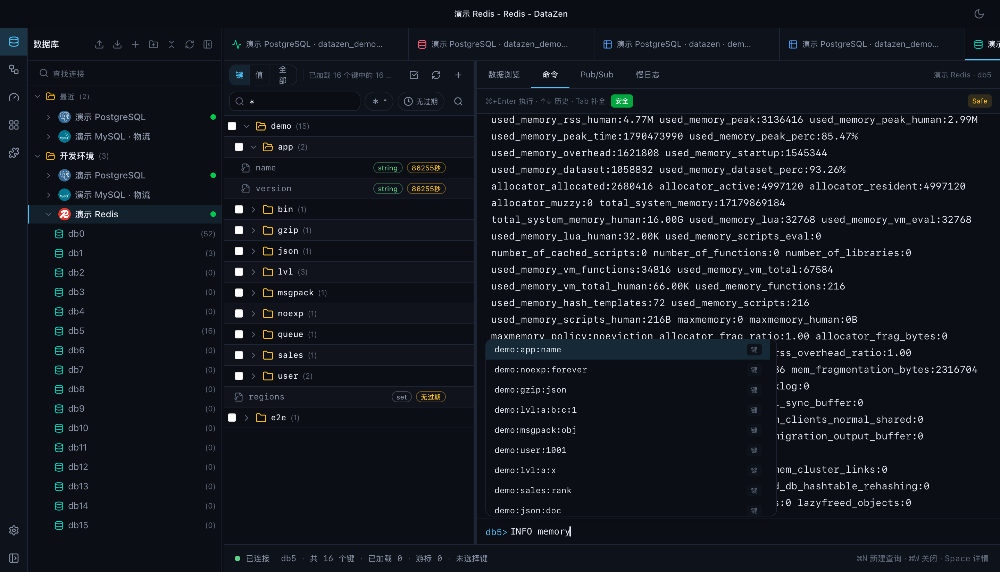

- 键浏览：键树 / 扁平双模式（SCAN 游标保持位置）、类型过滤、TTL 查看与修改、按类型查看与编辑值（String / Hash / List / Set / ZSet / Stream）。
- Console：直接执行 Redis 命令，危险命令分类 fail-closed。
- Slowlog、**MEMORY USAGE**、Pub/Sub 订阅、MONITOR 实时命令流。
- 压缩值解码：gzip / zlib / deflate / base64。
- 集群与哨兵模式感知；连接表单支持库索引与 TLS。

## 16. 安全与隐私

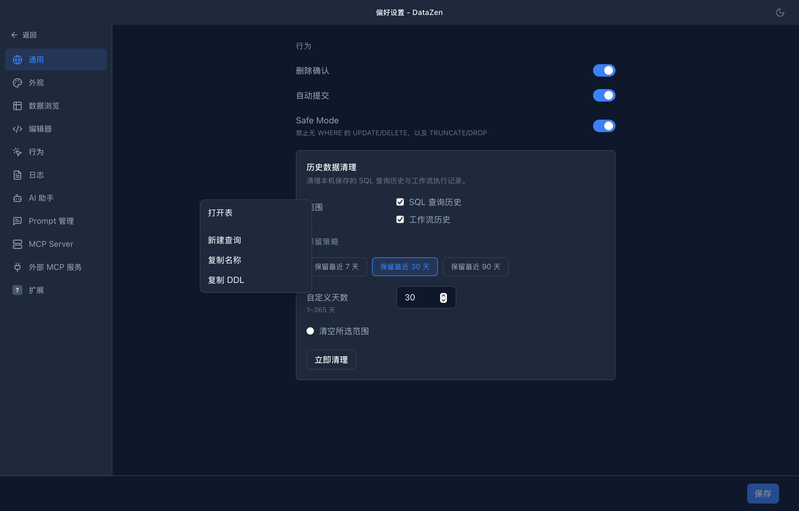

- **凭据加密**：AES-256-GCM；主密钥在 macOS 登录钥匙串 / Windows DPAPI（平台保险库），开发文件后端为显式配置；AI 配置单独加密存储。
- **只读连接**：驱动层拒绝写入；**Safe Mode**：尽力防护，禁止无 WHERE 的 UPDATE/DELETE 及 TRUNCATE/DROP；关闭后高危 SQL 弹框确认。
- **SQL 安全门**：高危语句执行前强制预览确认；行删除、破坏性部署、覆盖恢复等危险动作一律二次确认。
- **AI/MCP 边界**：AI 流量只去用户配置的 Provider；MCP 权限模式 + 工具开关 + 连接 allowlist + 调用审计；日志与错误不含凭据、敏感路径与原始连接串。
- **无账号、无遥测、无云端**：不收集查询、连接与数据。

## 17. 设置参考

设置页分两组十二节（代码 `settingsSections.ts`）：

| 分组 | 节 | 内容 |
| --- | --- | --- |
| 应用 | General | 语言（10 种内置 + **安装外部语言包**）、主题、默认页大小、连接池、历史清理、更新（自动更新 + **空闲定时提醒**） |
| 应用 | Appearance | 主题（亮/暗/跟随系统；可安装主题包） |
| 应用 | Data Browsing | 页大小、SELECT 结果上限、自动切换图表、网格密度/交替行/行号/滚动条、**值呈现规则**（全局时间戳格式/时区/毫秒精度，**列级覆盖**，跨窗口同步） |
| 应用 | Editor | 字号与字体、执行策略 |
| 应用 | Behavior | 删除确认、自动提交、**Safe Mode**、关闭后高危 SQL 弹框 |
| 应用 | Logging | 日志级别与路径、查看日志（改后需重启） |
| 集成 | AI Assistant | Provider / 协议 / 模型 / Key / 校验；AI 记忆管理；本地 CLI Agent Provider |
| 集成 | Prompt Management | 全局 / 每驱动提示词覆盖与重置 |
| 集成 | MCP Server | 启用、工具开关、权限模式（只读/安全写入/高危写入）、连接 allowlist、Cursor/Claude 配置一键复制 |
| 集成 | MCP Client | 外部 MCP Server 管理 |
| 集成 | Tunnels | SSH / HTTP CONNECT / WebSocket 隧道管理、测试、删除 |
| 集成 | Extensions | 内置扩展点（EP）暴露的设置 |

## 18. 多语言与跨平台

- **界面语言**：English、简体中文、繁體中文、日本語、한국어、Deutsch、Español、Français、Português (BR)、Русский；外部语言包经设置页安装。
- **平台矩阵**：macOS Apple Silicon / Intel（.dmg）、Windows x64（NSIS .exe / 便携 .zip）、Linux x86_64（.deb / .rpm / .AppImage）。
- **更新**：Tauri updater 自动更新（可关闭），更新通道按 SKU 分轨（Basic / All 各读自己的清单，安装前复核 variant 防误降级）；v0.3.0 起空闲时段才提醒更新。
- macOS 当前未公证：提示「已损坏」时执行 `xattr -cr /Applications/DataZen.app` 或右键打开一次。

## 19. 团队 Web 服务（v0.3.0 首版）

- `crates/datazen-server`：axum HTTP 宿主，`/api/v1` **十五域 108 条路由**（settings、identity、connection、session、execution、job、artifact、events SSE、tableData、driverGateway、queryAssets、schemaDiff、workflow、dashboard、dataSync）；`/healthz` `/readyz` 健康面。
- **同一业务内核双宿主**：桌面走 Tauri IPC，浏览器壳 `packages/web` 走 HTTP + SSE；契约唯一来源是 `packages/backend-client`。
- **团队认证 OIDC**（授权码 + PKCE）；`deploy/dev/` 一键开发栈（dex IdP + seed + 冒烟）；生产 Dockerfile / docker-compose。
- 管理库首版 SQLite（expand-only 迁移链）；Workflow / Dashboard / Data Sync / Schema Diff 五域的服务端半边（双端调度器、双端刷新监控、sync 执行面）。
- 口径：桌面团队认证接入（P8）与多 worker 协调（P9）**尚未交付**；server 形态的 AI 供应商注册表未开放。

## 20. 性能与可靠性设计

- 查询结果**流式传输** + 虚拟滚动渲染；大数据集延迟展示大对象。
- keyset 快速分页按驱动能力启用；Data Sync 大体量比较溢写磁盘；Data Transfer 检查点续传；导出流式 + 取消。
- SchemaCache 两级 TTL 缓存；空闲会话回收；窗口级 ErrorBoundary 故障隔离。
- E2E 全量 145 specs，PR 合并前有多重门禁（类型闸门、依赖边界、文档一致性）。

## 21. 本文未覆盖与已知边界

- **Workspace App（Wapp）**：按约定不在本文档范围，见 `packages/wapps/` 与 wapp-sdk 文档。
- `datazen` CLI 当前链接 PG / MySQL（含兼容）/ SQLite 驱动，其余引擎经桌面端能力访问。
- macOS 尚未公证；Windows 已配置代码签名证书。
- Dashboard 告警邮件渠道未开放；Data Sync / Transfer 同族配对外的组合标注「实验性」。

## 22. 文档索引

- 操作手册（怎么用）：[user-manual.zh-CN.md](user-manual.zh-CN.md)
- 数据浏览与编辑细节：[data-browsing-guide.zh-CN.md](data-browsing-guide.zh-CN.md)
- Workflow 语法：[workflow-guide.zh-CN.md](workflow-guide.zh-CN.md)
- 查询构建器：[query-builder.md](query-builder.md)
- Schema Diff 部署：[schema-diff-guide.zh-CN.md](schema-diff-guide.zh-CN.md) · [schema-diff-deploy.md](schema-diff-deploy.md)
- Data Sync / Transfer：[data-sync-guide.zh-CN.md](data-sync-guide.zh-CN.md) · [data-transfer-guide.zh-CN.md](data-transfer-guide.zh-CN.md)
- 运营看板：[ops-dashboard-guide.zh-CN.md](ops-dashboard-guide.zh-CN.md)
- 数据库隧道：[tunnel-guide.zh-CN.md](tunnel-guide.zh-CN.md)
- CLI 与 Agent Skill：[ai-cli.md](ai-cli.md)
- 无会话导出：[published-result-export.md](published-result-export.md)
- 架构系列文章：[../blogs/README.md](../blogs/README.md)
